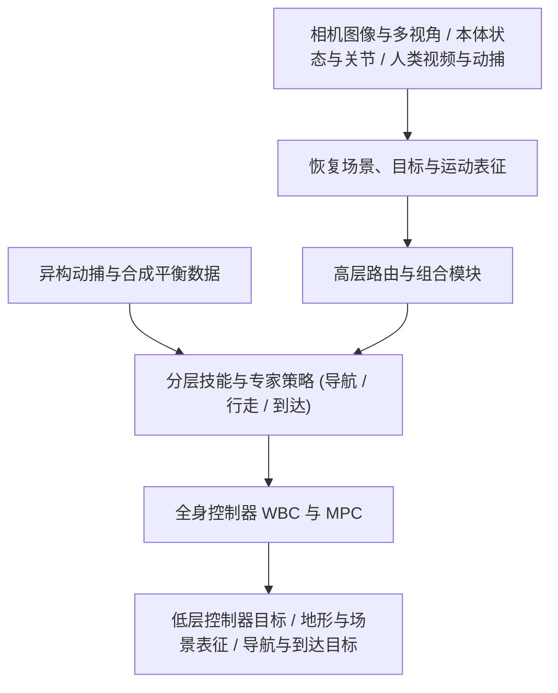

# HEAD：手眼自主配送（Hand-Eye Autonomous Delivery）

**手眼自主配送（HEAD: Hand-Eye Autonomous Delivery）** 在 [具身智能研究室 · 人形 Loco-Manip 161 篇长文](https://mp.weixin.qq.com/s/pACh9EhsISiyPGdiiR0C3A) 中出现于两个主题槽位（同一 Stanford University 论文 **第 126/161 篇** 归入 **06 特殊任务、接触规划与视觉闭环**，**第 145/161 篇** 归入 **08 硬件平台、感知配置与部署扩展**），现统一归并至本实体页。

## 一句话定义

这篇工作先从相机图像/多视角观测、本体状态与关节序列、人类视频/动捕轨迹恢复场景、目标或运动表征，再用异构动捕与合成平衡数据、全身控制器/WBC/MPC、分层技能/专家策略生成低层控制器目标、地形/场景表征与导航/到达目标。关键点是把任务拆成可路由的技能或专家策略，再用高层模块在执行中选择和组合。

## 英文缩写速查

| 缩写 | 英文全称 | 简要说明 |
|------|----------|----------|
| Loco-Manip | Loco-Manipulation | 行走与操作动力学耦合的全身任务 |
| WBC | Whole-Body Control | 协调全身关节满足多任务/约束的控制层 |
| MPC | Model Predictive Control | 基于动力学模型的滚动优化控制 |
| VLA | Vision-Language-Action | 视觉-语言-动作多模态策略 |

## 为什么重要

- 将长程人形「导航—行走—伸手交付」拆成可路由的技能与专家策略模块，避免单一大策略承受各段技能数据分布不均的压力。
- 在人形 Loco-Manip 161 篇总表中同时横跨 **#126/161**（特殊任务、接触规划与视觉闭环）与 **#145/161**（硬件平台、感知配置与部署扩展）两类视角。

## 核心信息

| 字段 | 内容 |
|------|------|
| 编号 / 双槽位 | **126/161**（06 特殊任务、接触规划与视觉闭环） & **145/161**（08 硬件平台、感知配置与部署扩展） |
| 原文题目 | Hand-Eye Autonomous Delivery: Learning Humanoid Navigation, Locomotion and Reaching |
| 机构 | Stanford University |
| 发表日期 | 2025年8月7日 |
| 论文/项目 | <https://tml.stanford.edu/HEAD/> |

## 核心机制（归纳）

### 策展导读要点

这篇工作先从相机图像/多视角观测、本体状态与关节序列、人类视频/动捕轨迹恢复场景、目标或运动表征，再用异构动捕与合成平衡数据、全身控制器/WBC/MPC、分层技能/专家策略生成低层控制器目标、地形/场景表征与导航/到达目标。关键点是把任务拆成可路由的技能或专家策略，再用高层模块在执行中选择和组合。

### 方法流程图

## 评测与指标

- 本条目为 161 篇清单索引合并条目，**未搬运原文量化 benchmark 与实机指标**；评测口径与具体数值以原文 PDF / 项目页为准。
- 评测原始出处：[原文 / 项目页](https://tml.stanford.edu/HEAD/)（见上方「核心信息」表「论文/项目」一行）。
- 横向评测对照请回到 [06 分类 hub](../overview/loco-manip-161-category-06-contact-tasks.md)、[08 分类 hub](../overview/loco-manip-161-category-08-hardware-deployment.md) 与 [技术地图](../overview/humanoid-loco-manip-161-papers-technology-map.md)。

## 源码运行时序图

**不适用**（本页为 161 篇策展清单合并条目，尚未收录并核对独立可运行官方仓库）。

## 结论

**HEAD 把「手眼自主配送」拆成导航、行走、到达三段可路由技能，在视觉闭环与完整交付流程两个视角之间建立统一接口。**

- 起作用的机制链是：相机图像/多视角观测、本体状态与关节序列、人类视频/动捕轨迹恢复场景与目标表征后，借助异构动捕与合成平衡数据训练分层技能/专家策略，输出低层控制器目标、地形/场景表征与导航/到达目标。
- 各段技能的训练数据分布本就不均，因此需结合异构动捕与合成平衡数据主动配平，并在模块切换边界由高层路由协调。
- 本工作关注分层任务路由与交付流程，不自动替代底层 WBC/MPC 物理鲁棒性；量化 benchmark 与真机指标以 [项目页](https://tml.stanford.edu/HEAD/) 为准。

## 常见误区

1. 161 篇策展条目提供 **地图坐标**；量化 benchmark 与实机指标以原文 PDF / 项目页为准。
2. Loco-manip 单篇工作不自动解决 **底层 WBC 鲁棒性**；须与运控/接触控制对照。

## 关联页面

- [腿足运动控制](../tasks/locomotion.md) — 延伸阅读，对照足式移动任务。

## 与其他页面的关系

- 技术地图：[humanoid-loco-manip-161-papers-technology-map.md](../overview/humanoid-loco-manip-161-papers-technology-map.md)
- 分类 hub（06 特殊任务与视觉闭环）：[loco-manip-161-category-06-contact-tasks.md](../overview/loco-manip-161-category-06-contact-tasks.md)
- 分类 hub（08 硬件与部署扩展）：[loco-manip-161-category-08-hardware-deployment.md](../overview/loco-manip-161-category-08-hardware-deployment.md)

## 参考来源

- [loco_manip_161_survey_126_n126.md](../../sources/papers/loco_manip_161_survey_126_n126.md) — 161 篇 #126/161 策展摘录
- [loco_manip_161_survey_145_n145.md](../../sources/papers/loco_manip_161_survey_145_n145.md) — 161 篇 #145/161 策展摘录
- [humanoid_loco_manip_161_catalog.md](../../sources/papers/humanoid_loco_manip_161_catalog.md)
- [wechat_embodied_ai_lab_humanoid_loco_manip_161_survey.md](../../sources/blogs/wechat_embodied_ai_lab_humanoid_loco_manip_161_survey.md)

## 推荐继续阅读

- [Loco-Manipulation 任务页](../tasks/loco-manipulation.md)
- [HEAD 项目页](https://tml.stanford.edu/HEAD/)
