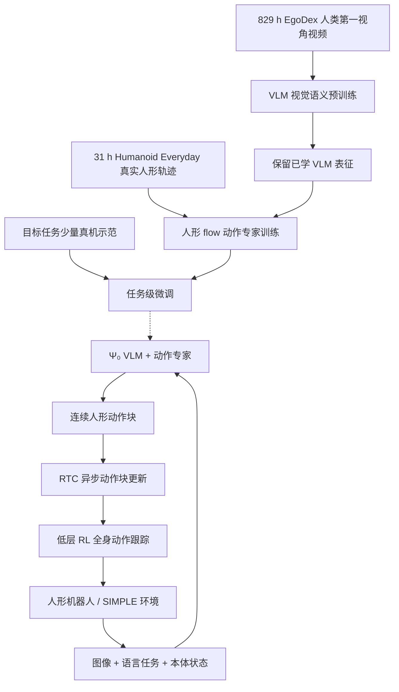
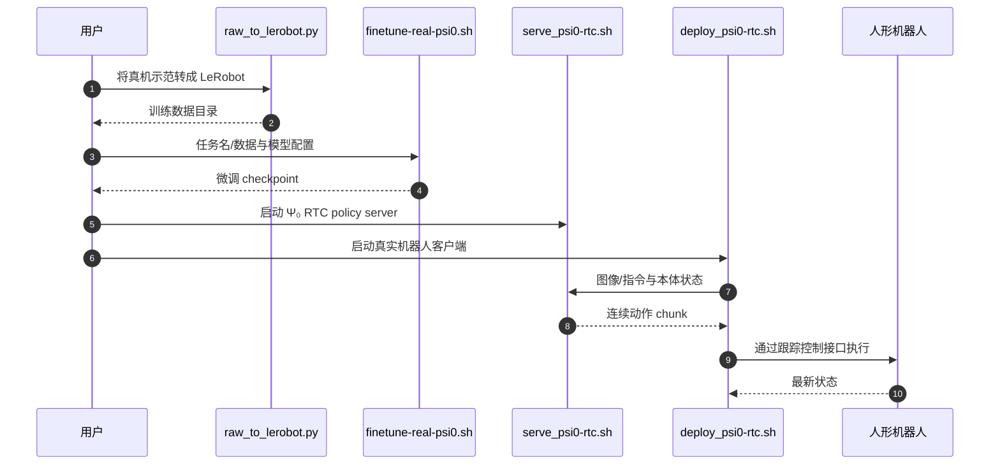

# Ψ₀（Psi-Zero）：面向通用人形移动操作的开放基础模型 / An Open Foundation Model Towards Universal Humanoid Loco-Manipulation

## 一句话定义

**Ψ₀** 是由 **南加州大学（USC）Physical Superintelligence Lab** 主导、NVIDIA 与 WorldEngine 作者合作的人形移动操作 VLA：先从人类第一视角视频学习视觉语义，再用较少的人形真机示范训练连续动作专家，并由下层全身跟踪策略保持行走和执行稳定（RSS 2026，[arXiv:2603.12263](https://arxiv.org/abs/2603.12263)）。

## 英文缩写速查

| 缩写 | 英文全称 | 简要说明 |
|---|---|---|
| VLA | Vision-Language-Action | 视觉、语言到机器人动作的任务条件策略 |
| VLM | Vision-Language Model | 从人类视频预训练的视觉语义骨干 |
| MM-DiT | Multimodal Diffusion Transformer | 使用 flow matching 预测人形机器人动作块 |
| RTC | Real-Time Chunking | 在异步动作推理与执行之间减小停顿 |
| RL | Reinforcement Learning | 低层机器人身体运动跟踪控制器训练 |
| SIMPLE | Simulation-Based Policy Learning and Evaluation | 提供机器人移动操作仿真和策略评测 |
| EEF | End Effector | 动作表示涉及的末端操作位姿 |

## 为什么重要

桌面机械臂 VLA 往往在固定机座下抓取，而人形移动操作必须同时解决靠近目标、搬运、开门、双手操作与平衡。Ψ₀ 将规模化的人类视频视觉语义与少量目标本体真机动作分**不同阶段**学习；不把人手关节轨迹直接视为人形关节控制。

## 核心原理

1. **视觉语义预训练**：829 小时 **EgoDex** 人类第一视角视频学习任务与动作语义；此阶段的目标是 VLM 自回归表征而不是直接下发控制指令。
2. **本体后训练**：使用 **Humanoid Everyday** 约 31 小时、覆盖 7 类 260 项任务的真实人形示范，冻结已学 VLM 表征，以 flow-based MM-DiT 动作专家学习机器人本体状态和连续动作块。
3. **任务适配**：在具体目标任务上少量示范微调；论文对不同任务的比较是在明确定义的真机测试协议上，不代表所有本体零样本可用。
4. **分层执行与时序**：高层动作生成考虑视觉、语言和本体状态，下层 RL 跟踪策略负责机器人稳定与身体动作执行；RTC 让动作块可以连续更新，不能将单次模型推理直接当低层伺服频率。

## 流程总览

虚线只表示训练所得权重对部署模型的影响，并非在线训练。

## 源码运行时序图

以下依据官方仓库 README 明确发布的真机微调、RTC 服务端与客户端启动路径，展示可核实的**入口级运行时序**，不是未经核实的函数级调用堆栈。

真实部署需要读取 [官方 real/README](https://github.com/physical-superintelligence-lab/Psi0/tree/main/real) 的安全条件；上述入口没有在本次环境实际运行。

## 实验与评测

| 指标/证据 | 作者口径 | 解读限制 |
|---|---|---|
| 人类第一视角数据 | 829 h EgoDex | 视觉动作语义来源，不是 829 h 人形关节动作 |
| 真实人形示范 | 31 h、260 项任务 | 数据需按任务/场景划分评测 |
| 同对照任务综合成功率 | 相比部分使用 10 倍以上数据的基线高于约 40% | 作者报告、特定任务集合，不能视为通用零样本收益 |
| 目标任务微调 | 官方称最少约 80 条任务轨迹可获得新技能 | 不等于任意任务均只要 80 条 |
| 策略推理 | 典型单次推理约 160 ms，配合 RTC | 策略生成速度不是低层稳定控制频率 |

## 结论

**Ψ₀ 主要证明高质量人类操作视频语义预训练与少量人形本体后训练的分阶段路线具有实际价值；全身操作仍需低层稳定控制。**

1. 数据配比应区分 Ego 人视频和可执行的人形真机动作，不能直接把两类关节状态混训。
2. 测试跨本体能力时先核对输出动作定义和低层跟踪器，不以 VLM 性能代替运动稳定性。
3. 对真实 160 ms 级策略推理，检查 RTC 缓冲、旧/新 chunk 衔接和延迟补偿。
4. SIMPLE 仿真和 G1 真机的动作空间与控制安全边界应独立验收。
5. 论文列出的成功率增益属于受控任务，不代表动态开放场景的普适保证。

## 与其他工作对比

- [GR00T N1.7](./paper-gr00t-n1-7.md)：重多本体通用机器人预训练与现成适配；Ψ₀ 强调人视频与人形数据**分阶段**利用及移动操作闭环。
- [LingBot-VLA 2.0](./lingbot-vla-v2.md)：强调大量跨本体机器人数据与统一动作空间；Ψ₀ 的数据分阶段与低层 tracker 边界更明确。
- [2026 VLA 项目三转变](../comparisons/vla-open-source-ecosystem-2026-three-shifts.md)：放在跨本体/全身方向的证据地图。

## 工程实践

- **准备**：依据 README 将真实机器人示范转成 LeRobot 格式，核验关节顺序、动作归一化和训练任务配置。
- **微调**：使用 `scripts/train/psi0/finetune-real-psi0.sh`，记录数据量、checkpoint 与任务分布。
- **部署**：`scripts/deploy/serve_psi0-rtc.sh` 与 `real/scripts/deploy_psi0-rtc.sh` 在匹配版本与已验证安全环境中运行；需有保护、限幅、急停与回退策略。
- **仿真**：使用官方 SIMPLE 独立评测入口，不将 sim2sim 成功等同真机部署成功。

## 局限与风险

- 行走、接触与平衡需依靠低层跟踪控制和硬件约束；基础 VLA 本身不提供形式化安全保证。
- 数据主要来自选定人类视频和真机任务分布，未知本体/场景仍需要校准、适配与保护。
- 必须区分可公开下载的具体 checkpoint/数据集与论文使用的完整数据分布。

## 关联页面

- [人形移动操作](../tasks/loco-manipulation.md)
- [VLA 方法](../methods/vla.md)
- [161 篇技术地图](../overview/humanoid-loco-manip-161-papers-technology-map.md)
- [2026 开源生态对比](../comparisons/vla-open-source-ecosystem-2026-three-shifts.md)

## 参考来源

- [Ψ₀ 论文全文与源码归档](../../sources/papers/psi0_arxiv_2603_12263_full_reading.md)
- [原 161 篇策展索引](../../sources/papers/loco_manip_161_survey_156_psi0.md)
- [官方项目](https://psi-lab.ai/Psi0/)
- [官方源码](https://github.com/physical-superintelligence-lab/Psi0)

## 推荐继续阅读

- [arXiv:2603.12263](https://arxiv.org/abs/2603.12263)
- [Psi0 官方 GitHub README](https://github.com/physical-superintelligence-lab/Psi0)
- [SIMPLE 仿真文档](https://github.com/physical-superintelligence-lab/Psi0#simulation)
