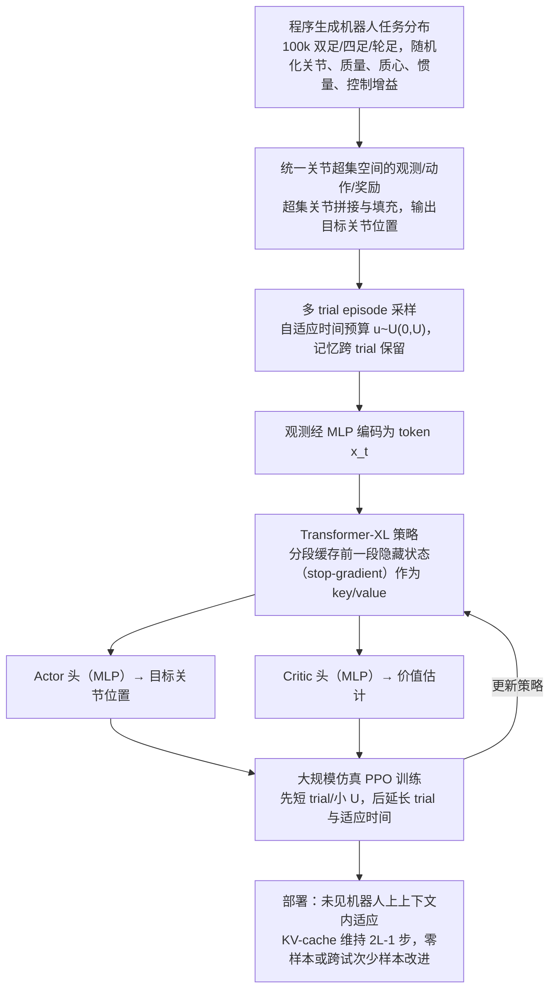

# LocoFormer

**LocoFormer** 是 Skild AI 署名的跨本体运动控制论文；[官方项目页](https://generalist-locomotion.github.io/)连接公司博客。[Light REACT](./light-react.md)是后续引用者，不是项目归属。

## 一句话定义

**大规模 PPO + 程序生成机器人 + Transformer-XL 跨 episode 记忆；未见形态/电机故障下 test-time 适应。**

## 英文缩写速查

| 缩写 | 英文全称 | 简要说明 |
|------|----------|----------|
| PPO | Proximal Policy Optimization | 大规模仿真强化学习 |
| TXL | Transformer-XL | 跨片段、跨试次保留记忆 |
| ICL | In-Context Learning | 从部署历史适应，不更新权重 |
| OOD | Out of Distribution | 未见形态与动力学条件 |

## 为什么重要

- Light REACT 对比 Transformer 64 帧上下文时引用；LocoFormer 代表「长上下文运动适应」前序。
- 博客 ingest 独立节点（非重复 stub）；见 [3 篇技术地图](../overview/lightorigins-3blogs-technology-map.md)。

## 核心原理

### 流程总览

图依据：`arXiv:2509.23745v1` §2 / Fig.3（§2.1 多 trial 预训练、§2.2 Transformer-XL 架构与 KV-cache 部署）。

### 关键机制（§2.1–§2.2）

- **100k 程序生成形态：** 在双足、四足、轮式双足与轮式四足基础上随机化构型、连杆质量、质心、惯量与控制增益，并以统一关节超集空间对齐不同本体的观测与目标关节位置输出。
- **多 trial 自适应公式（§2.1）：** 单个训练 episode 包含 $k$ 个连续 trial，前序 trial 的失败或跌倒状态经重置进入下一 trial，策略隐藏记忆跨 trial 保持，从而把跨试次试错收益直接纳入 PPO 折扣回报优化。
- **Transformer-XL 长记忆（§2.2）：** 序列切分为长度 $L$ 的段，通过 $\tilde{\mathbf{h}}_{z+1}^{n-1}=[\text{SG}(\mathbf{h}_z^{n-1})\circ \mathbf{h}_{z+1}^{n-1}]$ 逐层传递缓存隐藏状态，使有效感受野随层数线性扩展 $O(NL)$（6 层 TXL、$L=128$ 覆盖 896 步，在 50 Hz 下约 18 s）。

## 核心信息

| 项 | 内容 |
|----|------|
| **类型** | paper |
| **出处** | CoRL 2025 |
| **机构 / 作者** | Skild AI / Min Liu、Deepak Pathak、Ananye Agarwal |
| **日期** | 公司博客 2025-09-24；arXiv v1 提交 2025-09-28 |
| **项目页** | [generalist-locomotion.github.io](https://generalist-locomotion.github.io/) |
| **开源** | 2026-10-07 官方项目页未见代码、权重或数据下载入口；不推定待发布 |
| **arXiv** | [2509.23745](https://arxiv.org/abs/2509.23745) |

## 源码运行时序图

**不适用**（截至入库日无官方可运行实现，或仅有博客/论文叙述）。

## 实验与评测

### 仿真跨本体基准（§3.1, Table 1，10 款未见机器人 × 1,000 崎岖地形随机环境）

评测指标为归一化位移 $[0,1]$（Mean ± Std）：

| 方法 | 10 款未见机器人均值 | 典型难点对比（无踝双足 TRON1） | 说明 |
|------|--------------------:|-------------------------------:|------|
| **GRU** | 0.37 ± 0.41 | — | 循环隐藏状态有效记忆窗口受限 |
| **Conditioning** | 0.78 ± 0.37 | 0.07 | 传入特权运动学参数，但仅 64 帧上下文 |
| **Ours (zero-shot)** | 0.96 ± 0.19 | 0.87 | 无权重更新；Go2-W 0.97、TRON1-W 0.99、Spot 1.00 |
| **Ours (few-shot, 5 s 适应窗)** | **0.98 ± 0.13** | **0.96** | 5 s 上下文适应后 TRON1 相对零样本提升约 10% |
| **Expert Policy（上限参照）** | 0.99 ± 0.07 | — | 针对单款本体单独训练的专家策略 |

- **在线隐式本体辨识（§3.1, Fig. 4b）：** 在 4,096 次零样本 rollout 中，第 2 层表征在前 1 秒高度重叠，5 秒内按机器人本体形成清晰聚类，表明长上下文在未给显式运动学提示时隐式完成了动力学/形态识别。

### 真机零样本与极端故障适应（§3.2, Fig. 5）

- 在 Unitree G1、H1、Go2、Go2-W（含 Go2/Go2-W 仅后腿双足模式）上进行真机部署测试：
  - **锁死膝关节（A/E）：** 约 2–3 s 内重组为三足重心转移步态；
  - **无踝双足跌倒恢复（B）：** 前两次 trial 跌倒经验保留在 TXL 缓存中，第 3 次 trial 实现稳定行走；
  - **轮腿切换与外加负载（C）：** Go2-W 软件锁死轮毂增益后切换步行，解锁后切回滚动，外加负载仍可维持平衡；
  - **几何改动与删减自由度（D/F）：** 腿部加装高跷重调步频落足，截短小腿去掉 4 DoF 后约 7–8 s 学会大腿大幅摆动步行。
- **复现边界：** 截至 2026-11-21 官方项目页仍未开放代码、权重或训练环境，第三方暂无法直接重跑真机与仿真分数。

## 与其他工作对比

| 维度 | LocoFormer（本页） | 显式系统辨识 / 在线参数估计 | 域随机化 + 单一策略 |
|------|---------------------|------------------------------|----------------------|
| 适应机制 | **上下文内适应**：把历史 episode 当输入，不改权重 | 在线估参再调控制器 | 不适应，靠训练分布覆盖 |
| 跨形态能力 | 程序生成形态大规模训练 | 需为每类本体重建模型 | 取决于随机化范围 |
| 故障场景 | 电机故障作为分布外条件之一 | 需故障模型显式建模 | 落在随机化外即失效 |
| 主要代价 | 长上下文的显存与推理成本 | 建模与辨识工程量 | 保守策略带来的性能损失 |

## 工程实践

| 项 | 具体配置 / 落地要点 |
|----|----------------------|
| **开源状态** | **未开源**（2026-10-07 / 2026-11-21 复核官方项目页均无代码/权重/数据入口；社区 `lucidrains/locoformer` 属非官方 WIP） |
| **实时推理缓存** | 50 Hz 控制频率下以 KV-cache 维持最近 $2L-1$ 步（每层段长 $L=128$），将测试期前向复杂度压为线性 |
| **两阶段课程** | 先短 trial 与较小适应预算 $U$ 学快速起步适应，再延长 trial 与 $U$ 对齐连续部署 |
| **接口标准化** | 所有本体映射到统一关节超集空间并填充未用通道，部署新构型无需重定义网络输入输出头 |
| **算力成本** | 训练 6 层 TXL 约 4k 次迭代耗时 ~28 h，总算力约单本体专家策略的 500 倍（摊销到 100k 形态约 0.005 天/形态） |

## 局限与风险

- **「in-context 适应」依赖于训练形态覆盖：** 它把适应能力压进 **程序化形态族与域随机化覆盖的分布**；若真实本体或传感通道完全脱离超集空间，长上下文无法凭空创造全新执行器控制模态。
- **形态生成器仍是手工设计（§6）：** 100k 机器人的拓扑与参数边界由人工编写程序规则定义，尚未做到开放式结构自动发现。
- **预训练算力门槛高：** 约 500 倍于单本体策略的总算力意味着仅适合作为底座一次预训练、多次跨本体复用，不适合单机单任务从零反复重训。
- **与 [Light REACT](./light-react.md) 的关系：** 被引作「全身韧性智能」中 **硬件退化后仍可用** 的能力锚点；该定位说明它服务的是部署期鲁棒性，而非峰值敏捷性，读指标时不要与 parkour 类工作横比。
- **闭源复现风险：** 无官方源码与权重发布，任何第三方基于论文细节的复现都存在超参、奖励与程序化资产差异。

## 结论

**LocoFormer 通过「100k 程序化形态 × 大规模 PPO × 跨 trial Transformer-XL 记忆」证明了纯上下文自适应可以在不更新权重的情况下覆盖双足、四足、轮足及多种硬件故障，但官方资产仍完全闭源。**

1. **长上下文收益可定量验证：** 在 10 款未见机器人上，5 s 上下文使均分达到 `0.98 ± 0.13`（TRON1 从 `0.87` 升至 `0.96`），显著高于 GRU（`0.37`）与 64 帧特权条件基线（`0.78`）。
2. **故障适应发生在部署窗口内：** 锁膝、截腿、轮毂锁死与跌倒恢复均在数秒或 2–3 个 trial 内完成步态重组，无需在线梯度微调。
3. **工程复用前先看开放边界：** 官方项目页截至 2026-11-21 仍无代码、权重或数据发布；复现或评测对比需自行搭建程序化形态分布与 TXL PPO 管线。
4. **阅读配套脉络：** 建议结合 [Skild AI](./skild-ai.md) 了解公司在运动控制→操作 S1→Self-Play 的演进，并与 [Light REACT](./light-react.md) / [LightNav-0](./paper-lightnav-0.md) 对照阅读。

## 关联页面

- [Skild AI（论文署名机构）](./skild-ai.md)
- [S1（操作域视频上下文学习）](./skild-s1.md)

- [亮源新创（Light Origins）](./light-origins.md)
- [lightorigins-3blogs-technology-map](../overview/lightorigins-3blogs-technology-map.md)
- [LightNav-0](./paper-lightnav-0.md)
- [Light REACT](./light-react.md)

## 参考来源

- [LocoFormer 论文原文归档（arXiv:2509.23745v1）](../../sources/papers/locoformer_corl_2025.md) — 已通读全文（含 §1–§6、Table 1、Fig. 4–5 与 Appendix A–C）
- [Skild AI 官方时间线核查（2026-10-07）](../../sources/sites/skild-ai-timeline-audit-2026-10-07.md)
- [lightorigins_light_react_2026-09-09.md](../../sources/blogs/lightorigins_light_react_2026-09-09.md)
- [Tech Blog（引用背景）](https://www.lightorigins.com/blog/light-react)

## 推荐继续阅读

- [LocoFormer 官方项目页](https://generalist-locomotion.github.io/)
- [arXiv:2509.23745 全文](https://arxiv.org/abs/2509.23745)
- [3 篇技术地图](../overview/lightorigins-3blogs-technology-map.md)
