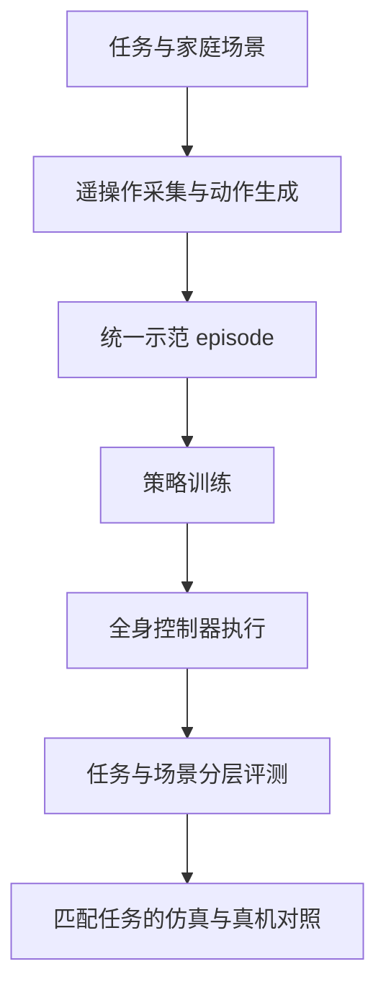

# LocoManiLab：人形移动操作全栈测试床

**一句话定义：** LocoManiLab 将任务与场景、演示数据、策略训练、全身控制、统一评测和实机部署纳入同一人形移动操作测试床，重点是让不同策略与控制器能在共享任务和接口下比较。

## 英文缩写速查

| 缩写 | 英文全称 | 简要说明 |
|---|---|---|
| Loco-Manip | Locomotion and Manipulation | 本文的人形移动操作任务，强调行走与物体交互的全身协调 |
| WBC | Whole-Body Controller | 执行策略输出并协调人形全身运动的控制器 |
| LoRA | Low-Rank Adaptation | 项目页用于比较动作生成模型微调的一种参数高效方法 |
| Sim2Real | Simulation to Reality | 本测试床以匹配任务比较仿真和真实机器人结果 |
| G1 | Unitree G1 | 项目页展示的共享人形机器人平台 |

## 为什么重要

移动操作系统的表现同时受示范数据、策略、低层控制器、任务难度和环境外观影响。若这些因素在不同论文中各自变化，成功率很难横向解释。LocoManiLab 的价值在于提供共同任务和评测切分，并分别比较策略与控制器，从而帮助判断收益来自哪一层，也暴露策略对未见任务、场景和视觉变化的泛化差异。

## 流程总览

## 方法与系统结构

### 任务、场景与数据

项目页列出 234 个任务定义：102 个原子任务和 132 个组合任务，分布在 13 个场景实例及厨房、客厅、卧室、浴室、办公室五类环境。数据层以模拟遥操作为主，项目页列出 14,160 段 episode；论文摘要报告 51.5 小时。官网同时展示以动作生成模型补充数据的研究，并用 Kimodo 预训练、LoRA 微调、全量微调三种设置比较任务执行结果。

### 策略与控制器分层比较

测试床比较 12 种策略在共享控制器条件下的表现，也比较两种策略在 5 种全身控制器下的结果。共享控制器让策略差异更容易归因到高层策略；跨控制器比较则揭示低层执行能力对最终移动操作成功率的影响。官网将 G1 作为共享具身，并展示 Dex3 灵巧手；策略执行接口标注为 50 Hz。

### 仿真到真机

项目页展示开冰箱、货架到桌面搬运和传送带抓放三个匹配任务的仿真与真机轨迹。论文摘要报告使用三个设置比较三种策略，并指出相近的策略排序支持基于仿真的相对评测；这只能支持给定场景与策略的排序一致性，不能说明模拟器与真机的绝对成功率完全相同。

## 实验与评测

| 评测维度 | 项目规模或论文结论 |
|---|---|
| 任务 | 234 项，含 102 个原子任务与 132 个组合任务 |
| 环境 | 13 个场景实例，覆盖五类家庭环境 |
| 示范 | 项目页列出 14,160 个 episode；论文摘要报告 51.5 小时模拟遥操作 |
| 策略 | 12 种策略在统一设置下比较 |
| 控制器 | 5 种全身控制器 |
| 泛化 | 未见任务和场景表现下降，视觉扰动通常降低成功率；不同策略的泛化与鲁棒性不同 |
| 动作生成 | 官网所列 30 个 task-scene 配对中，Kimodo 预训练 / LoRA / 全量微调总体成功率分别为 39.7% / 71.3% / 90.7% |
| Sim2Real | 三个任务场景用于仿真与现实对照；论文报告策略排序相近 |

Kimodo 的 39.7%–90.7% 是项目页特定动作生成实验的指标，不应当作整个 LocoManiLab 基准的平均成绩。项目页的 Arena 和结果 CSV 提供了可交互的结果复核入口。

## 与其他工作对比

| 工作 | 评测对象 | 分层方式 | 开放状态 | 与 LocoManiLab 的区别 |
|------|----------|----------|----------|-----------------------|
| [HumanoidArena](./paper-humanoidarena.md) | 7 项下肢关键 HOI/HSI 任务，视觉 / 语义 / 执行扰动与跨 GMT 迁移 | 高层策略输出中间全身动作，低层 GMT（TWIST2 / SONIC）执行 | 代码 / 数据 / 模型已开源 | HumanoidArena 聚焦 egocentric 高层策略与跟踪器接口；LocoManiLab 覆盖 234 个家庭场景任务，并显式做「固定控制器比策略 / 固定策略比控制器」两组对照 |
| [I-BFM](./paper-i-bfm.md) | 人形与物体交互的行为表征（搬运 / 推 / 踢与扰动恢复） | forward–backward 行为空间 + 奖励推断 latent 指令 | 项目页提供演示 | I-BFM 是被评测的方法类型（单策略复用），LocoManiLab 是评测这类方法的测试床 |

- **在评测基准谱系中的位置：** 按[具身大模型评测基准选型闭环](../queries/embodied-eval-benchmark-selection-loop.md)的分层，LocoManiLab 属 ③ 策略任务成功率层，并以三个匹配任务触及 ④ sim↔real 评测 gap 校准层；它支持的是策略**相对排序**的一致性，而非真机绝对成功率。
- **比较边界：** LocoManiLab 的成功率依赖其 task-scene 切分与 G1 平台，不能与其他基准的成功率直接横比。

## 结论

**一句话总判：** LocoManiLab 的主要贡献是将人形移动操作的示范、策略、控制器和评测放到可比较的共同测试床中；它提供系统级评测框架，目前公开入口尚不足以独立复现实验。

1. **区分策略与控制器：** 读结果时先确认评测固定了哪一层；共享控制器与跨控制器结果回答不同问题。
2. **把未见任务和视觉扰动纳入选型：** 论文报告的性能下降说明仅看训练分布内成功率会高估部署泛化。
3. **审慎解读 Sim2Real：** 三项匹配任务和相近策略排序支持仿真作相对比较，但不能推出绝对真机性能一致。
4. **开放状态要单独考虑：** 官网的 Code 与 Dataset 仍是 “Coming soon”；在线榜单和部分 CSV 可读，不等于训练实现与完整演示数据已开源。
5. **核对数据口径：** 项目页列出 14,160 段 episode，论文摘要报告 51.5 小时；引用时保留各自原始计量单位。

## 工程实践

- 用统一 task-scene 切分比较不同策略，记录 seen / unseen task、seen / unseen scene 与视觉扰动条件。
- 对照策略性能时固定控制器；评估控制器时固定策略和任务采样，避免把上下游变化混成一个结论。
- 建立仿真真机对照时，尽量保持物体、目标、初始条件和任务成功判据一致，并分别报告绝对成功率与策略排序。
- **复现入口：** 项目页提供在线 Arena 与部分结果 CSV；截至 2026-10-26 未提供公开代码仓和完整数据集，当前不能按官网链接完整复现训练与部署。

## 局限与风险

- **代码和数据未开放：** 项目页的 Code、Dataset 均标注 “Coming soon”，训练脚本、环境配置、权重和完整演示数据目前不可公开复现。
- **单一主要具身：** 项目页以 Unitree G1 为共享平台，结果不能直接代表不同人形结构或末端执行器。
- **基准成功率不是开放世界能力：** 未见任务、场景和视觉扰动表现下降，说明基准分数需要结合测试分布理解。
- **仿真到真机覆盖有限：** 三个匹配任务支持有限的相对评估，不足以证明所有移动操作任务都能在仿真中可靠预测实机结果。
- **页面统计与论文摘要可能采用不同呈现口径：** 复用 14,160 episode、51.5 小时等统计时，应分别标明来自项目页还是论文。

## 关联页面

- [移动操作任务](../tasks/loco-manipulation.md) — 跨策略、控制器与任务评测的任务背景。
- [HumanoidArena](./paper-humanoidarena.md) — 以 egocentric 分层策略与全身跟踪器评估人形交互的相关基准。
- [I-BFM](./paper-i-bfm.md) — 聚焦人形与物体交互行为表征及单策略复用的相关工作。

## 参考来源

- [LocoManiLab 论文摘录](../../sources/papers/locomanilab_arxiv_2610_30876.md)
- [LocoManiLab 官方项目页核查](../../sources/sites/locomanilab-project.md)

## 推荐继续阅读

- [LocoManiLab 官方项目页与 Loco-Mani Arena](https://locomanilab.github.io/)
- [LocoManiLab arXiv:2610.30876](https://arxiv.org/abs/2610.30876)
