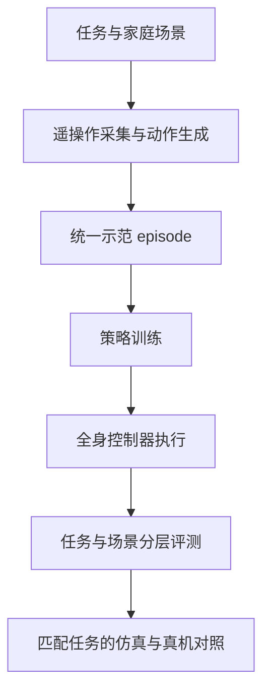

# LocoManiLab：人形移动操作全栈测试床

## 一句话定义

**LocoManiLab 用共享 episode 格式和策略—控制器适配器，把任务与场景、示范采集与生成、策略训练、全身控制器执行、统一评测和实机部署接成同一人形移动操作测试床，让不同策略与控制器能在相同任务、切分和接口下比较。**

## 英文缩写速查

| 缩写 | 英文全称 | 简要说明 |
|---|---|---|
| Loco-Manip | Locomotion and Manipulation | 本文的人形移动操作任务，强调行走与物体交互的全身协调 |
| WBC | Whole-Body Controller | 执行策略输出并协调人形全身运动的控制器 |
| VLA | Vision-Language-Action | 由图像与语言指令输出动作的策略，12 种被测策略中有 10 种属此类 |
| WAM | World-Action Model | 联合学习视觉动态与动作的策略，本文为 Fast-WAM |
| DR | Domain Randomization | 评测时改变纹理、光照、相机与干扰物，检验视觉鲁棒性 |
| PPO | Proximal Policy Optimization | 论文用于按执行奖励微调 Kimodo 去噪器的强化学习目标 |
| LoRA | Low-Rank Adaptation | 论文用于比较 Kimodo 微调的一种参数高效方法 |
| Sim2Real | Simulation to Reality | 本测试床以匹配任务比较仿真和真实机器人结果 |
| G1 | Unitree G1 | 论文与项目页的共享人形平台，配两只 Dex3-1 灵巧手 |

## 为什么重要

移动操作系统的表现同时受示范数据、策略、低层控制器、任务难度和环境外观影响。若这些因素在不同论文中各自变化，成功率很难横向解释。LocoManiLab 的价值在于提供共同任务和评测切分，并分别比较策略与控制器，从而帮助判断收益来自哪一层，也暴露策略对未见任务、场景和视觉变化的泛化差异。

## 流程总览

## 方法与系统结构

### 任务、场景与数据

论文与项目页列出 234 个任务定义：102 个原子任务和 132 个组合任务（组合任务串联 2–4 个原语），分布在 13 个场景实例及厨房、客厅、卧室、浴室、办公室五类环境。场景在 MuJoCo 中运行，物体来自 RoboCasa 与 Objaverse，房间布局来自 MolmoSpaces 的 iTHOR 衍生场景与 Holodeck 办公室；任务成功由物理谓词判定。示范有三类来源：VR 遥操作（仿真与真机）、动作合成和轨迹增强（以单条遥操作为先验，在扰动初始条件下重新执行，只保留成功回合）。论文附录 A 写明 14,160 段模拟遥操作 episode 合计 51.5 小时：SONIC 主语料 12,059 段，其余四种控制器在 10 个共享浴室任务上共 2,101 段。另有 567 段、约 9.0 小时真机遥操作。

### 策略与控制器分层比较

12 种策略为 10 个预训练 VLA（XR-1、DM0.5、π0.5、GR00T N1.7、InternVLA-A1.5、SmolVLA、PRTS、Ψ0、X-VLA、StarVLA-α）、1 个 WAM（Fast-WAM）和 Diffusion Policy 基线。主实验统一用 SONIC 执行：策略输入 320×240 头部 RGB 与 43 维关节状态，输出 64 维 SONIC motion token 加 14 维手指目标；共享驱动以 50 Hz 下发命令，每 20 个控制步查询一次策略。控制器对照用 GR00T N1.7 与 π0.5，按 AMO、SONIC、HEFT、ALMI、ScaleBFM 各自的命令格式（36 / 78 / 50 / 52 / 50 维）和对应数据分别训练。共享控制器让策略差异更容易归因到高层策略；跨控制器比较的是「策略—控制器对」，包含各自的训练数据与命令表示，揭示低层执行对成功率和运动质量的影响。

### Kimodo 数据生成

Kimodo 是一个人形动作扩散生成模型（论文图 1 中的 MDM）。它以动作文本、已执行的动作前缀和根部 / 腕部目标为条件，生成 3 秒的 G1 全身参考动作块，再交给冻结的 SONIC 执行。作者按扩散模型强化学习的做法，用 PPO 截断目标微调去噪器；奖励来自仿真中的控制器执行结果（手掌到达、根部接近，外加躯干倾斜惩罚），并比较 LoRA 与全量微调。场景级生成用 A* 规划导航根部航点，按物体几何构造腕部目标序列，只保留成功 rollout 作为示范。

### 仿真到真机

三个匹配任务为开冰箱、杯子从货架搬到桌面、传送带取箱。GR00T N1.7、Fast-WAM 与 XR-1 在每个任务上分别训练：仿真用每任务 50 条模拟遥操作、评测 20 回合；真机用每任务 50 条真机示范、试验 10 次，由人工判定成功。平均成功率排序在两域一致，但仿真场景只是真机场景的近似对应，并非几何配对；传送带任务的判据也不同（仿真须三箱都放上桌，真机只需从传送带取起一箱）。因此这组结果只支持给定任务与策略的相对排序，不能说明模拟器与真机的绝对成功率相同。

## 实验与评测

| 评测维度 | 项目规模或论文结论 |
|---|---|
| 任务 | 234 项，含 102 个原子任务与 132 个组合任务；评测切分为 seen 100、unseen task 123、unseen scene 11 项 |
| 环境 | 13 个场景实例，覆盖五类家庭环境 |
| 示范 | 14,160 段、51.5 小时模拟遥操作（五种控制器合计）；另有约 9.0 小时真机遥操作 |
| 策略（表 2） | 12 种策略共用 SONIC，按任务等权的总平均 XR-1 47.9% 居首，Diffusion Policy 7.1% |
| 泛化（表 2） | XR-1 由 seen 80.2% 降到 unseen task 25.2%；unseen scene 最高为 DM0.5 的 15.5%；原子任务表现相近的策略在组合任务上会拉开差距 |
| 视觉扰动（表 3） | Low / Mid / High 三档 DR 下平均成功率逐档下降；DM0.5 总平均 70.2% 居首，XR-1 在 Low 领先，Mid / High 被 DM0.5 超过 |
| 控制器（图 3） | GR00T N1.7 / π0.5 × 5 种控制器，10 个浴室任务；SR 最高不等于运动质量最好（GR00T N1.7 原子任务上 ALMI 的 SR 最高，但成功回合跌倒多于 SONIC；SONIC 的机械输出功率最低） |
| 示范规模（图 4） | 每任务示范由 10 条增至 50 条，GR00T N1.7 原子任务的五控制器平均 SR 由 33.0% 升至 69.8%；训练步数随数据同比增加，非等算力比较 |
| 数据来源（表 4） | 20 个任务上遥操作单源最好；GR00T N1.7 加入轨迹增强后组合任务由 56.2% 升至 68.8%，三源混合总分则降到 46.2% |
| 动作生成（表 5） | 30 个 task-scene 配对（每对每模型 10 次）中，Kimodo 预训练 / LoRA / 全量微调总体成功率分别为 39.7% / 71.3% / 90.7% |
| Sim2Real（表 6） | 仿真平均 76.7% / 53.3% / 50.0%，真机 70.0% / 53.3% / 46.7%（XR-1 / GR00T N1.7 / Fast-WAM），平均排序一致 |

Kimodo 的 39.7%–90.7% 是论文表 5 这一动作生成实验的指标（30 对中有 13 对与微调任务重叠），不应当作整个 LocoManiLab 基准的平均成绩。论文每个配置只训练一次，作者在 §5 也把重复训练列为后续工作。项目页的 Arena 和结果 CSV 提供了可交互的结果复核入口。

## 与其他工作对比

| 工作 | 评测对象 | 分层方式 | 开放状态 | 与 LocoManiLab 的区别 |
|------|----------|----------|----------|-----------------------|
| [HumanoidArena](./paper-humanoidarena.md) | 7 项下肢关键 HOI/HSI 任务，视觉 / 语义 / 执行扰动与跨 GMT 迁移 | 高层策略输出中间全身动作，低层 GMT（TWIST2 / SONIC）执行 | 代码 / 数据 / 模型已开源 | HumanoidArena 聚焦 egocentric 高层策略与跟踪器接口；LocoManiLab 覆盖 234 个家庭场景任务，并显式做「固定控制器比策略 / 固定策略比控制器」两组对照 |
| [I-BFM](./paper-i-bfm.md) | 人形与物体交互的行为表征（搬运 / 推 / 踢与扰动恢复） | forward–backward 行为空间 + 奖励推断 latent 指令 | 项目页提供演示 | I-BFM 是被评测的方法类型（单策略复用），LocoManiLab 是评测这类方法的测试床 |

- **在评测基准谱系中的位置：** 按[具身大模型评测基准选型闭环](../queries/embodied-eval-benchmark-selection-loop.md)的分层，LocoManiLab 属 ③ 策略任务成功率层，并以三个匹配任务触及 ④ sim↔real 评测 gap 校准层；它支持的是策略**相对排序**的一致性，而非真机绝对成功率。
- **比较边界：** LocoManiLab 的成功率依赖其 task-scene 切分与 G1 平台，不能与其他基准的成功率直接横比。

## 结论

**一句话总判：** LocoManiLab 的主要贡献是将人形移动操作的示范、策略、控制器和评测放到可比较的共同测试床中。官方代码、基准数据和部分权重已公开，但模型集成未全部端到端复验，论文的 12 策略主表仍不能只凭公开权重直接复现。

1. **区分策略与控制器：** 读结果时先确认评测固定了哪一层；共享控制器与跨控制器结果回答不同问题。
2. **把未见任务和视觉扰动纳入选型：** 论文报告的性能下降说明仅看训练分布内成功率会高估部署泛化。
3. **审慎解读 Sim2Real：** 三项匹配任务和相近策略排序支持仿真作相对比较，但不能推出绝对真机性能一致。
4. **开放状态要单独考虑：** 官方仓库（MIT）与 HF 数据集截至 2026-11-06 已公开（仓库首个提交 2026-11-02），但只发布了 GR00T N1.7、DM0.5、XR-1 三个策略的微调权重；仓库适配的模型与论文 12 种策略不完全一致，README 也声明集成未全部端到端复验。
5. **核对数据口径：** 14,160 段 episode 与 51.5 小时是同一份模拟遥操作语料（五种控制器合计）的两种计量；约 9.0 小时真机遥操作另计，项目页的「50+ h」是取整写法。

## 工程实践

- 用统一 task-scene 切分比较不同策略，记录 seen / unseen task、seen / unseen scene 与视觉扰动条件。
- 对照策略性能时固定控制器；评估控制器时固定策略和任务采样，避免把上下游变化混成一个结论。
- 建立仿真真机对照时，尽量保持物体、目标、初始条件和任务成功判据一致，并分别报告绝对成功率与策略排序。
- **复现入口：** 官方仓库提供 `lab` CLI，流程为 collect → prepare → convert → train → evaluate → deploy。`src/locomanilab/benchmark/tasks.yaml` 记录 234 个任务的评测设置，`lab eval --task / --task-set` 在仿真中闭环评测；G1 控制器 SONIC、HEFT、AMO、ScaleBFM、ALMI 经 `g1_backend` 子模块接入。HF 数据集 `GammaRobotics/LocoManiLab` 提供 LeRobot v2.1 格式数据（33 GB）、仿真资产清单、三个策略的推理权重（无优化器状态，不能续训）和五种控制器权重。README 建议先跑 CPU 样例，但作者明言它 “is not a robot demonstration or a training benchmark”。本页只核对了 README、docs、数据集卡与文件清单（2026-11-06），未运行代码。

## 局限与风险

- **开放边界：** 代码与数据已公开，但 README 声明 “Model integrations are retained for research and have not all been revalidated end to end”。仓库不含论文评测的 SmolVLA、X-VLA 适配，另含论文 12 种策略之外的 ACT、DreamZero。许可也不统一：依赖、基座模型、控制器权重（SONIC 为 NVIDIA Open Model License）与仿真资产各守原条款，`docs/THIRD_PARTY.md` 指出 PRTS 与 InternVLA-A 系列的上游代码为非商用许可（CC BY-NC 4.0 / CC BY-NC-SA 4.0），任务加载的 2 个 Objaverse 物体为 CC BY-NC 4.0。
- **单一主要具身：** 论文与项目页以 Unitree G1 为共享平台，结果不能直接代表不同人形结构或末端执行器。
- **基准成功率不是开放世界能力：** 未见任务、场景和视觉扰动表现下降，说明基准分数需要结合测试分布理解。
- **仿真到真机覆盖有限：** 只有 3 种策略 × 3 个任务 × 每格 10 次真机试验，场景仅近似对应，传送带任务判据也不同；这支持有限的相对评估，不足以证明所有移动操作任务都能在仿真中可靠预测实机结果。论文也指出，机载算力受限时依赖边缘 / 云推理带来的通信延迟尚未评估。
- **单次训练、非等算力：** 每个配置只训练一次；示范规模实验的训练步数随数据增加，数据源混合未均衡各来源样本数，相关结论受训练暴露量影响。
- **项目页与论文统计略有出入：** SONIC 原子 / 组合 episode 拆分在项目页为 5,258 / 6,801，论文附录 A 为 5,207 / 6,852（合计一致）；引用时以论文为准并注明来源。

## 关联页面

- [移动操作任务](../tasks/loco-manipulation.md) — 跨策略、控制器与任务评测的任务背景。
- [HumanoidArena](./paper-humanoidarena.md) — 以 egocentric 分层策略与全身跟踪器评估人形交互的相关基准。
- [I-BFM](./paper-i-bfm.md) — 聚焦人形与物体交互行为表征及单策略复用的相关工作。

## 参考来源

- [LocoManiLab 论文摘录](../../sources/papers/locomanilab_arxiv_2610_30876.md)
- [LocoManiLab 官方项目页核查](../../sources/sites/locomanilab-project.md)
- [LocoManiLab 官方仓库](https://github.com/Gamma-Robot/LocoManiLab)（2026-11-06 核查 README 与 docs）
- [LocoManiLab HF 数据集与权重](https://huggingface.co/datasets/GammaRobotics/LocoManiLab)（2026-11-06 核查数据集卡与文件清单）

## 推荐继续阅读

- [LocoManiLab 官方项目页与 Loco-Mani Arena](https://locomanilab.github.io/)
- [LocoManiLab arXiv:2610.30876](https://arxiv.org/abs/2610.30876)
- [LocoManiLab 官方仓库](https://github.com/Gamma-Robot/LocoManiLab)
