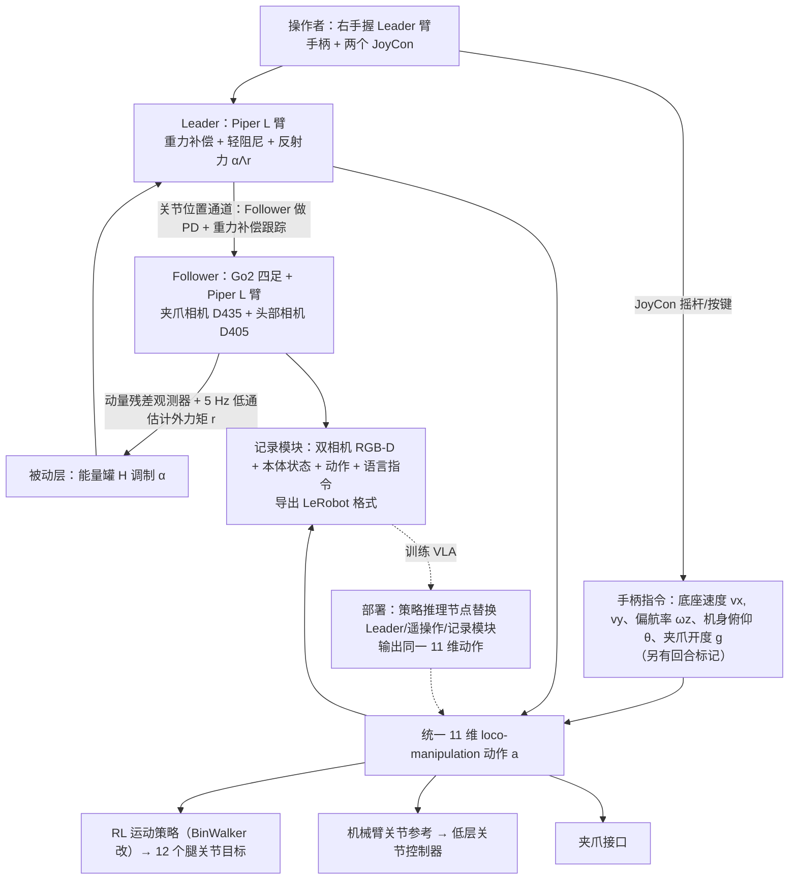

# LocoPilot：面向移动操作策略学习的单人双向遥操作

**LocoPilot**（*LocoPilot: Single-Operator Bilateral Teleoperation for Loco-Manipulation Policy Learning*，[arXiv:2610.27998](https://arxiv.org/abs/2610.27998)）收录于 senlanke「具身运控lab」10-19–10-23 前沿论文动态（人形/四足）。本页依据**周报条目 + arXiv 摘要页**整理，未逐页核对正文 PDF；指标与结论以论文为准。

## 一句话定义

**LocoPilot：面向移动操作策略学习的单人双向遥操作——用主机械臂与两个手柄实现全系统同步控制，以无力传感器方式估计并反馈接触力；数据采集和策略部署共享同一个 11 维动作接口，避免额外动作重定向。**

## 英文缩写速查

| 缩写 | 英文全称 | 简要说明 |
|------|----------|----------|
| RL | Reinforcement Learning | 强化学习 |
| WBC | Whole-Body Control | 全身控制 |

## 为什么重要

- 周报所述待解决的问题：单人难以同时控制四足底盘、身体姿态、机械臂和夹爪，而无实机示范又缺少平台特有观测和动作。

## 流程总览

图依据：论文 §II-A / §II-B / §III-A / §III-B 与 Fig. 2–3。

## 核心机制

| 项 | 内容 |
|----|------|
| **arXiv** | [2610.27998](https://arxiv.org/abs/2610.27998) · [PDF](https://arxiv.org/pdf/2610.27998) |
| **作者（arXiv）** | Antonio Langella, Giovanni Minelli, Giovanni B. Dessy, Lorenzo Amatucci, Giulio Turrisi, Victor Barasuol, Claudio Semini |
| **机构（周报所述，未逐条核实）** | 意大利技术研究院动态腿式系统实验室 |
| **arXiv 评论栏** | （无） |
| **开源** | arXiv 摘要页/评论给出 GitHub 链接（https://github.com/iit-DLSLab/LocoPilot；仅核对到链接存在，未核验仓库内容）（2026-10-26） |
| **周报所述创新点** | 用主机械臂与两个手柄实现全系统同步控制，以无力传感器方式估计并反馈接触力；数据采集和策略部署共享同一个 11 维动作接口，避免额外动作重定向。 |

### arXiv 摘要节选（英文原文）

> Learning loco-manipulation policies requires demonstrations that capture coordinated base and arm motion on the target embodiment. Robot-free interfaces allow demonstrations to be collected independently of the target robot, increasing flexibility but without directly capturing platform-specific commands, proprioception, and body-mounted observations.

## 源码运行时序图

**不适用**：arXiv 摘要页/评论给出 GitHub 链接（https://github.com/iit-DLSLab/LocoPilot；仅核对到链接存在，未核验仓库内容），无可对齐的官方代码流程。

## 实验与评测

- 周报与摘要给出的数字/场景已写入上表「创新点」与摘要节选；其余实验细节、基线与成功率定义请回到论文正文。
- 读法：先对齐任务设定、传感器与成功定义（仿真/真机），再解读 headline 数字，勿跨论文直接比较。

## 与其他工作对比

| 维度 | 读法 |
|------|------|
| **同周对照** | 见 [人形/四足周报技术地图](../overview/senlanke-weekly-2026-10-19-23-humanoid-quadruped-technology-map.md)，按方向浏览同期论文 |
| **开源状态** | arXiv 摘要页/评论给出 GitHub 链接（https://github.com/iit-DLSLab/LocoPilot；仅核对到链接存在，未核验仓库内容） |

## 结论

**LocoPilot：面向移动操作策略学习的单人双向遥操作。**

1. 本页是入库级摘要，复现前请核对论文正文、附录与代码仓库。
2. 指标须连同实验条件解读。
3. 关注 arXiv 版本更新与代码发布。

## 关联页面

- [senlanke-weekly-2026-10-19-23-humanoid-quadruped-technology-map](../overview/senlanke-weekly-2026-10-19-23-humanoid-quadruped-technology-map.md)
- [locomotion](../tasks/locomotion.md)
- [reinforcement-learning](../methods/reinforcement-learning.md)

## 参考来源

- [locopilot-bilateral-teleop-loco-manipulation_arxiv_2610_27998.md](../../sources/papers/locopilot-bilateral-teleop-loco-manipulation_arxiv_2610_27998.md)
- [wechat_senlanke_weekly_humanoid_quadruped_2026-10-19_23.md](../../sources/blogs/wechat_senlanke_weekly_humanoid_quadruped_2026-10-19_23.md)
- [arXiv:2610.27998](https://arxiv.org/abs/2610.27998)
- [arXiv PDF](https://arxiv.org/pdf/2610.27998)：已通读全文：§II 系统概览、§III 遥操作与数据采集框架（双边遥操作、统一动作接口）、§IV 实验

## 推荐继续阅读

- [arXiv PDF](https://arxiv.org/pdf/2610.27998)
