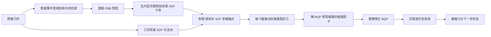

# Lodos: A Lightweight Simulator Designed for Contact-Rich Interactions with Detailed Meshes

[arXiv:2611.08872](https://arxiv.org/abs/2611.08872)（v1，2026-11-06）；作者 Onur Beker、A. René Geist、Georg Martius，机构为蒂宾根大学与马克斯·普朗克智能系统研究所（论文首页）；代码 [martius-lab/lodos](https://github.com/martius-lab/lodos)。来源归档见 [sources/papers/lodos_arxiv_2611_08872.md](../../sources/papers/lodos_arxiv_2611_08872.md)。

## 一句话定义

**Lodos 是一个从零设计的 GPU 并行刚体仿真器：用「球体–SDF」碰撞代替凸多面体碰撞，用「弹簧阻尼接触力 × 逐碰撞对缩放因子」代替标准 SOCP 接触求解，目标是在大批量并行、非凸精细网格接触下提高吞吐（摘要、I）。** 它是仿真工具，不是策略学习算法。

## 英文缩写速查

| 缩写 | 英文全称 | 简要说明 |
|------|----------|----------|
| SDF | Signed Distance Function | 有符号距离函数，网格外正、内负 |
| SNF | Surface Normal Function | 由样条 SDF 的归一化梯度得到的表面法向（III-A2） |
| NCP / CCP | Nonlinear / Cone Complementarity Problem | 描述接触的互补问题，常见仿真器的求解对象（I） |
| SOCP | Second-Order Cone Program | MuJoCo、Drake 所用的接触力优化形式（式 3） |
| BQP | Box-constrained Quadratic Program | Lodos 把 SOCP 集总参数化后得到的盒约束二次规划（式 4、5） |
| GJK / EPA | Gilbert-Johnson-Keerthi / Expanding Polytope Algorithm | 凸体碰撞检测常用算法，MJWarp 使用 |
| OBB | Oriented Bounding Box | 有向包围盒，用于整对剔除（III-C4） |
| MPPI | Model Predictive Path Integral | 基于采样的 MPC，实验 V-C2 所用 |
| iLQR | iterative Linear Quadratic Regulator | 轨迹优化方法，实验 V-C1 所用 |
| MJWarp | MuJoCo Warp | MuJoCo 的 NVIDIA Warp GPU 实现，论文主要对照 |
| Lodos-MJ-N | Lodos with MuJoCo convention, N stagger iterations | 论文的配置命名，N 为交错迭代次数（V） |

## 为什么重要

- 并行仿真是强化学习、随机 MPC、随机平滑轨迹优化的基础设施；接触密集场景要用精细网格时，常规做法要么用球、胶囊、盒近似，要么付出网格–网格碰撞的吞吐代价（摘要）。
- 论文的核心论点（作者自述，I）：这些方法本来就对「接触参数的随机化集合」取平均，单个仿真成员的物理忠实度只部分影响最终选出的动作，所以可用简化接触动力学换更大的集合规模。这是作者的论证，不是被实验直接检验的结论。
- 与机器人强化学习的关系要看清：论文没有在 Lodos 里训练强化学习策略。Microduck 策略在 MJWarp 训练后零样本放入 Lodos，用来说明物理忠实度（V-A3）；控制实验用的是 iLQR 与 MPPI（V-C）。所以它更接近「可能服务于 RL 与采样控制的仿真器」，不能写成「用 Lodos 训练出的 RL 结果」。

## 核心原理与流程总览

1. **几何表示（III-A、III-B）：** 每个几何 = 表面稠密顶点（半径 0 的球）+ 体内内切球 + 3D 三次样条 SDF 与法向。样条的紧支撑使求值与网格复杂度无关（64 项非零），网格复杂度只影响所需体素分辨率与存储；SDF 网格在并行实例间共享，存储不随批量增长（III-A）。
2. **窄相（III-B）：** 精确的网格–SDF 碰撞需要顶点–SDF 与边–SDF 接触；Lodos 只做顶点与内切球，刻意省略边–SDF（作者给出的理由是 2–4 倍减速换一个可检测、可避免的小伪影，III-B3）。
3. **宽相（III-C）：** 体素中心 SDF 提供球体距离下界以剔除不可能穿透的球；球心沿 Hilbert 曲线排序后分块，建两级层次；流压缩加「reduce-then-scan」处理变长数组；缓冲容量按观测到的最大接触数在线标定（默认余量 α = 2），触发重标定时会有一次主机–设备同步；整对剔除用 OBB。
4. **接触模型（IV-C）：** 先由闭式弹簧阻尼公式（V 节采用 [38, 37] 的方法）算各接触点的力，再对每个碰撞对乘一个非负标量，把 MuJoCo 式 SOCP 化为 BQP，用单线程投影坐标下降求解；交错迭代让力分布随累积速度重算；第二个 BQP 做摩擦修正，使静摩擦可达库仑上界、避免「所有接触终将滑移」（IV-C3）。
5. **默认约定（IV-A）：** 正则化 R 与穿透项 γ 默认提供 MuJoCo 约定与动能最小化约定（R = 0、γ = 0）。

## 实验与结果（均来自论文）

| 实验 | 设置 | 结果 |
|------|------|------|
| 夹方块摩擦修正（V-A1，Fig.4） | 两个球形手指夹 1 m、10 kg 方块，μ = 0.6，每指 100 N | 无修正最大摩擦 8.22 N 提不起来；有修正精确 120 N，起升前 114 ms 滑 5.97 mm 后黏着，保持 5 s 蠕变 -0.0014 mm/s |
| 25 块石拱（V-A2，Fig.5） | 15 s 仿真 | Lodos-MJ-0、MJ-1 逐渐垮塌，MJ-2 稳定；MJWarp 的 GJK+EPA 接触点跳变导致石块间可见滑移 |
| Microduck 双足（V-A3，Fig.1） | MJWarp 训练的策略零样本放入 Lodos | 成功执行多种行为（定性，见视频） |
| 四指棱柱抓取（V-A4，Fig.6） | MuJoCo 中用 Dexonomy 优化抓取姿态与位置目标后直接迁入 | 物理忠实度随交错迭代增加而改善 |
| 20 只 armadillo 落地（V-B1，Table I） | 批量 20；Lodos 每只 451 顶点加 100 球，MJWarp 34 个凸多面体；取 1–4 s 区间 | 峰值批量下整步加速 21.7 / 14.8 / 10.3 倍（Ns = 0 / 1 / 2），接触流水线 24.8 / 16.7 / 11.1 倍 |
| 手内重定向吞吐（V-B2，Table I） | Sharpa Wave 手（Lodos 3,479 顶点，MJWarp 87 个凸多面体）；从 MPPI 轨迹取 2,500 个接触最多的状态 | 整步加速 9.19 / 7.49 / 6.29 倍，接触流水线 14.0 / 11.0 / 9.90 倍 |
| iLQR + 随机平滑（V-C1，Fig.8） | 两球夹起 1 m 方块并转 60 度，状态 24 维、控制 6 维 | Lodos 全程 0.75 mm / 0.13 度；Lodos 线性化加 MJWarp 滚动 10.5 mm / 1.24 度 |
| MPPI 手内操作（V-C2，Fig.9） | 64 个并行 rollout，无域随机化，四个 60 度目标，5 个随机序列 | Lodos 无明显伪影；Lodos 控制器放到 MuJoCo-CPU 被控对象上可迁移（以图与视频为证，无汇总数值） |

所有实验为单卡 RTX 4080、2 ms 步长（V）。

## 工程实践

- **适用场景：** 需要几千以上批量、几何必须保留精细非凸网格的采样式控制或并行 rollout。论文自述的收益区间在大批量；Table I 中 MJWarp 到 2^12 为止、Lodos 到 2^14–2^16，单世界步时间随批量下降（V-B）。
- **使用前要做：** 把网格烘焙成 SDF 样条加稠密球（论文用 Bubblify 手工放内切球，也可用球分解算法，III-B2）；调好 Lodos 缓冲容量与 MJWarp 的接触、约束上限（V）。
- **精度与速度取舍：** 交错迭代次数 N 越大越稳但越慢：以手内重定向为例峰值批量 N = 0 为 0.299 µs，N = 2 为 0.437 µs（Table I）；拱的稳定性需要 N ≥ 2（V-A2）。
- **控制侧建议（作者）：** 可在控制器中惩罚内切球接触点相对自身 SDF 的穿透来避开省略边–SDF 的伪影（III-B3）。
- **代码（静态读 README，未运行）：** README 称为「研究代码库」，基于 Warp、沿用 MJWarp 的部分约束模型，并给出 viewer、bench、网格预处理与调参说明；其对求解器的描述（原始形式精确求解 Signorini-Coulomb、非光滑 Newton）与论文 v1 的 BQP 描述不完全一致，作者称仓库含 v1 之后的扩展（见来源归档），具体差别未核实。

## 与其他工作对比

| 维度 | Lodos | [MuJoCo](./mujoco.md) / [MJWarp](./mujoco-warp.md)（论文主要对照） |
|------|-------|------------------------------------------------------|
| 碰撞几何 | 表面稠密零半径球 + 内切球 + 样条 SDF（III） | 凸多面体，GJK + EPA（I） |
| 接触求解 | 弹簧阻尼力 × 逐碰撞对缩放，SOCP 集总为 BQP，投影坐标下降（IV-C） | 正则化 SOCP（MuJoCo、Drake，式 3） |
| 静摩擦 | 摩擦修正 BQP 可达库仑上界（IV-C3） | 作者称正则化使摩擦低于静止所需值、所有接触终将滑移（I） |
| 吞吐（所测网格场景） | 整步约 6.29–21.7 倍于 MJWarp（Table I） | 小批量（< 约 256 用 MuJoCo-CPU，约 256–1024 用 MJWarp）或可用基本体近似时更优（VI） |
| 自动微分 | 暂不支持（VI） | — |

对比的边界：吞吐对照中两边几何表示不同（Lodos 为顶点加球，MJWarp 为 34 / 87 个凸多面体），论文没有同时给出两边的几何或接触精度误差；物理忠实度对比只有夹方块、石拱等定性 / 单例实验，无真实世界测量。接触模型层面的更系统比较可参考 [Le Lidec 等的接触模型比较](./paper-le-lidec-contact-models-comparative-analysis.md)，仿真伪影问题见 [仿真器接触伪影审计](./paper-simulator-contact-artifacts-audit.md)。

## 结论

**Lodos 在「大批量 + 必须保留精细非凸网格」这一窄区间里给出了可信的吞吐优势，但物理忠实度证据仍以定性和单例实验为主。**

1. 真正该看的指标是同一场景、相同批量下的整步吞吐与接触流水线耗时（Table I），而不是「约一个数量级」的概括：数字只覆盖 armadillo 与 Sharpa Wave 两个场景。
2. 交错迭代次数 N 是精度与速度的主旋钮：石拱稳定需 N ≥ 2（V-A2），代价是加速比从 9.19 倍降到 6.29 倍（手内重定向）。
3. 次要成本：网格要预先烘焙成 SDF 样条与内切球；缓冲容量重标定会触发一次主机–设备同步（III-C3）。
4. 批量小或几何可用基本体近似时，作者自己建议继续用 MuJoCo-CPU / MJWarp（VI）。
5. 部署读法：论文没有在 Lodos 中训练 RL，也没有真机实验；控制迁移只是 Lodos 到 MuJoCo-CPU 的仿真到仿真。开源仓库已是 v1 之后的扩展版，复现论文数字前需确认版本。

## 局限

**论文自述（VI）：**
- 批量小于约 256 时 MuJoCo-CPU、约 256–1024 时 MJWarp 的 rollout API 仍是最佳选择；Lodos 要靠增大批量才有吞吐优势。
- 几何可用基本体近似时 MJWarp 仍更快。
- 目前不支持经 Nvidia Warp 的自动微分。
- 省略边–SDF 接触理论上可能产生毫米级穿透，边–边交互不稳定（III-B3）。

**未验证之处（本页读后判断，非论文自述）：**
- 吞吐对比的两边几何表示不同（Lodos 为顶点加球，MJWarp 为 34 或 87 个凸多面体），论文未同时给出两者的接触精度或几何误差，所以「更快」不等于「同精度更快」。
- 「物理忠实度与成熟仿真器相当」的证据是少量定性或单例实验，无针对真实世界测量的定量比较，无真机实验。
- Table I 中 MJWarp 在批量大于 2^12 处为空（论文未说明原因，推测为显存或接触容量限制），因此「峰值批量」比较的批量并不相同；表中 2^9 以下 Lodos 似乎也已更快，与 VI 节「中等批量 MJWarp 仍最佳」的表述需结合具体场景理解，论文未提供 MuJoCo-CPU 吞吐数据。
- 手内操作控制实验的结果主要以曲线与视频呈现，5 个随机目标序列，样本量小。
- 补充视频未读，视频中的定性现象只依据正文文字。

## 对强化学习综述类写法的提示

- 不要把 Lodos 写成「用 Lodos 训练 RL 的结果」：论文中 RL 策略只在 MJWarp 训练（Microduck，来自第三方开源仓库）后零样本放入 Lodos 以展示物理忠实度。
- 不要把「约一个数量级」泛化到所有仿真负载：论文数字为 6.29–21.7 倍，仅对应 armadillo 与 Sharpa Wave 两个网格场景，并以基本体近似的场景为反例（VI）。

## 关联页面

- [MuJoCo Warp](./mujoco-warp.md)：论文的主要吞吐对照与 Lodos 部分代码的基础
- [MuJoCo](./mujoco.md)：论文沿用其接触约定并以 MuJoCo-CPU 为被控对象
- [NVIDIA Warp](./nvidia-warp.md)：Lodos 的实现框架
- [Sharpa Wave 手](./sharpa-w02-hand.md)：手内操作实验所用的灵巧手
- [接触模型比较分析（Le Lidec 等）](./paper-le-lidec-contact-models-comparative-analysis.md)：论文引用的接触模型对比工作
- [仿真器接触伪影审计](./paper-simulator-contact-artifacts-audit.md)：同类问题的相邻节点
- [接触动力学](../concepts/contact-dynamics.md)
- [接触丰富操作](../concepts/contact-rich-manipulation.md)
- [域随机化](../concepts/domain-randomization.md)
- [物理保真度与 sim2real 差距](../concepts/physics-fidelity-sim2real-gap.md)
- [可微仿真](../concepts/differentiable-simulation.md)
- [MPPI](../methods/mppi.md)
- [LQR / iLQR](../methods/lqr-ilqr.md)

## 参考来源

- [sources/papers/lodos_arxiv_2611_08872.md](../../sources/papers/lodos_arxiv_2611_08872.md)
- [arXiv:2611.08872](https://arxiv.org/abs/2611.08872)
- [martius-lab/lodos README](https://github.com/martius-lab/lodos)

## 推荐继续阅读

- [arXiv PDF（v1）](https://arxiv.org/pdf/2611.08872v1)
- [MuJoCo Warp](./mujoco-warp.md)
- [接触动力学](../concepts/contact-dynamics.md)
- [物理保真度与 sim2real 差距](../concepts/physics-fidelity-sim2real-gap.md)
