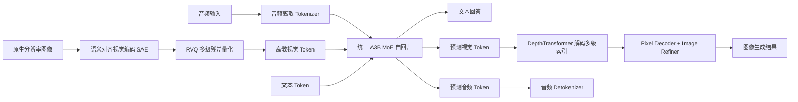
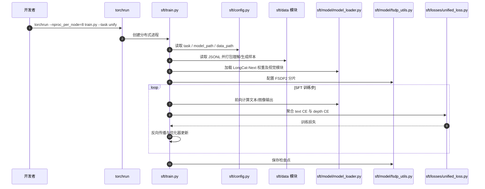

# LongCat-Next: Lexicalizing Modalities as Discrete Tokens（将多模态词汇化为离散 Token）

## 一句话定义

**LongCat-Next**（美团 LongCat 团队，[arXiv:2603.27538v1](https://arxiv.org/abs/2603.27538v1)）以 **DiNA（Discrete Native Autoregression）** 把文本、图像与音频接入同一离散自回归模型；关键是 **SAE/RVQ + dNaViT** 将视觉信息保留为能兼顾理解与生成的分层离散表示。它是**独立于 [LongCat-2.5](./longcat-2-5.md) 的论文与模型**。

## 英文缩写速查

| 缩写 | 英文全称 | 简要说明 |
|---|---|---|
| DiNA | Discrete Native Autoregression | 文本/视觉/音频共享离散自回归目标 |
| dNaViT | Discrete Native-Resolution Vision Transformer | 原生/动态分辨率的视觉离散化和还原接口 |
| SAE | Semantic-and-Aligned Encoder | 将图片映射为语言语义对齐的视觉特征 |
| RVQ | Residual Vector Quantization | 逐层对前一级量化残差编码 |
| NTP | Next-Token Prediction | 统一的下一 token 预测训练目标 |
| MoE | Mixture of Experts | A3B 稀疏激活的语言模型骨干 |
| SFT | Supervised Fine-Tuning | 官方已开源的理解/生成混合监督微调 |
| FSDP2 | Fully Sharded Data Parallel 2 | PyTorch 分片模型训练实现 |

## 核心信息

| 字段 | 内容 |
|---|---|
| 论文 | [arXiv:2603.27538v1](https://arxiv.org/abs/2603.27538v1) |
| 团队 | 美团（Meituan）LongCat Team |
| 模型骨干 | LongCat-Flash-Lite A3B，约 **68.5B 总参数 / 3B 激活参数**，不同于 LongCat-2.5 |
| 模态 | 文本、视觉理解、视觉生成、语音理解与合成 |
| 代码 | [meituan-longcat/LongCat-Next](https://github.com/meituan-longcat/LongCat-Next) |
| 权重 | [Hugging Face](https://huggingface.co/meituan-longcat/LongCat-Next) |
| 状态 | 模型、tokenizer、SFT 与推理接入已公开；附录/全部消融尚待进一步通读复核 |

## 为什么重要

- 大量 VLM 以连续视觉特征拼接语言输入，图像生成又依靠独立头。DiNA 试图统一为离散语言式预测，让理解与生成共享视觉词汇。
- 论文提出**语义完整性**：离散 token 应在回答问题时尽可能保留原图的有用语义，并可被重建到视觉空间；这既关心感知判别，也关心生成。
- 视觉 tokenizer 的质量会制约下游模型上限。其 RVQ 残差细化、原生分辨率和视觉解码器设计，值得作为机器人视觉表征研究的参考；但该论文没有直接提供机器人闭环控制策略。

## 核心原理

### 1. dNaViT：连续图像到多级视觉词

原始图像 \(I\) 经语义对齐视觉编码器产生连续特征，映射后进入多级 RVQ。每一级编码上一级量化误差，最后通过离散索引组合表达视觉内容。论文对语义完整性提出两类需求：离散表示对视觉问答等**判别任务足够**，且对图像恢复等**生成任务足够**。作者实际实现借用 Qwen2.5-ViT 作为 SAE 近似，以 28× 空间压缩配置构建 tokenizer。

RVQ 的可复现机制要点是**残差量化逐级进行、码本 EMA 更新、低使用率码本重置**。解码侧冻结 tokenizer，先用 ViT pixel decoder 重建，再用 flow-matching image refiner 增补高频细节（并不表示重建数学上严格无损）。

### 2. 统一自回归

视觉多级索引经过嵌入与 DepthTransformer 机制接入同一个自回归骨干；音频也有离散 tokenizer/detokenizer。模型通过 NTP 训练跨模态序列：图像理解是视觉条件下的文本输出，图像生成是文本条件下的视觉索引输出。论文还讨论声音与文字的串行/并行生成及随机延迟对齐。

### 3. 阶段训练与公开范围

原文将训练分为**独立 tokenizer 训练 → Pre-align（冻结语言骨干、热启模态嵌入和解码头）→ Pre-train/Mid-train/SFT**。官方仓库公开了 **FSDP2 SFT**，支持 understand、generate、unify 模式；完整原始预训练数据及其所有阶段不是仅靠这一 SFT 入口就能复现。

### 流程总览

## 实验与评测

原论文报告以下结果（**作者自测/汇总，不是本仓库独立复测**）：

| 方向 | 评测 | LongCat-Next |
|---|---|---|
| 视觉理解 | MMMU | **70.6** |
| 视觉理解 | MathVista | **83.1** |
| 图像生成 | GenEval（论文生成表） | **84.44** |
| 图像生成 | DPG | **84.66** |
| 文本生成保真 | LongText EN / ZH | **93.15 / 89.08** |
| 视觉编码 | 压缩配置 | **28×** |

读数时需注意生成表和跨模型表中的 GenEval 在数值呈现与舍入上可能不同（主表 84.44，统一模型表 84），不能擅自合并两种口径。论文还给出语音识别和音频问答测评；部分对手基线取自公开报告、评测协议并非完全同源。

## 结论

**LongCat-Next 的贡献是离散视觉表征下的多模态统一训练，而不是把 LongCat-2.5 压缩到 3B，也不等于已获得机器人动作控制能力。**

1. 视觉离散化要同时检验**语义问答损失**和**解码图像质量**，仅报告视觉重建指标不够。
2. SAE 选型很关键；论文的 Qwen2.5-ViT 是具体实现而非语义完整性的唯一可选编码器。
3. RVQ 多级表示提高信息承载能力，却增加编码/解码与多级 token 输出的工程复杂度。
4. 28× 是论文中的空间压缩配置；部署需另测 OCR、小目标与细粒度纹理质量。
5. 完整链路请区分：公开的模型推理与 FSDP2 SFT 可以研究和复现部分内容，但整套大规模预训练结果不能凭这些代码保证。
6. 相关视觉表示理念可迁移至机器人感知研究，仍需独立评估控制、时序一致性和物理状态适配。

## 源码运行时序图

基于仓库的 [Quick Start](../../sources/repos/longcat-next.md)、`sft/README.md` 和 `sft/train.py` 核验：下面画的是**公开的 SFT 运行入口**，不是未开放完整预训练的伪造流程。

## 工程实践

- **推理：** 官方 README 使用 `AutoModelForCausalLM.from_pretrained(..., trust_remote_code=True)`、`AutoTokenizer`、`AutoProcessor`，再调用 `model.generate(input_ids, visual_inputs, audio_inputs)`；按 `visual_ids` 和 `audio_ids` 分别解码。加载远程模型代码前应审阅模型仓库。
- **硬件：** README 推荐至少 **3 张 80GB GPU** 用于示例推理；SFT 示例使用 8×H800 80GB，不能推断可在 8GB 消费级 GPU 上直接复现。
- **训练：** `sft/train.py` 的 `--task understand|generate|unify` 使用相同 JSONL `messages` 数据结构；输出理解文本 CE、视觉 token depth CE，可参照 `sft/examples/train_unify_8gpu.sh`。
- **验证：** 视觉问答检查信息保留与 OCR；图像生成检查细节和文字渲染；音频检查语义一致性与时延；跨任务同时训练需观察负迁移。

## 局限与风险

1. **证据范围：** 论文附录中的所有补充实验尚未逐项复核，本节点保留 `draft`，不声明原文已全部通读。
2. **压缩损失：** 离散视觉词表仍可能丢失局部细节；论文报告的表现受 SAE、码本深度、分辨率与训练数据影响。
3. **训练复现门槛：** 开源 SFT 不是全流程训练数据与集群配置的公开证明；单机/单卡成本较高。
4. **具身边界：** 模态一致性和统一多任务性能不是动作条件世界模型或真机任务成功率。

## 与其他工作对比

| 模型路线 | 表征与目标 | 关键差异 |
|---|---|---|
| [LongCat-2.5](./longcat-2-5.md) | 原生多模态、Agent 和大规模推理 | 重点在 1.6T/48B 大基座的 Agent/长上下文及 W4A4 EPD |
| LongCat-Next | 分层视觉离散 token + 自回归 NTP | 重点在理解/生成统一和 token 语义完整性 |
| 连续视觉特征 VLM | 连续 ViT 向量接语言 | 多用于视觉理解，图像生成路径通常分离 |

## 关联页面

- [LongCat-2.5 模型与昇腾部署](./longcat-2-5.md)
- [GRPO：强化学习后训练](../methods/grpo.md) — 作为方法背景，不代表论文自身只使用 GRPO
- [Generative World Models](../methods/generative-world-models.md) — 区分图像生成与动作条件世界预测

## 参考来源

- [LongCat-Next 原始论文归档](../../sources/papers/longcat_next_arxiv_2603_27538.md)
- [LongCat-Next 模型与源码入口归档](../../sources/repos/longcat-next.md)
- [LongCat-Next v1 原文](https://arxiv.org/abs/2603.27538v1)

## 推荐继续阅读

- [LongCat-Next 官方代码、模型运行与 SFT](https://github.com/meituan-longcat/LongCat-Next)
- [论文 HTML 全文](https://arxiv.org/html/2603.27538v1)
