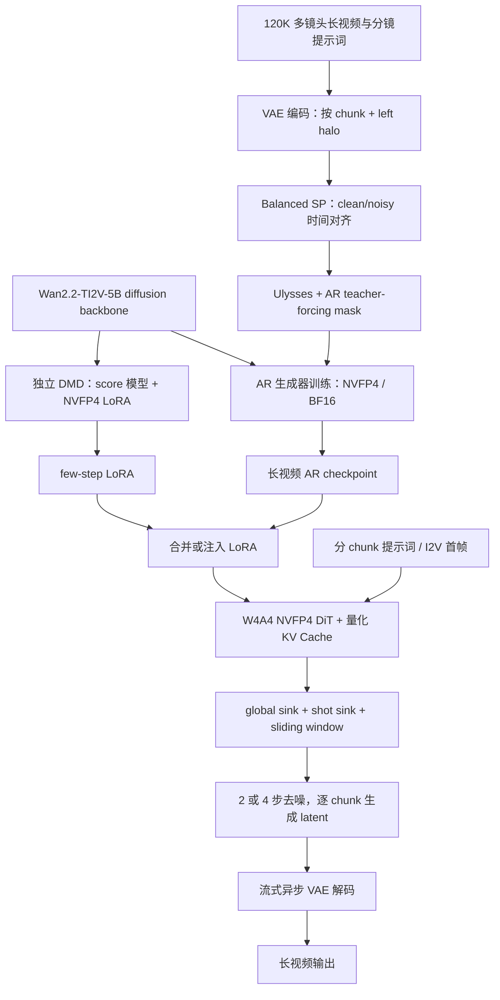
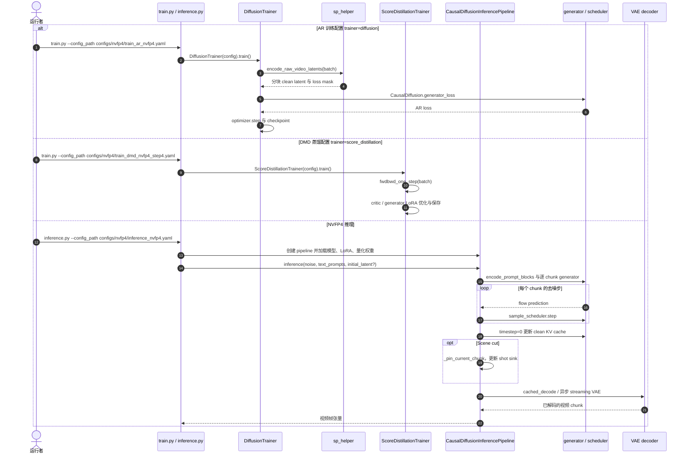

# LongLive 2.0：NVFP4 并行长视频生成基础设施 / An NVFP4 Parallel Infrastructure for Long Video Generation

> **一手资料**：[arXiv:2605.18739v2（2026-05-19）](https://arxiv.org/html/2605.18739v2) · [NVIDIA 项目主页](https://nvlabs.github.io/LongLive/LongLive2/) · [官方 LongLive2.0 代码](https://github.com/NVlabs/LongLive/tree/main/LongLive2.0) · [使用文档](https://nvlabs.github.io/LongLive/LongLive2/docs/)；主要作者 Yukang Chen、Luozhou Wang、Wei Huang、Shuai Yang 等；机构：**英伟达（NVIDIA）**。仓库公告发布时间是 **2026-05-13**，不是 2026-11 新开源。

## 一句话定义

**LongLive 2.0** 将 Balanced Sequence Parallelism、NVFP4 训练、DMD LoRA 蒸馏与 W4A4/KV Cache 量化、流式 VAE 解码联合设计，使 5B 长视频扩散模型能进行多镜头自回归训练和快速推理；45.7 FPS 是**不含 VAE 的扩散阶段帧率**，不能误称端到端帧率。

## 英文缩写速查

| 缩写 | 英文全称 | 简要说明 |
|---|---|---|
| NVFP4 | NVIDIA 4-bit Floating Point | E2M1 数据配 16 元素 FP8 块级缩放和 FP32 全局缩放 |
| AR | Autoregressive | 按时序 chunk 预测后续视频 latent |
| SP | Sequence Parallelism | 在 GPU 间切分时序 token 并交换注意力头 |
| DiT | Diffusion Transformer | 长视频去噪主干 |
| DMD | Distribution Matching Distillation | 用 score 模型指导 few-step 学生并蒸馏独立 LoRA |
| W4A4 | 4-bit Weights / 4-bit Activations | NVFP4 量化推理的权重与激活精度 |
| KV | Key-Value Cache | 跨 chunk 重用注意力历史；采用量化与 sink 约束增长 |
| VAE | Variational Autoencoder | 视频与 latent 的编码解码，可与去噪异步重叠 |
| T2V/I2V | Text-to-Video / Image-to-Video | 官方均提供训练与推理流程 |

## 为什么重要

- **长序列吞显存和训练时间**：teacher forcing 同时处理 clean 历史与 noisy 目标，普通 SP 会令不同 rank 的监督 token 数量与 VAE 编码负荷不均衡。
- **训练/推理精度协同**：与部署时才 PTQ 相比，NVFP4-aware 训练使 W4A4 的质量损失更可控；DMD 的 LoRA 只在独立低秩分支更新。
- **指标去混淆**：扩散 FPS 和完整视频 E2E 时延不是同一个指标；输出时要同时列视频时长、生成延时、解码 GPU 与分辨率。
- **与具身的关系**：该研究是视频生成基础设施，Long-WAM 用 LongLive-2.0 checkpoint 作为机器人视频专家初始化来源，但视频生成本身不直接输出机器人动作。

## 核心原理

### 1. Balanced SP：chunk 对齐的 AR Teacher Forcing

依据论文 §2.1 和 Appendix C，对每段长视频用 VAE 得到 latent；在每个 SP rank 本地配对同一时间区间的 clean history / noisy target，构成允许 noisy chunk 读取先前 clean chunks 的 block-sparse attention mask。VAE 局部编码使用必要的 left halo；Ulysses All-to-All 交换序列维和注意力头后，在**交错 token 顺序**直接执行 mask，不在各层反复重排 Q/K/V。全局 RoPE 索引、监督 mask 与误差回收 buffer 都按 rank 时间位置对齐。

### 2. NVFP4：贯穿 AR 训练、DMD 和推理

NVFP4 以 E2M1 4-bit 值、每 16 元素的 FP8 E4M3 块级 scale 与 tensor 级 FP32 scale 表示权重/激活；对线性层 GEMM 采用低精度路径，而归约、优化器状态等数值敏感运算保留高精度。论文还用 Four-Over-Six 的候选 scale 误差比较减轻 FP4 最大值附近的量化偏差。与直接 PTQ 不同，训练期已适配部署期的 W4A4。

### 3. 多镜头生成与独立 few-step LoRA

以 Wan2.2-TI2V-5B 为基础，直接进行长视频、多镜头、按 chunk 提示词变化的 AR 微调，不强制沿用原 Self-Forcing 的 ODE 初始化、短视频 DMD、长时适配多阶段串联。另从原始 diffusion backbone 独立进行 DMD LoRA 蒸馏，可与 AR 训练并行，推理时注入可使去噪由 4-step 降至 2-step。global attention sink 保留全视频身份；shot-level sink 在 scene cut 时重新绑定，帮助维持当前镜头的局部一致性。

### 4. NVFP4 KV Cache、序列并行与异步 VAE

生成时为每个 latent chunk 缓存注意力 KV（论文中每块 8 latent frames）；NVFP4 KV 配合 K-smoothing、并行反量化减少驻留显存。论文报告 KV 缓存接近 **3.6×** 压缩、反量化开销低于 **2%**。SP 推理可对 Q/K/V 做低精度通信，不过**发布版本的 `inference_sp.py` 仍会禁用 `kv_quant`**，不应把论文中的所有通信优化视作当前入口已验证可用。streaming VAE 可以把 chunk c 的解码与 chunk c+1 的 DiT 去噪重叠，端到端统计仍须说明解码器是否额外占卡。

## 流程总览

论文 Fig. 1–6 与 Appendix C/D 的主数据流概括；AR 和 DMD 可以并行训练，非串联依赖：

## 源码运行时序图

以下调用链核对自官方 `LongLive2.0/train.py`、`trainer/diffusion.py`、`trainer/distillation.py`、`inference.py` 与 `pipeline/causal_diffusion_inference.py`；说明的是**发布代码路径**而非论文所有理论模块必然生效。

说明：`inference_sp.py` 是独立 SP 推理入口、使用 `CausalDiffusionInferencePipelineSP`，当前代码在配置开启 `kv_quant` 时主动设为 false（见 [源码核验归档](../../sources/repos/nvlabs-longlive2.md)）。

## 工程实践

| 项目 | 官方路径与核验结论 |
|---|---|
| 开源程度 | **已开源**：官方 NVlabs/LongLive 的 `LongLive2.0/`，包括训练/推理、配置、NVFP4 扩展与模型下载指引 |
| 依赖 | BF16 默认 Python 3.10 / PyTorch 2.8+cu128；NVFP4 推荐 Python 3.12.12 / PyTorch 2.10+cu128 / CUDA 12.8 / FlashAttention 2.8.3，并编译 `fouroversix` 和 `utils/kernel` |
| AR 训练 | `train.py --config_path configs/nvfp4/train_ar_nvfp4.yaml`（可用 torchrun 多进程） |
| DMD 蒸馏 | `train.py --config_path configs/nvfp4/train_dmd_nvfp4_step4.yaml` |
| NVFP4 推理 | `inference.py --config_path configs/nvfp4/inference_nvfp4.yaml`；TE 与 FourOverSix checkpoint/backend 必须匹配 |
| 模型 | Wan2.2-TI2V-5B 组件 + LongLive-2.0 BF16、NVFP4-S4 / NVFP4-S2 checkpoint |
| 支持范围 | T2V/I2V、交互多镜头、KV quant（单机普通推理）、FP8 PTQ（H100 路线，**不等于** 45.7 FPS NVFP4 路线） |
| 测试建议 | 同时记录显卡、SP 数量、分辨率、chunk 大小、步数、是否包含 VAE/异步 GPU、warmup 与 VBench |

官方 [完整安装及配置指引](https://nvlabs.github.io/LongLive/LongLive2/docs/) 和 [README / 原始源码核验](../../sources/repos/nvlabs-longlive2.md) 是运行参数的唯一依据；本文未实际执行 GPU 训练与 benchmark。

## 实验与评测

**论文数据，未经本仓库复测。** 论文 Table 3 说明单 GB200（180 GB）模型计算，启用 Async Decoding 时 **另用 GPU 解码**。

| 模型条件（720p、5B、GB200） | Diffusion FPS（不含 VAE） | VBench Total |
|---|---:|---:|
| BF16 / 4-step | 24.8 | 85.06 |
| NVFP4 / 4-step（KV quant） | 29.7 | 84.51 |
| NVFP4 / 2-step（KV quant） | **45.7** | **83.14** |

| 指标 | 官方结果 | 测试口径 |
|---|---:|---|
| 64s 视频 E2E 耗时 BF16 → 2-step NVFP4+Async | 112.9s → **36.3s** | Table 3；额外解码 GPU |
| 64s AR 单步训练 BF16+SP → NVFP4+Balanced SP | 1372.9s → **639.5s** | Table 1；约 2.15× |
| DMD 每 GPU 峰值显存 | 70.5GB → **49.0GB** | Table 2；0.69× |
| 64s 2-step NVFP4 推理表列总峰值显存 | **19.4GB** | Table 3；报告口径需注意模型与解码设备 |
| 60s VBench-Long 平均排名 | **3.67（BF16）** | Table 5；长视频四步设置 |

论文 Appendix I：AR 训练报告 32× GB200、SP=4、600 iterations；DMD 报告 16× GB200、5000 iterations。不要把论文训练规模误读为下载权重的推理最低配置。

## 结论

**LongLive 2.0 的价值是把低位精度、长序列并行、少步数蒸馏和流式解码作为一个系统共同设计；45.7 FPS 只是其中一种明确限定条件的吞吐测量。**

1. **对外引用最快结果**：必须带上 5B、720p、GB200、NVFP4、2-step，以及“不含 VAE”。
2. **讨论端到端体验**：引用 64s 视频 **36.3s** 的实验，且说明 async VAE 额外 GPU。
3. **做质量权衡**：对比 4-step BF16 的 VBench 85.06 和 2-step NVFP4 的 83.14，不能只关注 FPS。
4. **做训练复现**：优先检查 clean/noisy chunk 对齐、VAE halo、SP 全局位置、NVFP4 算子与 checkpoint 后端对应关系。
5. **做部署复现**：分开核验单卡 KV quant、`inference_sp.py` 的 KV quant 支持状态；H100 FP8 结果不要与 GB200 FP4 宣传数字混用。

## 与其他工作对比

- **LongLive 1.0**：以 1.3B、480p 的实时交互长视频为主要目标；本文升级至 Wan2.2 5B、720p 并重构量化与并行训练/推理基础设施，两者硬件及规模不同，不宜只用 FPS 排序。
- **Self-Forcing / Causal-Forcing**：论文把它们列作需多阶段训练的参照；LongLive 2.0 直接长视频 AR 训练，few-step LoRA 可独立蒸馏。
- **[Long-WAM](paper-long-wam-scaling-context.md)**：它利用 LongLive-2.0 checkpoint 继续训练机器人视频预测专家，并结合动作专家输出动作，**是另一个具身研究项目**；同仓库 `Long-WAM/` 和 `LongLive2.0/` 必须区分。

## 局限与风险

- 论文作者将其称为“首个 NVFP4 全流程长视频生成训练/推理系统”，属**作者限定范围的首创主张**，没有独立核验“全球所有 4-bit 系统中第一”。
- NVFP4 加速高度依赖 Blackwell Tensor Core 与自定义扩展；非 Blackwell 的 SP、FP8 是不同路线，不能据此保证相同帧率。
- 当前已公开 `inference_sp.py` 禁用 `kv_quant`，论文 Appendix D 的压缩通信实现与此特定入口之间有发布版本差异；需在部署前实际核对。
- 5B 2-step 的 VBench 下降；多镜头长时一致性仍需按目标场景评价。
- 本页为论文、官网和官方运行代码静态审阅，**未复跑训练、推理或实测质量与 FPS**。

## 关联页面

- [Long-WAM：长上下文机器人世界–动作模型](paper-long-wam-scaling-context.md)
- [生成式世界模型](../methods/generative-world-models.md)
- [世界–动作模型](../concepts/world-action-models.md)

## 参考来源

- [论文 v2 原文通读与测试表核验](../../sources/papers/longlive2_nvfp4_arxiv_2605_18739.md)
- [NVIDIA 官方项目主页及 Docs](../../sources/sites/longlive-2-nvlabs.md)
- [NVlabs/LongLive2.0 实际源码及配置入口](../../sources/repos/nvlabs-longlive2.md)

## 推荐继续阅读

- [LongLive 2.0 官网](https://nvlabs.github.io/LongLive/LongLive2/)
- [论文 HTML v2](https://arxiv.org/html/2605.18739v2)
- [源码目录与 Quick Start](https://github.com/NVlabs/LongLive/tree/main/LongLive2.0)
- [模型权重（NVFP4 2-step）](https://huggingface.co/Efficient-Large-Model/LongLive-2.0-5B-NVFP4-S2)
