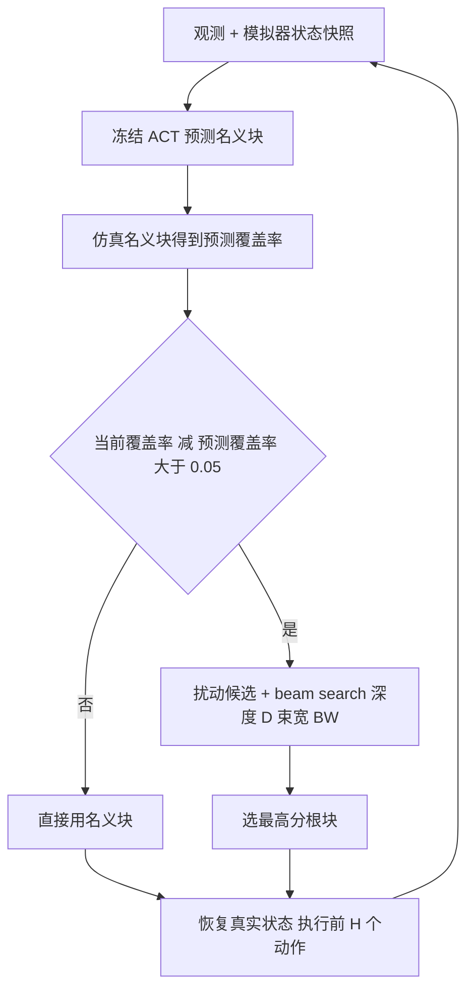

# Look Ahead：冻结 ACT 的选择性前瞻搜索（arXiv:2611.10769）

**Look Ahead: Search-Driven Reasoning in Embodied AI**（[arXiv:2611.10769](https://arxiv.org/abs/2611.10769)，Yildiz Technical University，土耳其）：在 PushT 仿真里，对冻结的 ACT 策略输出的动作块做局部扰动，用克隆的模拟器状态前向推演并按覆盖率打分；再提出 One Step Ahead（OSA）门控，只在名义块预计让覆盖率下降时才做完整搜索。

## 一句话定义

**不改策略参数，用模拟器复制状态对 ACT 动作块的扰动候选做 beam search，并用“先仿真一个名义块、预测覆盖率掉超过 0.05 才搜索”的门控省算力（论文第 3 节）。**

## 英文缩写速查

| 缩写 | 英文全称 | 简要说明 |
|------|----------|----------|
| ACT | Action Chunking with Transformers | 视觉动作块模仿学习策略，本文冻结使用（第 3.1 节） |
| VLA | Vision-Language-Action | 视觉 + 语言 + 动作模型；本文动机来自 VLA 的测试时规划，但实验未用 VLA |
| OSA | One Step Ahead | 本文的门控：先仿真名义块，再决定是否完整搜索（第 3.3 节） |
| ASR | Alternative Selection Ratio | 选中扰动块占全部块选择的比例（式 4） |
| D / C / BW | Depth / Candidates / Beam Width | 树深 / 每节点候选块数（含名义块）/ 束宽（Table 1） |
| H | Execution horizon | 每次规划后实际执行的动作数，决定重规划频率（第 3.2 节） |

## 为什么重要

- 它把“长动作块什么时候值得重新规划 / 多想一步”变成可量的问题：搜索预算加大并不一定更好，见第 4.2 至 4.4 节。
- 对想给冻结策略加测试时算力的人，OSA 是一个很小的、可复现的门控样例；但证据只覆盖 PushT 仿真与一个 ACT 检查点（第 5 节）。

## 核心原理与流程总览

规划点（第 3.2 节）：快照模拟器状态；ACT 给名义块 A(0)，候选集为名义块加 C-1 个加噪并裁剪的扰动块（式 2）；每个候选从父状态仿真，按覆盖率打分；每层保留 BW 个最高分节点，扩展到深度 D 或成功；选最佳根块，恢复真实状态，只提交前 H 个动作。仅提交的转移计入回合奖励。

设置（第 4.1 节）：检查点 `aadarshram/act_pusht`，每配置 50 回合，上限 300 步，成功为覆盖率至少 95%；H=10 时完整搜索每回合最多调用 30 次（式 3）。

## 工程实践

- 代码：[AhmedZeer/lerobot-tree](https://github.com/AhmedZeer/lerobot-tree)，PushT 实现在 `examples/tree_search/pusht`；README 称需配合兼容的 LeRobot checkout 或 fork，给出并行评测命令（`--episodes=50`、`--execute-steps=10` 等）与 `lerobot-eval` 的 ACT 基线命令。本次只静态读 README，未运行；README 示例参数（如 depth=3、num-candidates=3）与论文 Table 1 的配置不完全相同，复现论文表格需对照作者脚本参数（未核实）。
- 项目页：[azeer.co/research/lookahead](https://azeer.co/research/lookahead/)，有成功 / 失败回合对照视频；页面导航仍标 Paper Coming Soon。
- 前提：需要能保存 / 恢复完整状态的模拟器和任务提供的覆盖率（第 3.2 节明说这是“特权信息”），换到真机或学习的世界模型需要另行解决（第 5 节）。

## 与文章说法的核对

对照公众号文章《机器人动作块太长，什么时候该重新规划？》（2026-11-11 的 53 篇论文速览，条目 38）的逐句判断：

| 文章说法 | 论文核对 |
|----------|----------|
| 冻结动作策略 | 属实：ACT 参数冻结（第 4.1 节） |
| 用复制的仿真状态搜索候选动作块 | 属实：克隆 / 恢复模拟器状态，候选为扰动动作块（第 3.2 节） |
| 预判变差时才启动前瞻搜索 | 属实但需限定：触发条件是名义块预测最终覆盖率比当前低超过 0.05，只检测“预测退步”，可能漏掉停滞与中途有害转移（第 3.3 节） |
| 证据来自推物仿真 | 属实：仅 PushT 仿真（第 5 节） |
| 较弱基线 | 属实：ACT 基线成功率 0%，最强完整搜索仅 18%，论文自称不代表任务被可靠解决（第 5 节） |
| 需要模拟器状态 | 属实：依赖恢复的模拟器状态与任务专用覆盖率反馈（第 3.2、5 节） |
| 尚未验证语言 VLA 或真机 | 属实：论文明说 ACT 非语言条件，真机与 LIBERO 属未来工作（摘要、第 5 节） |

文章未给出具体数字，故无数字可对。补充：论文还写了 50 回合无置信区间、无与 VLA-Reasoner / VLAPS 的共享基准对比（第 5 节），文章只说了较弱基线。项目页与论文口径略有出入（OSA 提速项目页写 2.5 至 4 倍，论文写约 3 倍；项目页累计奖励写 39.4 至 90.7，论文最高 103.2），引用时以论文为准。

## 论文的关键结果（作者自述）

- Table 1（第 4.2 节）：基线 39.44 / 成功 0% / 2 s；D=4、C=8、BW=4：103.2 / 18% / 47 s（约 23.5 倍时间）。D=4、C=8、BW=8：92.2 / 10% / 87 s，更宽反而更差。
- 深度单独增加无益：C=4、BW=2 时 D=2、4、8 平均奖励相同、成功率均 18%。候选数增加使 ASR 上升（D=4、BW=2 时 C=2 为 37.5%，C=8 为 75.6%），成功率增益有限。
- 重规划（第 4.3 节，Figure 2）：执行视野越短奖励一般越高，大树优势在长视野消失。
- OSA（第 4.4 节，Figure 3）：运行时间约降 3 倍，成功率保持或提高、累计奖励可能下降；作者对 BW=8 下 OSA 更好的解释（少暴露于短视启发式偏好的扰动）被明确标为解释，未单独测因果。

## 局限

论文自己承认（第 5 节）：ACT 非语言条件；单检查点、单任务族；无与 VLA-Reasoner、VLAPS 的共享基准对比；依赖模拟器状态恢复与覆盖率；真机需要可靠动力学模型和从真实观测得到的进度估计；未量化模型误差对排序与 OSA 触发的影响；门控窄、阈值固定；50 回合无置信区间与多 seed 变异；基线 0%、最强 18%；需更强检查点和等算力对比，才能判断搜索与改进基座策略孰优。

我的判断（非论文自述）：
- OSA 的成功率优势（约 22% 对 18% 等）以 50 回合计只差 2 个回合，论文自己提示“小差异需谨慎”，不宜当结论。
- Figure 2、3 的数值我是目测，非论文给出。
- 运行时间的硬件与实现细节论文未写（本次未读源码，未核实）。
- 题名与项目页 BibTeX（Language and Embodied AI）不一致，本页以 arXiv v1 PDF 为准。

## 关联页面

- [Action Chunking](../methods/action-chunking.md)
- [模仿学习](../methods/imitation-learning.md)
- [VLA](../methods/vla.md)
- [ACT 论文页](./paper-act.md)
- [Diffusion Policy 论文页](./paper-diffusion-policy.md)
- [SmolVLA](./paper-smolvla.md)、[π0](./paper-pi0.md)、[Octo](./paper-octo.md)
- [LeRobot](./lerobot.md)
- [仿真评测与真机差距](../concepts/sim-vs-real-eval-gap.md)
- [Sim2Real](../concepts/sim2real.md)
- [接触丰富操作](../concepts/contact-rich-manipulation.md)

## 参考来源

- [sources/papers/look-ahead-search-pusht_arxiv_2611_10769.md](../../sources/papers/look-ahead-search-pusht_arxiv_2611_10769.md)
- [arXiv:2611.10769](https://arxiv.org/abs/2611.10769)
- 项目页 <https://azeer.co/research/lookahead/>；代码 <https://github.com/AhmedZeer/lerobot-tree/tree/main/examples/tree_search/pusht>
- ACT 检查点 <https://huggingface.co/aadarshram/act_pusht>

## 继续阅读

- [arXiv PDF](https://arxiv.org/pdf/2611.10769v1)
- [ACT 论文页](./paper-act.md)
- [Action Chunking 方法页](../methods/action-chunking.md)
