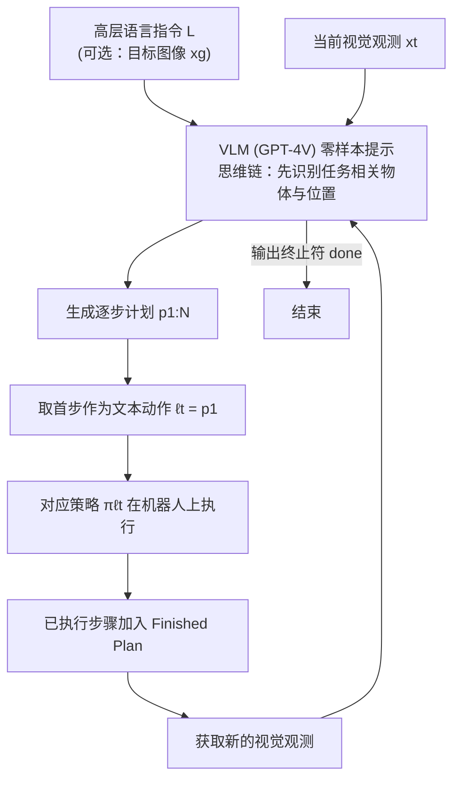

# Look Before You Leap（LBYL）

**Look Before You Leap（LBYL）**（[arXiv:2311.17842](https://arxiv.org/abs/2311.17842)）收录于 Lumina [Embodied-AI-Guide 微信专辑](../../wiki/overview/embodied-ai-guide-wechat-album-curator.md)。本页为独立详情节点；实验数字以原文为准。

## 一句话定义

**ViLa：用 VLM（GPT-4V）零样本直接看图生成逐步计划，取首步执行并以新观测闭环重规划，使规划本身带有视觉 grounding（依据 arXiv:2311.17842v2 摘要、§III）。**

## 英文缩写速查

| 缩写 | 英文全称 | 简要说明 |
|------|----------|----------|
| VLA | Vision-Language-Action | 视觉–语言–动作策略 |
| LLM | Large Language Model | 大语言模型 |
| IL | Imitation Learning | 模仿学习 |
| BC | Behavior Cloning | 行为克隆 |

## 流程总览

图依据：论文 §III-A/B / Fig.2、Algorithm 1。

## 核心信息

| 项 | 内容 |
|----|------|
| **机构** | — |
| **arXiv** | [2311.17842](https://arxiv.org/abs/2311.17842) |
| **开源** | 待核实 |

## 实验与评测

- **本页为索引级节点**（Lumina Embodied-AI-Guide 微信专辑）：正文固化定位与开源边界，**未转存原文实验表**。
- **论文报告的数字**：8 个真实世界任务平均成功率 ViLa 80%，SayCan 13%，Grounded Decoding 20%（依据 §IV 与 Tab. I 正文）；开环 vs 闭环（带视觉反馈）在 4 个任务上 20% / 0% / 30% / 20% 对 90% / 100% / 90% / 80%（Tab. III）。论文未讨论「感知动作计入任务成本」，也未定义主动感知动作。
- **读法：** 先对齐本体、任务集与成功判定，再读任何数字；勿把专辑摘要当实验结论。

## 与其他工作对比

| 维度 | 读法 |
|------|------|
| **对照工作** | SayCan、Grounded Decoding（依赖外部 affordance / 感知模块的 LLM 规划器）；以及 ViLa 自身的开环变体（Tab. III） |
| **横比口径** | 论文中基线与 ViLa 使用同一套原语技能（§IV）；各表的任务集与成功判定以原文为准。 |
| **开源状态** | **待核实** — 复现前以项目页 / 官方仓实际链接为准 |

## 结论

LBYL（ViLa）强调计划必须可被观测修正。

- 与开环对比：同一方法加视觉反馈的闭环执行显著优于开环（Tab. III）。
- 与 LLM 规划器对比：直接把图像送入 GPT-4V 做推理，免去独立 affordance / 感知模块（依据 §I、§IV）。

## 源码运行时序图

**不适用**

## 关联页面

- [paper-saycan](./paper-saycan.md)
- [paper-voxposer](./paper-voxposer.md)

## 参考来源

- [wechat_lumina_embodied_practice_part1_llm_planner_2026-09-20.md](../../sources/blogs/wechat_lumina_embodied_practice_part1_llm_planner_2026-09-20.md)
- 核对（2026-11-02）：对照 arXiv:2311.17842v2（24 Dec 2023）摘要、§I、§III、§IV，ViLa 为 GPT-4V 零样本闭环逐步规划，论文无「感知动作计入任务成本 / 感知主动化」说法，已改为论文口径并补数字；流程图与论文一致，未改。
- [arXiv PDF](https://arxiv.org/pdf/2311.17842)：已通读方法部分（实验与附录以略读为准）：§I 引言、§III 方法（问题定义、ViLa 流程、性质分析）

## 推荐继续阅读

- [arXiv:2311.17842](https://arxiv.org/abs/2311.17842)
