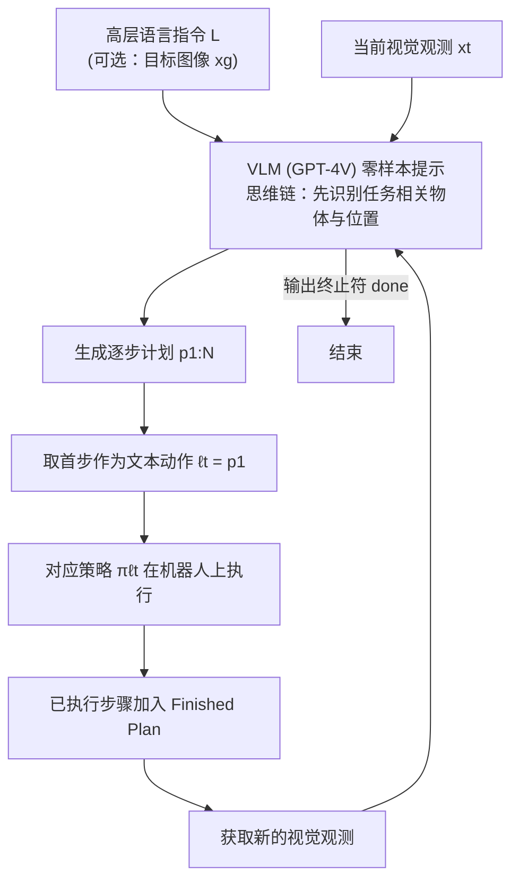

# Look Before You Leap（LBYL）

**Look Before You Leap（LBYL）**（[arXiv:2311.17842](https://arxiv.org/abs/2311.17842)）收录于 Lumina [Embodied-AI-Guide 微信专辑](../../wiki/overview/embodied-ai-guide-wechat-album-curator.md)。本页为独立详情节点；实验数字以原文为准。

## 一句话定义

**先「看明白」再动——感知主动化嵌入 LLM 规划环。**

## 英文缩写速查

| 缩写 | 英文全称 | 简要说明 |
|------|----------|----------|
| VLA | Vision-Language-Action | 视觉–语言–动作策略 |
| LLM | Large Language Model | 大语言模型 |
| IL | Imitation Learning | 模仿学习 |
| BC | Behavior Cloning | 行为克隆 |

## 流程总览

图依据：论文 §III-A/B / Fig.2、Algorithm 1。

## 核心信息

| 项 | 内容 |
|----|------|
| **机构** | — |
| **arXiv** | [2311.17842](https://arxiv.org/abs/2311.17842) |
| **开源** | 待核实 |

## 实验与评测

- **本页为索引级节点**（Lumina Embodied-AI-Guide 微信专辑）：正文固化定位与开源边界，**未转存原文实验表**。
- **回原文须核对的证据**：本页结论已点明「感知动作计入任务成本」——回原文须核对成功率是否**含主动感知的额外步数 / 时间开销**；不计开销只报成功率会高估该路线的收益。
- **读法：** 先对齐本体、任务集与成功判定，再读任何数字；勿把专辑摘要当实验结论。

## 与其他工作对比

| 维度 | 读法 |
|------|------|
| **对照工作** | 与开环 LLM 计划对照：后者一次成型不回看，本文用观测验证换取纠错能力，代价是额外的感知动作 |
| **横比口径** | 若基线不把感知开销计入成本，两者成功率不可直接比；须先统一成本口径再读差值。 |
| **开源状态** | **待核实** — 复现前以项目页 / 官方仓实际链接为准 |

## 结论

LBYL 强调计划必须可被观测修正。

- 与开环 LLM 计划对比
- 感知动作计入任务成本

## 源码运行时序图

**不适用**

## 关联页面

- [paper-saycan](./paper-saycan.md)
- [paper-voxposer](./paper-voxposer.md)

## 参考来源

- [wechat_lumina_embodied_practice_part1_llm_planner_2026-09-20.md](../../sources/blogs/wechat_lumina_embodied_practice_part1_llm_planner_2026-09-20.md)
- [arXiv PDF](https://arxiv.org/pdf/2311.17842)：已通读方法部分（实验与附录以略读为准）：§I 引言、§III 方法（问题定义、ViLa 流程、性质分析）

## 推荐继续阅读

- [arXiv:2311.17842](https://arxiv.org/abs/2311.17842)
