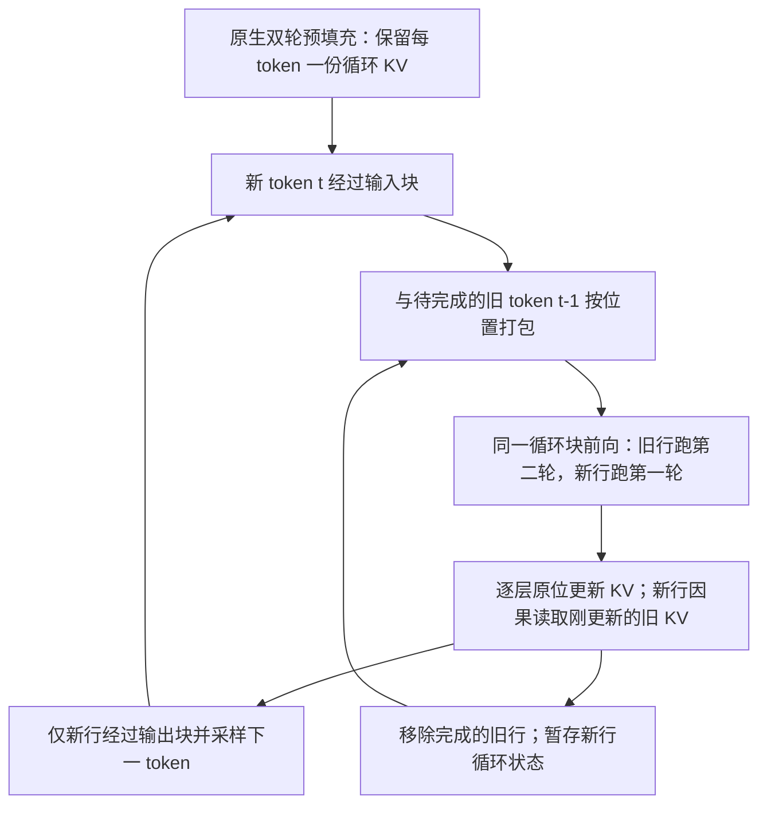
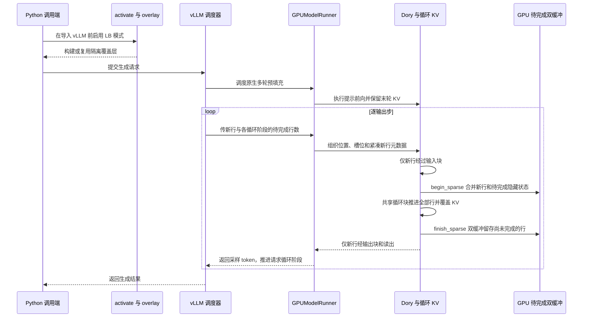

# Loop Behind: Rethinking Where Extra Loops Pay Off in Looped Language Models｜循环语言模型的后置循环解码

## 一句话定义

**Loop-Behind（LB）先为当前 token 读出下一 token 的分布，再把尚未完成的共享层循环放进后续解码步，让其产生的深层 KV 服务于之后的 token。** 不是删掉循环，也不是增加可见的思维链。

## 核心信息

| 项目 | 内容 |
| --- | --- |
| 作者与机构 | Xijie Gong、Tonghan Wang；清华大学人工智能学院 |
| 预印本 | 2026-11-23 · [作者 PDF](https://xijiegong.com/loopbehind.pdf) · [作者 HTML](https://huggingface.co/blog/XijieGong/loop-behind-rethinking-where-extra-loops-pay-off-i) |
| 模型 | Dory-4B 为主；Huginn-0125 验证；Ouro-1.4B Base 为架构反例 |
| 开放代码 | [XijieGo/LoopBehind](https://github.com/XijieGo/LoopBehind) 的 Dory vLLM 插件、速度基准及参考检查；不是完整论文评测栈 |

## 英文缩写速查

| 缩写 | 英文 | 本页含义 |
| --- | --- | --- |
| LoopLM | Looped Language Model | 在同一 token 的计算中反复应用共享 Transformer 层 |
| LB | Loop-Behind | 读出后继续推进该 token 的循环 |
| KV | Key–Value | 历史注意力键值；循环块可为同一历史 token 产出不同深度的 KV |
| TPOT | Time per Output Token | 每输出 token 的解码用时，与提示预填充时间分开 |
| FLOPs | Floating-Point Operations | 计算量；不等于串行深度或实际延迟 |

## 为什么重要

相同的额外循环有两个作用：改变当前预测，以及留下供许多后续位置读取的 KV。若后者占主导，就能保留总循环次数，同时缩短每个输出 token 必须等待的路径。这个区别适合用于分析长上下文推理服务；参数、总计算量、带宽和串行深度要分别记账。

## 核心机制与流程

Dory 的循环块在独立的输入块和输出块之间。原生解码在读出前串行跑完所有循环；LB 默认仍用原生多轮末轮缓存预填充提示，再切换到解码流水线。下图以两轮为例：旧行与新行不是两个并发独立请求，而是在同一次共享块前向中按 token 位置排序。

三轮以上时，最近的历史 token 未必已经写到最深的 KV。双轮时的新行可以读到紧邻旧行刚写出的二轮 KV。缓存是每个 token 每层一份循环 KV，另加待完成行的小状态缓冲，不是整个运行时的显存等同于单轮。

## 评测协议

**来源：论文图 2、表 2–4 / 8–9 及附录。** Dory 的 12 项准确率是各基准的平均（编码与工具调用、数学与科学、逻辑）；每题一次生成，温度 1.0、top-p 0.95。解耦试验固定历史输出块 KV 为原生单轮，隔离循环块历史 KV；当前 token 本地仍读取自身算出的键值。

## 对比与消融

| Dory-4B 干预 | 12 项平均准确率 | 相对单轮 |
| --- | --- | --- |
| 原生单轮 | 40.5% | 基线 |
| 当前双轮，只读历史第一轮 KV | 41.3% | +0.8 个百分点 |
| 当前单轮，读历史第二轮 KV | 47.3% | +6.8 个百分点 |
| 原生双轮（逐轮缓存） | 47.7% | +7.2 个百分点 |

在特意选出的 1,000 个单轮与双轮预测分歧位置上，单轮读深层历史 KV 更接近原生双轮的下一 token 分布（平均 KL 0.06，另一干预为 0.29）。这个受控干预并非 LB：它为历史位置按原生双轮构造 KV，而 LB 在解码过程中写入自己的 KV。

| Dory-4B 设置 | 12 项平均准确率 | KV（GiB） | 解码 TPOT（ms） | 预填充（s） |
| --- | --- | --- | --- | --- |
| 原生单轮 | 40.5% | 12.59 | 10.75 | 4.05 |
| 原生双轮（逐轮缓存） | 47.7% | 19.58 | 15.56 | 6.35 |
| LB-2 | 47.2% | 12.59 | 11.16 | 6.26 |
| 原生四轮（末轮缓存） | 48.5% | 12.59 | 25.02 | 11.01 |
| LB-4 | 48.3% | 12.59 | 11.15 | 10.65 |

速度与缓存列均为**单 H100、8K 上下文、批量 32、同步调度**；KV 列不含 LB-2 / LB-4 分别额外分配的 23 / 47 MiB 待完成缓冲。另一个**异步、带宽利用率更高**的测试中，16K / 批量 32 的 LB-4 对比原生四轮末轮缓存解码快 2.56 倍（31.13 → 12.15 ms），不代表首 token 或端到端加速。

- **Huginn-0125：** 总共跑 16 轮、第 8 轮读出，10 项平均 57.4%，与原生 16 轮持平；作者的单请求实现解码快 1.75 倍。
- **Ouro-1.4B Base：** 原生 2 / 4 轮为 59.6% / 66.9%，而两轮读深层历史 KV 为 51.8%。作者在 WikiText-2 观察到首层跨轮 key 漂移；Ouro 循环全栈且没有独立输入块，不能假定早轮查询能直接使用更深的历史 KV，论文未在 Ouro 上应用 LB。

## 官方插件运行时序

依据[固定提交的源码](../../sources/repos/xijiego-loop-behind.md)，下图为 Dory 的默认原生预填充与稀疏输入/输出实现。覆盖层激活和推理状态流分开；不涉及运行 Self-Spec 的验证与回滚。

## 工程实践与局限

- 要验证的是模型的跨轮 KV 兼容性与目标设备的实际瓶颈。带宽受限时，旧行、新行共享权重和历史缓存读流量；总循环计算不消失，在计算受限时收益缩小。论文的 32B / 64B 时延实验用随机权重，不支持大模型准确率外推。
- “等价”是与同样早读出、同样原位覆盖 KV 的顺序波前参考等价，不是与原生多轮生成逐 token 相同。报告服务性能时，应同时记录预填充、TPOT、尾延迟、显存与准确率；论文实现未覆盖前缀缓存和抢占能力验证。
- 源码已走读，未在 H100 重跑。论文没有机器人闭环实验；若用于具身语义层，需另外验证状态条件、动作质量与端到端时限，不把语言基准转换为控制成功率。

## 关联页面

- [通用循环模型与循环深度](../concepts/general-looped-models.md)
- [LLM 推理显存估算](../concepts/llm-inference-vram-estimation.md)
- [Inner Thinking Transformer](./paper-inner-thinking-transformer.md)：按 token 学习分配计算，与 LB 重排推理读出时序不同。
- [视觉语言动作模型](../methods/vla.md)：可为语言骨干研究调度，但不能直接套用到动作头。
- [Transformer 行为克隆](../methods/bc-with-transformer.md)：序列策略迁移时另测观测窗口、动作预测与闭环延迟。
- [模型架构纵深路线：Stage 5](../../roadmap/depth-model-architecture.md)

## 参考来源

- [论文通读归档](../../sources/papers/loop-behind.md)
- [官方插件源码归档与运行入口](../../sources/repos/xijiego-loop-behind.md)

## 推荐继续阅读

- 先对照作者 PDF 的图 2、算法 1 与附录 B / F，看清历史 KV 干预、后置解码与原生多轮是三种不同执行路径；再读表 8 / 9，比较同步与异步调度口径。
- [NVIDIA Dory-4B 模型卡](https://huggingface.co/nvidia/NVIDIA-Nemotron-Labs-Dory1.0-4B-BF16)：查看循环深度、滑窗与全注意力设置，再决定是否能迁移到其他架构。
