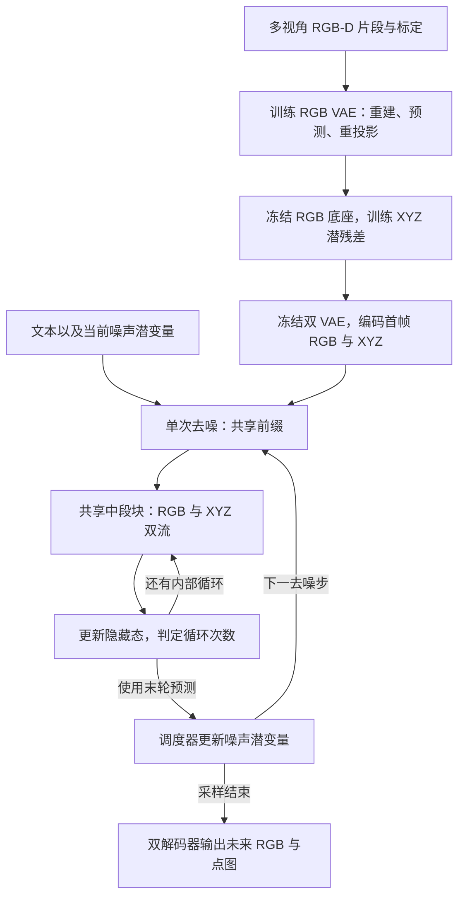

# Loop4D：用 4D VAE 与循环扩散 Transformer 建模具身世界
*Loop4D: Embodied World Modeling with 4D VAEs and Looped Diffusion Transformers*

## 一句话定义

Loop4D 接收首帧 RGB-D 和语言指令，预测未来 RGB 视频与相机坐标系 XYZ 点图；循环发生在**单个去噪步内部**，不是机器人动作闭环。

## 英文缩写速查

| 缩写 | 英文全称 | 简要说明 |
| --- | --- | --- |
| VAE | Variational Autoencoder | 变分自编码器，压缩视频或点图序列 |
| DiT | Diffusion Transformer | 在潜空间进行扩散预测的 Transformer |
| gFVD | Generative Fréchet Video Distance | 生成视频分布差异，越小越好 |
| AbsRel | Absolute Relative Error | 深度平均绝对相对误差，越小越好 |

## 为什么重要

视频压缩可能优先保留背景而损害运动中的机器人轮廓；并行预测点图可保留接触几何，而共享层细化可将参数量与有效深度分开衡量。

## 核心原理

1. **RGB VAE。** 保留整段重建，同时随机使用仅观察前缀的预测分支，将被遮住的未来潜变量补零，让同一解码器预测未来帧。用真值 XYZ、相机标定和共可见机器人像素做跨视角重投影监督，减少机械臂运动区域的压缩失真。
2. **几何 VAE。** 将相机系 XYZ 归一化到 RGB 输入范围，从训练好的 RGB VAE 初始化后冻结编解码器，只在潜空间训练零初始化残差适配器。几何监督包括 XYZ 误差、法向、深度与空间梯度，并限制潜变量偏离冻结底座。
3. **双流 LoopDiT。** 冻结两套 VAE 后训练生成器。RGB、XYZ 隐藏态分开但共享 Transformer 权重，RGB 特征经停止梯度的横连注入 XYZ。单个去噪步的文本、首帧和噪声时间不变；共享中段块循环传递隐藏态，后缀和预测头的输出不回灌到循环。
4. **受控细化。** 每轮都有流匹配监督，若当轮机器人区域误差比上轮增大则加惩罚；第二轮起共享门控按样本和模态分别给出标量更新幅度，首轮完整更新。

图为原文方法级训练与采样流程，不是代码调用时序；每轮训练读出用于监督而不改变循环状态。

## 实验与评测

| 口径 | 论文报告 | 应怎样解读 |
| --- | --- | --- |
| 表 1，VAE 重建 | 仿真 / 真机场景深度 AbsRel 为 0.0109 / 0.0080 | 优于表中其他 VAE，但 rFVD 并非最优 |
| 表 2，仿真未来生成 | 1.3B 的 gFVD/gFID 为 449.33/49.37，5B 为 421.04/41.96 | 1.3B 在此优于所列 Wan2.1-14B、LTX-2.3 22B；不可外推到真机场景 gFVD |
| 表 2，真机场景未来生成 | 5B 的 gFID 41.63、AbsRel 0.0831，gFVD 721.24 | 这里的真机是数据来源；Wan2.1-14B 的 gFVD 668.84 更低 |
| 表 3，仿真执行 | Loop4D 10/30（33.3%），Robot4DGen 5/30（16.7%），Diffusion Policy 3/30（10.0%） | 每任务仅 10 次；三类任务匹配演示和初始条件，单项列是 0–1 比例而平均列为百分数 |
| 表 6，5B 固定 50 去噪步 | 加两轮中段循环后，gFVD 618.032 → 511.161，耗时 21.84 → 29.40 秒/视频 | 参数不随循环倍增，但计算和时延上升；本表是独立消融，不与表 2 的 gFVD 混算 |
| 表 6，1.3B 固定 50 去噪步 | gFVD 631.435 → 606.496，几何阈值准确率 93.88% → 92.44%，耗时 36.92 → 49.93 秒/视频 | 不是所有指标都会随循环改善，也不保证小模型更快 |

生成评估采用 Robot4DGen 的 3 个仿真、4 个真机采集任务，生成分辨率 640 × 480；生成指标排除条件首帧。仿真任务是谷物盒、锅铲、苹果，Loop4D 分别成功 5/10、2/10、3/10。图 8 的 5B 消融里，中段循环优于同宽度早段、晚段与整骨干循环，使用两轮表现最好，增加轮次无稳定收益；近似等推理 FLOPs 时，内部循环优于单纯增加去噪步数，但未证明总是适用。

## 与其他工作对比

与 RGB-only 视频生成器相比，Loop4D 同时输出点图；没有几何预测的基线不参与深度指标排名。与 Robot4DGen 相比，Loop4D 复用任务和执行评测，但把改进重点放在潜表示和去噪内部计算。与通用 LoopedDiT 相比，Loop4D 额外约束机器人区域并对两种模态分别门控，不直接复用其效果结论。

## 结论

用更适合操作视频的压缩和双流细化可以改善部分生成指标；在已测任务内它也提升仿真成功率，但资源开销、真实控制与跨任务迁移仍需分别验证。

## 工程实践

复核时分开记录重建、去掉条件首帧后的生成、以及轨迹恢复后执行三层指标。测循环开销时先固定分辨率、序列长度、去噪步和硬件，再分别记录 FLOPs 与实际秒数；若改为等预算对照，应单列采样步数。

## 局限与风险

- 预测 RGB/几何不等于直接输出控制量，更不等于验证了物理约束。论文的下游执行依赖从生成帧中恢复轨迹并控制，误差不能只归于生成器；未展示 Loop4D 真机闭环。
- 更高的重建分数不保证更好生成。表 4 中移除预测重建使重建 rFVD 由 22.77 降为 19.01，但相应生成 FVD 由 588.7 升为 697.5。
- 截至 2026-11-27，未找到可确认归属的官方项目页、源码或权重；未运行模型或复现结果。

## 关联页面

- [生成式世界模型](../methods/generative-world-models.md)：对照首帧与语言条件下的预测、动作条件生成以及闭环控制。
- [机器人操作](../tasks/manipulation.md)：将生成质量、轨迹回收与任务成功率作为相互独立的验收。
- [通用循环模型](../concepts/general-looped-models.md)：同参数反复计算是共同思想；这里重复的是一次扩散去噪内的中段隐藏态，而不是生成推理 token。
- [Robot4DGen](./paper-geometry-aware-4d-video-generation.md)：提供对照数据与执行路线；Loop4D 的重点是更适合操作运动的 VAE 及共享层细化。

## 参考来源

- [论文原始资料及核对记录](../../sources/papers/loop4d_arxiv_2611_34199.md) · [arXiv v1 HTML](https://arxiv.org/html/2611.34199v1) · [arXiv v1 PDF](https://arxiv.org/pdf/2611.34199v1)

## 推荐继续阅读

先看原文图 3 区分两层循环，再读图 8(c) 的等预算对照；若目标是部署操作策略，接着读 [Robot4DGen 的轨迹解析路径](./paper-geometry-aware-4d-video-generation.md)。
