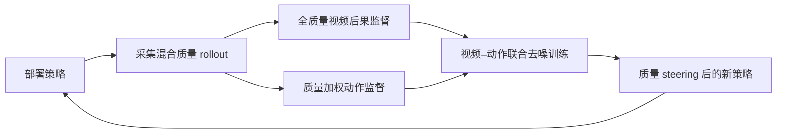
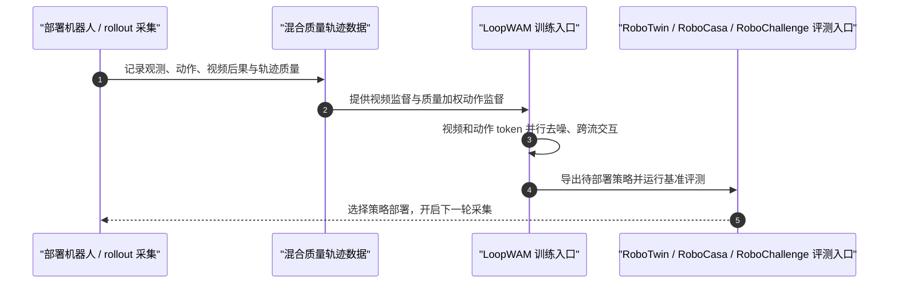

# LoopWAM：从部署 rollout 闭环改进通用策略

**LoopWAM**（*Closed-Loop Generalist Policy Improvement from Deployment Rollouts*，arXiv:2610.18873）是一种从部署经验持续改进通用机器人策略的世界–动作模型：成功、次优和失败 rollout 都用于世界建模，动作模仿强度则按轨迹质量调节。

## 英文缩写速查

| 缩写 | 英文全称 | 简要说明 |
|------|----------|----------|
| WAM | World Action Model | 联合预测未来视觉与机器人动作的模型 |
| VLA | Vision-Language-Action | 以视觉和语言条件生成机器人动作的模型 |
| RL | Reinforcement Learning | 用环境反馈持续优化策略的方法 |
| DiT | Diffusion Transformer | LoopWAM 视频与动作并行去噪所用的扩散 Transformer 架构 |
| SR | Success Rate | 任务成功率，需结合各基准的任务数与协议解读 |

## 为什么重要

- 部署轨迹天然混有成功、次优和失败行为。把所有动作都当专家演示会强化坏动作，直接丢弃失败又会损失其提供的物理后果信息。
- LoopWAM 把“学习动作”和“学习动作后果”分开利用：视频监督覆盖不同质量的 rollout，动作模仿由质量信号控制。
- 多轮部署结果显示，真实 rollout 可以成为策略改进数据源，而不只是验收日志。

## 方法

1. **收集混合经验。** 汇集 LoopWAM 自身及其他已部署策略生成的成功、次优、失败轨迹，并标记来源与质量。
2. **保留视频后果监督。** 不因动作失败而丢弃视频轨迹，学习动作条件下的视觉后果；不同来源使用 source-dependent noise sampling。
3. **质量调节动作学习。** 质量 steering 指定推理目标质量，quality-weighted supervision 控制动作模仿强度，失败 rollout 不直接贡献动作模仿损失。
4. **联合去噪与部署迭代。** 视频和动作 token 在并行去噪的各层交互，使世界预测所学到的结果参与动作生成；部署新策略并把 rollout 加回训练集。

## 流程总览

## 源码运行时序图

仓库 README 提供环境、数据、训练与三类 benchmark 评测入口；图中表示 README 描述的运行闭环，具体命令与配置应以[官方仓库](https://github.com/loop-wam/LoopWAM)当前版本为准。

## 实验与评测

| 基准 | 报告结果 | 读法 |
|------|----------|------|
| RoboChallenge Table30-V2 | 三轮部署训练后成功率 23.67%→43.33%，提升 19.7 个百分点；综合分 56.80 | 展示部署驱动改进，成功率与综合分是不同指标 |
| RoboTwin 2.0 | 平均成功率 94.5% | 50 项双臂任务；未使用额外具身预训练 |
| RoboCasa365 | 总体成功率 49.5% | 365 类任务总体结果；未使用额外具身预训练 |
| Shirt folding | 两轮部署改进后 13.20%→55.56% | 单任务后训练后的部署改进案例 |

论文报告在所比较方法中三项基准总体表现领先。RoboChallenge 的三轮提升来自部署与训练交替；不要把它与固定训练的一次性离线对比混为一谈。

## 结论

**LoopWAM 的关键取舍是：失败动作可以不模仿，但失败带来的视觉后果仍值得学习。**

1. **分开处理后果与动作。** 失败轨迹保留视频监督，避免把失败动作作为正例。
2. **按质量调节动作信号。** steering 决定期望策略质量，quality-weighted supervision 控制不同轨迹对动作学习的贡献。
3. **把 rollout 视作训练数据。** 多轮部署与再训练带来明显增益，尤其适合已有真实部署和数据回流能力的团队。
4. **联合建模服务动作选择。** 视频和动作 token 每层交互，让后果预测参与动作生成，而不是只在训练后独立做世界预测。
5. **核对基准协议。** RoboTwin、RoboCasa 与真机挑战集的成功率、任务组成和评测分数不可直接横向比较。

## 与其他工作对比

| 对照 | 差异 |
|------|------|
| [WAM-TTT](./paper-wam-ttt-human-video-test-time-steering.md) | WAM-TTT 在推理期用人类视频作测试时 steering；LoopWAM 在部署后收集机器人 rollout 并更新模型 |
| [Motus2](./paper-motus2.md) | Motus2 用共享 WAM 的策略、模拟器和评估器支撑测试时分支搜索；LoopWAM 通过多轮数据回流做训练期改进 |
| [World Action Models](../concepts/world-action-models.md) | LoopWAM 是联合视频–动作建模中显式利用部署质量信号的一条闭环路线 |

## 工程实践

- **适用条件：** 有稳定 rollout 采集、轨迹质量估计和周期训练能力；单次离线数据集无法直接复现其部署飞轮收益。
- **数据字段：** 至少应保留轨迹来源、成功/质量标签、观测视频和动作时序，以区分视频监督与动作模仿。
- **评估建议：** 每一轮都用固定独立种子集评估，并同时记录任务成功率、综合分、失败类型及数据来源。
- **开放状态：** [官方仓库](../../sources/repos/loopwam.md)已公开训练与评测入口；具体权重和数据的可获取性以仓库 README 为准。

## 局限与风险

- 混合质量监督依赖有用的质量信号；质量标注偏差会影响动作权重和 steering 目标。
- 部署闭环涉及真实机器人安全、数据治理和训练资源，论文分数本身不能替代硬件风险管理。
- 真机 Table30-V2 结果对应有限任务集与特定实验设置；尚不足以推断任意机器人、任务都能获得同等提升。

## 关联页面

- [World Action Models](../concepts/world-action-models.md)
- [Model-Based RL](../methods/model-based-rl.md)
- [Manipulation](../tasks/manipulation.md)
- [WAM-TTT](./paper-wam-ttt-human-video-test-time-steering.md)

## 参考来源

- [LoopWAM 论文摘录](../../sources/papers/loopwam_arxiv_2610_18873.md)
- [LoopWAM 项目页](../../sources/sites/loop-wam-project.md)
- [LoopWAM 官方仓库](../../sources/repos/loopwam.md)

## 推荐继续阅读

- [LoopWAM 项目页](https://loop-wam.github.io/)
- [LoopWAM 官方代码](https://github.com/loop-wam/LoopWAM)
- [arXiv:2610.18873](https://arxiv.org/abs/2610.18873)
