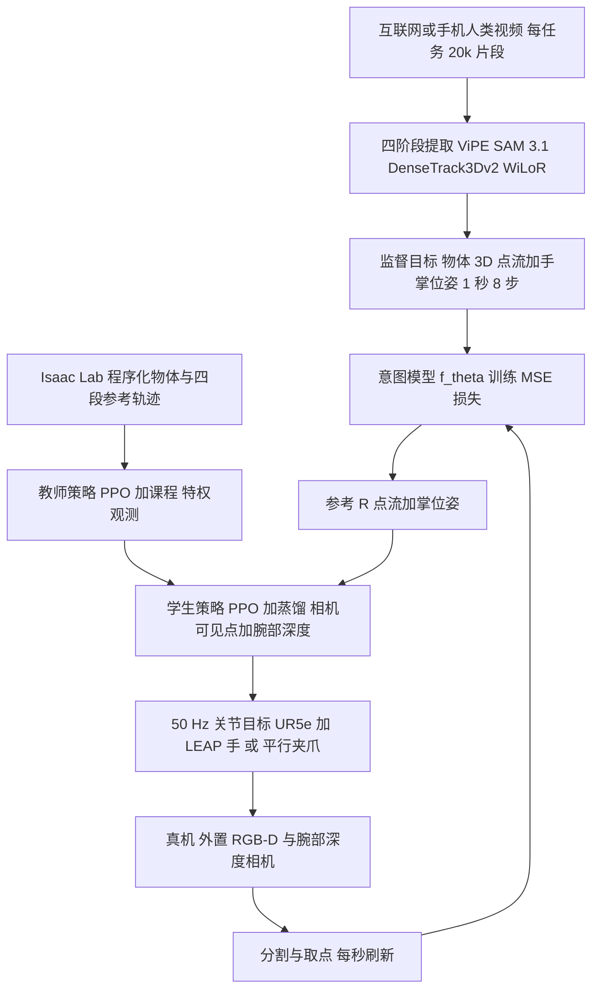

# LUCID（arXiv:2606.11628）：从非结构化人类视频学与本体无关的意图模型

## 一句话定义

**LUCID**（*LUCID: Learning Embodiment-Agnostic Intent Models from Unstructured Human Videos for Scalable Dexterous Robot Skill Acquisition*，[arXiv:2606.11628](https://arxiv.org/abs/2606.11628)）把「要让场景发生什么变化」（意图）与「机器人怎么做到」（控制）拆开：意图模型从互联网人类视频学习，预测未来 1 秒的物体 3D 点流与手掌位姿；感知运动策略在 Isaac Lab 大规模并行仿真里用单一任务无关奖励训练，在真机上跟踪该参考，且每秒重新预测一次意图（闭环）。作者：Harsh Gupta、Guanya Shi、Wenzhen Yuan。

> 注意：库中另有一篇缩写同为 LUCID 的论文（[paper-lucid](paper-lucid.md)，Latent-Skill Unified Control，人形 loco-manipulation，arXiv:2608.07746），与本文无关。

## 英文缩写速查

| 缩写 | 英文全称 | 简要说明 |
|------|----------|----------|
| LUCID | 论文题名缩写 | 本文方法；论文未在正文展开缩写 |
| SE(3) | Special Euclidean group in 3D | 三维刚体位姿（旋转加平移），手掌位姿的表示 |
| MANO | hand Model with Articulated and Non-rigid defOrmations | 参数化人手网格，WiLoR 输出 |
| RGB-D | Red-Green-Blue plus Depth | 彩色加深度图像 |
| PPO | Proximal Policy Optimization | 教师训练与学生蒸馏中的 RL 算法 |
| DR / ADR | (Adaptive) Domain Randomization | 域随机化 / 按课程标量插值的自适应域随机化（附录 B.6） |
| EMA | Exponential Moving Average | 动作目标平滑与权重滑动平均 |
| PD | Proportional-Derivative | 关节低层控制器 |
| LEAP Hand | Low-cost, Efficient, Anthropomorphic Hand | 论文主要使用的 16 自由度灵巧手 |
| AME | 论文引用的交叉注意力架构 | 源自足式运动，本文改为以物体查询点作 token |

## 为什么重要

- 机器人操作常依赖遥操作演示或结构化人类采集（动捕、可穿戴、手持夹爪），采集成本随操作员时间线性增长（§1）。LUCID 的路线是让两种各自可扩展的监督源配对：互联网人类视频给意图，仿真给控制，全程不需要遥操作（§6）。
- 与「开环视频生成规划」相比，意图每个周期从当前观测重预测，抓偏或物体被推走后可纠正（§4.1）。
- 同一个意图模型的输出，被灵巧手和平行夹爪两个本体各自的策略使用，且成功数相同（19/30 对 19/30，§4.3）。

## 核心原理与流程总览

- **意图模型（§3.1，附录 A.2，表 1）：** 输入最近 F=2 帧 RGB-D，N=16 个物体查询点与当前掌位姿；预测未来 T=8 步（1 秒）的点位置和掌位姿，损失是点流、掌位置、掌旋转三项均方误差之和。冻结 DINOv3 ViT-B/16 编码 RGB，深度走零初始化残差适配器；主干为 CoTracker3 的 EfficientUpdateFormer，改为向前预测并增加一个掌 token。对人手像素做重度外观增广（概率 0.6），使模型不依赖示范者手的外观，因为部署时画面里的手是机器人（§3.1，附录 A.2.3）。
- **感知运动策略（§3.2，附录 B）：** 参考轨迹由程序生成，分四段（接近 2.5 s、手内运动 0-7.5 s、目标 3.0 s、撤离 2.5 s，表 3），不使用 fθ 或人类视频。动作含机械臂 6 维关节增量、5 维 eigen-grasp 系数（由重定向的人类抓取主成分得到）与 16 维手部残差。奖励以物体点跟踪为主信号，掌位姿跟随与指尖接触为塑形项（表 6）。教师特权观测，学生只用相机可见点流和 80x60 腕部深度图；PPO 加蒸馏的混合目标，蒸馏权重 λD 在前 1000 个 epoch 内由 1.0 线性退火到 0.1（附录 B.5，表 8）。
- **闭环执行（§3.3，表 11）：** 意图周期 1 Hz，策略 50 Hz，期间用滑动窗 3D 点跟踪器（30 Hz）保持当前点位置；一旦前瞻窗口走完 1 秒参考就重新查询 fθ。

## 工程实践

- **算力与硬件：** 监督提取和意图模型训练在 A100 节点（附录 A.2.2）；教师 PPO 与学生蒸馏各用单张 RTX 5090，教师 20,480 个并行环境，学生 2,048 个（附录 B.5，表 8）；部署栈全部跑在单张 RTX 5090（附录 B.8）。机器人为 UR5e 加 LEAP Hand，用 CMA-ES 对关节做系统辨识（附录 B.7）。
- **每任务单独的意图模型：** 每个任务要单独训练一个意图模型，并需要人工筛选语料（附录 A.2.2，§5）；训练设置为 AdamW、100 epoch、batch 16、学习率 1e-4（表 2）。
- **腕部深度：** 部署时用 Fast-FoundationStereo 处理红外对，而非传感器自带深度（附录 B.8，图 10）。
- **推测（非论文所述）：** 想复现需要同时跑通 ViPE、SAM 3.1、DenseTrack3Dv2、WiLoR 等多个上游模型和 Isaac Lab 训练，工程量不小；论文与摘要均未给出代码仓库地址，本页因此不写 `code:`。

## 评测证据与清单说法的对比核对

清单一句话摘要（作者说由 LLM 据摘要起草）：「Learns embodiment-agnostic intent from unstructured internet human videos, executed by a tracking policy trained in simulation.」

- **「非结构化互联网人类视频」：** 大体属实，但分两种。三个任务（搅拌、擦拭、装箱）每任务 20k 个片段，来自 Panda-70M 等公开视频集，以 YouTube 在野视频为主（§3.1，附录 A.1.1）；另两个任务（Push-T、线缆布线）用自己用手机录的约 1 小时视频（摘要、§4.3、§3.1「约 100 条」）。清单没提这后一半。
- **「与本体无关」：** 这是论文的主张，证据是同一个意图模型的输出被两种本体各自的策略使用（灵巧手与平行夹爪，各 19/30，§4.3）。限定词：只验证了两种本体、只在 Push-T 与线缆布线两个手机视频任务上；感知运动策略仍是每种本体各训一个（§3.2）；意图中的掌位姿是人手的，对夹爪要靠对齐闭合轴的手工映射（附录 C.1）。我的判断：「与本体无关」在这里是「接口共享」，不等于零适配。
- **「由仿真中训练的跟踪策略执行」：** 属实：Isaac Lab 里用 PPO 训练教师，再蒸馏学生，跟踪的是物体点流和掌位姿参考（§3.2）。真机是 UR5e 加 LEAP 手或夹爪（附录 B.7、C.1）。
- **清单没有说到的关键点：** (1) 意图每秒闭环重预测，与开环视频规划对比是论文的主要实验（§4.1）；(2) 真机共 5 个任务，网络视频任务每场景仅 10 次试验，自录视频任务每本体每任务 15 次（§4.1、§4.3），样本量小；(3) 开环基线是 Veo 3.1 生成视频规划加同一策略，生成视频还被人工过滤（附录 C.1）；(4) 每任务单独训练意图模型。
- **结果确实在论文里：** 73% 对 28% 可由图 12 的计数核对（66/90 对 25/90）；该数字是网络视频三任务平均，不含手机视频任务。

## 结论

LUCID 以短时三维意图连接人类视频与闭环控制，收益依赖上游感知质量及任务语料。

- 分别验收点跟踪、掌位姿和控制器，避免把感知失败归于策略本身。
- 为缺少自然终止条件的任务设置外部停止规则，并计入人工语料筛选成本。
- 对精细接触与新任务补做验证，三维点流接口不能完整表达手指构型和接触力。

## 局限

**作者自述（§5）：**

1. 管线脆弱：SAM 3.1、DenseTrack3Dv2、ViPE、WiLoR 任何一环出错都会沿链传到策略；遮挡和无纹理物体尤其如此。
2. 任务条件缺口：没有可验证终止条件的任务会让意图模型无限循环（搅拌需外部停止）；新任务需人工筛选语料。
3. 手工设计的 3D 点流加掌位姿接口有损，丢失手指构型和精细接触信息。

**我看到的未验证之处（判断，非作者自述）：**

- 样本量：每个场景 10 次试验，没有置信区间或多种子汇报；仿真消融用 3 个种子（§4.4）。
- 对比基线只有一个开环视频规划器（Veo 3.1），并且生成视频经人工过滤和重采样（附录 C.1）；没有与其他「人类视频到灵巧手」方法在同任务上的对比。
- 失败集中在感知丢失与不可恢复状态（图 12），说明性能瓶颈部分在上游感知，而非意图或控制本身；作者对 Push-T 与线缆布线的失败归因于 1 小时手机语料偏小，这是推断，论文用「likely」措辞（§4.3）。
- 缩放结论只覆盖装箱任务 1k 到 20k 片段，作者自己承认无法外推（附录 C.3）。
- 「涌现的任务组合」（擦完后把纸巾丢进垃圾箱，§4.1）是定性观察，作者归因于语料中混有装箱片段，未做对照。

## 关联页面

- [PPO](../methods/ppo.md)：教师训练与学生混合目标中的 RL 算法
- [教师-学生与 DAgger 训练](../methods/teacher-student-dagger-training.md)：学生蒸馏与 DAgger-BC 对照的背景
- [模仿学习](../methods/imitation-learning.md)
- [域随机化](../concepts/domain-randomization.md)
- [课程学习](../concepts/curriculum-learning.md)
- [Sim2Real](../concepts/sim2real.md)
- [Isaac Lab](isaac-lab.md)
- [Masquerade](paper-notebook-masquerade-learning-from-in-the-wild-human-video.md)：另一条「在野人类视频」路线
- [HOST：单条人类视频习得操作](paper-host-one-shot-human-video.md)
- [DexCap](paper-notebook-dexcap-scalable-and-portable-mocap-data-collecti.md)：论文引为「结构化人类采集」的代表
- [同名缩写的另一篇 LUCID](paper-lucid.md)（无关）

## 参考来源

- [来源归档：lucid_arxiv_2606_11628.md](../../sources/papers/lucid_arxiv_2606_11628.md)
- [arXiv:2606.11628](https://arxiv.org/abs/2606.11628)
- [项目页（论文摘要所列）](https://lucid-robot.github.io/)

## 推荐继续阅读

- [arXiv PDF](https://arxiv.org/pdf/2606.11628v1)
- [PPO 方法页](../methods/ppo.md)
- [Sim2Real 概念页](../concepts/sim2real.md)
