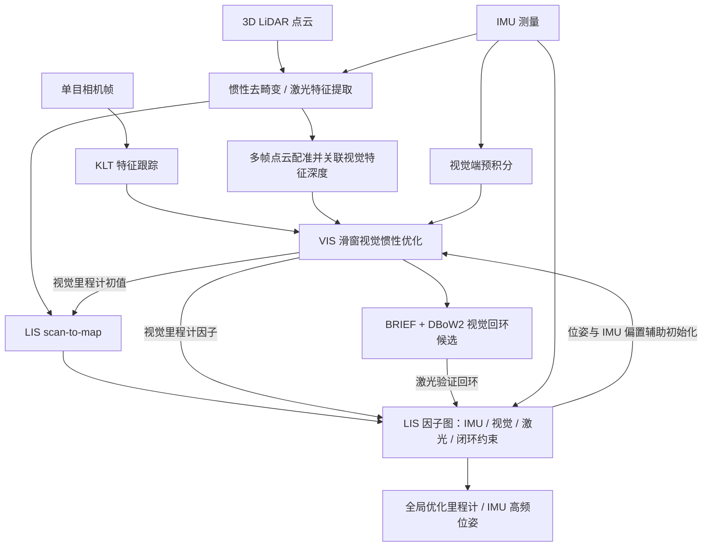

# LVI-SAM：通过平滑与建图紧耦合激光、视觉和惯性

## 一句话定义

LVI-SAM（Tixiao Shan et al., ICRA 2021）组合视觉-惯性系统 VIS 和激光-惯性系统 LIS，使激光为视觉初始化/特征深度提供约束，视觉为激光扫描匹配/闭环提供信息，再经因子图全局优化输出位姿。

## 英文缩写速查

| 缩写 | 英文全称 | 简要说明 |
|------|----------|----------|
| LVI-SAM | Lidar-Visual-Inertial Odometry via Smoothing and Mapping | 本项目：激光-视觉-惯性紧耦合定位建图 |
| VIS | Visual-Inertial System | 视觉特征、图像关键帧及 IMU 滑窗估计 |
| LIS | Lidar-Inertial System | 激光去畸变、点线面特征、scan-to-map、图优化 |
| IMU | Inertial Measurement Unit | 提供预积分运动约束与高频传播 |
| VIO | Visual-Inertial Odometry | 基于图像和惯性量测的局部状态估计 |
| LIO | Lidar-Inertial Odometry | 基于 LiDAR 和惯性量测的局部状态估计 |
| iSAM2 | Incremental Smoothing and Mapping 2 | GTSAM 增量式因子图优化器 |
| KLT | Kanade–Lucas–Tomasi | 用于连续图像特征跟踪 |
| DBoW2 | Distributed Bag of Words 2 | 视觉回环候选检索方法 |
| RMSE | Root Mean Square Error | 轨迹相对 GPS 的均方根误差 |

## 为什么重要

- 纯 VIO 在纹理不足、光照突变、剧烈运动、低激励初始化时可能失败；纯 LIO 在平坦空旷或缺少几何结构时 scan-to-map 约束退化。
- 论文采用两套可以各自工作、相互传递信息的子系统，而不是强行将所有原始量测塞进同一求解入口；LIS 以因子图进行全局一致性优化。
- 对机器人实装而言，**传感器之间传递什么、何时拒绝退化观测**，比堆叠传感器数量更有价值。

## 核心信息

| 字段 | 核实结果 |
|------|----------|
| 原论文 | [arXiv:2104.10831v2（2021-05-30）](https://arxiv.org/pdf/2104.10831) |
| 发表 | ICRA 2021，Tixiao Shan、Brendan Englot、Carlo Ratti、Daniela Rus |
| 机构 | 麻省理工学院（MIT）、史蒂文斯理工学院（Stevens Institute of Technology） |
| 官方源码 | [TixiaoShan/LVI-SAM](https://github.com/TixiaoShan/LVI-SAM)；本次核对 master `0d822f6` |
| 传感器 | 单目相机、3D LiDAR、IMU；论文评测采用 GPS 轨迹作对照 |
| 核心参考实现 | VIS 继承 VINS-Mono 线路，LIS 继承 LIO-SAM 线路 |

## 核心原理与方法

### VIS：视觉与惯性估计

1. **特征追踪：** 检测角点，使用 KLT 光流跨帧追踪，维持滑动窗口。
2. **借 LIS 初始化：** 论文指出低加速度激励使纯视觉惯性尺度和 IMU 偏置初始化困难；先初始化 LIS，将其位姿和 IMU 偏置按图像关键帧时间戳插值，作为 VIS 优化初值。
3. **激光辅助特征深度：** 将经位姿配准的多帧激光点累计为深度点，映射到以相机为中心的单位球面，在球面附近查找三个深度点，求该平面与视觉射线交点的深度；深度一致性检验拒绝歧义匹配。
4. **联合残差：** 在滑窗优化中结合 IMU 预积分、无深度视觉重投影和有深度视觉特征。
5. **失败检测与回环：** 视觉跟踪点不足或 IMU 偏置异常时报告 VIS 失败并重初始化；使用 BRIEF + DBoW2 查回环候选，将候选传给 LIS 进一步验证。

### LIS：激光与惯性估计

1. IMU 辅助点云运动去畸变，提取激光边缘/平面特征。
2. 将当前激光帧与滑窗局部特征地图做 scan-to-map 匹配；VIS 里程计可作为扫描匹配的初值，视觉失败时回退 IMU 传播。
3. 通过 IMU 预积分、视觉里程计、激光里程计、回环这四类约束形成因子图，并以 iSAM2 优化。
4. 检测扫描匹配正规方程的退化特征值；判定约束不可信时不将对应激光里程计因子加入图。
5. 优化后的状态和 IMU 偏置再馈送 VIS，优化后偏置用于更稳定的 IMU 频率位姿传播。

## 流程总览（依据论文 Fig. 1、2、5）



说明：图描述**论文的体系结构与数据关系**，不是主线程的顺序执行图；实际 ROS 源码按多个异步节点/回调工作。

## 源码运行时序图

官方 ROS1 入口：`roslaunch lvi_sam run.launch`；`launch/run.launch` 进一步包含 `module_sam.launch`，后者启动七个主要可执行节点及图像 compressed→raw republish。下图按官方源码中订阅/发布的话题与函数核对（master `0d822f6`，未执行 rosbag）。

```mermaid
sequenceDiagram
    autonumber
    participant Sensors as 传感器和 rosbag
    participant IP as imageProjection.cpp
    participant FE as featureExtraction.cpp
    participant MO as mapOptmization.cpp
    participant IM as imuPreintegration.cpp
    participant FT as feature_tracker_node.cpp
    participant VE as estimator_node.cpp
    participant LOOP as loop_detection_node.cpp
    Sensors->>IP: pointCloudTopic 与 imuTopic
    Sensors->>IM: imuTopic
    Sensors->>FT: IMAGE_TOPIC 图像
    IP->>IP: cloudHandler 去畸变与点云投影
    IP->>FE: PROJECT_NAME/lidar/deskew/cloud_info
    FE->>FE: calculateSmoothness / extractFeatures
    FE->>MO: PROJECT_NAME/lidar/feature/cloud_info
    FT->>FT: img_callback 执行特征跟踪
    FT->>VE: PROJECT_NAME/vins/feature/feature
    Sensors->>VE: IMU_TOPIC
    IM-->>VE: odometry/imu 供初始化与估计
    VE->>VE: process 线程内调用 Estimator::processIMU 和 processImage
    VE-->>IP: PROJECT_NAME/vins/odometry/imu_propagate_ros
    MO->>MO: laserCloudInfoHandler / updateInitialGuess / scan-to-map
    MO->>MO: 关键帧与因子图优化
    MO-->>IM: PROJECT_NAME/lidar/mapping/odometry
    VE-->>LOOP: vins/odometry/keyframe_pose 与 keyframe_point
    LOOP->>LOOP: process / DBoW 视觉回环检测
    LOOP-->>MO: PROJECT_NAME/vins/loop/match_frame
    MO->>MO: 回环约束验证和图优化
```

**源码核对范围：** `README.md`、`launch/run.launch`、`launch/include/module_sam.launch`、`src/lidar_odometry/{imageProjection.cpp,featureExtraction.cpp,imuPreintegration.cpp,mapOptmization.cpp}`、`src/visual_odometry/visual_feature/feature_tracker_node.cpp`、`visual_estimator/{estimator_node.cpp,estimator.cpp}`、`visual_loop/loop_detection_node.cpp`。核对启动入口、主要话题、关键回调与处理流程；未逐行审阅第三方库及全部优化器内部细节。

## 实验与评测

论文 §III 使用自采 Urban、Jackal、Handheld 三组数据，和 VINS-Mono、LOAM、LIO-mapping、LINS、LIO-SAM 比较。**应区分同一测试中的 RMSE（相对 GPS）和起终点平移/旋转闭合误差：二者不可互换。**

| 原文实验 | 条件 | 结果 |
|---------|------|------|
| Urban 消融 A3（无回环） | VIS+LIS，禁用视觉特征深度 / 启用深度 | 起终点平移误差 **45.42 → 32.18 m**，改善约 29%（Table I） |
| Urban 消融 A4 | 全部模块启用、闭环开启 | 起终点平移误差 **0.28 m**；旋转 **5.77°**（Table I） |
| Jackal（有回环） | 论文 Table II | LVI-SAM GPS 轨迹 RMSE **0.67 m**，起终点平移 **0.11 m**、旋转 **1.52°** |
| Handheld（有回环） | 论文 Table II | LVI-SAM GPS 轨迹 RMSE **0.83 m**，起终点平移 **0.27 m**、旋转 **3.82°** |

论文中的 GPS 在实验对照中被用作参考轨迹；**不要据此理解为这组结果必须用 GPS 传感器参与在线 VIO/LIO 融合**。本文实验环境与传感器参数有限，不能外推出任意车辆/室内场景的通用精度。

## 结论

**总判：LVI-SAM 的主要价值是对 VIS 和 LIS 的双向帮助与退化场景回退，而非简单地增加传感器。**

1. **初始化**：静止/低激励时优先关注视觉惯性尺度与偏置的可观性；作者使用 LIS 初值辅助 VIS。
2. **视觉深度**：激光深度帮助减少滑窗 VIO 的尺度漂移，但深度关联必须验证几何一致性。
3. **退化检测**：要拒绝低置信度视觉与激光约束，避免单模块失败把全局图优化一起拖垮。
4. **闭环**：视觉擅长回环召回，激光扫描匹配可提供进一步几何验证。
5. **读数**：不应把 Urban 起终点误差 0.28m 误写为平均 ATE；详见原论文 Table I/II。

## 与其他工作对比

| 系统 | 主模态与特色 | LVI-SAM 的补充 |
|------|--------------|----------------|
| [VINS-Fusion](./vins-fusion.md) / VINS-Mono | 基于视觉、IMU 的滑窗优化（VINS-Fusion 还支持其他传感器/全局融合） | 激光点云提供尺度、特征深度与几何初值 |
| [LIO-SAM](./lio-sam.md) | 激光和 IMU 因子图优化 | 视觉里程计先验、视觉回环候选、弱几何退化场景互补 |
| 纯激光 LOAM | 以激光几何匹配为核心 | 在空旷平面弱几何条件下由视觉约束补充可观性 |

## 工程实践

1. 在 ROS1 catkin 工作空间准备 GTSAM、Ceres 等依赖；作者 README 测试环境为 ROS Kinetic/Melodic（不等于直接兼容 ROS2 Humble）。
2. 检查 `config/params_lidar.yaml`、`config/params_camera.yaml`：坐标外参、时间同步、相机内参、IMU 噪声以及话题名；标定参数错误会放大融合误差。
3. `catkin_make` 后以 `roslaunch lvi_sam run.launch` 启动，用官方数据集 `rosbag play handheld.bag` 驱动；README 提示 bag 为压缩图像时可启用对应 republish。
4. 重点监测：VIS 特征数量/重初始化、LIS scan-to-map 退化、时间戳延迟、滑窗计算时延、回环误匹配，以及轨迹起终点误差与 GPS-RMSE 的区别。

## 局限与风险

- **原论文的可观性/退化边界**：缺纹理和缺几何不能互相无条件补偿；低激励、严重模态故障、时间/外参不准仍是风险。
- **代码与论文实现边界**：官方 README 的 TODO 明确提出仍需更新 `imuPreintegration.cpp` 中全部三类因素的图优化实现，提示“论文体系框架”与“现有代码内部实现细节”应分别核对，不可默认每个论文所述耦合因子均以同样方式在源码中集中实现。
- **复现边界**：论文给出特定数据集的轨迹误差，未证明机器人任意速度、任意环境下都同等稳健；源码 ROS1 环境及旧版依赖需要适配。
- **源码审查边界**：时序图验证的是节点、话题与入口连接，不是已验证数值优化完整调用链，更不是运行成功证明。

## 关联页面

- [LIO-SAM](./lio-sam.md)
- [VINS-Fusion](./vins-fusion.md)
- [LiDAR / LIO / VIO 选型](../comparisons/lidar-slam-lio-vio-selection.md)

## 参考来源

- [LVI-SAM 原始论文档案](../../sources/papers/vision3d_lvi_sam_20261108.md) — arXiv 2104.10831v2，7 页正文及方法、实验、参考文献已核读
- [LVI-SAM 官方源码档案](../../sources/repos/vision3d_lvi_sam_20261108.md)
- [论文 PDF](https://arxiv.org/pdf/2104.10831)（全文核对：2026-11-08）
- [官方仓库源码](https://github.com/TixiaoShan/LVI-SAM)（主要启动与回调路径核对：master `0d822f6`）

## 推荐继续阅读

- [LVI-SAM 代码 README 与启动说明](https://github.com/TixiaoShan/LVI-SAM/blob/master/README.md)
- [VINS-Mono 原论文](https://ieeexplore.ieee.org/document/8421746)
- [LIO-SAM 作者仓库](https://github.com/TixiaoShan/LIO-SAM)
