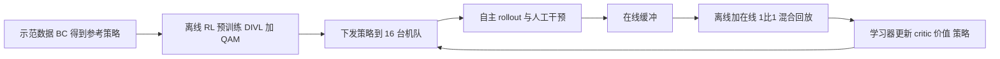

# Learning While Deploying（LWD，arXiv:2605.00416）

## 一句话定义

**LWD 是一个机队规模的离线到在线强化学习框架：把部署中机器人的自主 rollout 与人工干预汇入共享回放，用 DIVL 学分布式价值、用 QAM 把价值梯度传给 flow 式 VLA，持续后训练一个通用策略（摘要与 Sec. I）。**

## 英文缩写速查

| 缩写 | 英文全称 | 简要说明 |
|------|----------|----------|
| LWD | Learning While Deploying | 本文框架：边部署边学习 |
| VLA | Vision-Language-Action | 视觉-语言-动作策略 |
| DIVL | Distributional Implicit Value Learning | 分布式隐式价值学习，取回放动作 Q 值分布的 τ 分位作自举目标（Sec. IV-A） |
| QAM | Q-learning with Adjoint Matching | 把 critic 梯度转为沿参考 flow 的逐步回归目标（Sec. III-C） |
| IQL | Implicit Q-Learning | DIVL 借用其不对 max 动作自举的思路（Sec. III-B） |
| RECAP | 论文基线名（出自 π0.6* 工作） | 优势条件化的迭代离线后训练基线（Sec. V-A） |
| HG-DAgger | Human-Gated DAgger | 带人工接管的交互式模仿学习基线 |
| TD | Temporal Difference | 时序差分目标 |
| SFT | Supervised Fine-Tuning | 本文的参考策略：在示范上做 flow matching 微调 |

## 为什么重要

- 论文论点（Sec. I）：离线预训练不足以直接用于真实部署，部署带来分布偏移与长尾失败，所以要让策略从部署经验持续改进。
- 与只做在线 RL 的 VLA 后训练不同，它同时复用大量离线与异策略数据，并且在 8 个任务上共用一个策略（Sec. II-A、II-B）。
- 以 16 台真机、8 个任务、3–5 分钟长程任务的规模报告了结果（Sec. V），在公开的 VLA RL 论文里属于真机规模较大的一类（推测：未与全部同类工作逐一比较）。

## 核心原理与流程总览

流程（Fig. 2、Algorithm 1）：先在示范上行为克隆得到 π0.5 检查点并固定为参考策略 πβ；阶段 1 用离线缓冲（示范、历史 rollout、play 数据，共 652.5 小时，Table IV）训练策略、critic 与分布式价值；阶段 2 把策略下发到机队，自主 rollout 与可选的人工干预写入在线缓冲，学习器在离线与在线各约 1:1 的混合回放上更新，并周期性回传策略。

- **价值学习 DIVL（Sec. IV-A）：** 价值头输出 K=201 个原子的分类分布（附录 A1），目标是 EMA critic 的 Q 值经 C51 投影；TD 目标用该分布的 τ 分位（式 13–14）；τ 随归一化熵下调：τ = clip(τbase − α·H, τmin, τmax)（式 17–18），离线 τbase=0.6、在线 0.9，α=0.3（附录 B2）。命题 1 称在理想极限下两步法与直接非对称回归同解，证明在附录 A2，是理想化条件下的论证。
- **策略抽取 QAM（Sec. IV-B）：** 参考 flow 固定，沿其轨迹用 critic 动作梯度初始化终端伴随状态，把轨迹级优化变成局部回归；温度 λ=2。论文称直接穿过多步去噪反传昂贵且不稳定（附录 A3 为分析性论述，没有对应的对比实验）。
- **离线 n 步目标（式 19）：** 长程任务离线用 10 步 chunk 级 TD，杂货任务 1 步；在线一律 1 步，作者推测原因是在线轨迹混有人工干预片段（Sec. IV-C，作者的推测）。

## 工程实践

- **模型（Sec. IV-D）：** 策略是 π0.5 架构（PaliGemma，Gemma-2B 加 SigLIP，Gemma-300M 动作专家）；价值与 critic 为独立网络，共享 Gemma3-270M-IT 加 SigLIP-So400M 骨干，critic 为两个标量头的 clipped double-Q。在线阶段策略的 VLM 骨干冻结，只更新动作专家，价值与 critic 全量微调。
- **超参（附录 B2）：** 动作块 H=30，策略学习率 2e-5，价值与 critic 5e-4，γ=0.9999，EMA 0.005。
- **机队与系统（Sec. V-A、附录 D）：** 边缘端按回合上传对象存储，协调器提交版本化快照，学习器为多机 SPMD JAX；在 8 小时、16 台、1604 回合的统计中每个回合都完成了入库，回合到可采样的延迟 P50 41 秒、P99 148 秒，模型发布到机器人加载 P50 38 秒、P99 55 秒（Table VI）。
- **预算：** 每个在线实验每个方法 4 小时墙钟，约 60 机器人小时。
- **评测口径（Sec. V-A）：** 杂货任务为二值成功率；长程任务为人工按细则给的子步骤分（1 / 0.5 / 0）均值。
- **代码：** 论文首页只给项目页，正文与附录未见代码仓库链接，本页不列 code。

## 与清单说法的核对

清单（Glen Berseth 的 CoRL 2026 阅读清单，P1，RL Fine-Tuning of VLAs & Generative Policies 组，作者称摘要由 LLM 据论文摘要起草）一句话：「Fleet-scale offline-to-online RL for continual post-training of generalist VLAs from autonomous rollouts and human interventions.」

| 清单说法 | 论文核对 |
|----------|----------|
| Fleet-scale | 成立但有限定：16 台同型号 AgiBot G1 双臂、8 个任务，全部真机（Sec. V-A）。这里的 fleet 是一个实验室级机队，不是跨家庭、跨商店的开放部署；论文也没有报告在真实终端用户场景中的长期部署。 |
| offline-to-online RL | 成立：阶段 1 离线、阶段 2 在线，同一 RL 目标（Sec. IV-C）。 |
| continual post-training | 部分成立：在线阶段每个方法固定 4 小时、约 60 机器人小时（Sec. V-A）；作者在局限里承认在线调度较朴素、长期持续改进未验证（Sec. VI）。 |
| generalist VLAs | 成立但有限定：一个策略覆盖 8 个任务，基于 π0.5 架构；任务集是论文自选的杂货与长程操作，并未测试未见任务（推测：文中未见零样本新任务评测）。 |
| from autonomous rollouts and human interventions | 部分成立：算法里干预是「可选」的（Fig. 2、Algorithm 1），回放同时含干预段；但主结果表没有单独消融干预的作用，因此「靠干预提升」没有直接证据。 |

清单没有提到、但读论文时应知道的：基线只有 SFT、RECAP、HG-DAgger 三个，且 RECAP 是作者为多任务设定自行改写的实现（附录 C1）；成功率表没有给出每格评测回合数与方差（Table I），所以小差距（如 0.97 对 1.00）不宜过度解读。

## 局限

- **论文自述（Sec. VI）：** 在线更新用朴素的实时调度，更大规模或长期持续改进未必最优；长程任务只用一条短指令，缺少任务分解与闭环恢复所需的更强视觉语言推理；没有显式建模执行安全。
- **未验证之处（我的观察）：**
  - 主表（Table I）正文与附录都没给每个任务的评测回合数、随机种子或置信区间，仅图 5 的周期时间给了标准误。
  - 长程任务得分由人工评分员按细则打分，细则对所有方法相同，但没说明评分员是否对方法盲评。
  - 文中称 DIVL 在「所有任务」上优于标量 expectile（Sec. V-C.1），但 Table V 里离线的 Freezer（1.00 对 0.92）、Open-Cooler（1.00 对 0.95）以及在线 Correction（并列 1.00）并非 DIVL 更好，该说法过强。
  - 自适应 τ 的消融只在离线阶段做（Table III），Cocktail 从 0.70 到 0.83 贡献最大，但 Fruit Juice、Shoebox 反而下降（0.76 到 0.74、0.90 到 0.86）。
  - 基线预算：RECAP 与 HG-DAgger 各用约 60 机器人小时的 rollout（附录 C1），但 RECAP 为两轮离线迭代而非连续在线，二者的比较是否「同算力」不能直接从文中确认。
  - 命题 1 只在无限细离散与充分容量的理想条件下成立；实际用 201 原子与有限数据，论文没有定量检验这个差距。
  - 价值曲线可视化（Fig. 6、9）只展示了一条成功与一条失败的功夫茶回合，作者自己称其为定性诊断。

## 关联页面

- [VLA 方法页](../methods/vla.md)
- [强化学习](../methods/reinforcement-learning.md)
- [模仿学习](../methods/imitation-learning.md)
- [DAgger](../methods/dagger.md)
- [Flow Matching 具身策略](../concepts/flow-matching-embodied-policy.md)
- [数据飞轮](../concepts/data-flywheel.md)
- [奖励设计](../concepts/reward-design.md)
- [RLinf-VLA](paper-rlinf-vla.md)（论文引用的 VLA 在线 RL 框架）
- [π0.5 开放世界 VLA](paper-pi05-open-world-vla.md)（LWD 的策略架构来源）
- [Training in Deployment](paper-training-in-deployment.md)
- [CEL 机队经验](paper-cel-fleet-experience.md)

## 参考来源

- [来源归档：lwd-fleet-scale-rl_arxiv_2605_00416.md](../../sources/papers/lwd-fleet-scale-rl_arxiv_2605_00416.md)
- [arXiv:2605.00416](https://arxiv.org/abs/2605.00416)

## 继续阅读

- [arXiv PDF](https://arxiv.org/pdf/2605.00416v1)
- 项目页：<https://finch.agibot.com/research/lwd>
- 论文引用的前序工作：QAM（arXiv:2601.14234）、SOP 在线后训练系统（arXiv:2601.03044）、π0.6*（arXiv:2511.14759）
- [强化学习方法页](../methods/reinforcement-learning.md)
