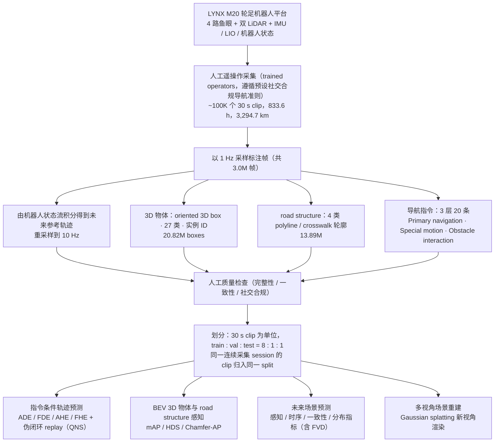

# LynxScenes（arXiv:2610.18093）

**LynxScenes**（*LynxScenes: A Large-Scale Real-World Benchmark for Outdoor Wheel-Legged Robot Perception, Navigation, Imagination and Reconstruction*，[arXiv:2610.18093](https://arxiv.org/abs/2610.18093)，Jun Tian、Hao Wu、Ruo Chen、Yiyi Liao、Hongyi Lin、Jincheng Yu、Chao Li、Yingjie Niu；Deep Robotics、UIUC、HKUST、浙江大学、清华大学、MIT；[官方项目页](https://developer.deeprobotics.cn/research/articles/lynx-scenes/index.html)）。

## 流程总览

图依据：数据采集与标注流程 + 评测任务图（论文 §3.1–3.5 Dataset、§4.1–4.4 Benchmark Tasks and Metrics、Fig. 4；伪闭环 QNS 见 §4.1）

## 一句话定义

**LynxScenes 是用真实 LYNX M20 同步采集环视、LiDAR 与运动状态的室外基准，用同一评测工具覆盖感知、导航、未来场景想象与重建。**

## 英文缩写速查

| 缩写 | 英文全称 | 简要说明 |
|------|----------|----------|
| LiDAR | Light Detection and Ranging | 激光雷达，M20 配 2 个 96 线 |
| LIO | LiDAR-Inertial Odometry | 运动状态来源之一 |
| BEV | Bird's-Eye View | 稠密鸟瞰标注 |

## 采集方法与数据规模（项目页自报）

- 100K 个 30 秒片段、3.0M 标注帧、833.6 h 室外导航、3,294.7 km。
- 传感：4 路鱼眼（1920×1536、10 Hz）、2 个 96 线 LiDAR、6 维运动（IMU + LIO + 机器人状态）。
- 操作员按预设社交合规协议遥操，不安全或不一致示范在审核中剔除。
- **重定向就绪度：** 数据由 LYNX M20 轮足形态单一平台采集，相机高度、鱼眼视角与运动状态都与该机型绑定；作为其他形态（足式、人形、轮式底盘）的训练输入时需先评估视角与运动学差异，不能视为跨形态即插即用。

## 评测任务

- 同一评测工具覆盖**感知、导航、未来场景想象、重建**四类任务（项目页列出的任务族）。
- 各任务的具体指标、基线与划分以论文为准；数据集未发布前无法复核评测工具实现。

## 与其他工作对比

- **相对 [DR-VLA](./paper-dr-vla.md)：** 同团队工作。DR-VLA 是导航策略，用第一视角人类视频预训练再以遥操作机器人片段适配；LynxScenes 提供的是真实轮足机器人采集的多任务基准与标注，两者分别处于「方法」与「数据 / 评测」层。
- **相对 [DR-WM](./paper-dr-wm.md)：** DR-WM 用于导航候选动作的未来观测预测；LynxScenes 的「想象」任务可作为此类世界模型预测保真度的真实数据评测入口，但需等数据发布后核对协议。

## 开源状态

Code 与 Dataset 均为 **SOON**（2026-10-24 核查），页面标注 ICLR 2027 审稿中。

## 结论

**目前只能读论文与项目页；数据与代码未发布，无法复核标注质量与评测工具。**

## 关联页面

- [DR-WM](./paper-dr-wm.md) — 云深处同批研究
- [云深处 rl_training](./deeprobotics-rl-training.md) — 同公司 RL 训练工程
- [wheel-legged-quadruped](../concepts/wheel-legged-quadruped.md)
- [DR-VLA](./paper-dr-vla.md) — 同团队轮足导航 VLA
- [具身大模型评测基准选型闭环知识链](../queries/embodied-eval-benchmark-selection-loop.md) — 「想象」任务对应②层世界模型预测保真度评测，「导航」任务对应③层任务评测
- [机器人视觉感知栈选型闭环知识链](../queries/robot-perception-stack-selection-loop.md) — 环视鱼眼 + 双 LiDAR + BEV 标注对应①层传感与标定、③层 3D 语义建图

## 参考来源

- [项目页归档](../../sources/sites/deeprobotics-lynxscenes.md)
- [arXiv 原文](https://arxiv.org/abs/2610.18093)
- [官方项目页](https://developer.deeprobotics.cn/research/articles/lynx-scenes/index.html)
- [云深处前沿探索](https://developer.deeprobotics.cn/research/)
- [arXiv PDF](https://arxiv.org/pdf/2610.18093)：已通读 Abstract、§1 Introduction、§3 Dataset（3.1–3.5）、§4 Benchmark Tasks and Metrics；§5 实验结果、附录以略读为准

