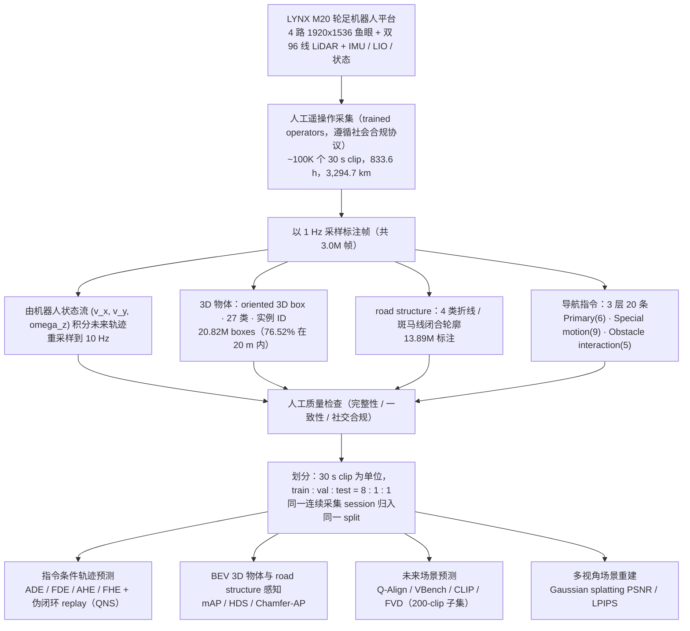

# LynxScenes（arXiv:2610.18093）

**LynxScenes**（*LynxScenes: A Large-Scale Real-World Benchmark for Outdoor Wheel-Legged Robot Perception, Navigation, Imagination and Reconstruction*，[arXiv:2610.18093](https://arxiv.org/abs/2610.18093)，Jun Tian、Hao Wu、Ruo Chen、Yiyi Liao、Hongyi Lin、Jincheng Yu、Chao Li、Yingjie Niu；DEEP Robotics、UIUC、HKUST、浙江大学、清华大学、MIT；[官方项目页](https://developer.deeprobotics.cn/research/articles/lynx-scenes/index.html)）基于真实轮足机器人 LYNX M20 在人车混行室外环境采集，把同步多模态传感、稠密 3D/道路标注与行为级导航指令统一到同一评测基准下。

## 一句话定义

**LynxScenes 是基于真实 DEEP Robotics LYNX M20 同步采集环视鱼眼、双 96 线 LiDAR 与运动状态的室外多模态基准（833.6 小时 / 3,294.7 km），在同一平台与场景分布下统一评测轨迹预测（QNS）、BEV 感知、未来场景预测与多视角重建四类任务。**

## 英文缩写速查

| 缩写 | 英文全称 | 简要说明 |
|------|----------|----------|
| LiDAR | Light Detection and Ranging | 激光雷达，M20 前后各配 1 台 96 线 RoboSense Airy（360°×90°） |
| LIO | LiDAR-Inertial Odometry | 激光惯性里程计，6-DoF 运动状态来源之一 |
| BEV | Bird's-Eye View | 鸟瞰图空间感知表示，用于 3D 物体框与道路结构检测 |
| QNS | Quadruped Navigation Score | 结合无碰撞、可通行区、TTC、余量、进度与指令遵从的伪闭环评分 |
| FLU | Front-Left-Up | 机器人中心右手坐标系（x 前、y 左、z 上） |
| FVD | Fréchet Video Distance | 未来场景预测视频分布真实度核心指标 |

## 为什么重要

- **填补低视角、近距密集交互的室外轮足空白：** 自动驾驶数据集（如 nuScenes）相机高位且侧重机动车道，而轮足机器人运行于人行道、校园、公园与非结构化路面；LynxScenes 中 **76.52%** 的标注目标位于 20 m 近距内（平均 13.93 m），行人占比 35.98%，精准对应近身避障与社会合规痛点。
- **同源多任务打破能力孤岛：** 既有数据往往只服务单一任务；LynxScenes 用同一批 100K 真实片段同时支持规划（VLN/VLA）、感知（BEV）、想象（视频/世界模型）与重建（Gaussian Splatting），可直观暴露同一模型在不同维度上的短板。
- **揭示「模仿误差最低 ≠ 导航最安全」：** 引入 log-replay 伪闭环评估 `QNS`（`NC × WAC × 加权(EP, TTC, CL, IC)`），显式惩罚停滞不前、闯入非可通行区或不遵从语义指令的轨迹。

## 流程总览

图依据：数据采集、标注流程与四任务基准框架（论文 §3.1–3.5、§4.1–4.4、Fig. 4；伪闭环 QNS 公式见 §4.1 Eq. 1）。

## 核心原理

- **传感同步与状态构建（§3.1–3.3）：** 4 路鱼眼（10 Hz）、双 96 线 LiDAR（10 Hz）、IMU、6-DoF LIO 与机器人底盘速度流在硬件时间同步下采集。参考未来轨迹并非直接用容易漂移的 GPS，而是以机器人状态流 $(v_x, v_y, \omega_z)$ 积分变换至当前帧 Body-FLU 坐标并重采样至 10 Hz。
- **三层解耦行为指令（§3.4）：** 20 条语义指令拆为「主导航路线（6 条，100% 覆盖）」「特殊运动如原地转向/横移/静止（9 条，35.91%）」「障碍物交互如等待/左右绕行/重规划（5 条，22.42%）」，同一层内互斥而跨层可并发，使评测能够按意图细分能力。
- **伪闭环评估 `QNS`（§4.1）：** 在标注智能体与道路结构上回放模型预测的 1 s 轨迹（$10 \times 3$），将无碰撞（NC）与可通行区遵从（WAC）设为硬门控乘子，再加权进度（EP）、碰撞时间（TTC）、安全余量（CL）与指令遵从（IC），避免「原地不动刷零碰撞」的指标作弊。

## 源码运行时序图

**不适用**：截至 2026-11-21 复核，官方项目页 Code 与 Dataset 按钮均标注 `SOON`（ICLR 2027 审稿中，拟论文录用后公开数据集与评测工具套件），目前尚无公开源码仓库入口。

## 工程实践

| 项 | 建议 / 核查结果 |
|----|-----------------|
| **开源状态** | **待发布（SOON）**（截至 2026-11-21）：论文处于 ICLR 2027 审稿阶段，代码与 833.6 h 数据集拟录用后开源，目前仅可读论文与项目页 |
| **跨形态复用（重定向就绪度）** | 数据全部由 LYNX M20 单一轮足平台采集，4 路鱼眼安装高度、视场畸变与运动学均绑定 M20；迁移至人形、普通四足或轮式底盘训练前须评估视角域差与运动学约束，不可视为即插即用 |
| **防泄漏划分规范** | 虽以 30 s clip 为切分单元（8:1:1），但同一连续采集 session 的所有片段被强制划入同一 split；自建户外导航数据集时应沿用 session 级隔离以防近帧时空泄漏 |

## 实验与基线基点（论文 §5）

| 任务 | 测试基线与代表结果（项目页 / 论文自报） |
|------|-----------------------------------------|
| 轨迹预测（10 个 VLN/VLA 模型，§5.1） | **NaVILA** 取得最高 QNS **0.843**（StreamVLN 0.833、π₀.₅ 0.819、LingBot-VLA-v2 0.809、OpenVLA 0.802）；论文指出开环误差最低并不等同最高 QNS |
| BEV 感知（4 模型，§5.2, Table 3） | **SparseDrive**（Cam.+Pose）道路 Line mAP 最优（**21.08**）；**BEVFusion**（Cam.+LiDAR）3D 物体 Box mAP（**67.11**）与 HDS（**64.48**）最优（需注意额外 LiDAR 输入） |
| 未来场景预测（6 模型，200-clip 子集，§5.3） | **WorldStereo** 获最低 FVD（**386.2**）；**LingBot-World** 领跑 Q-Align-I/V 与 LAION-Aes，尚无单一模型全面占优 |
| 多视角重建（§5.4） | **ReCoSplat** 获最优 PSNR（**15.94**）、LPIPS 与多尺度结构相似度 |

## 与其他工作对比

- **相对 [DR-VLA](./paper-dr-vla.md)：** 同团队工作。DR-VLA 是利用第一视角网络视频与 EgoLynx-Robot 遥操训练的导航策略模型；LynxScenes 提供的是面向全行业的多任务评测基准与 833.6 小时 M20 真实数据，两者分别处于「方法」与「数据 / 基准」层。
- **相对 [DR-WM](./paper-dr-wm.md)：** DR-WM 用于导航候选动作的未来观测与物理可通行性预测；LynxScenes 的「未来场景预测」子任务可作为此类世界模型预测保真度的真实室外评测入口（待数据开源后对齐协议）。

## 结论

**一句话总判：** LynxScenes 首次用实体轮足机器人 M20 的 833.6 小时真实室外数据把感知、轨迹规划、未来场景想象与三维重建置于同一起跑线，揭示了当前 VLN/VLA 与世界模型在低视角近距混行场景下的明显短板，但在数据集与评测套件正式释放前仅可作指标与任务设计参考。

1. **四项任务无一出现「全能赢家」：** NaVILA 领跑 QNS（0.843），BEVFusion 依赖 LiDAR 领跑 3D 框检测（64.48 HDS），WorldStereo 与 LingBot-World 在世界生成中各擅胜场，说明室外轮足自治仍缺乏统一强基线。
2. **伪闭环指标 QNS 是避免开环误差误判的关键：** 单看 ADE/FDE 无法分辨碰撞与违背语义指令风险，门控乘子 `NC × WAC` 能直接暴露不安全轨迹。
3. **跨模态融合仍不可轻易省去 LiDAR：** 在 BEV 3D 物体检测上，纯相机/姿态方法与 Cam.+LiDAR 的 BEVFusion 仍有明显差距（Box mAP 58.70 vs 67.11）。
4. **当前不可直接下载跑榜：** 代码与数据集均标注 SOON（ICLR 2027 审稿中），选型排期需留意官方正式发布节点。

## 局限与风险

- **数据与评测脚本尚未开放：** 在数据集与官方 toolkit 发布前，外部研究者无法复核标注噪声率、QNS 回放脚本细节或在其 test split 上跑榜。
- **单一平台视角与运动学绑定：** 全量数据均来自 LYNX M20，相机高度与非完整/轮足复合动力学使其难以直接无适配地迁移至双足人形或小型室内机器人。
- **伪闭环不完全等价于真机长程闭环：** QNS 基于录制场景中的历史智能体轨迹回放，未建模其他交通参与者对机器人行为的反事实交互响应。

## 关联页面

- [DR-WM](./paper-dr-wm.md) — 云深处同批导航世界模型研究
- [DR-VLA](./paper-dr-vla.md) — 同团队轮足导航 VLA
- [云深处 rl_training](./deeprobotics-rl-training.md) — 同公司 RL 训练工程
- [轮足四足机器人](../concepts/wheel-legged-quadruped.md) — 采集平台 LYNX M20 所属形态
- [具身大模型评测基准选型闭环知识链](../queries/embodied-eval-benchmark-selection-loop.md) — 「想象」任务对应②层世界模型预测保真度评测，「导航」任务对应③层任务评测
- [机器人视觉感知栈选型闭环知识链](../queries/robot-perception-stack-selection-loop.md) — 环视鱼眼 + 双 LiDAR + BEV 标注对应①层传感与标定、③层 3D 语义建图
- [Embodied Agent Benchmarking · 具身智能体评测方法](../methods/embodied-agent-benchmarking.md)：LynxScenes 基于真实轮足平台采集 100K 多模态片段，以统一 QNS 伪闭环指标覆盖规划、感知、想象与重建四类任务评测。
- [Robot Navigation Workflow · 机器人导航与路径执行](../methods/robot-navigation-workflow.md)：该基准面向人车混行的室外人行道与校园等非结构化环境，重点评测轮足机器人的近距密集避障与指令遵循导航表现。

## 参考来源

- [lynxscenes_arxiv_2610_18093.md](../../sources/papers/lynxscenes_arxiv_2610_18093.md) — arXiv:2610.18093v1 全文通读归档
- [项目页归档](../../sources/sites/deeprobotics-lynxscenes.md) — 官方项目页归档

## 推荐继续阅读

- [arXiv 全文 HTML](https://arxiv.org/html/2610.18093)
- [arXiv PDF](https://arxiv.org/pdf/2610.18093)
- [官方项目页](https://developer.deeprobotics.cn/research/articles/lynx-scenes/index.html)
