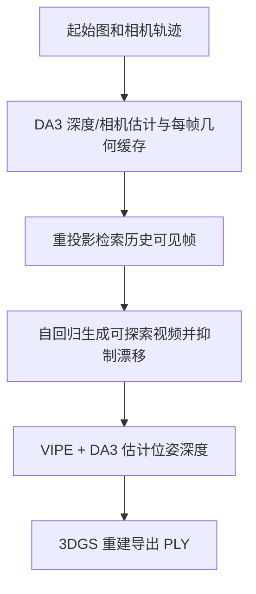
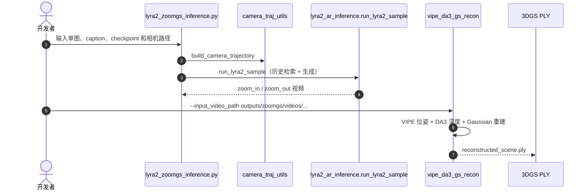

# Lyra 2.0｜长时可探索三维场景与几何回访

**核心定位：** 单图与相机轨迹先生成空间连贯视频，再用 VIPE + Depth Anything 3 重建可导出的 3D Gaussian 场景。

## 一句话定义

单图与相机轨迹先生成空间连贯视频，再用 VIPE + Depth Anything 3 重建可导出的 3D Gaussian 场景。

## 英文缩写速查

| 缩写 | 英文全称 | 简要说明 |
|---|---|---|
| WM | World Model | 由条件预测环境后续视觉或潜在状态 |
| AR | Autoregressive | 基于历史视频块续写未来 |
| DiT | Diffusion Transformer | 部分生成路径的视频扩散骨干 |
| 3D | Three-Dimensional | 空间结构或几何缓存的维度 |

## 为什么重要

- **研究角色：** 几何缓存支撑视角回访和最终可导出 3DGS；可用于世界模型架构和工程复现的横向对照。
- **边界明确：** 比 HY-World 2.0 的全景—规划—合成 3DGS 流程更突出长程回访时的历史帧选择；与视频实时交互项目相比偏离线几何资产生成。
- **资料身份：** arXiv 2026-04-14，开发团队 英伟达空间智能实验室（NVIDIA Spatial Intelligence Lab）；源码/权重与报告不能一概而论。

## 核心信息

| 字段 | 内容 |
|---|---|
| 机构 | 英伟达空间智能实验室（NVIDIA Spatial Intelligence Lab） |
| 技术原文 | [官方报告](https://arxiv.org/abs/2604.13036) |
| 官方代码 | [nv-tlabs/lyra](https://github.com/nv-tlabs/lyra)（模块 `Lyra-2/`） |
| 发布范围 | 训练/推理代码和权重已发布，模型许可限科研开发 |
| 控制接口 / 输出 | 一张起始图、配套文本 caption、指定相机轨迹；生成探索视频，随后输出 `reconstructed_scene.ply` 三维高斯点云。 |

## 核心原理

Lyra 2.0 区分空间遗忘与时间漂移：为每帧保留深度、相机和点云的独立缓存，不把噪声深度硬融合成全局地图；依据目标视角的可见性召回历史关键帧，通过重投影提供对应关系。训练时引入自身生成的退化历史来修正长期 drift。生成探索视频后，以 VIPE 位姿估计和 DA3 深度将视频 lift 为 3DGS/网格。

### 流程总览

图的模块关系依据 [官方 README 及源码归档](../../sources/repos/lyra-2.md) 和 [报告/主页](https://arxiv.org/abs/2604.13036)；无真实硬件执行验证。

## 源码运行时序图

**核对入口：** Lyra-2/lyra_2/_src/inference/lyra2_zoomgs_inference.py、vipe_da3_gs_recon.py；上图聚焦源码实际提供的推理入口，非训练系统所有内部调用；未在本地执行 GPU 推理。

## 工程实践

官方推理入口 `PYTHONPATH=. python -m lyra_2._src.inference.lyra2_zoomgs_inference --input_image_path assets/samples --sample_id 4 --checkpoint_dir checkpoints/model --prompt_dir assets/samples --output_path outputs/zoomgs`；再运行 `python -m lyra_2._src.inference.vipe_da3_gs_recon --input_video_path outputs/zoomgs/videos/4.mp4`。超过 500 帧建议 `vipe_da3_chunked_gs_recon` 分块重建。

### 建议验证指标

- 对动作/相机控制：轨迹遵从、操作响应、长程回访同视角一致性。
- 对效率：将模型 FPS、首响应帧、单块时延、端到端用户可见延迟分开记录。
- 对复现：记录代码版本、checkpoint 类型、GPU/显存、图像大小与许可证。

## 实验与评测

README 在 1×H100 80GB 上报告生成 80 帧约 9 分钟，使用 DMD 可约 35 秒；这些是离线生成时间，不等同实时交互延迟。论文示例可把重建资产导入 Isaac Sim 做环境探索。

## 与其他工作对比

比 HY-World 2.0 的全景—规划—合成 3DGS 流程更突出长程回访时的历史帧选择；与视频实时交互项目相比偏离线几何资产生成。 可与 [11 项世界模型对照](../comparisons/open-source-world-models-11-2026.md)中的实时视频、3D 资产与 latent 预测分支比较。

## 结论

**总判：Lyra 2.0 的价值在于几何缓存支撑视角回访和最终可导出 3DGS，而不是泛化为物理真值模拟器。**

1. 首先验证官方控制接口与实际输出，而非仅对比宣传视频。
2. 区分公开代码、权重、训练数据和许可证，确定复现边界。
3. 论文的主场景是静态环境，不显式模拟动态物体；训练数据光照变化可传入生成结果，损害 3DGS 重建。

## 局限与风险

论文的主场景是静态环境，不显式模拟动态物体；训练数据光照变化可传入生成结果，损害 3DGS 重建。代码 Apache-2.0，但模型权重使用 NVIDIA Internal Scientific Research and Development Model License，不应误称可任意商用。

此外，视频视觉一致性与物理动力学准确性不是同一个指标，机器人控制仍需独立验证闭环执行和接触动力学。

## 关联页面

- [2026 年 11 项开源世界模型技术对照](../comparisons/open-source-world-models-11-2026.md)
- [Generative World Models](../methods/generative-world-models.md)
- [Video as Simulation](../concepts/video-as-simulation.md)
- [WAM 纵深学习路线](../../roadmap/depth-wam.md)

## 参考来源

- [官方代码与运行入口](../../sources/repos/lyra-2.md)
- [官方项目页面核对](../../sources/sites/lyra-2.md)
- [论文原文归档](../../sources/papers/lyra-2_arxiv_2604_13036.md)
- [深蓝具身智能综述线索](../../sources/blogs/wechat_shenlan_world_models_11_2026_11_20.md)

## 推荐继续阅读

- [官方仓库 README](https://github.com/nv-tlabs/lyra)
- [官方技术报告](https://arxiv.org/abs/2604.13036)
