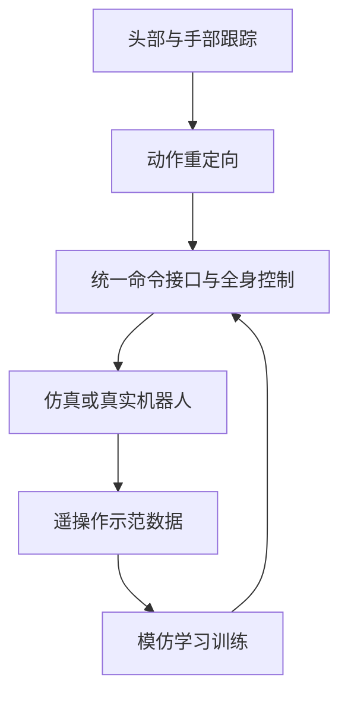

# MABEL（arXiv:2611.04083）

**MABEL**（*MABEL: An Open Anthropomorphic Mobile Bimanual Platform for Teleoperation and Learning*，[arXiv:2611.04083](https://arxiv.org/abs/2611.04083)，[项目页](https://robotmabel.github.io/website/)，[代码](https://github.com/robotmabel/open_mabel)）来自 [具身智能小站 2026-11-04 盘点](../../sources/blogs/wechat_embodied_station_57_papers_da_reward_model_failure_2026-11-04.md)，属「数据采集与跨形态迁移」组。

## 一句话定义

**将移动底盘、升降躯干、双臂和灵巧手接入统一控制接口，贯通遥操作采集与模仿学习；适合评估工作空间、集成成本与整机协同的团队。**

## 英文缩写速查

| 缩写 | 英文全称 | 简要说明 |
|------|----------|----------|
| MABEL | Mobile Anthropomorphic Bimanual Embodiment for Learning | 移动双臂机器人平台 |
| ACT | Action Chunking with Transformers | 模仿学习策略 |
| DOF | Degrees of Freedom | 自由度 |

## 为什么重要

- 把双臂灵巧操作扩展到移动平台。
- 开源结论：**已开源**（步骤 2.5，2026-11-04）。官方仓库已公开硬件、固件、仿真与学习代码；可复现程度尚待核验。
- 同期同组工作见 [VLM 奖励评估、动作动力学与开放权重机器人智能体：具身智能小站 11-04 期 57 篇阅读坐标](../overview/embodied-station-2026-11-04-57-papers-technology-map.md)。

## 流程总览

论文介绍的共用接口将示范采集和策略执行连接起来。上述图依据论文摘要及项目说明，全文与具体代码链路仍待完整核查。

## 核心机制

| 项 | 内容 |
|----|------|
| **arXiv** | [2611.04083](https://arxiv.org/abs/2611.04083) |
| **开源** | **已开源** |
| **要点** | 将移动底盘、升降躯干、双臂和灵巧手接入统一控制接口，贯通遥操作采集与模仿学习；适合评估工作空间、集成成本与整机协同的团队。 |
| **文内指标** | 论文摘要报告 56 个功能自由度、约 8100 美元零件成本，以及机器人热点下 137 ms 平均端到端视频延迟；其余实验条件与结果尚待全文核验。 |

## 源码运行时序图

待完成：已核对官方 `server/run.sh` 与 `server/start_teleop.sh` 的启动入口，尚未完成运行模块调用链逐项核验。

## 实验与评测

- 公众号未给具体数字，本页不引用。
- **读法：** 本页为索引级摘要，依据公众号转述的官方摘要与仓库信息整理；逐项数字与 baseline 以原文 PDF 为准。

## 与其他工作对比

- 横向索引见 [VLM 奖励评估、动作动力学与开放权重机器人智能体：具身智能小站 11-04 期 57 篇阅读坐标](../overview/embodied-station-2026-11-04-57-papers-technology-map.md)；同 arXiv 不重复造页。

## 结论

**把双臂灵巧操作扩展到移动平台：将移动底盘、升降躯干、双臂和灵巧手接入统一控制接口，贯通遥操作采集与模仿学习；适合评估工作空间、集成成本与整机协同的团队。**

1. 开源边界：**已开源** — 官方仓库已公开硬件、固件、仿真与学习代码；可复现程度尚待核验。
2. 核心机制：将移动底盘、升降躯干、双臂和灵巧手接入统一控制接口，贯通遥操作采集与模仿学习；适合评估工作空间、集成成本与整机协同的团队。
3. 复现与选型前核对任务协议、硬件与基准口径，勿直接横比公众号摘录数字。

## 关联页面

- [embodied-data-collection-four-layers-taxonomy](../concepts/embodied-data-collection-four-layers-taxonomy.md)
- [teleoperation](../tasks/teleoperation.md)
- [imitation-learning](../methods/imitation-learning.md)
- [bimanual-manipulation](../tasks/bimanual-manipulation.md)
- [teleoperation](../tasks/teleoperation.md)
- [embodied-station-2026-11-04-57-papers-technology-map](../overview/embodied-station-2026-11-04-57-papers-technology-map.md)

## 参考来源

- [mabel_arxiv_2611_04083.md](../../sources/papers/mabel_arxiv_2611_04083.md)
- [wechat_embodied_station_57_papers_da_reward_model_failure_2026-11-04.md](../../sources/blogs/wechat_embodied_station_57_papers_da_reward_model_failure_2026-11-04.md)
- [arXiv:2611.04083](https://arxiv.org/abs/2611.04083)

## 推荐继续阅读

- [arXiv PDF](https://arxiv.org/pdf/2611.04083)
- [项目页](https://robotmabel.github.io/website/)
- [https://github.com/robotmabel/open_mabel](https://github.com/robotmabel/open_mabel)
