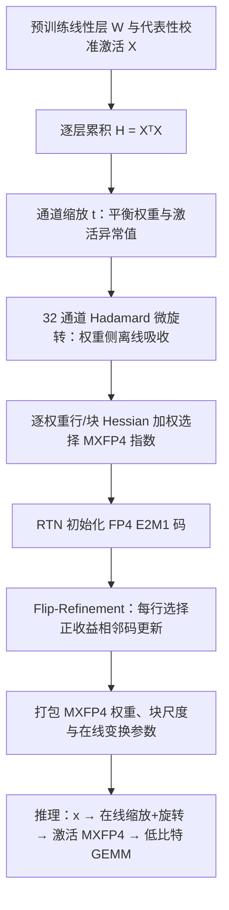
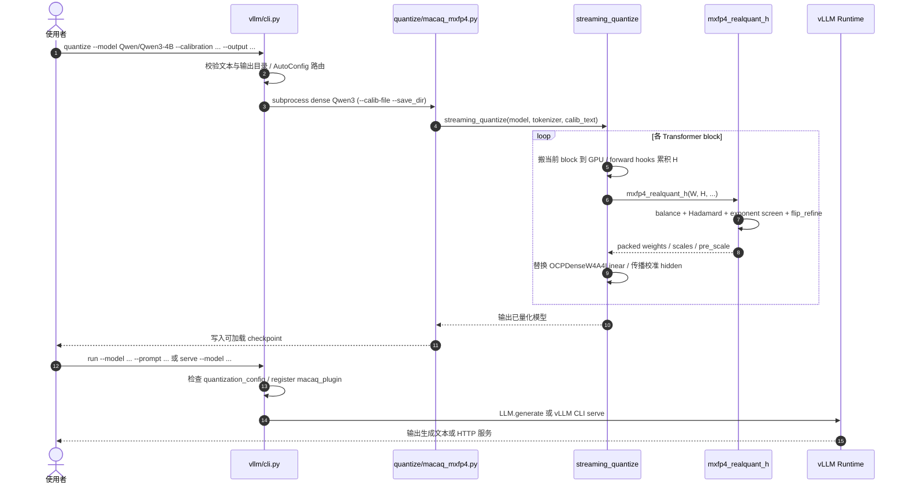

# MACaQ: Fast, Model Agnostic Calibrated Quantization for Low-Precision Weights and Activations
# MACaQ：面向低精度权重与激活的快速、模型无关校准量化

## 一句话定义

**MACaQ** 是 Huawei Computing Systems Lab（华为计算系统实验室，瑞士）提出的 **逐线性层独立** MXFP4 W4A4 训练后量化（PTQ）方法：在线对激活进行通道缩放与块 Hadamard 旋转，离线将对应变换吸收到权重，再用 Hessian 感知的指数搜索与 Flip-Refinement 修正 4-bit 量化码，无须跨层传播变换（[arXiv:2611.10649v2](https://arxiv.org/abs/2611.10649v2)）。

## 英文缩写速查

| 缩写 | 英文全称 | 简要说明 |
|---|---|---|
| MACaQ | Model Agnostic Calibrated Quantization | 模型无关的校准量化；核心为逐层局部处理 |
| PTQ | Post-Training Quantization | 不重训原模型参数的训练后量化 |
| MXFP4 | Microscaling Floating Point 4-bit | 32 元素共用 E8M0 块尺度，元素使用 E2M1 码 |
| W4A4 | 4-bit Weights and 4-bit Activations | 权重与激活均为 4 bit；不能等同全模型所有张量皆 4 bit |
| RTN | Round-to-Nearest | 最近邻初始量化 |
| PPL | Perplexity | 语言模型困惑度，越低越好 |
| GGUF | GPT-Generated Unified Format | llama.cpp 生态的模型文件格式 |

## 为什么重要

权重与激活同时压缩有利于缩小显存和使用低比特矩阵乘算子，但传统「把基变换折叠到相邻层」需理解每个模型的归一化、残差和投影接口，跨架构维护成本高。MACaQ 将变换留在每个线性层内部，既支持逐层流式量化，也能复用同一框架到语言模型和扩散模型。**对机器人是可能的模型压缩基础能力，并非作者已报告的 VLA/真机成果。**

## 核心机制与流程总览

论文 §2 / Eq.(1)–(19) 的对象是逐层线性映射：`H=XᵀX` 表示校准激活的二阶统计，目标是最小化输出重建误差。设 B 为 32 通道块 Hadamard 正交矩阵、t 为通道缩放向量，则 `x'=(x⊙t)B`，`W'=(W⊘t)B`，保持全精度线性层输出不变；MXFP4 对每 32 元素共享 E8M0 尺度，元素采用 E2M1 码。

1. **指数搜索：** 以块最大值对应指数为中心筛选 `{+1,0,−1}`，按 Hessian 加权误差选尺度，再固定尺度。
2. **Flip-Refinement：** 用局部二次目标的精确变化量选一个邻接 E2M1 码改变，每轮每个输出行最多一次，收益非正时停止。
3. **逐层流式：** 只将当前 transformer block 加载至 GPU、累积校准统计并量化、替换打包层，其余层驻留 CPU。
4. **开销口径：** 论文 Eq.(18) 给 32 维 Hadamard 的附加理论算术工作比例约 `3/m`（m 为输出宽度）；具体延迟仍必须用真实 kernel 测量。

## 实验与评测

| 指标 | 原文测量设置 | 结论 |
|---|---|---|
| 量化后 PPL | v2 Table 1；Llama-3-8B，WikiText-2 / C4 | MACaQ 6.90 / 11.01；MR-GPTQ 7.13 / 11.37；FP16 6.14 / 9.46 |
| 量化时间–质量 | v2 Fig.2 / Appendix Table 7 | Llama-3-8B 匹配较强基线的最好 PPL 时，量化时间约缩短 11×（特定配置） |
| 超大模型离线量化 | v2 §3.2；Qwen3.5-122B-A10B；单卡 96 GB | 64 分钟、峰值量化显存 32.5 GB，产物推理约需 74 GB；不能把 32.5 GB 说成推理显存 |
| 推理端到端 | v2 Fig.3 / Appendix Table 6；Qwen3-32B，vLLM batch=1 | 在线变换相对纯 MXFP4 增约 2.3% 开销；MACaQ 69.8 tok/s vs BF16 22.8 tok/s |
| 图像扩散 | v2 Table 3；FLUX.2-klein-4B，GenEval2 | MACaQ MXFP4 PSNR 15.04 / LPIPS 0.218；NVFP4 为 14.85 / 0.235，格式位宽不同 |
| 消融 | v2 Table 5；Llama-3-8B，WikiText-2 | RTN 8.28 → +指数 8.09 → +旋转 7.65 → +缩放 7.08 → +Flip 6.87 |

## 与其他工作对比

- **QuaRot / FlatQuant：** 使用跨层传播或结构相关变换吸收来减轻在线开销；MACaQ 保留轻量在线变换换取架构无关性，不能据此断言在全部模型尺寸和 batch 下更快。
- **MR-GPTQ / DuQuant++：** 同为强 MXFP4 基线；MACaQ 在本论文 Table 1 的若干 PPL 与 Fig.2 的量化时间–质量折衷上占优。
- **[VLAQuantBench](./paper-vlaquantbench.md)：** 对机器人 VLA 的闭环成功率、动作头敏感性与真实 kernel 延迟评测；**MACaQ 本文没有机器人闭环证据**，不能以通用 LLM PPL 替代机器人部署验收。

## 结论

**MACaQ 的核心价值是将校准、旋转、指数选择与量化码修正全部局限于线性层，减少架构改造和离线量化资源，同时用少量在线变换换取低比特精度。**

1. 适合具有大量线性层的模型尝试 MXFP4 W4A4，先核对目标硬件是否支持真实低比特算子。
2. 选择校准 token 数与 Flip 轮数时比较 **PPL/任务质量—量化用时** Pareto，不只追求更多 flips。
3. 区分 **量化峰值显存** 和 **量化后推理显存**（122B 实验分别为 32.5 与 74 GB）。
4. 大模型在线变换成本较低，不应外推到小模型（0.6B 约 8%）。
5. 机器人部署必须做真实策略闭环、动作误差、最坏延迟与功耗的额外评估；论文没有相关实测。

## 源码运行时序图

下面仅绘制**已核对的官方 dense Qwen3 + vLLM 路径**；MoE、hybrid Qwen、Diffusers、llama.cpp 使用独立入口与适配器，不可视作同一调用链。对应 [官方仓库归档](../../sources/repos/macaq.md) 的 `vllm/cli.py`、`quantize/macaq_mxfp4.py` 与 README：

## 工程实践

- **源码状态：** 已开源（Apache-2.0）。官方提供 vLLM、llama.cpp（含 GGUF 与 MACaQ-R）、Diffusers 和 PyTorch 后端，具体模型支持、依赖与精度模式不同。官方 Hugging Face 集合可访问，看到的 MACaQ-R GGUF 不代表所有论文模型权重已公开。
- **vLLM 试跑路径：** 按 [vLLM 官方 README](https://github.com/huawei-csl/MACaQ/blob/main/vllm/README.md) 使用 Linux + Python 3.12、准备代表性 calibration 文本，执行 `vllm/cli.py quantize`，再 `run` 或 `serve`；保存 checkpoint 后推理无需重校准。
- **机器人相关（工程建议、非论文实测）：** 如果用于 VLA 视觉/语言骨干，需单独分离骨干、动作头与输出投影的量化作用域，比较 BF16/W4/W4A4 的闭环成功率、动作连续性、单步 p99 延迟与功耗；并核实目标芯片（如 Jetson）的 MXFP4 Kernel 能力，不能默认官方 x86 GPU 配方可移植。

## 局限与风险

1. **无法跨层补偿：** 层局部的好处也是约束，作者明确不做跨层误差反馈。
2. **规模相关开销：** 0.6B 模型在线变换额外开销约 8%，不能把 Qwen3-32B 的 2.3% 套到小模型。
3. **MoE 范围：** 论文实验仅量化 expert 层；README 的不同后端精度、开放状况也不统一。
4. **评测外推风险：** 官方 v2 是文本/图像扩散与 kernel 基准，不含机器人闭环；GGUF 扩展与官方交互演示中的音视频/3D 示例应与论文实验表格分别核查。
5. **复现状态：** 本次已阅读源码入口与原文，**未在本环境执行量化、模型推理或硬件 benchmark**；需以后续运行验证为准。

## 关联页面

- [GGUF 量化内幕](./gguf-quant-internals.md) — 对照 GGUF 的块/码本结构与不同低比特格式
- [VLAQuantBench](./paper-vlaquantbench.md) — 机器人 VLA 的真实闭环量化敏感性证据
- [ONNX Runtime vs MNN vs TensorRT](../comparisons/onnxruntime-vs-mnn-vs-tensorrt.md) — 目标部署后端的算子与性能选型
- [模型架构纵深路线 Stage 5](../../roadmap/depth-model-architecture.md) — 量化与机载时延的学习定位

## 参考来源

- [MACaQ arXiv v2 原文记录](../../sources/papers/macaq_arxiv_2611_10649.md)
- [MACaQ 官方源码核对](../../sources/repos/macaq.md)
- [Huawei CSL 官方交互博客](../../sources/sites/macaq-official-blog.md)
- [Hugging Face 官方模型集合](../../sources/sites/macaq-huggingface-collection.md)
- [arXiv HTML v2](https://arxiv.org/html/2611.10649v2)

## 推荐继续阅读

- [论文 PDF v2](https://arxiv.org/pdf/2611.10649v2)
- [官方代码与各后端 README](https://github.com/huawei-csl/MACaQ)
- [官方交互技术介绍](https://huawei-csl.com/blog/macaq/)
