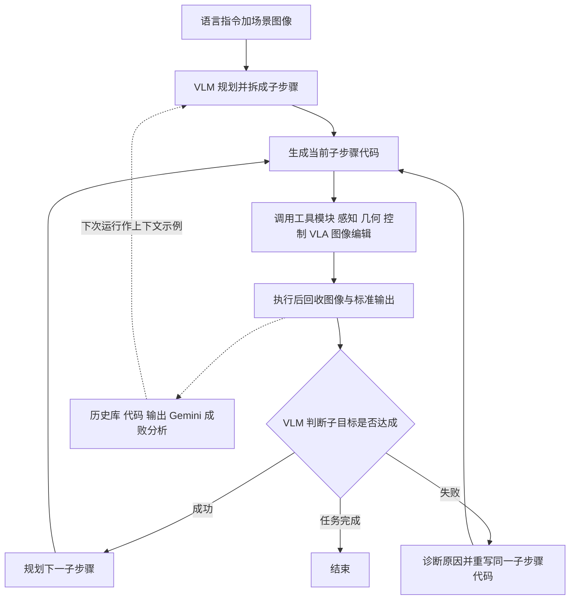

# MAESTRO（arXiv:2511.00917）

**MAESTRO**（*Managerial Agent for Executing Sensorimotor Tasks in RObotics*；v1 标题 *MAESTRO: Orchestrating Robotics Modules with Vision-Language Models for Zero-Shot Generalist Robots*，[arXiv:2511.00917](https://arxiv.org/abs/2511.00917)）来自宾夕法尼亚大学。本页依据 arXiv v1 全文整理；CoRL 2026 阅读清单 P1 档收录（见「与清单说法的核对」）。

## 一句话定义

**以 VLM 编程智能体为策略核心：不训练端到端动作模型，而是让 VLM 在「规划、反应、重规划」闭环中写并执行代码，调用一组精选的感知、几何、控制、学习策略与图像编辑模块，完成零样本操作任务（摘要、III 节）。**

## 英文缩写速查

| 缩写 | 英文全称 | 简要说明 |
|------|----------|----------|
| VLM | Vision-Language Model | 视觉-语言模型；本文用 Gemini Robotics-ER 1.5 作主智能体 |
| VLA | Vision-Language-Action | 视觉-语言-动作端到端策略；基线为 π0 与 π0.5 |
| CaP | Code as Policies | 让 LLM / VLM 生成程序调用 API 作为策略 |
| STAR-Gen | 论文引用的机器人泛化分类法 | 用系统扰动（外观、位姿、动词、新物体）生成评测变体 |
| DROID | Distributed Robot Interaction Dataset | 桌面平台配置（Franka + Robotiq）与数据集；基线 checkpoint 在其上微调 |
| IK | Inverse Kinematics | 逆运动学；移动任务失败原因之一（IV-C） |

## 为什么重要

- 主流路线是堆遥操作数据训练端到端 VLA；本文给出反例：不用机器人训练数据、只靠工具广度与闭环接口，也能在若干真机桌面任务上超过 DROID 微调的 π0 / π0.5（作者自述，I、IV-B）。
- 保留了模块化系统的可解释、可调试、可扩展：可以把 VLA 本身当工具接入，换具身只需局部改工具或代码（摘要、I；移动平台为实例）。
- 对 CaP 路线的启示：作者把差距归因于「更全的工具」与「更精简的闭环接口」，并用消融（表 IV）部分支持前者（II-A、IV-D）。

## 核心原理与流程总览

**工具集（III-A、附录 A、表 I）：** 感知由粗到细（原始 RGB 与本体感觉 → 分割中心 / 指点 → VLM 选取的任务相关关键点，受 ReKep 启发），FoundationStereo 估深度，主动感知（腕部相机放大、环顾）；几何与线性代数（距离、向量构造、向量间相对旋转、按角度旋转向量）；控制（笛卡尔末端、夹爪，cuRobo 点云避碰运动规划）；学习策略（GraspGen 抓取模型、π0.5 作为可调用 VLA，配 Qwen2.5-VL-72B 的 2 Hz 完成监控）；图像编辑（画点、叠加 6D 位姿）。移动平台另加 Faster-LIO 状态估计、环视与篮子查看、Nav2 导航与微调「nudge」、语义地图。

**演化（III-C）：** 每次运行后记录代码、输出和 Gemini 对执行视频的成败分析，下次运行前作为上下文示例给 Gemini；没有参数更新。

## 工程实践

- **VLM 与外部模型：** 主智能体 Gemini Robotics-ER 1.5（IV-A）；关键点工具调用 GPT-o3（附录 A）；VLA 监控用本地 Qwen2.5-VL-72B-Instruct（III-A）。即系统依赖多个云端与本地大模型，API 延迟计入运行时间（V）。
- **平台：** DROID 配置桌面臂；Unitree Go2-W 加 AgileX PiPER 移动操作（IV-A）。
- **评测协议：** 5 次试验 / 任务，由 STAR-Gen 扰动生成并对所有方法固定；设任务时限；按附录 B 子步骤给进度分。叠毛巾任务的评分细则按试验动态调整（附录 B-2）。
- **基线实现：** Gemini Robotics Agent 是作者按 Gemini Robotics 技术报告自行实现的 CaP 基线，工具较少（IV-B、表 I）；π0 用 π0-FAST-DROID，π0.5 用 π0.5-DROID（IV-B）。
- **未公开信息：** 论文与本次读到的内容均未给出代码仓库地址，只有项目页 maestro-robot.github.io（未读）。

## 与清单说法的核对

清单一句话：*A VLM coding agent orchestrating perception, planning and control tools matches VLAs zero-shot, without new teleop data.*

| 清单说法 | 论文核对 |
|----------|----------|
| VLM 编程智能体编排感知、规划、控制工具 | 属实（III、表 I）。补充：工具还含几何、图像编辑、可调用的 π0.5 与 GraspGen；除 Gemini 外还用 GPT-o3 与 Qwen2.5-VL-72B |
| 零样本「持平」VLA | 偏保守但需限定：摘要与引言写 "matches and in many cases surpasses"。表 II 中 7 个桌面任务 6 个 MAESTRO 均值最高，挂杯任务 π0.5 为 80.0 高于 69.0，叠毛巾 71.3 对 70.0 差距在标准差内。仅真机、仅 DROID 桌面平台、每任务 5 次试验，标准差很大（如放入碗 ±4.5 对 π0 ±37.1）。比较对象是 DROID 微调的 π0-FAST 与 π0.5，不是所有 VLA |
| 没有新的遥操作数据 | 论文结论写 "Without relying on any robot training data"（V）。需注意：其工具（GraspGen、FoundationStereo、Grounded-SAM 等）与 Gemini Robotics-ER 本身都由数据训练得到，只是本文未新增机器人数据；「演化」一节用到真机试验的上下文记录（IV-E），不属于零样本 |
| 题名 "Coding Agents" | v1 首页标题为 "…with Vision-Language Models…"；清单题名可能来自后续版本，推测，未核实 |
| （清单未提）移动操作与「MAESTRO + π0.5」 | 移动 4 任务仅有 MAESTRO 自身结果，无基线（表 III）。正文称含 MAESTRO + π0.5 对比，但 v1 表 II 无该列，数字缺失 |

## 局限

**作者承认（IV-B、V、I）：**
- 需要复杂对象可供性与空间朝向思维链的任务仍失败（挂杯：对不准杯柄孔与支架分叉）。
- 精细连续控制需要更丰富的低层行为；VLM API 响应带来暂停，运行时间延长，延迟与算力开销高于端到端 VLA。
- 移动任务中深度估计偶有误差导致抓取位姿违反 IK 约束；重规划有时陷入振荡（IV-C）。

**我看到的未验证之处（判断，非作者所述）：**
- 样本量小：每任务 5 次试验、标准差大，多个任务的差异置信度有限；消融只在两个任务上做（表 IV）。
- 基线公平性：Gemini Robotics Agent 为自行实现；π0 / π0.5 用 DROID 微调版并在作者场景扰动下评测，未见对基线的调参或提示工程描述；MAESTRO 使用时限内多次重试，论文称基线同样可重试，但具体次数未给出。
- 评分为人工设计的子步骤进度，且叠毛巾的细则按试验动态调整（附录 B-2），可比性依赖作者。
- 没有在仿真基准或第三方实验室复现；移动操作无基线对比。
- 工具链依赖较多外部模型与闭源 API，成本与可复现性未量化。

## 关联页面

- [VLA 方法总览](../methods/vla.md)
- [LLM 与机器人控制接口](../concepts/llm-robotics-control-interfaces.md)
- [行为树与 VLA 编排](../concepts/behavior-tree-vla-orchestration.md)
- [Code-as-World](./paper-code-as-world.md)
- [移动 Code-as-Policies 相关论文](./paper-mocap-mobile-code-as-policies.md)
- [Gemini Robotics](./gemini-robotics.md)
- [π0.5 开放世界 VLA](./paper-pi05-open-world-vla.md)
- [π0](./paper-pi0.md)
- [DROID 策略学习](./droid-policy-learning.md)
- [cuRobo](./curobo.md)

## 参考来源

- [MAESTRO 来源归档](../../sources/papers/maestro_arxiv_2511_00917.md)
- 论文：<https://arxiv.org/abs/2511.00917>（v1 PDF 全文）
- CoRL 2026 Reading List（Glen Berseth 博客，清单摘要为 LLM 据摘要起草）：<https://www.fracturedplane.com/blog/2026/11/10/CoRL2026-Reading-List.html>

## 继续阅读

- 项目页：<https://maestro-robot.github.io>（视频与补充材料，本页未读）
- 对比阅读：[Code-as-World](./paper-code-as-world.md) 与 [π0.5](./paper-pi05-open-world-vla.md)，对照「代码即策略」与「端到端 VLA」两条路线。
