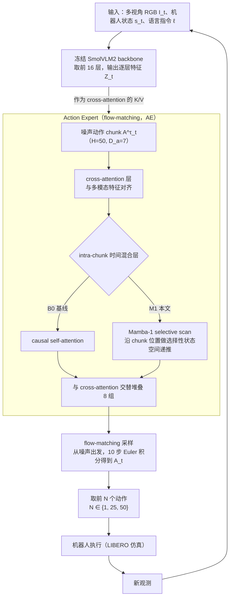

# Mamba SmolVLA Expert（arXiv:2608.21407）

**Mamba SmolVLA Expert**（[arXiv:2608.21407](https://arxiv.org/abs/2608.21407)）收录于 [多模空间 · 一周 VLA 研究趋势简析（2026.08.10–08.16）第一篇](../../sources/blogs/wechat_duomo_vla_weekly_trends_2026-08-10_part1.md) **架构模块** 段。

## 一句话定义

**用 Mamba 选择性状态空间替代 SmolVLA action expert 中的因果自注意力；逐步规划成功率接近 Transformer 且参数更少，连续多步执行时任务成功率保留更好，适合实时部署。**

## 英文缩写速查

| 缩写 | 英文全称 | 简要说明 |
|------|----------|----------|
| VLA | Vision-Language-Action | 视觉–语言–动作策略 |
| VLM | Vision-Language Model | 视觉–语言多模态模型 |
| VLN | Vision-Language Navigation | 视觉–语言导航 |
| WAM | World Action Model | 联合未来与动作生成的具身策略 |
| TTT | Test-Time Training | 部署阶段无标注数据的在线适配 |

## 为什么重要

- 用 Mamba 选择性状态空间替代 SmolVLA action expert 中的因果自注意力；逐步规划成功率接近 Transformer 且参数更少，连续多步执行时任务成功率保留更好，适合实时部署。
- 开源状态：**待核实**（步骤 2.5，入库日 2026-09-19）。
- 与 [vla weekly trends 2026 08 10 part1 technology map](../overview/vla-weekly-trends-2026-08-10-part1-technology-map.md) 同批工作可横向对照。

## 流程总览

图依据：论文 §III-A–D、§IV-A / Fig.2

## 核心机制

| 项 | 内容 |
|----|------|
| **arXiv** | [2608.21407](https://arxiv.org/abs/2608.21407) |
| **开源** | **待核实** |
| **文内评测** | LIBERO |

## 源码运行时序图

**不适用**（截至入库日未提供可运行官方代码入口，或仓库尚未公开）。

## 实验与评测

- **文内口径：** LIBERO
- **读法：** 本页为 [公众号策展](../../sources/blogs/wechat_duomo_vla_weekly_trends_2026-08-10_part1.md) 摘要；逐项指标以 **原文 PDF** 为准。

## 与其他工作对比

> 下表只做**定位对照**：本页与下列同批各页均为 [公众号策展](../../sources/blogs/wechat_duomo_vla_weekly_trends_2026-08-10_part1.md) 的索引级摘要，未逐条核对原文实验表，彼此**不共享同一评测协议**，不可据此横比数字。

| 对照 | 差异读法 |
|------|----------|
| [选择性状态空间模型](../concepts/state-space-model-ssm.md) / [RNN·CNN·Transformer·Mamba 对比](../comparisons/rnn-cnn-transformer-mamba.md) | 这两页给「用 SSM 换注意力」的一般理由（近线性复杂度 + 长程建模）；本文是把该替换**只做在 action expert 上**、VLM 骨干不动的一个具体落点，读法应是局部换算子而非换骨干 |
| [WA-SpecDec](./paper-wa-specdec.md) | 同批同为压动作生成开销，层次不同：本文换**算子**（因果自注意力 → Mamba，参数更少），WA-SpecDec 改**解码流程**（投机 + 校验）。两条正交，可叠加 |
| [Action Chunking](../methods/action-chunking.md) | 本文的卖点是「连续多步执行时任务成功率保留更好」，落点正是 chunk 的 open-loop 段；该页解释这段为何会漂，读本文应看**多步保留**而非单步规划成功率 |
| [实时性 ↔ 泛化取舍](../concepts/embodied-fm-latency-generalization-tradeoff.md) | 「成功率接近 Transformer 且参数更少」是这条取舍线上的一次移动；跨设定搬运前须确认 action expert 以外的骨干规模一致，否则省下的参数量不可比 |

## 结论

**Mamba SmolVLA Expert 适合作为本期「架构模块」路线的快速索引页。**

1. 核心贡献：用 Mamba 选择性状态空间替代 SmolVLA action expert 中的因果自注意力；逐步规划成功率接近 Transformer 且参数更少，连续多步执行时任务成功率保留更好，适合实时部署。
2. 开源结论：**待核实** — 以项目页/仓库实际链接为准。
3. 横向对照见 [技术地图](../overview/vla-weekly-trends-2026-08-10-part1-technology-map.md)，避免与同 arXiv 重复造页。

## 关联页面

- [VLA（Vision-Language-Action）](../methods/vla.md)
- [一周 VLA 趋势技术地图](../overview/vla-weekly-trends-2026-08-10-part1-technology-map.md)
- [Generative World Models](../methods/generative-world-models.md)

## 参考来源

- [wechat_duomo_vla_weekly_trends_2026-08-10_part1.md](../../sources/blogs/wechat_duomo_vla_weekly_trends_2026-08-10_part1.md)
- [arXiv:2608.21407](https://arxiv.org/abs/2608.21407)
- [arXiv PDF](https://arxiv.org/pdf/2608.21407)：已通读方法部分（实验与附录以略读为准）：§I Introduction、§III Methods（A–D）、§IV-A 实现细节；§IV 其余与 §V 实验以略读为准

## 推荐继续阅读

- [VLA 方法页](../methods/vla.md)
- [arXiv PDF](https://arxiv.org/pdf/2608.21407)
