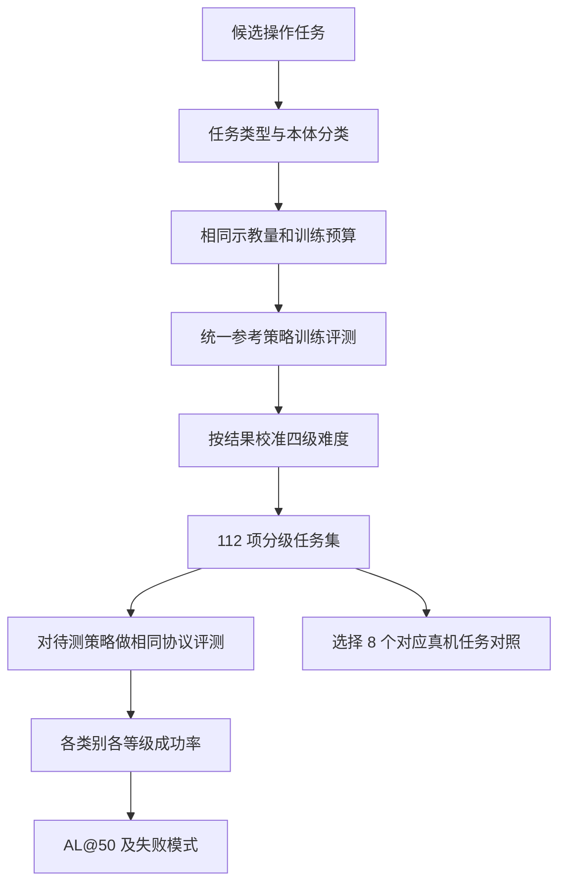

# ManiLadder: Benchmarking Robot Manipulation Through a Categorized and Multi-Difficulty Level Task Ladder｜ManiLadder：操作难度阶梯基准

## 一句话定义

**ManiLadder** 将机器人操作评测分解为任务类别与四级难度，以统一参考策略和训练预算校准任务难度，比单一平均成功率更清楚地定位策略短板。

## 英文缩写速查

| 缩写 | 英文全称 | 简要说明 |
|---|---|---|
| AL@50 | Attained Level at 50% | 同时要求等级、任务覆盖率和成功率 |
| VLA | Vision-Language-Action | 视觉语言动作模型 |
| IL | Imitation Learning | 模仿学习 |
| Sim2Real | Simulation to Reality | 从仿真到真实系统的迁移 |

## 为什么重要

平均成功率相近的操作策略，可能分别卡在柔性物体、双臂、长程任务或基础接触控制。分类型分难度报告能揭示不同能力短板，避免用单一排行榜分数掩盖失败模式。

## 核心信息

| 项 | 内容 |
|---|---|
| 原文 | [arXiv:2611.16374v1](https://arxiv.org/abs/2611.16374) |
| 项目 | [ManiLadder](https://maniladder-benchmark.github.io/)（站点读取未完成） |
| 范围 | **112 项**操作任务，**4 级**难度 |
| 真机 | **8 项**对应任务，每项 **50 次** |
| 可运行代码 | 未核实官方发布链接，待再次检查项目页 |

## 核心原理

1. 在不同操作任务类型及机器人形态下组织基准，采用同一参考策略和受控数据/训练预算校准任务难度。
2. 通过任务成功率与学习曲线划分四个相对难度级别；**等级依赖校准策略和预算**，不能当成任务本身独立于算法的绝对属性。
3. 评测新策略时按任务类别、难度级别统计成功率与覆盖率。AL@50 定义：只有目标级和所有更低级的每一级中，至少 **80%** 的任务成功率达到 **50%**，才算达成目标等级。

### 流程总览

这是论文的研究与基准流程，并非未核验代码仓库中的脚本执行流程。

## 源码运行时序图

**不适用（项目代码待核实）：** 原文提供项目入口，但当前无法可靠读取 https://maniladder-benchmark.github.io/ 的 Code / Resources，也未核实官方可运行实现和脚本入口；不能编造 `sequenceDiagram` 或断言未开源。

## 工程实践

1. 先锁定参考策略、训练预算、数据量、评测种子与成功判据，确保任务难度对照有可比性。
2. 同时发布 **任务族 × 难度** 成功率矩阵与 AL@50，不仅输出平均成功率。
3. 达成等级需从低到高逐级覆盖；某个高难任务得分很高，不能抵消大量低难任务失败。
4. 对预期硬件选择对应的真实任务进行验证；仿真难度排序不保证跨本体普适。

## 实验与评测

- **112 个任务、四级难度：** 参考策略在受控预算下校准分层，后续同协议比较不同策略。
- **AL@50：** 50% 任务成功率阈值与 80% 任务覆盖率阈值均须满足，且每个更易等级均需满足。
- **真机：** 八个对应操作任务各评测 50 次，难度相对顺序基本保留；不能推出全部仿真任务都有同等现实可迁移性。

## 结论

**操作基准必须交代类别分布、难度校准策略和资源预算；只看汇总成功率不足以诊断策略能力。**

1. 用分层结果定位模型能力缺口，优先分析跨等级退化而非单个最高分。
2. 准确计算 AL@50 的低层连续覆盖，不把它误作均值。
3. 把训练/示教预算作为难度定义的一部分公开。
4. 将真机结果理解为有限对应场景的验证，不能外推全部形态。
5. 官方代码是否发布须等待项目页重新核验，再补真正的运行时序。

## 与其他工作对比

| 工作 | 重点 | 解读边界 |
|---|---|---|
| ManiLadder | 分类别、难度和覆盖率评测 | 相对于校准模型和预算 |
| [操作基准审计](./paper-manipulation-benchmark-audit.md) | 语言捷径、显著性和数据来源 | 重点是评测可信度 |
| [LIBERO](./libero-benchmark.md) | 操作任务迁移与成功率 | 不提供本文同样的难度阶梯 |

## 局限与风险

任务难度是参考策略与训练资源条件化的测量，等级跨策略/跨本体不必相同。真机只验证八个对应任务。项目页读取受阻，源码和数据开放状态未核实；**论文解读完成不意味着官方实现已验证或已复现**。

## 关联页面

- [机器人操作基准审计](./paper-manipulation-benchmark-audit.md)
- [LIBERO](./libero-benchmark.md)
- [JustRUA](./paper-justrua-robot-use-agents.md)
- [具身评测纵深 Stage 3](../../roadmap/depth-embodied-eval.md)

## 参考来源

- [论文正文核读归档](../../sources/papers/maniladder-arxiv-2611-16374.md)
- [官网开放状态核对记录](../../sources/sites/maniladder-project.md)

## 推荐继续阅读

- [论文 HTML](https://arxiv.org/html/2611.16374)
- [项目官网](https://maniladder-benchmark.github.io/)
