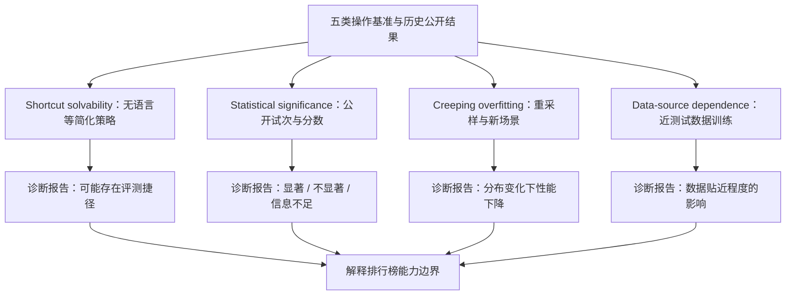
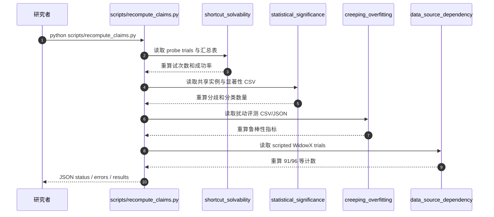

# What Are We Actually Benchmarking in Robot Manipulation?｜机器人操作基准到底测到了什么？

论文：[arXiv:2606.04233](https://arxiv.org/abs/2606.04233)；[项目主页](https://ripl.github.io/manipulation_benchmark_audit/)；[官方开源与证据](https://github.com/ripl/ManipulationBenchmarkAudit)。本文是基准有效性审计，**不是** 新的高成功率操作策略。论文与证据范围见[原文归档](../../sources/papers/manipulation_benchmark_audit_arxiv_2606_04233.md)。

## 一句话定义

通过四类诊断审计五个常用机器人操作 benchmark，回答“高分到底来自稳定的语言/操作/泛化能力，还是来自狭窄初始状态、贴近测试的数据、统计噪声或可用捷径”。

## 英文缩写速查

| 缩写 | 英文全称 | 简要说明 |
|---|---|---|
| LIBERO | Lifelong Benchmark for Robot Manipulation | 审计的语言条件机器人操作基准 |
| CALVIN | Composing Actions from Language and Vision | 长序列机器人操作基准 |
| VLA | Vision-Language-Action | 视觉语言动作基础策略 |
| DSD | Data Source Dependence | 训练演示数据与测试分布接近时产生的依赖 |
| CI | Confidence Interval | 判断比较差异的不确定性工具 |
| ATC | Average Tasks Completed | CALVIN 序列任务平均完成数 |

## 为什么重要

- 机器人操作排行榜通常汇总为单个成功率，但模型可能凭任务 ID、固定初始条件或近测试示范绕过被声称的能力。
- 模型间几百分点的差异，若没有逐任务/逐试次结果与不确定性，无法自动视为真正优于上一模型。
- 场景扰动、分布外初始化、数据源依赖应与 IID 分数并列汇报。

## 核心原理与流程总览

| 检查 | 核心问题 | 论文证据 |
|---|---|---|
| 捷径可解性 | 模型是否可以不使用语言信息？ | LIBERO 无语言编码器的约 0.09B probe 在基准高分区域 |
| 统计显著性 | SOTA 差距超过噪声吗？ | 论文早期 LIBERO 公告数字 19.8% 可证显著；按最新官方代码包另有 18.3% 的修订子集 |
| 测试条件过拟合 | 小幅调整物体起点后是否下降？ | CALVIN 在训练位置范围内重采样积木位姿，受测策略 ATC 下滑 |
| 数据源依赖 | 近测试数据能否让小模型接近大型 VLA？ | SimplerEnv 22M 近测试数据策略 94.8%，不同条件 X-VLA 95.8% |

**覆盖的五类基准：** LIBERO、CALVIN、SimplerEnv、RoboCasa、RoboTwin 2.0；四项诊断并不表示每个基准都有同样深度的四套完整实测。

## 实验与评测

- **LIBERO probe：** 约 0.09B 的简化方案无需语言编码器，并非证明大型 VLA 无用，而是表明某些 benchmark 的非语言线索足以构成高分捷径。
- **CALVIN 扰动：** 在训练范围内改变积木位置，也能让所有受测策略的平均任务完成数下降；考验的是策略对具体摆位的鲁棒性。
- **显著性比例不要跨版本混写：** 论文原始摘要/项目页给出 LIBERO **19.8%**；官方 `CLAIMS.md` 描述 camera-ready 口径 LIBERO Spatial/Object/Goal **144/789 = 18.3%**，SimplerEnv **24/122 = 19.7%**。公开包明确 frozen-paper 与 release-current 差异 88 行。其余非显著/不可判定的比较不能一概说“都不成立”。
- **SimplerEnv 数据源：** 脚本数据近测试条件，小模型 **91/96 = 94.8%**；X-VLA 约 **95.8%** 使用不同训练来源，属于混杂因素分析而非严格隔离参数量作用。
- **证据等级：** 官方仓库既有原始 trial 结果、可重算统计、简单模型的部分训练脚本，也有未打包的外部模型和仿真依赖。不能把“在公开 CSV 上重算一致”写成“独立复现训练”。

## 源码运行时序图

根据 [官方 README](https://github.com/ripl/ManipulationBenchmarkAudit/blob/main/README.md)、[`CLAIMS.md`](https://github.com/ripl/ManipulationBenchmarkAudit/blob/main/CLAIMS.md)、[`scripts/recompute_claims.py`](https://github.com/ripl/ManipulationBenchmarkAudit/blob/main/scripts/recompute_claims.py) 的真实入口，以下是**轻量 claim 复核**，并非第三方策略全流程仿真：

注意：图示输入为官方公开结果文件；各诊断本体的训练/仿真脚本需按 [REPRODUCIBILITY.md](https://github.com/ripl/ManipulationBenchmarkAudit/blob/main/REPRODUCIBILITY.md) 分别准备数据、权重和环境。

## 工程实践

1. 先使用 `python scripts/recompute_claims.py` 复核发布的 headline claims，再用 `scripts/validate_release.py` 检查文件与精确初始化状态；这是论文已有证据的自洽校验。
2. 对自己的模型：固定并公开环境初始化、试次数、策略 checkpoint、成功/失败原始计数、场景扰动协议和训练数据来源。
3. 排行榜微小提升须有显著性或区间判断，必要时用同一组初始场景开展配对比较。
4. **开源状态：** [官方仓库](https://github.com/ripl/ManipulationBenchmarkAudit) 已公开四类诊断包、部分训练/评测代码及可重算结果，部分大型权重与数据在独立下载位置；不保证第三方 benchmark 一键复现。

## 结论

**操作基准分数只能证明具体评测协议下的表现，不能自动外推为开放环境中的语言理解、稳健操作或泛化能力。**

1. 先用“去掉语言、换随机初始状态”检查基准是否存在可利用捷径。
2. 同时报成功率、试次数、可信区间及逐任务分数，不只比较榜单单一数字。
3. 追踪训练数据与测试场景的来源接近程度，防止把数据覆盖当算法泛化。
4. 严格标注论文版本与统计分类规则：19.8%、18.3%、19.7% 分属不同快照/集合。
5. 对小样本真机报告，建议同时展示完成次数、失败类别和多次重复。

## 局限与风险

- 这些诊断发现的是**被测试的模型与基准**的弱点，不能概括所有机器人学习路线；作者自己的小 probe 也不代表全面策略能力。
- 不同 benchmark 的实验、分数与试次不可以直接合并比较；显著性“无法判定”与“证明无效”不同。
- 全部历史第三方 checkpoint、数据与环境并未一并打包，官方复现说明列明不可一键重放的边界。

## 关联页面

- [Manipulation](../tasks/manipulation.md) — 任务和协议背景。
- [VLA](../methods/vla.md) — 为什么单一 benchmark 高分不证明语言条件策略泛化。
- [DISCO](./paper-distilled-tree-search-multi-object-rearrangement.md) — 真机每任务三次的例子，说明试次数披露的重要性。
- [RoboTTT](./paper-robottt-test-time-training-vla-context.md) — 注意部分完成度与全任务成功率的区别。

## 参考来源

- [全文核对归档](../../sources/papers/manipulation_benchmark_audit_arxiv_2606_04233.md)
- [项目主页归档](../../sources/sites/manipulation-benchmark-audit.md)
- [官方源码与数据复核归档](../../sources/repos/manipulation-benchmark-audit-official.md)
- [arXiv 原论文](https://arxiv.org/abs/2606.04233)

## 推荐继续阅读

- [项目主页](https://ripl.github.io/manipulation_benchmark_audit/)
- [官方实验代码与 CLAIMS 映射](https://github.com/ripl/ManipulationBenchmarkAudit)
- [官方发布及复现限制](https://github.com/ripl/ManipulationBenchmarkAudit/blob/main/REPRODUCIBILITY.md)
