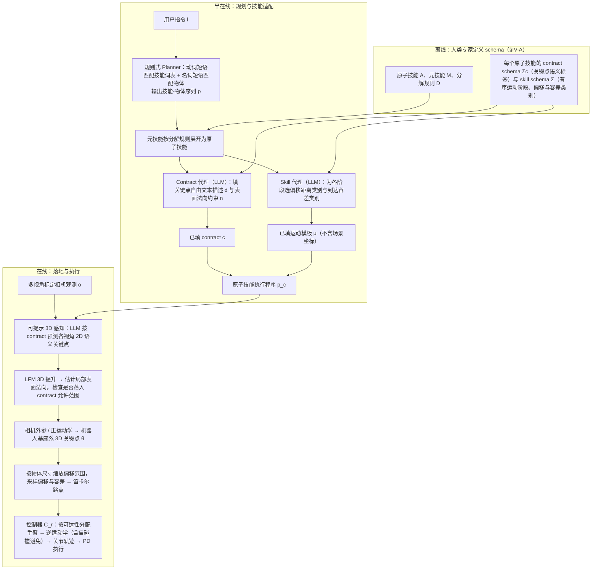

# ManiSkillFormer（arXiv:2609.16331）

**ManiSkillFormer**（*ManiSkillFormer: Demonstration-Free Compositional Manipulation via Task-Conditioned Geometric Contracts*，[arXiv:2609.16331](https://arxiv.org/abs/2609.16331)）来自 [senlanke 具身运控lab 周更盘点](../../sources/blogs/wechat_senlanke_weekly_manipulation_2026-09-14_18.md)（2026-09-14–18）。

## 一句话定义

**Task-Conditioned Geometric Contract 声明 keypoint/normal 等 primitive；LLM 生成 contract+模板，视觉定位后实例化；Galaxea R1-Lite 无示范 Pick-and-Place 88.24%。**

## 英文缩写速查

| 缩写 | 英文全称 | 简要说明 |
|------|----------|----------|
| LLM | Large Language Model | 大语言模型 |
| BC | Behavior Cloning | 行为克隆 |
| EE | End-Effector | 末端执行器 |

## 为什么重要

- 无示范组合操作需可验证几何契约而非黑盒 policy。

## 流程总览

图依据：论文 §IV-A 至 §IV-F 与 Fig. 1 / Fig. 2

## 核心机制

| 项 | 内容 |
|----|------|
| **arXiv** | [2609.16331](https://arxiv.org/abs/2609.16331) |
| **开源** | **待发布**（步骤 2.5，2026-09-20） |
| **方法摘要** | LLM contracts + motion templates + 3D primitive grounding on dual-arm platform. |

## 源码运行时序图

**不适用**（截至 2026-09-20 未发布可运行官方代码或待核实）。

## 实验与评测

- Pick-and-place 88.24% avg without per-object demos（作者报告）。
- 读法：先对齐任务设定、传感器与成功定义，再解读 headline 数字。

## 与其他工作对比

| 维度 | 读法 |
|------|------|
| **同周对照** | 见对应 [周更盘点](../../sources/blogs/wechat_senlanke_weekly_manipulation_2026-09-14_18.md) 映射表，勿跨任务直接比 SR |
| **开源状态** | **待发布** — 部署前以项目页/arXiv 为准 |

## 结论

**ManiSkillFormer 用几何契约 + LLM 模板实现无示范双臂组合操作。**

1. 开源：**待发布**；勿凭公众号摘要臆断可复现性。
2. 指标须连同实验条件解读（仿真/真机、平台、成功阈值）。
3. 关注 arXiv 版本更新与代码发布。

## 关联页面

- [manipulation](../tasks/manipulation.md)
- [vla](../methods/vla.md)
- [loco-manipulation](../tasks/loco-manipulation.md)

## 参考来源

- [maniskillformer_arxiv_2609_16331.md](../../sources/papers/maniskillformer_arxiv_2609_16331.md)
- [wechat_senlanke_weekly_manipulation_2026-09-14_18.md](../../sources/blogs/wechat_senlanke_weekly_manipulation_2026-09-14_18.md)
- [arXiv:2609.16331](https://arxiv.org/abs/2609.16331)
- [arXiv PDF](https://arxiv.org/pdf/2609.16331)：已通读方法部分（实验与附录以略读为准）：§III 问题定义，§IV 方法（系统概览、Planner、几何 contract、3D 感知模块、AgenSkillGraph、控制器）

## 推荐继续阅读

- [arXiv PDF](https://arxiv.org/pdf/2609.16331)
