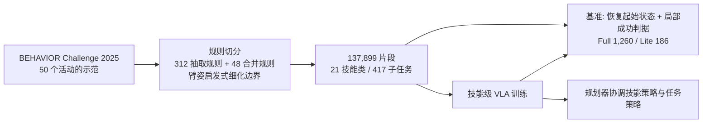

---

type: entity
project_id: maniunit
tags: [paper, manipulation, dataset, benchmark, long-horizon, skill-learning, vla, behavior-1k, njust, intellifusion, npu]
status: complete
updated: 2026-10-12
arxiv: "2610.12089"
related:
  - ../overview/frontier-manipulation-2026-10-05-10-09.md
  - ../tasks/manipulation.md
  - ../methods/vla.md
  - ../methods/star-vla.md
  - ./behavior-1k.md
  - ./paper-pi05-open-world-vla.md
  - ./paper-oss-detect-restore-resume.md
  - ./paper-skillweave.md
sources:
  - ../../sources/papers/maniunit_arxiv_2610_12089.md
  - ../../sources/blogs/frontier_manipulation_2026_10_05_10_09.md
summary: "ManiUnit 把 50 个 BEHAVIOR-1K 活动切成 137,899 个技能片段（21 类、417 子任务），并配 1,260 实例的技能级基准；关节起始扰动使成功率降约 56%，技能策略 78.7% 对任务策略 49.3%。"
---

# ManiUnit

**ManiUnit**（arXiv:2610.12089，南京理工大学 / 西北工业大学 / 云天励飞等）是面向长程移动操作的**技能级数据集 + 基准**：从 BEHAVIOR-1K 的长任务示范里切出带显式子任务指令的技能片段，并通过“恢复中间仿真状态 + 局部成功判据”让每个技能能被单独测试，不必先跑完前面的阶段。

## 英文缩写速查

| 缩写 | 英文全称 | 简要说明 |
|------|----------|----------|
| BEHAVIOR-1K | Benchmark of 1,000 Everyday Activities | 论文数据来源的日常活动仿真基准 |
| BDDL | Behavior Domain Definition Language | 描述任务目标谓词，用作局部成功判据 |
| VLA | Vision-Language-Action | 评测的策略类型 |
| StarVLA | 模块化 VLA 训练框架 | 论文以 Qwen3.5-2B / Cosmos2 骨干构造三个变体 |
| Q-score | 部分完成度得分 | 论文用于全任务评分的平均指标（具体定义原文未在可读段给出） |

## 为什么重要

- **定位失败源：** 任务级成功率看不出是哪个技能出错；ManiUnit 的 1,260 个实例按 21 类技能分别评分。
- **起始状态鲁棒性被量化：** 在 Full 上，关节起始扰动相对原始起始状态使成功率下降约 56%（PI 60.1 -> 26.5，GR00T 63.5 -> 28.2）。
- **技能级训练更有效：** 同一 π0.5 权重、同样 5 epoch，技能策略 78.7% 对任务策略 49.3%。

## 流程总览

## 核心原理（方法）

### 1）数据构造
以 2025 BEHAVIOR Challenge 对 50 个 BEHAVIOR-1K 活动的示范为源，用 312 条手写抽取规则和 48 条合并规则从标注动作区间切片，再用臂姿启发式（每臂 3 个关节、至少偏离 15 度、至少 5 帧）与夹爪事件保持细化边界。每个片段含头部及双腕 RGB、机器人状态与动作，配显式子任务指令；平均 17.9 s。21 种技能类型包括 Pick Up、Place、Open/Close Door/Drawer/Lid、Pour、Wipe、Insert、Hang 等。Lite 子集：10,588 片段、7 类技能，取自成功率最高的 8 个活动。

**重定向就绪度 / 训练输入：** 片段切自 BEHAVIOR 仿真示范中机器人自身的状态—动作轨迹（非人体动作），无需重定向，可直接作为同一本体的技能级 VLA 策略训练输入——论文四个被评策略均直接在片段上训练。机器人本体与仿真器名称在可读正文中未给出，迁移到其他本体需自行适配动作空间与相机配置。

### 2）基准协议
测试实例 e=(s0, l, g)：恢复的起始状态、子任务指令、局部 BDDL 成功谓词。场景通过回放已存回合历史重建、恢复辅助抓取约束，并先 25 步稳定、再 60 步保持。条件：Original、Base Perturbation（基座平移）、Joint Perturbation（部分臂/躯干关节），均做碰撞与物体关系检查。局部目标须连续保持 10 帧且不超过该子任务平均示范时长的 3 倍；Full 每实例 3 次重复、Lite 5 次，按技能类型等权平均。

### 3）被评策略
StarVLA-PI、StarVLA-GR00T（Qwen3.5-2B 骨干 + 随机初始化动作头）、StarVLA-Cosmos2（Cosmos-Predict2 骨干）、π0.5（用 RLinf 微调）；均 5 epoch、跨技能混合训练。学习率、批大小、算力与机器人/仿真器型号在可读正文中未给出。

### 4）规划器协调
规划器读取机器人状态与视觉历史，决定何时交出控制权及给出哪条子任务指令；具体架构在附录 D.3，本次未能读取，不作推断。

## 源码运行时序图

不适用：论文与可读正文未提供项目页、仓库或数据发布信息（附录未读到），截至 2026-10-12 无法对齐任何公开目录或脚本。

## 工程实践

- 作为评测协议的复用点：用“回放历史重建起始状态 + 局部谓词”，避免为了测第 5 个技能而跑前 4 个。
- 评测时同时报 Original / Base / Joint 三个条件；只看 Original 会高估鲁棒性（Lite 上 π0.5 80.0 对 Joint 53.0）。
- 复现规则切分需要原 312+48 条规则，论文未见公开。
- **开源状态：** 无项目页、无仓库，数据集与基准发布未核实（附录被截断，不排除附录中有声明）；不得写为已开源。

## 实验与评测

| Full（1,260） | Original | Base | Joint | Overall |
|------|------|------|------|------|
| StarVLA-PI | 60.1 | 51.2 | 26.5 | 45.9 |
| StarVLA-GR00T | 63.5 | 51.3 | 28.2 | 47.6 |

| Lite（186） | Original | Base | Joint | Overall |
|------|------|------|------|------|
| StarVLA-PI | 70.1 | 67.3 | 26.8 | 54.7 |
| StarVLA-GR00T | 77.8 | 64.0 | 29.6 | 57.1 |
| StarVLA-Cosmos2 | 63.2 | 59.0 | 13.8 | 45.3 |
| π0.5 | 80.0 | 65.8 | 53.0 | 66.3 |

- 相似总分掩盖技能差异：Full 上 Pick Up GR00T 54.4 对 PI 44.4；Lite 上 Place PI 81.9 对 GR00T 70.5，Pour GR00T 40.0 对 PI 12.4。
- Pick Up 的对象变化（Lite）：π0.5 91.4（原始）/ 74.3（位置）/ 80.0（颜色）/ 80.0（干扰物）；PI 68.6 / 40.0 / 60.0 / 62.9；位置变化降幅最大。
- 技能策略对任务策略（两个活动、75 个实例）：78.7% 对 49.3%（Original 84.0 对 60.0，Base 76.0 对 56.0，Joint 76.0 对 32.0）；Press radio 13.3% -> 80.0%，Pick up trash 60.0% -> 93.3%。
- 规划器协调后全任务成功率 Radio/Trash/总：任务策略 4.0/4.0/4.0%，组合系统 24.0/12.0/18.0%。

## 结论

**ManiUnit 说明长程任务的短板常在“技能在非示范起始状态下失效”，而技能级数据 + 局部评测既能定位问题，也能在同等训练预算下显著提高局部成功率。**

1. **关节起始扰动是主要杀手：** Joint 条件比 Original 低约 56%，比 Base 平移更严重。
2. **按技能而不是按总分选模型：** 总分接近的模型在 Pour、Place 等技能上差异巨大。
3. **技能策略优于任务策略：** 78.7% 对 49.3%，Joint 条件下 76.0 对 32.0。
4. **规划器仍是瓶颈：** 组合系统全任务 18.0%，距离局部 78.7% 很远。
5. **证据面：** 全任务只测了两个活动，规划器细节未读到。

## 与其他工作对比

| 对照 | 差异读法 |
|------|----------|
| [BEHAVIOR-1K](./behavior-1k.md) | 数据来源；ManiUnit 在其示范上重切成技能级 |
| [OSS Detect-Restore-Resume](./paper-oss-detect-restore-resume.md) | 同样关注技能起始状态偏移；OSS 用恢复纠偏，ManiUnit 先量化敏感度 |
| [SkillWeave](./paper-skillweave.md) | SkillWeave 研究怎样用异构示范与交接引导合成长程链；ManiUnit 提供数据和评测 |
| [StarVLA](../methods/star-vla.md) | 论文的三个评测变体基于该框架 |

## 局限与风险

- 作者自述：可靠的技能执行在扰动起始下仍困难，完整任务还取决于规划器的子任务选择与切换时机。
- 全任务实验仅两个活动；片段由规则切分，边界质量依赖启发式；超参、硬件、数据发布未核实。

## 关联页面

- [Manipulation 周报汇总（10.5-10.9）](../overview/frontier-manipulation-2026-10-05-10-09.md)
- [操作任务总览](../tasks/manipulation.md)
- [VLA 方法页](../methods/vla.md)
- [BEHAVIOR-1K](./behavior-1k.md)
- [具身大模型评测基准选型闭环](../queries/embodied-eval-benchmark-selection-loop.md) — 本页提供③层技能级评测数据与协议：恢复起始状态 + 局部判据按技能分开评分，并用关节起始扰动暴露均值成功率掩盖的脆弱性

## 参考来源

- [ManiUnit 论文归档](../../sources/papers/maniunit_arxiv_2610_12089.md)
- [Manipulation 周报来源](../../sources/blogs/frontier_manipulation_2026_10_05_10_09.md)
- 论文：<https://arxiv.org/abs/2610.12089>

## 推荐继续阅读

- [arXiv HTML 全文](https://arxiv.org/html/2610.12089v1)
- [BEHAVIOR-1K 项目](https://behavior.stanford.edu/)
