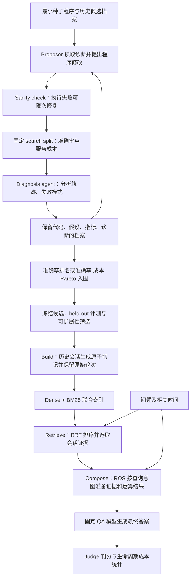
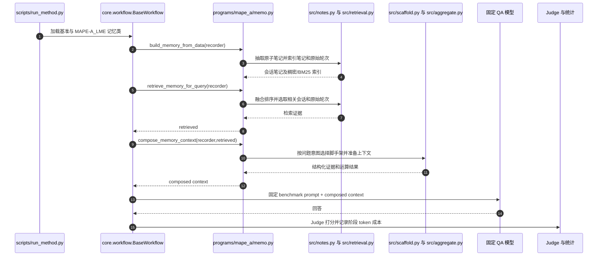

# MAPE：通过程序进化发现有效的智能体记忆设计 / Discovering Effective Agent Memory Designs through Program Evolution

## 一句话定义

**MAPE（arXiv:2611.17068v1）**把 Agent 长期记忆的**构建、检索与证据编排**定义为可执行程序，通过「提案 → 小样本校验 → 评测 → 诊断」进化完整记忆架构，并研究回答准确率与生命周期服务成本的权衡。

## 英文缩写速查

| 缩写 | 英文全称 | 简要说明 |
|------|----------|----------|
| MAPE | 论文框架名称（原文未明确展开） | 从最小种子进化完整记忆程序，统一比较多个生命周期阶段 |
| RQS | Query-Routed Scaffolding | 根据查询意图，为检索证据准备时间、聚合、更新、偏好等专用脚手架 |
| RRF | Reciprocal Rank Fusion | 将稠密嵌入与 BM25 稀疏排序融合的检索方式 |
| BM25 | Best Matching 25 | 按词项相关性排名的经典稀疏检索算法 |
| LLM | Large Language Model | 执行程序提案、摘要构建、诊断及最终问答等模型角色 |
| QA | Question Answering | 长历史下基于证据的问答与客观评测 |
| RAG | Retrieval-Augmented Generation | 文中以向量检索对话消息作为基础对照 |

## 核心信息

| 字段 | 事实与链接 |
|------|------------|
| 论文 | [arXiv:2611.17068v1](https://arxiv.org/abs/2611.17068)，2026-11-12，预印本 |
| 作者 | Xinheng Ding、Seyyed Saeid Cheshmi、Ziyang Zhang、Tairan Chen、Wenya Xie、Yu Hou、Rui Zhang、Zirui Liu |
| 机构 | 明尼苏达大学（University of Minnesota）、史蒂文斯理工学院（Stevens Institute of Technology） |
| 基准 | LoCoMo / LongMemEval-S（**语言对话记忆 QA**，非机器人控制） |
| 官方代码 | [ash-ding/MAPE](https://github.com/ash-ding/MAPE)，包含进化循环、基线和 MAPE-A_LME 实现 |
| 开放核查 | 2026-11-23：项目自有代码 Apache-2.0；官方注明运行结果和 traces 未随仓库打包 |

## 为什么重要

仅把历史对话压成摘要或向量，不保证能在日后回答「上次确切说了什么」「哪天发生」「累计几次」等问题。MAPE 将「**检索到了哪些证据**」与「**如何把证据转成可回答上下文**」分离，并允许程序搜索跨阶段联合修改表示和计算分配。它将 [Agent 记忆与 dreaming](../concepts/agent-memory-and-dreaming.md) 中的记忆设计从经验规则进一步变成可比较的候选程序，也为 [AI Agent 评测](../concepts/ai-agent-evaluation.md) 提供可追溯的指标闭环。

## 流程总览

下图依据论文 §2、Fig. 1–2 与官方实现整理；上部为搜索过程，下部为最终候选在 QA 时的使用流程。**原文不是在线机器人决策回路**。



## 核心原理

### 四阶段生命周期与搜索空间（§2.1–2.3）

| 阶段 | 形式化关系 | 主要设计选择 |
|------|------------|--------------|
| Build | M = B(H) | 原始对话保留、原子笔记、会话索引 |
| Retrieve | E = R(M, q) | 稀疏/稠密融合、挑选证据与会话 |
| Compose | c = K(q, E) | 按意图归类问题、日期/计数/偏好脚手架 |
| Answer | ŷ = G(q, c) | **固定**回答模型与 QA prompt；不属于可进化代码 |

候选 Python 程序通过 `MemoClass` 实现前两项必需 hook 与一项可选 Compose hook。不同候选共享回答器、评测器和计费规则，避免将 backbone 切换错当成记忆算法增益。

**MAPE-A** 只以 QA 准确率选候选；**MAPE-P** 同时将准确率、全生命周期 token 服务成本作为两项目标，维护 Pareto frontier。构建成本在同一对话的多个问题之间摊销；不同评测任务每个历史服务的问题数不同，故「成本低」不能脱离工作负载解读。

### 两个反复出现的设计（§4.3）

1. **保留原始对话是事实保险**：单靠抽取后的短笔记会遗漏细节，MAPE-A_LME 同时索引原子笔记和对话轮次，检索后返回相关笔记与最多五条高相关原始轮次。工程含义是保留可回查的细粒度出处，而非无条件把全历史塞给 QA。
2. **RQS 是检索后整理，不是换检索器**：在现有证据上按问题意图选择时间解析、计数/求和、知识更新或偏好推荐路径，部分确定性运算交给程序执行，再交固定 QA 模型。它主要缓解证据足够但模型不会用的错误；**不能恢复根本未检索到的事实**。
3. **目标函数决定算力放在哪**：准确率优先时可能在写入时大量调用 LLM 来提取笔记；准确率+成本时则倾向储存原文、仅在查询时选择性处理。最优策略取决于一个历史未来会回答几道题。

## 源码运行时序图

以下依据官方 README、`core/workflow.py`、`core/memo_class.py` 与 `programs/mape_a/memo.py` 的可运行**单次评测**路径整理；它不是进化搜索本身的提案循环。



**复现入口**（官方 README，未在本次会话执行）：

```bash
uv sync --group dev
uv run python scripts/fetch_data.py
# 设置 .env 与必要的模型服务
uv run python scripts/run_method.py --benchmark longmemeval --n 20
# 新进化搜索依赖 Singularity / Claude Code：
uv run python -m evolution.orchestrator --config configs/evolution/locomo_accuracy.yaml
```

## 实验与评测

论文的 **accuracy 为百分比，cost 为每 1,000 问的美元 token 服务成本**；以下均是作者的评估集报告，未自行复现。

| 数据集与模型 | 方法 | 准确率 | 服务成本 |
|--------------|------|-------:|---------:|
| LoCoMo / GPT-4.1 mini | SimpleMem | 80.80% | $5.46 |
| LoCoMo / GPT-4.1 mini | MAPE-A_LCM | **87.94%** | $7.21 |
| LoCoMo / GPT-4.1 mini | MAPE-P_LCM | 85.18% | $2.03 |
| LoCoMo / Qwen3-30B-A3B | SimpleMem | 69.32% | $3.24 |
| LoCoMo / Qwen3-30B-A3B | MAPE-P_LCM | **81.33%** | $1.14 |
| LongMemEval / Qwen3-30B-A3B | RAG | 66.00% | $2.62 |
| LongMemEval / Qwen3-30B-A3B | MAPE-A_LME | **77.00%** | $52.84 |
| LongMemEval / Qwen3-30B-A3B | MAPE-P_LME | 72.25% | $5.76 |

- **消融**：去除原始对话轮次，MAPE-A_LME 在 LoCoMo / LongMemEval 分别降 **12.17 / 6.50** 个百分点；去掉 RQS 分别降 **4.44 / 6.25** 个百分点。
- **迁移**：RQS 直接迁移至 Mem0、A-Mem、LightMem、SimpleMem、Zep，在 LongMemEval 上整体提升 **2.75–9.25** 个百分点；分题型并非全部正收益。
- **切分**：LoCoMo 2 条对话搜索、8 条对话评估，排除 adversarial 问题；LongMemEval-S 100 题搜索、400 题评估。
- **成本定义**：LLM 输入/输出与 embedding token，包含 Build/Retrieve/Compose/Answer；不含 Judge、搜索 agent、本地计算、存储与时延。论文先于候选搜索隔离评估集，但最终候选筛选用到评估集。

## 与其他工作对比

| 路线 | 设计重心 | MAPE 的差别 |
|------|----------|-------------|
| [Agent 记忆与 dreaming](../concepts/agent-memory-and-dreaming.md) | 在线笔记和后台回顾/修订 | MAPE 是**离线进化记忆程序结构**及成本分配，不是每晚 dreaming |
| [RAG](../concepts/retrieval-augmented-generation.md) | 检索消息/文档给模型 | MAPE 额外搜整个 Build + Retrieve + Compose 设计，且保留 raw evidence |
| Mem0 / A-Mem / LightMem / SimpleMem / Zep | 各自的抽取与记忆组织 | MAPE 比较这些固定基线，并验证 RQS 可作为后处理模块跨系统迁移 |
| [Self-Improvement Memory（SIM/CRSI）](./paper-self-improvement-memory-crsi.md) | 保存 harness 迭代的根因/改进轨迹 | SIM 将过程经验当作供优化器读取的记忆；MAPE **优化的是为用户回答问题的记忆程序** |

## 结论

**优先保证可追溯的原始证据，再用意图相关的结构化处理帮助回答器；单纯写更多摘要并不总是正确的成本分配。**

1. 原始轮次与抽取笔记应互补，保存回查路径，避免压缩损失不可恢复的细节。
2. 把检索质量与检索后证据组织分开测，RQS 增益只在相关证据已经到位时才可能出现。
3. 对日期、计数、求和、更新事实等问题，尝试确定性运算；对偏好等问题保留显式证据。
4. 评估系统应固定 backbone、QA prompt 和 judge，分开记录准确率与 Build/Query 的摊销成本。
5. 如果一个历史只服务少量问题，昂贵的构建期抽取可能亏；不能把某一数据集的最优方案直接外推到常驻服务。
6. 论文虽已公开程序，但**未提供机器人实机对照实验**；对具身 Agent 的应用属于待验证工程迁移。

## 工程实践

- **可跑代码：** `ash-ding/MAPE` 提供 `evolution/orchestrator.py` 进化入口、`evolution/heldout.py` 评估入口与 `programs/mape_a/` 可运行记忆程序；见[官方源码核对](../../sources/repos/mape-agent-memory-program-evolution.md)。
- **原始数据保留策略：** 为事实保真保留会话原文 + 时间戳/角色，并维护可查索引；同时考虑隐私、保留期及删除一致性。
- **评测建议：** 分开统计 Evidence Recall/Completeness、Answer Accuracy、token 成本、检索延迟、过期事实误用；对机器人长期任务增设环境变化检查与真实任务成功率（**本条是工程迁移建议，不是本文实测**）。
- **适用层：** 可用于机器人上层任务助手、技能文档查询或设备维护对话的记忆检索；不能当作 50Hz/1kHz 闭环运控策略，实时控制须另设确定性环节。

## 局限与风险

- 论文报告结果基于 LoCoMo、LongMemEval-S 的文本 QA；未在机器人感知、动作执行或真实时延约束下评测。
- 测试期有**最终模型筛选**，不得将已报告的 held-out 准确率等同完全未接触的外部新数据结果。
- token 计费省略存储、本地检索和算力及 search agent/Judge；低服务美元费用不等于低总拥有成本。
- 保留 raw 对话有隐私、安全及长期过期问题；需权限隔离、删除机制和事实冲突处理。
- 官方仓库 README 声明未打包运行结果/trace；模型调用和外部服务需要独立配置，本次为源码静态核对，非端到端运行验证。

## 关联页面

- [Agent 记忆与 dreaming](../concepts/agent-memory-and-dreaming.md) — 在线/后台整理与离线程序搜索的互补关系
- [AI Agent 评测](../concepts/ai-agent-evaluation.md) — Judge、数据隔离与成本/准确率双指标
- [检索增强生成](../concepts/retrieval-augmented-generation.md) — 对照 RAG 的检索与证据组织分工
- [递归自我改进](../concepts/recursive-self-improvement.md) — 程序进化是被测系统的离线改进，不能直接等同自主长期 RSI
- [Self-Improvement Memory（SIM/CRSI）](./paper-self-improvement-memory-crsi.md) — 优化过程记忆而非用户对话记忆

## 参考来源

- [论文全文与实验摘录（原文归档）](../../sources/papers/mape_agent_memory_program_evolution_arxiv_2611_17068.md)
- [官方代码运行入口与开放核查](../../sources/repos/mape-agent-memory-program-evolution.md)
- [论文 v1 HTML](https://arxiv.org/html/2611.17068v1)

## 推荐继续阅读

- [MAPE 官方代码与复现指南](https://github.com/ash-ding/MAPE)
- [arXiv:2611.17068 PDF](https://arxiv.org/pdf/2611.17068)
