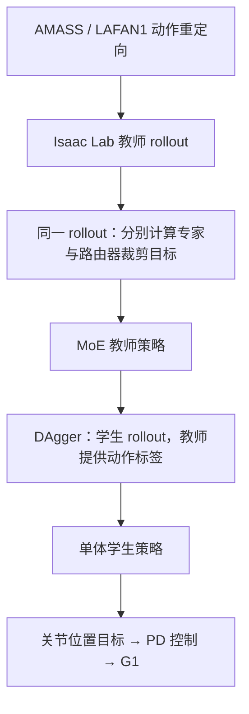

# MAPO：用于通用人形运动跟踪的交替策略优化专家混合

> 核对范围：已通读 arXiv:2611.02613v1 正文（§1–8）、参考文献前部，以及附录 A–D（含表 C.1–C.3、图 D.1–D.4）；项目页为前端 JS 应用，静态抓取未得到正文，代码与数据开放状态未核实。

## 一句话定义

MAPO 将密集专家混合策略的专家与路由器更新分开计算，以缓解混合策略散度对组件更新幅度的误估。

## 英文缩写速查

| 缩写 | 英文全称 | 简要说明 |
|---|---|---|
| MAPO | Mixture of Experts with Alternating Policy Optimization | 本文方法 |
| MoE | Mixture of Experts | 专家混合：由路由器对多个专家输出加权求和 |
| PPO | Proximal Policy Optimization | 近端策略优化，用概率比裁剪约束策略更新 |
| KL | Kullback–Leibler divergence | 相对熵，本文用于度量新旧策略的差异 |
| DAgger | Dataset Aggregation | 学生 rollout、教师标注动作的蒸馏方法 |
| PD | Proportional–Derivative | 比例微分关节控制，将关节位置目标转为力矩 |

## 为什么重要

通用人形运动跟踪需要覆盖大量差异很大的人类动作（如站立、蹲起、转身、单脚旋转），单体策略容易出现任务间干扰，因此 MoE 结构在该任务中被广泛采用。但已有工作多聚焦网络结构设计，MoE 策略在 PPO 等策略梯度算法下的优化问题较少被研究。论文指出，这类算法依赖新旧策略的散度来约束更新，而 MoE 的散度会因路由器变化而被误估，进而导致更新过保守或过激进。MAPO 给出了一个不改结构、只改更新目标的处理方式，对选择 MoE 教师的训练方案有直接参考价值。

## 核心原理

**输入与输出。** 教师策略以本体感知状态与参考动作状态为输入，输出目标关节位置，由 PD 控制器转换为关节力矩。学生策略不使用特权观测，由教师经 DAgger 蒸馏得到。

**散度误估。** 将策略建模为高斯分布，其均值由密集 MoE 给出：$\pi(a|s)=\mathcal N\!\left(\sum_e w_e\mu_e,\ \sigma^2 I\right)$，其中 $w$ 为路由器输出经 softmax 归一化的混合权重。把新旧均值之差拆为专家变化 $d_\mu$ 与路由器变化 $d_w$ 两部分，可得

$$KL_{\text{measured}}=KL_{\text{router}}+KL_{\text{expert}}+\frac{d_w\cdot d_\mu}{\sigma^2}$$

交叉项 $d_w\cdot d_\mu$ 为正时测量值高估（过保守），为负时低估（约束失效）。论文指出其符号难以显式控制，因此调整 PPO 裁剪范围不能根本解决。

**MAPO 的做法。** 对同一批 rollout 计算两个概率比：更新专家时固定混合权重为采样时的值，更新路由器时固定专家输出为采样时的值（式 7）。两个裁剪目标分别求梯度，因此每个分量只被自身的裁剪范围约束，路由器仍然能用 RL 目标端到端优化。"交替"指分开求梯度，而不是交替训练轮次，两项在同一更新步内同时计算。代价是每步优化的是部分更新后的策略，会引入梯度偏差；附录 B 指出，专家参数的偏差保持驻点不变，路由器参数的偏差取决于专家间的相对偏差，专家协同更新时会消失。

**教师-学生框架。** 教师在仿真中使用特权观测训练，观测包括参考动作的未来关节/链接位置、朝向和速度等；奖励由跟踪项与正则项组成（表 C.1，跟踪项权重 1.0 至 20.0，关节限位与接触项为惩罚）。学生为单体网络（不使用特权观测），观测与域随机化沿用 TWIST 设置，使用 DAgger 蒸馏。

## 流程总览

## 实验与评测

**设置。** 在 Isaac Lab 中以 4096 个并行环境、单张 NVIDIA A6000 训练；训练数据为 AMASS 与 LAFAN1，评测数据为 OMOMO；动作统一经 GMR 重定向到 G1。主设置使用 6 个专家，PPO 裁剪参数 $\epsilon=0.2$，其余超参见表 C.2。基线包括 PPO with MoE、Monolithic PPO、MAPO with fixed router、HOVER（作者在同平台重实现，惩罚项缩至 20%）和 TWIST2（使用公开 checkpoint）。

**跟踪指标。** 动作在平均全局位置误差低于 0.5 m 时计为成功；失败后误差冻结在失败时刻的值；不做动作筛选。

**主要结果（表 1）。**

| 设置 | 方法 | 成功率 | Eg-pos（mm） |
|---|---|---|---|
| 训练集（AMASS + LAFAN1） | PPO with MoE | 83.38% | 153.1 |
| 训练集（AMASS + LAFAN1） | MAPO（6 个专家） | 86.60% | 147.4 |
| OMOMO 测试集 | PPO with MoE | 82.78% | 241.4 |
| OMOMO 测试集 | MAPO（6 个专家） | 85.45% | 225.8 |
| OMOMO 测试集 | HOVER（重实现） | 83.39% | 272.2 |
| OMOMO 测试集 | TWIST2（公开 checkpoint） | 57.85% | 386.6 |

- **专家数消融：** 专家数取 4、8、16 时，MAPO 的训练集成功率分别为 86.87%、87.85%、87.73%，均高于同设置的 PPO with MoE（83.96%、82.28%、82.95%）；根部 roll、pitch 误差并非总是更优。
- **训练动态（图 4a）：** MAPO 的平均奖励显著高于 PPO with MoE，固定路由器版本略高于 PPO with MoE。
- **专家特化（图 4b–c）：** PPO with MoE 的混合权重更平缓，MAPO 更尖锐，专家输出间的平均两两距离也更大。
- **混杂因素（图 5）：** 对裁剪参数、熵系数、学习率和 PPO 变体的扫描中，MAPO 均保持优势；Averaged-MAPO 在匹配熵系数的设置下仍优于 PPO with MoE，说明收益并非仅来自有效熵系数的变化。
- **多种子（附录 D）：** 3 个训练种子下，MAPO 成功率为 87.03 ± 0.64%，PPO with MoE 为 82.89 ± 0.43%；Eg-pos 分别为 147.9 ± 1.5 mm 与 154.1 ± 1.7 mm。
- **逐动作对比：** 在 5 次评测 rollout 中，MAPO 稳定成功而 PPO with MoE 稳定失败的动作为 182 个，反向为 1 个；三个种子分别为 182/155/191 与 1/1/0。这是对该评测的计数，不是真机成功率。
- **真机：** 学生策略在 29 自由度 Unitree G1 上展示了包括深蹲、鞠躬在内的动作（图 1），论文未给出真机成功率的定量统计。
- **路由器裁剪比例（附录 D）：** 在 MAPO 训练中，MAPO 路由器判据仅裁剪约 2% 的更新，若改用 PPO 判据约为 24%。

## 结论

**一句总判：** 对 MoE 策略，问题不只在网络结构，还在于 PPO 类算法如何度量"更新幅度"；按分量分别度量并裁剪，能在不放弃路由器优化的前提下获得更高的训练奖励和跟踪成功率。

1. **检查散度是否可信** — 当策略由路由器与多专家加权而成时，整体 KL 可能高估或低估各分量变化（式 6 的交叉项），训练时应同时监控分量级的裁剪比例。
2. **不要只靠调裁剪范围** — 论文指出，交叉项符号不可控，调整 $\epsilon$ 并不能消除误估；MAPO 的收益在 $\epsilon$ 扫描中依然成立。
3. **固定路由器是有代价的折中** — 固定路由器可以减少误估，但阻止了路由器端到端优化；在 OMOMO 上其位置误差并不更低，说明路由器优化本身有价值。
4. **数字应按评测口径读** — 182 条动作的统计与 0.5 m 成功判据绑定在教师策略、特定动作集和评测 rollout 上，不宜与其他论文的成功率直接比较。
5. **教师结果与学生真机之间仍有缺口** — 论文的定量结果来自带特权观测的教师策略，真机仅有定性展示。

## 源码运行时序图

**不适用**（官方可运行实现未核实：项目页为前端应用，静态抓取未获得代码链接，论文正文亦未给出代码仓库）。

## 工程实践

| 项目 | 取值 / 做法 | 来源 |
|---|---|---|
| 训练平台 | Isaac Lab，4096 并行环境，单张 A6000 | §6.1 |
| 机器人 | Unitree G1（29 自由度），动作经 GMR 重定向 | §6.1 |
| 专家数 / 裁剪 | 6 个专家（主设置）；$\epsilon=0.2$ | §6.1、表 C.2 |
| PPO 超参 | $\gamma=0.99$，GAE $\lambda=0.95$，24 步 × 4096 环境，5 个 epoch，4 个 mini-batch，熵系数 0.01，自适应学习率，梯度范数上限 1.0 | 表 C.2 |
| 网络 | 共享编码器 [512, 256] → 特征 256；路由器 [256, 128]；每个专家 [128, 128]；值函数 [512, 256, 128]；ELU 激活 | 表 C.2 |
| 梯度细节 | 交替优化时，路由器梯度不回传到共享编码器 | 附录 C.2 |
| 学生策略 | 单体网络 [512, 256, 128]，固定学习率 $2\times10^{-4}$，DAgger 蒸馏 | 附录 C.2 |
| 域随机化 | 关节 PD 增益 ×U(0.75, 1.25)，控制延迟 U(0, 60) ms，推力间隔 5 s 等 | 表 C.3 |
| 调试指标 | 分量级裁剪比例（路由器与专家）；混合权重的排序分布；专家两两输出距离；路由器梯度夹角（论文报告训练中保持在 90° 以下） | §4、§6.2、附录 B、D |

**复现要点（论文描述，未经代码验证）：**

- 实现上只需把 PPO 的 MoE 更新拆成两个裁剪目标：专家项固定采样时的混合权重，路由器项固定采样时的专家均值（式 7）。
- 教师奖励沿用 BeyondMimic 与 SONIC 的设置（论文称与 [15, 17] 基本一致）；表 C.1 中的相对位置奖励需要较陡的指数尺度，否则动作容易只完成一半（附录 C.1）。
- 论文给出的 Averaged-MAPO 变体（两个代理损失各乘 1/2）可用于检验收益是否来自有效熵系数的变化。

## 局限与风险

- **仅为教师策略的仿真结论。** 绝大多数定量结果评测的是带特权观测的教师，学生在真机上的成功率没有定量报告。
- **成功判据与数据口径。** 0.5 m 平均位置误差判据、冻结失败后误差、不做动作筛选，使结果只能在同一评测口径下比较。训练动作未经人工筛选，论文承认部分动作对该机器人可能不可行（附录 D）。
- **基线不完全对等。** HOVER 为作者重实现且惩罚项被缩放到 20%，TWIST2 为公开 checkpoint 且未重训，二者的差距不宜直接解读为方法优劣。论文表中的 CLONE、KungfuBot2、GMT、FAST 等未进入对比。
- **理论假设有限。** 分析假设密集 softmax 路由、每次更新内 $\sigma$ 固定；不涵盖学习得到的分专家方差或 top-k 稀疏路由。论文认为误估在这些设定下可能仍然存在（§8）。
- **梯度偏差。** 部分更新会引入梯度偏差，其在专家间不协同时不会消失；论文认为净效果仍然更好，但没有给出普遍的偏差上界（附录 B）。
- **专家特化仍是开放问题。** 论文指出，鼓励专家间可区分性的辅助损失是未来方向（§8）。
- **种子与统计。** 主表与图 4 基于单一种子；多种子结果只覆盖 MAPO 与 PPO with MoE 两种方法。
- **代码与复现（未核实）。** 项目页静态抓取未得到正文，也未在 arXiv 页面或项目页脚本中发现代码仓库链接。截至入库日，代码、权重与数据开放状态均未核实，复现前需再次确认。

## 关联页面

- [YAHMP](./paper-yahmp.md)
- [SONIC 运动跟踪](../methods/sonic-motion-tracking.md)
- [PPO](../methods/ppo.md) — MAPO 所修改的基础策略梯度算法
- [MoE（专家混合）](../concepts/mixture-of-experts.md) — 密集与稀疏 MoE 的背景
- [教师-学生 DAgger 训练](../methods/teacher-student-dagger-training.md) — 本文的教师到学生蒸馏流程

## 参考来源

- [论文归档及 v1 原文](../../sources/papers/mapo_arxiv_2611_02613.md)
- [项目页归档](../../sources/sites/mapo-project.md)
- [具身工作站 57 篇论文技术地图（2026-11-04）](../../sources/blogs/wechat_embodied_station_57_papers_da_reward_model_failure_2026-11-04.md)

## 推荐继续阅读

- [MAPO 论文（arXiv:2611.02613）](https://arxiv.org/abs/2611.02613) — 完整方法、实验与附录
- [MAPO 项目页](https://mapo-corl2026.github.io/MAPO/) — 官方视频与补充材料（页面为前端应用，内容需在浏览器中查看）
- [PPO（arXiv:1707.06347）](https://arxiv.org/abs/1707.06347) — 本文基线与裁剪目标的原始出处
- [GMT（arXiv:2506.14770）](https://arxiv.org/abs/2506.14770) — 同类可微密集 MoE 的人形运动跟踪工作，本文的对比背景
