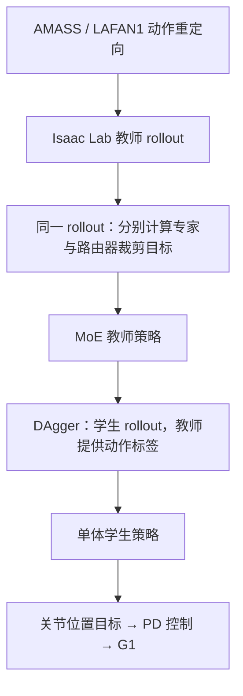

# MAPO：用于通用人形运动跟踪的交替策略优化专家混合

> 草稿：已核对论文核心方法与部分实验；全文及必要附录尚未读完，项目页内容和代码状态待核实。

## 一句话定义

MAPO 将密集专家混合策略的专家与路由器更新分开计算，以缓解混合策略散度对组件更新幅度的误估。

## 英文缩写速查

| 缩写 | 英文全称 | 简要说明 |
|---|---|---|
| MAPO | Mixture of Experts with Alternating Policy Optimization | 本文方法 |
| MoE | Mixture of Experts | 专家混合 |
| PPO | Proximal Policy Optimization | 近端策略优化 |
| DAgger | Dataset Aggregation | 学生 rollout、教师标注的蒸馏方法 |
| PD | Proportional–Derivative | 比例微分关节控制 |

## 核心机制

对高斯策略，路由权重变化与专家输出变化的交叉项可使整体散度高估或低估组件散度之和。MAPO 分别固定 rollout 时的另一组件，计算两项裁剪目标；两者使用同一 rollout，在同一更新步骤分别求梯度。论文也指出这种部分更新会引入梯度偏差。

## 流程总览

## 评测与局限

教师在 Isaac Lab 的 OMOMO 动作上评测，学生在 29 自由度 G1 上展示。五次独立试验中，182 条动作由 MAPO 稳定成功而 PPO-MoE 稳定失败，反向为 1 条；不能将此数字解释成真机成功率。其余实验和附录待通读。

## 与其他工作对比

- **对比 PPO with MoE：** 同为密集 MoE、同数据与超参，差别只在更新目标：PPO 对整体混合策略比值裁剪，MAPO 分别裁剪专家项与路由器项。表 1 中（6 个专家）训练集成功率 83.38%→86.60%，OMOMO 测试集 82.78%→85.45%；专家数取 4、8、16 时 MAPO 成功率仍更高，但根部 roll、pitch 误差不总占优（§6.1–6.2）。
- **对比 Monolithic PPO 与 MAPO with fixed router：** 前者衡量 MoE 结构本身的收益，后者固定路由器以减少误估，但放弃路由器端到端优化。OMOMO 上成功率分别为 84.36%、85.21%，MAPO 为 85.45%；测试集差距较小，MAPO 的全局位置误差（225.8 mm）也不低于固定路由器版本（221.6 mm）（表 1b）。
- **对比 [HOVER](./paper-bfm-14-hover.md)、[TWIST2](./paper-twist2.md)：** HOVER 由作者在同平台、同数据上重实现教师，惩罚项缩至原值 20%；TWIST2 直接评测其公开 checkpoint，未重训。OMOMO 成功率分别为 83.39%、57.85%（表 1b）。MAPO 一侧评测的是含特权观测的教师策略，该差距不宜直接解读为方法优劣。
- **相关工作定位：** [CLONE](./paper-bfm-12-clone.md)、[KungfuBot2](./paper-notebook-kungfubot-2.md) 采用稀疏 MoE，路由不可微；[GMT](./paper-gmt.md) 与 FAST 采用可微密集 MoE。论文认为这些工作偏重架构，MAPO 不改架构而处理 [PPO](../methods/ppo.md) 下的 [MoE](../concepts/mixture-of-experts.md) 优化问题（§2）。上述方法未列入表 1 对比。
- **可比性提醒：** 成功判据为平均位置误差低于 0.5 m，失败后误差冻结在失败时刻值，且不做动作筛选（§6.2）；其他论文的判据和数据筛选不同，成功率不可横比。

## 结论

MAPO 的研究重点是 MoE 训练时组件更新的优化问题。

- 检查路由器和专家更新是否互相掩盖，不能只看整体散度。
- 区分教师仿真评测和学生真机展示。
- 项目页与官方源码开放状态未核实，复现前需进一步确认。

## 源码运行时序图

暂不适用：尚未核实官方可运行实现。

## 关联页面

- [YAHMP](./paper-yahmp.md)
- [SONIC 运动跟踪](../methods/sonic-motion-tracking.md)

## 参考来源

- [论文归档及 v1 原文](../../sources/papers/mapo_arxiv_2611_02613.md)
- [项目页归档](../../sources/sites/mapo-project.md)
