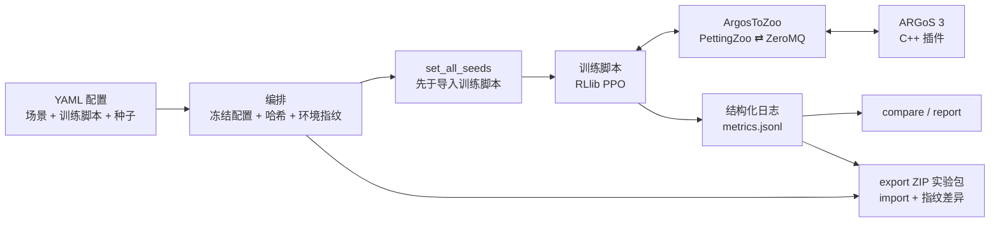
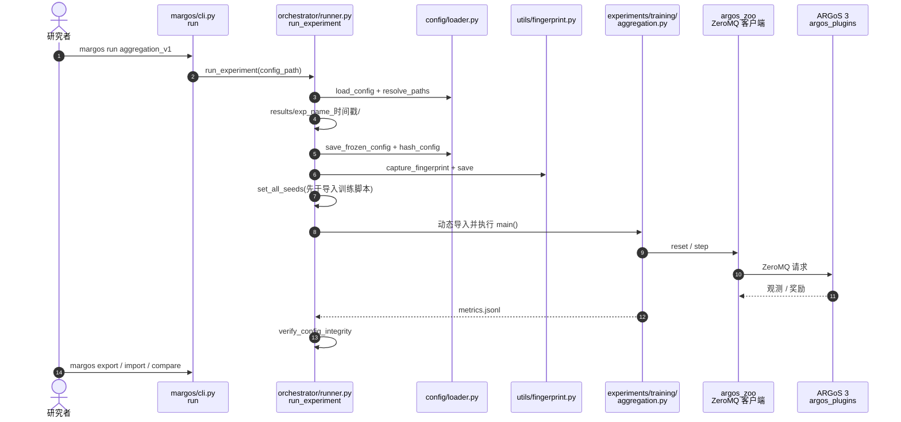

# MARGoS：把群体强化学习的复现变成平台职责

**MARGoS**（论文 *MARGoS: A Configuration-Driven Platform for Reproducible MARL Experiments in ARGoS*，[arXiv:2610.13772](https://arxiv.org/abs/2610.13772)，[代码](https://github.com/tombackert/margos)）由 **Lübeck 大学、Southampton 大学与 Bonn-Rhein-Sieg 应用科学大学** 提出，发表于 VARIABILITY 2026 项目展示赛道（LNCS 17104）。它不是新的 MARL 算法，而是围绕 ARGoS 群体机器人模拟器的**实验管理平台**：配置、种子、环境、日志与交接包由平台托管。

## 一句话定义

**用一个五命令的命令行，把「模拟器文件 + 训练脚本 + 配置值 + 种子 + 环境」冻结、哈希、记录并打包，让别人能重放并核对同一个 ARGoS+MARL 实验。**

## 英文缩写速查

| 缩写 | 英文全称 | 简要说明 |
|------|----------|----------|
| MARL | Multi-Agent Reinforcement Learning | 多智能体强化学习 |
| ARGoS | Autonomous Robots Go Swarming | 多机器人/群体机器人模拟器，C++ 插件架构 |
| RLlib | Ray RLlib | 训练库；仓库用其 PPO |
| PettingZoo | PettingZoo | 多智能体环境接口，ArgosToZoo 对其兼容 |
| KLM | Keystroke-Level Model | 用键击级模型估算专家操作时间的可用性方法 |
| ZeroMQ | ZeroMQ | ARGoS 与 Python 之间的消息通道 |

## 为什么重要

- 群体机器人 MARL 的复现常卡在「手工对齐的一堆文件」，课题组内部交接都脆弱；平台把这些输入当作可审计产物。
- 它提供了一套可借用的**复现机制清单**：配置哈希、先于导入的种子设置、环境指纹、含源码副本的实验包、对照参考的 compare 命令。
- 价值在研究工程基础设施，不在机器人性能；读它是为学习复现流水线设计，而不是学习新算法。

## 核心信息

| 项 | 内容 |
|----|------|
| 机构 | University of Lübeck；University of Southampton；Bonn-Rhein-Sieg University of Applied Sciences |
| 栈 | ARGoS 3 + 两个 C++ 插件；ArgosToZoo（ZeroMQ 桥）；Ray RLlib（PPO，PyTorch）；Typer 命令行 |
| 命令 | `run`、`show`、`compare`、`export`、`import`（无独立 reproduce 命令） |
| 评估 | 五个维度，单开发者兼评估者，复现仅同硬件（macOS，CPU） |
| 开源 | **已开源**（MIT）：[tombackert/margos](https://github.com/tombackert/margos)，README 自述 research MVP |

## 方法栈与流程总览

## 方法

- **配置与哈希：** 对规范化冻结配置计算哈希；配置存文件引用而非文件内容，所以哈希不是源码版本管理，重跑同一性默认被引用源文件未变。运行结束后 `verify_config_integrity` 再核对一次。
- **种子：** 端到端传播，且在导入训练脚本之前设置全部随机数。
- **环境指纹：** 每个完成的 run 记录 ARGoS 版本、git 提交、GPU 与库版本等指纹，随实验包携带；导入时与当前环境做差异比较。
- **实验包：** 含冻结配置、完整性哈希、指纹、日志，以及场景与训练脚本源码副本，导入时引用重写到包内副本。
- **对照：** `compare` 比较尾部奖励均值、训练曲线 AUC、配置哈希与完整性，给出 handoff 通过与严格复现通过两种判定（默认相对偏差 1%、奖励尾窗 50）。

## 源码运行时序图

对齐 [tombackert/margos](https://github.com/tombackert/margos) 的 `margos/orchestrator/runner.py` 等模块（归档见 [repos/margos.md](../../sources/repos/margos.md)；本次未实际运行训练）：

## 工程实践

| 项 | 建议 |
|----|------|
| 安装 | `pip install -e ".[ml]"`，另需自行安装 ARGoS 3 并用 CMake 编译 `argos_plugins` |
| 配置 | 如 `experiments/configs/aggregation_v1.yaml`：experiment.name/seed、scenario.file、training.script/iterations、output.dir |
| 复现核对 | import 后 run，再用 compare 对参考运行；不是单条 reproduce 命令 |
| 同一性假设 | 哈希只覆盖配置，不覆盖被引用的场景/脚本内容；改了脚本要靠实验包里的源码副本 |
| 测试 | `pytest` 默认跳过慢速端到端测试；`pytest -m slow` 需要 ARGoS + RLlib |
| 跨机器 | 仅同硬件验证；换机器时看指纹差异报告，别假设位级一致 |

## 实验与评测

五维评估（目标阈值来自论文）：

| 维度 | 设计 | 结果 | 目标 |
|------|------|------|------|
| RQ1 架构 | 协议可用性 | 平台跑通 RQ2–RQ5 协议 | 仅验证可用 |
| RQ2 效率 | 每条件 N=5，单专家 | 时间 87.0±15.02 s → 19.0±1.41 s（−78.2%）；步数 6 → 2（−66.7%） | ≥50% |
| RQ3 复现 | 同硬件 20 次自动重跑 | 20/20 与参考一致，SD 0.0000 | ≥90% |
| RQ4 可用性 | 35 条启发式审计 + KLM | 30/35 合规（85.7%）；七任务加权 KLM 缩减 56.9% | ≥80%；≥50% |
| RQ5 协作 | 手工与平台各 10 次交接 | 成功率两者均 100%；分享步数 8→1；分享时间 −65.3%；复现时间 −45.9%；首次运行慢 7.4% | ≥50%；≥90% |

KLM 细节：T3–T7 缩减 58–88%，配置编辑 T1–T2 为 0%（两种条件用同一编辑器）。RQ5 的复现时间缩减略低于 50% 目标，作者判定 RQ2–RQ4 获支持、RQ5 部分支持；RQ5 分享包完整性 8/8，设置分歧平均 3.0 个包版本不一致但不妨碍复现。

## 结论

**MARGoS 的贡献是把「复现」做成命令行的一等能力，证据足以说明同硬件下可复现与流程提速，但不足以证明跨机器可复现。**

1. **复现机制可直接借鉴。** 先冻结配置并哈希、先设种子再导入脚本、记录环境指纹、实验包带源码副本。
2. **同硬件 20/20 一致。** 这是同机重跑结果，不是跨平台结论。
3. **效率增益来自流程压缩。** 时间 −78.2%、步数 −66.7%，但样本 N=5 且评估者就是开发者。
4. **别把 KLM 当用户研究。** 它模拟专家无错操作；配置编辑部分无增益。
5. **首次运行有代价。** RQ5 中首次运行慢 7.4%，开销来自解包、路径重写、指纹比较。
6. **适用范围窄。** 只验证了 ARGoS+RLlib 栈；论文未提供算法或机器人性能结果。

## 局限与风险

- 单个开发者兼评估者，存在自评偏差；复现只在同一硬件（macOS，CPU）验证，跨硬件、跨实验室未验证。
- 哈希覆盖配置而非引用文件内容；协作者使用已准备好的账户，存在可测量的库漂移。
- 只评估了 ARGoS/RLlib 栈和实际执行的任务集；结论是阈值与效应量判断，不是总体统计推断；预印本未经同行评审（正式版为 LNCS 论文）。
- **开源状态：** 已开源，MIT；README 自述 research MVP，慢速端到端测试依赖本机 ARGoS 与 RLlib，本次未运行。

## 与其他工作对比

| 对照 | 差异读法 |
|------|----------|
| [四旋翼群体 RL（quad-swarm-rl）](./quad-swarm-rl.md) | 那是具体的群体 RL 训练框架与任务；MARGoS 是通用于 ARGoS 的实验管理层，不含任务算法 |
| [MARL 方法页](../methods/marl.md) | 方法页讲算法；MARGoS 只关心实验如何被冻结和交接 |
| [人形足球群体智能](./paper-humanoid-soccer-swarm-intelligence.md) | 研究多智能体涌现行为本身，MARGoS 提供其复现的基础设施思路 |
| [强化学习](../methods/reinforcement-learning.md) | MARGoS 内部用 PPO，但论文不比较算法 |

## 关联页面

- [34 篇空间落地技术图谱（汇总页）](../overview/embodied-station-34-papers-spatial-grounding-technology-map.md)
- [MARL](../methods/marl.md)
- [四旋翼群体 RL](./quad-swarm-rl.md)
- [强化学习](../methods/reinforcement-learning.md)

## 参考来源

- [具身智能小站 34 篇盘点（2026-10-12）](../../sources/blogs/wechat_embodied_station_34_papers_spatial_grounding_2026-10-12.md)
- [margos_arxiv_2610_13772.md](../../sources/papers/margos_arxiv_2610_13772.md) — 论文摘录与开源核查
- [margos.md](../../sources/repos/margos.md) — GitHub 仓库归档
- [arXiv:2610.13772](https://arxiv.org/abs/2610.13772)

## 推荐继续阅读

- [MARGoS GitHub](https://github.com/tombackert/margos)
- [Springer 正式版 DOI](https://doi.org/10.1007/978-3-032-40421-3_24)
- [ARGoS 官方站点](https://www.argos-sim.info/)
