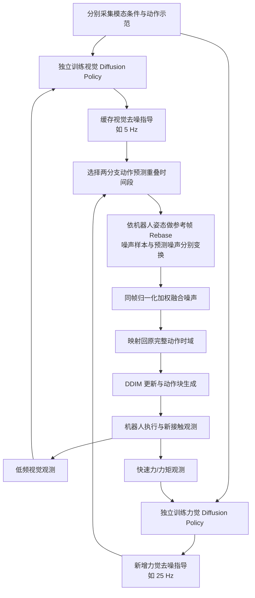

# MATE：异步多速率扩散策略组合 / Asynchronous Multi-Rate Diffusion Policy Composition

**MATE**（作者 Zihao He、Hongjie Fang 等，上海交通大学、Noematrix 等；[arXiv:2607.17257v2](https://arxiv.org/html/2607.17257v2)，[官方项目页](https://lag-fusion.github.io/)）是 2026 年 11 月改名更新的异步扩散策略组合框架。v1 名为 **LAG-Fusion**，两者是**同一篇论文**而不是两个项目。

## 一句话定义

**让独立训练的低频视觉策略与高频力觉策略各跑各的推理节拍，在同一动作时间窗与参考坐标系中融合扩散去噪指导，既保留全局任务方向，也及时纠正接触误差，不需要联合重训。**

## 英文缩写速查

| 缩写 | 英文全称 | 简要说明 |
|------|----------|----------|
| MATE | Asynchronous Multi-Rate Diffusion Policy Composition（论文名称） | 异步多速率扩散策略组合框架；作者并未将 MATE 展开为单词短语 |
| LAG-Fusion | Latency-Aware Guidance Fusion | v1 旧框架命名；v2 更名 MATE |
| DP | Diffusion Policy | 使用去噪网络生成未来动作块 |
| DDIM | Denoising Diffusion Implicit Models | 组合噪声后用于生成动作的采样更新 |
| FT | Force/Torque | 六轴力和力矩观测 |
| PnP | Pick-and-Place | 遮挡抓取与放置实验 |

## 为什么重要

传统统一多模态策略通常要等最慢的视觉编码与推理，导致高速变化的接触信号只能低频进入动作决策；专门的慢快网络又常需耦合训练。[MATE](https://lag-fusion.github.io/) 将**策略模块化**与**保留各模态原生推理频率**同时实现，适合已有视觉扩散策略、希望逐步增加力觉策略的情形。

## 核心信息

| 项目 | 一手资料实测设置 |
|------|----------------|
| 机构 | 上海交通大学（Shanghai Jiao Tong University）、Noematrix、上海创智学院（Shanghai Innovation Institute）；作者列表另标 independent researcher |
| 论文 | arXiv:2607.17257v2（2026-11-06）；v1 名 LAG-Fusion |
| 真机 | Flexiv Rizon4 + FT03S 六轴 FT；每任务 50 条示范 |
| 视觉/力策略推理 | 5 Hz / 25 Hz（Flip、Polish Curve） |
| 全局 3D / 腕部 2D 推理 | 2 Hz / 5 Hz（Occluded PnP） |
| 采样与控制区分 | RGB/Depth 录制 20 Hz、低维数据录制 1000 Hz；动作 chunk 以 50 Hz 采样，均不代表策略推理频率 |
| 项目开源 | 2026-11-10 项目页显示 **code coming soon**；训练/部署源码尚无官方公开入口 |

## 核心原理

### 为什么不能直接对异步预测取平均

视觉在时刻 `t₁` 查询时生成的相对动作，以当时末端姿态为参考；力策略在 `t₂` 查询时以新姿态为参考。两个分支即使在数值上输出相同的动作向量，也可能指向不同的物理位姿。MATE 要先选择共同时间段、统一几何参考帧，才能加权融合噪声。

对原先参考帧 1 与当前参考帧 2，有 `T_{2←1}=T_2^{-1}T_1`。在作者的 10D 动作（3D 平移、**列式** 6D 旋转、夹爪）中，`A` 是正交块旋转矩阵，`b` 是平移偏置。原文式 (4)–(8) 给出三种不同变换：

- 干净动作：`a' = Aa + b`。
- 扩散噪声样本：`a'_k = Aa_k + \sqrt{\bar{\alpha}_k}\,b`。
- 预测噪声：`\epsilon'_k = A\epsilon_k`。

**注意**：平移偏置不能直接加到扩散噪声，`A` 正交才能保持标准高斯噪声协方差；一般欧拉角或轴角的旋转重映射不能直接套用列式 6D 证明。

### 异步去噪组合

将慢策略的最近预测缓存；力策略的新观测到达后，取两者预测动作时域的重叠段，重映射到当前参考帧，再按非负权重融合去噪指导，映射回完整动作时域进行 DDIM 更新。多策略版本对每个分支独立完成同样的重映射。

## 流程总览

图示来自原论文 `III 的模块与信号关系，说明**推理时**如何组合独立策略，不表示官方已发布某个同名源码模块。

### 实际融合权重与模型配置

- 附录 VI-C：所选动作时域内，视觉权重随动作索引线性从 **0.8 降到 0.2**，力觉权重互补；是作者的实例化配置，不代表对所有动作的最优权重。
- 力觉策略以 **1 秒 × 100 Hz × 6 通道**力历史作为输入；MLP 特征编码 `600 → 256 → 16`。
- 力觉动作块为 **50 步 × 50 Hz = 1 秒**，输出每步 10D；U-Net channels [32, 64]，DDPM 训练 100 steps，DDIM 推理 10 steps。
- 作者测得异步融合后平均推理约 **40 ms**，相当于 25 Hz；不应推断整个机器人低层伺服环只运行 25 Hz。

## 工程实践

| 步骤 | 工程判断 |
|------|----------|
| 检查兼容性 | 分支需要共享兼容动作空间、扩散噪声日程与输出约定；不能直接把任意 VLA flow action head 丢进来 |
| 保留快反馈 | 分开度量传感采集 Hz、策略推理 Hz、动作执行 Hz、真实闭环延迟；不要将 1000 Hz FT 记录率说成 1000 Hz 策略 |
| 动作对齐 | 必须保存每次查询时刻对应的末端参考姿态，对重叠预测进行显式 Rebase |
| 时域配置 | 检查视觉长时域与力觉短时域的重叠边界、缓存新鲜度及超时退化行为 |
| 接触调试 | 分开观测未接触期力噪声漂移、接触切换时间、保持接触力与打磨完成程度 |
| 复现状态 | 当前仅论文和项目演示可查，需等待官方运行代码再验证实际模块入口、调度与设备接口 |

## 源码运行时序图

**不适用（2026-11-10 核查）。** 官方项目页注明 `code coming soon`，未给可运行训练/推理入口；按仓库要求不凭论文结构伪造“源码运行时序图”。上述 Mermaid 是**论文方法流程图**，不是源码分析。

## 实验与评测

论文 Table I/II（各完整任务 **20 次**试验，初始物体位置按固定集合复用）：

| 任务及指标 | MATE | 同步组合 | 其他对照 |
|------------|------|----------|----------|
| Flip：翻转分项得分 | **60.0%** | 25.0% | RDP 35.0%；RISE vision-only 30.0% |
| Polish Curve：擦除分档得分 | **55.0%** | 25.0% | RDP 45.0%；RISE vision-only 35.0% |
| 遮挡 PnP：Reach / Pick / Place | **100 / 90 / 85%** | 90 / 80 / 75% | RISE 60 / 15 / 10% |

**指标口径**：Flip 的部分翻转按半次计算；Polish Curve 按擦除比例分档（1.0 / 0.75 / 0.25 / 0），不能把这两个分项都叫二元“成功率”。论文 Fig 5 将视觉维持低频、提高力策略推理频率，Flip/Polish 得分随之上升。附录的独立力策略实验单独设置了预接触初态，不能和完整任务测试混用。

## 与其他工作对比

| 路线 | 区别 |
|------|------|
| [Diffusion Policy](../methods/diffusion-policy.md) | 生成动作块的方法基础；MATE 在推理时组合**多个**独立策略的去噪指导 |
| [FA-RDP](./paper-fa-rdp.md) / Reactive Diffusion Policy | 慢快架构需要专门设计/训练，MATE 强调可复用独立已训练分支 |
| Synchronous Composition / Policy Consensus | 要求共同推理时刻；MATE 可异步且通过参考帧对齐后再融合 |
| Global 3D + Wrist 2D | 同一 MATE 框架也验证跨视角视觉策略组合，非仅限力觉 |

## 结论

**MATE 的主要工程价值是保留快反馈的响应频率，同时复用慢视觉的全局引导；实现正确性依赖相容动作表示、时间重叠和参考帧重映射。**

1. **优先区分三种频率**：5/25 Hz 是策略查询，20/1000 Hz 是采集设置，50 Hz 是动作块的时间采样。
2. **异步并非直接平均**：相对动作以不同末端姿态为参考，必须做噪声样本和预测噪声各自的 Rebase。
3. **可以不联合重训**：论文展示独立训练后测试时融合，但要求分支动作空间与扩散参数相容。
4. **优势主要体现于接触时机**：Flip 60.0%、Polish 55.0%，优于同步组合的 25.0% / 25.0%，需按原文分项指标解读。
5. **跨视觉视角同样适用**：全球 3D 2 Hz + 腕部 2D 5 Hz 的 PnP 放置指标 85%，优于同步融合 75%。
6. **尚未形成开源复现配方**：当前项目页未开放官方代码，也未展示灵巧手或 Flow Matching 扩展验证。

## 局限与风险

- **结构性假设**：分支需有兼容动作空间、噪声参数化与重叠时域；并非任意已训机器人策略可即插即用。
- **范围有限**：单款 Flexiv 机械臂、平行夹爪、三项真实操作任务；没有公开多平台、灵巧手、flow action 实验。
- **失败仍存在**：力信号在接触前较噪、初次碰撞易错失时机、持续打磨仍难保持理想接触力；遮挡取放仍会失败。
- **可复现性**：项目页截止核查日标记代码待发布，不能宣称已完成可执行源码验证。
- **文献身份**：2026-07 v1 旧题名为 LAG-Fusion，2026-11 v2 为 MATE；应按同一 arXiv 编号去重。

## 关联页面

- [Diffusion Policy](../methods/diffusion-policy.md)
- [接触丰富型操作](../concepts/contact-rich-manipulation.md)
- [视触融合](../concepts/visuo-tactile-fusion.md)
- [Action Chunking](../methods/action-chunking.md)
- [FA-RDP](./paper-fa-rdp.md)

## 参考来源

- [MATE v2 论文通读归档](../../sources/papers/mate_asynchronous_multirate_diffusion_arxiv_2607_17257.md)
- [MATE 官方项目页核验](../../sources/sites/mate-lag-fusion.md)
- [论文 HTML 全文 v2](https://arxiv.org/html/2607.17257v2)

## 推荐继续阅读

- [MATE 官方项目页（方法图与真机演示）](https://lag-fusion.github.io/)
- [原始 arXiv 版本历史](https://arxiv.org/abs/2607.17257)
