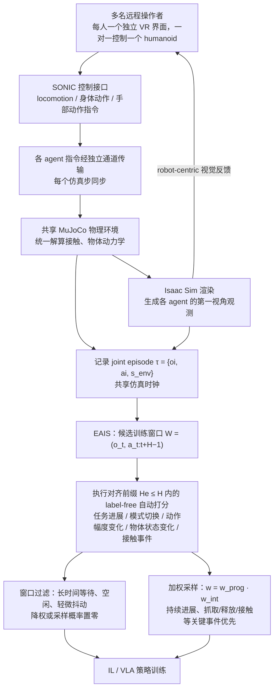

# MATE（arXiv:2609.26520）

**MATE**（*MATE: Multi-Agent Virtual Teleoperation Platform for Humanoid Collaboration Data Collection*，[arXiv:2609.26520](https://arxiv.org/abs/2609.26520)，[项目页](https://yerik-yu.github.io/MATE/)）来自 [具身智能小站 12 篇盘点](../../sources/blogs/wechat_embodied_station_12_papers_collab_wm_2026-09-23.md)。

## 一句话定义

**多操作者在共享物理仿真中同时全身遥操作 humanoid；EAIS 优先采样任务推进与交互关键片段。**

## 英文缩写速查

| 缩写 | 英文全称 | 简要说明 |
|------|----------|----------|
| MATE | Multi-Agent Virtual Teleoperation Platform | 本文虚拟协作遥操作平台 |
| EAIS | Execution-Aligned Interaction Sampling | 任务推进/交互关键片段优先采样 |
| VLA | Vision-Language-Action | 视觉–语言–动作策略 |
| IL | Imitation Learning | 模仿学习 |

## 为什么重要

- 多 humanoid 协作数据采集受硬件数量、场地与重置成本限制；虚拟平台把 amortized 采集从 ~89s 降到 ~41s（Bottle Relay）。
- 开源结论：**待发布**（步骤 2.5，2026-09-23）。
- 与 [12 篇技术地图](../overview/collab-wm-12-papers-technology-map.md) 中同类工作可横向对照。

## 流程总览

图依据：论文 Methodology（MATE Platform、Execution-Aligned Interaction Sampling）、Fig. 2、Eq. 1–4

## 核心机制

| 项 | 内容 |
|----|------|
| **arXiv** | [2609.26520](https://arxiv.org/abs/2609.26520) |
| **开源** | **待发布** |
| **要点** | 分布式全身遥操作 + 共享物理环境 + Execution-Aligned Interaction Sampling；24.1h / 2500 joint episodes / 5 长时程任务。 |
| **文内指标** | IL 与 VLA 可学；报告虚拟示范到真机 humanoid 零样本迁移（无额外真机数据）。 |

## 源码运行时序图

**不适用**（入库日模型/训练权重未公开，或仅有 API/CLI 封装；无可运行官方训练/推理入口。）

## 实验与评测

- IL 与 VLA 可学；报告虚拟示范到真机 humanoid 零样本迁移（无额外真机数据）。
- **读法：** 索引级摘要；逐项对照与 baseline 以原文 PDF 为准。

## 与其他工作对比

- 横向索引见 [12 篇技术地图](../overview/collab-wm-12-papers-technology-map.md)；与同 arXiv 节点不重复造页。

## 结论

**MATE 把协作数据问题从「买更多机器人」转成「共享虚拟世界 + 对齐采样」；代码待论文发布。**

1. 开源边界：**待发布** — 以项目页实际链接为准（入库日 2026-09-23）。
2. 核心机制：分布式全身遥操作 + 共享物理环境 + Execution-Aligned Interaction Sampling；24.1h / 2500 joint ep…
3. 部署前核对任务协议与硬件条件，勿直接横比公众号摘录数字。

## 关联页面

- [loco-manipulation](../tasks/loco-manipulation.md)
- [imitation-learning](../methods/imitation-learning.md)
- [vla](../methods/vla.md)
- [paper-me-u0](./paper-me-u0.md)

## 参考来源

- [mate-virtual-teleop_arxiv_2609_26520.md](../../sources/papers/mate-virtual-teleop_arxiv_2609_26520.md)
- [wechat_embodied_station_12_papers_collab_wm_2026-09-23.md](../../sources/blogs/wechat_embodied_station_12_papers_collab_wm_2026-09-23.md)
- [arXiv:2609.26520](https://arxiv.org/abs/2609.26520)
- [arXiv PDF](https://arxiv.org/pdf/2609.26520)：已通读方法部分（实验与附录以略读为准）：Methodology（MATE Platform、EAIS）、Fig. 2

## 推荐继续阅读

- [arXiv PDF](https://arxiv.org/pdf/2609.26520)
- [项目页](https://yerik-yu.github.io/MATE/)

