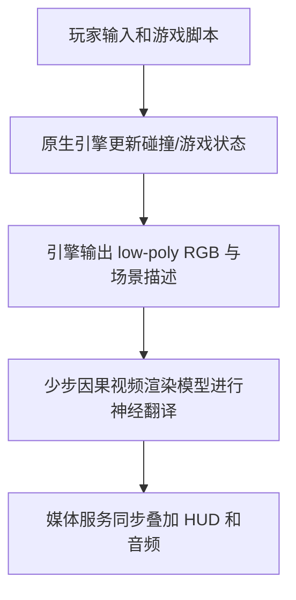
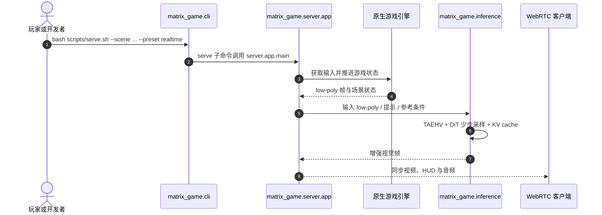

# Matrix-Game 4.0｜游戏引擎执行、生成模型渲染

**核心定位：** 游戏引擎维护确定的世界规则和 low-poly 帧，因果视频模型将其实时神经渲染为高质量画面。

## 一句话定义

游戏引擎维护确定的世界规则和 low-poly 帧，因果视频模型将其实时神经渲染为高质量画面。

## 英文缩写速查

| 缩写 | 英文全称 | 简要说明 |
|---|---|---|
| WM | World Model | 由条件预测环境后续视觉或潜在状态 |
| AR | Autoregressive | 基于历史视频块续写未来 |
| DiT | Diffusion Transformer | 部分生成路径的视频扩散骨干 |
| 3D | Three-Dimensional | 空间结构或几何缓存的维度 |

## 为什么重要

- **研究角色：** 执行状态由引擎而非生成模型维护；可用于世界模型架构和工程复现的横向对照。
- **边界明确：** 与 LingBot-World Infinity 直接生成可交互视频不同，本项目由传统可执行引擎兜底物理与事件；它更适合神经渲染工程对照，不等于自主学习真实物理。
- **资料身份：** arXiv 2026-10-20，开发团队 昆仑万维 SkyworkAI（联合高校研究团队）；源码/权重与报告不能一概而论。

## 核心信息

| 字段 | 内容 |
|---|---|
| 机构 | 昆仑万维 SkyworkAI（联合高校研究团队） |
| 技术原文 | [官方报告](https://arxiv.org/abs/2610.27999) |
| 官方代码 | [SkyworkAI/Matrix-Game](https://github.com/SkyworkAI/Matrix-Game)（模块 `Matrix-Game-4/`） |
| 发布范围 | 模型/游戏资产和推理代码已开放；源码与资产许可分开核对 |
| 控制接口 / 输出 | 游戏引擎低多边形帧 + 固定或动态场景描述 + 参考帧；模型输出视觉增强后的连续帧（HUD / 音频由外部层提供）。 |

## 核心原理

将「规则正确」与「视觉逼真」拆分：原生游戏引擎管理物理、碰撞、角色、事件和持久状态，输出 low-poly RGB。条件视频扩散/自回归模型结合场景文本与参考帧做视觉翻译；多模态 coding agent 在研究路线中负责编写游戏规则和生成动态描述，不能与已经部署的渲染推理模块混同。推理栈采用轻量 TAEHV、少步蒸馏、FP8、CUDA Graph、环形 KV cache 与异步媒体 IO。

### 流程总览

图的模块关系依据 [官方 README 及源码归档](../../sources/repos/matrix-game-4.md) 和 [报告/主页](https://arxiv.org/abs/2610.27999)；无真实硬件执行验证。

## 源码运行时序图

**核对入口：** Matrix-Game-4/scripts/serve.sh、matrix_game/cli.py、README Offline Rendering / Browser Demo；上图聚焦源码实际提供的推理入口，非训练系统所有内部调用；未在本地执行 GPU 推理。

## 工程实践

子目录 `Matrix-Game-4/` 安装后，离线执行 `matrix-game render --scene ancient-egypt --input lowpoly.mp4 --resources resources --preset realtime --prompt-mode fixed --output outputs/egypt`；在线用 `mediamtx configs/mediamtx.yml` 和 `bash scripts/serve.sh --scene ancient-egypt --resources resources --preset realtime --fps 40`。RTX 5090 / 5080 / 5070 Ti 需显式选择对应 preset。

### 建议验证指标

- 对动作/相机控制：轨迹遵从、操作响应、长程回访同视角一致性。
- 对效率：将模型 FPS、首响应帧、单块时延、端到端用户可见延迟分开记录。
- 对复现：记录代码版本、checkpoint 类型、GPU/显存、图像大小与许可证。

## 实验与评测

论文在 RTX 5090、864×480、单步模型推理下报告稳态 83.4 FPS、key-to-frame 112 ms、峰值约 18.2 GiB；5080 / 5070 Ti 固定提示词下模型稳态约 67 / 58 FPS。上述指标主要是模型侧，不是浏览器 WebRTC 端到端指标。

## 与其他工作对比

与 LingBot-World Infinity 直接生成可交互视频不同，本项目由传统可执行引擎兜底物理与事件；它更适合神经渲染工程对照，不等于自主学习真实物理。 可与 [11 项世界模型对照](../comparisons/open-source-world-models-11-2026.md)中的实时视频、3D 资产与 latent 预测分支比较。

## 结论

**总判：Matrix-Game 4.0 的价值在于执行状态由引擎而非生成模型维护，而不是泛化为物理真值模拟器。**

1. 首先验证官方控制接口与实际输出，而非仅对比宣传视频。
2. 区分公开代码、权重、训练数据和许可证，确定复现边界。
3. 生成渲染不负责碰撞/游戏逻辑；HTTP/RTSP/WebRTC 示例仅适合可信单用户环境，不能未经鉴权直接暴露公网。

## 局限与风险

生成渲染不负责碰撞/游戏逻辑；HTTP/RTSP/WebRTC 示例仅适合可信单用户环境，不能未经鉴权直接暴露公网。源代码 Apache-2.0，模型和游戏资源按各自许可。README 的 `--fps 40` 是采集目标，不保证端到端吞吐。

此外，视频视觉一致性与物理动力学准确性不是同一个指标，机器人控制仍需独立验证闭环执行和接触动力学。

## 关联页面

- [2026 年 11 项开源世界模型技术对照](../comparisons/open-source-world-models-11-2026.md)
- [Generative World Models](../methods/generative-world-models.md)
- [Video as Simulation](../concepts/video-as-simulation.md)
- [WAM 纵深学习路线](../../roadmap/depth-wam.md)

## 参考来源

- [官方代码与运行入口](../../sources/repos/matrix-game-4.md)
- [官方项目页面核对](../../sources/sites/matrix-game-4.md)
- [论文原文归档](../../sources/papers/matrix-game-4_arxiv_2610_27999.md)
- [深蓝具身智能综述线索](../../sources/blogs/wechat_shenlan_world_models_11_2026_11_20.md)

## 推荐继续阅读

- [官方仓库 README](https://github.com/SkyworkAI/Matrix-Game)
- [官方技术报告](https://arxiv.org/abs/2610.27999)
