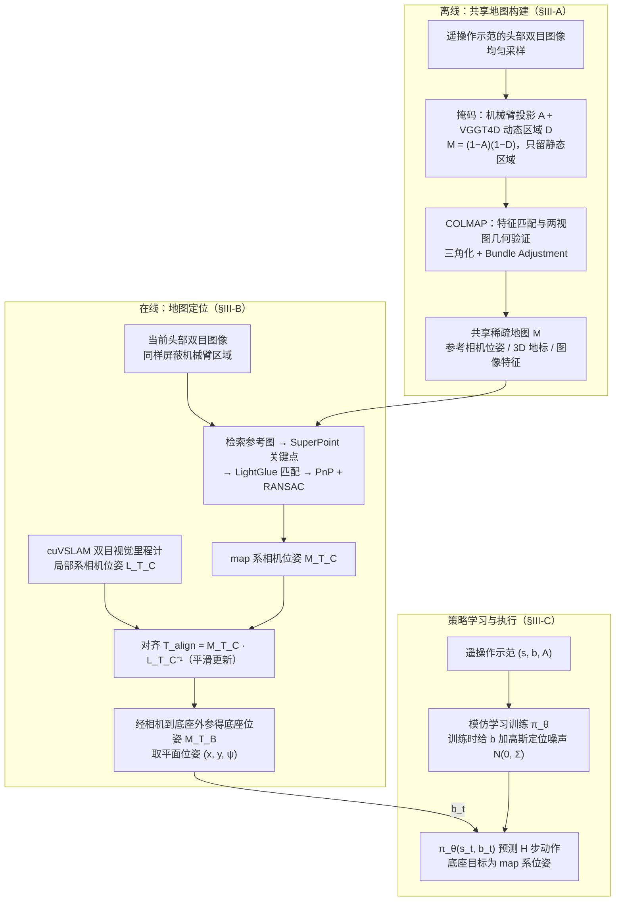

# MAVP（arXiv:2609.26378）

**MAVP**（*MAVP: Map-Aware Visuomotor Policies for Mobile Manipulation*，[arXiv:2609.26378](https://arxiv.org/abs/2609.26378)，[项目页](https://123qwedsa123.github.io/mavp/)）来自 [具身智能小站 12 篇盘点](../../sources/blogs/wechat_embodied_station_12_papers_collab_wm_2026-09-23.md)。

## 一句话定义

**从遥操作示范重建共享静态地图，策略显式预测 map-frame 底盘目标，前馈 + 位姿误差反馈跟踪。**

## 英文缩写速查

| 缩写 | 英文全称 | 简要说明 |
|------|----------|----------|
| MAVP | Map-Aware Visuomotor Policy | 本文地图感知视运动策略 |
| FF | Feedforward | 前馈底盘目标跟踪 |
| FB | Feedback | 位姿误差反馈修正 |
| ACT | Action Chunking Transformer | 动作分块 Transformer 策略 |

## 为什么重要

- 仅速度控制的移动操作示范在「该停在哪」上不一致；map-frame 目标把底盘意图钉在空间参考系。
- 开源结论：**待发布**（步骤 2.5，2026-09-23）。
- 与 [12 篇技术地图](../overview/collab-wm-12-papers-technology-map.md) 中同类工作可横向对照。

## 流程总览

图依据：论文 §III-A/B/C（Fig. 2–3、Eq. 1–7）

## 核心机制

| 项 | 内容 |
|----|------|
| **arXiv** | [2609.26378](https://arxiv.org/abs/2609.26378) |
| **开源** | **待发布** |
| **要点** | 共享地图对齐示范底盘位姿；策略同时预测臂/夹爪与 map-frame pose；部署期持续定位更新。 |
| **文内指标** | 六个真实任务、三类策略（ACT/Diffusion/Flow）；P 相对 V 在各任务均更高（如 Disassemble 38%→90%）。 |

## 源码运行时序图

**不适用**（入库日模型/训练权重未公开，或仅有 API/CLI 封装；无可运行官方训练/推理入口。）

## 实验与评测

- 六个真实任务、三类策略（ACT/Diffusion/Flow）；P 相对 V 在各任务均更高（如 Disassemble 38%→90%）。
- **读法：** 索引级摘要；逐项对照与 baseline 以原文 PDF 为准。

## 与其他工作对比

- 横向索引见 [12 篇技术地图](../overview/collab-wm-12-papers-technology-map.md)；与同 arXiv 节点不重复造页。

## 结论

**MAVP 说明移动操作需要显式空间锚，而非只靠局部速度模仿；入库日项目页未列 GitHub。**

1. 开源边界：**待发布** — 以项目页实际链接为准（入库日 2026-09-23）。
2. 核心机制：共享地图对齐示范底盘位姿；策略同时预测臂/夹爪与 map-frame pose；部署期持续定位更新。…
3. 部署前核对任务协议与硬件条件，勿直接横比公众号摘录数字。

## 关联页面

- [loco-manipulation](../tasks/loco-manipulation.md)
- [manipulation](../tasks/manipulation.md)
- [imitation-learning](../methods/imitation-learning.md)
- [paper-industrialvla-bench](./paper-industrialvla-bench.md)

## 参考来源

- [mavp_arxiv_2609_26378.md](../../sources/papers/mavp_arxiv_2609_26378.md)
- [wechat_embodied_station_12_papers_collab_wm_2026-09-23.md](../../sources/blogs/wechat_embodied_station_12_papers_collab_wm_2026-09-23.md)
- [arXiv:2609.26378](https://arxiv.org/abs/2609.26378)
- [arXiv PDF](https://arxiv.org/pdf/2609.26378)：已通读方法部分（实验与附录以略读为准）：§III MAVP（A–C）

## 推荐继续阅读

- [arXiv PDF](https://arxiv.org/pdf/2609.26378)
- [项目页](https://123qwedsa123.github.io/mavp/)

