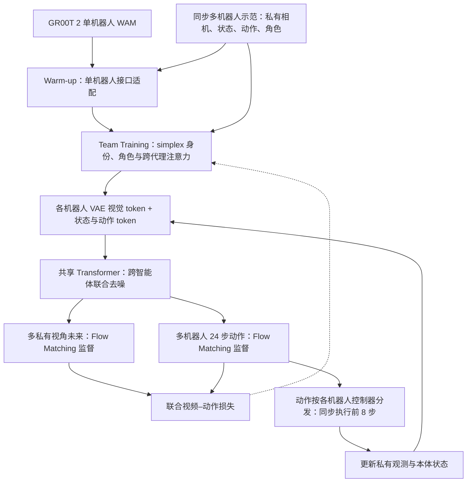
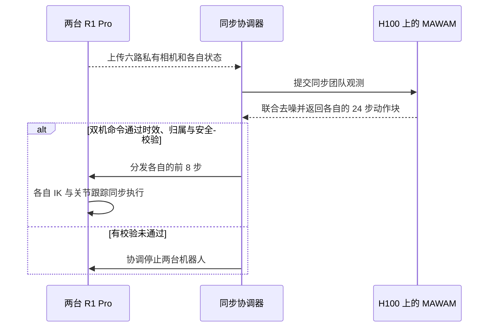

# MAWAM：用于协同操作的多智能体世界–动作模型
*MAWAM: A Multi-Agent World-Action Model for Coordinated Manipulation*

## 一句话定义

**MAWAM** 是一种多机器人 Joint World-Action Model：在一个联合样本中同步生成**每台机器人的未来私有相机视图与可执行动作块**，通过共享跨智能体注意力协调团队，却始终保持每台机器人的观测归属和控制器接口独立。

## 英文缩写速查

| 缩写 | 英文全称 | 简要说明 |
|---|---|---|
| MAWAM | Multi-Agent World-Action Model | 论文提出的多机器人联合世界–动作模型 |
| WAM | World-Action Model | 把世界未来预测与动作预测联合建模 |
| VLA | Vision-Language-Action | 视觉语言动作策略，对比 MA-VLA |
| DiT | Diffusion Transformer | 联合视觉与动作 token 的生成式骨干 |
| RoPE | Rotary Position Embedding | 代理身份使用的旋转位置编码 |
| VAE | Variational Autoencoder | 冻结的视频潜空间编码器 |

## 为什么重要

多机器人共同折衣、传递物体、协力抓取时，队友动作直接改变自己会观察到的未来。如果仅预测每个机器人的动作，或者仅渲染团队未来却不输出控制，难以将交接时序与执行动作统一。MAWAM 将二者绑定成团队级生成过程。

## 核心信息

| 项 | 论文中的定义 |
|---|---|
| 论文 | arXiv:2611.25105v2，2026-11-18 首发，2026-11-20 修订 |
| 机构 | 英伟达（NVIDIA）、香港大学（The University of Hong Kong）、麻省理工学院（MIT） |
| 初始化 | 单机器人 GR00T 2 WAM |
| 真机 | 两台 Galaxea R1 Pro，各 3 路私有相机，无共享全局视角 |
| 仿真 | RoboFactory，2–4 条 Panda 机械臂；可用只读共享相机 |
| 输出与闭环 | 每机器人 24 步动作和各私有相机未来 8 帧；同步执行前 8 步再重规划 |
| 官方代码/权重 | 正式 NVIDIA 项目页已可访问；代码标为待发布，暂无可核实的 MAWAM 代码、权重或示范数据下载 |

## 核心原理与方法

1. **归属分离**：view–agent map 记录每路相机所属机器人，VAE 把多相机历史编码成潜 token，状态和动作保留 per-agent 结构及控制器反向路由；共享相机（若有）仅提供 read-only context。
2. **跨代理联合去噪**：共享 Transformer/DiT 对所有机器人未来视图、状态、动作 token 做 dense cross-agent attention；两个 modality-specific heads 分别以 flow matching 预测未来视图和动作，并仅在有效私有视图/控制维度计算损失。
3. **身份与职责分离**：simplex RoPE 身份绑定同一机器人的不同视角，action-to-video bias 将该机器人动作与自身未来画面耦合；task-role embedding 区分交接者、接受者、持相机者等职责。同一角色可由多机器人承担；论文仅支持**近似**排列等变。
4. **两阶段训练**：先单机器人 Warm-up 适配相机和控制器，再以同步示范启用团队注意力、随机身份分配、整个 agent 组打乱与全员未来视图监督。

### 流程总览

## 实验与评测

**真机（Table 1）**：两台 R1 Pro、3 类任务、每任务 30 次，同样示范/硬件/相机的 MA-VLA 为 π0.5 重实现。

| 任务 | MA-VLA | MAWAM |
|---|---:|---:|
| 收衣袋 | 30.0% | **53.3%** |
| 浴巾折叠 | 46.7% | **63.3%** |
| 雨伞交接 | 70.0% | **86.7%** |
| **平均** | **48.9%** | **67.8%** |

相差 **18.9 个百分点**。同架构移除 cross-agent attention 后，真机均值降至 **52.2%**。

**仿真（Table 2）**：RoboFactory 八任务、每任务 150 条团队示范/100 回合，MAWAM **90.3%**，MA-VLA **已发表平均** 83.4%。四臂 Take Photo **97%**、Long Pipeline Delivery **95%**；三臂 Stack Cube 仅 **59%**。

**消融（Table 3 / Appendix D）**：
- 四臂交接去跨智能体注意力：**95%→39%**；去 Warm-up：**95%→34%**；集中式单动作接口基线：**0%**。
- Place Food 去团队阶段未来视频监督：**78%→47%**；全部机器人使用同一任务角色：**78%→0%**。
- 测试时**冻结未来视图 token 的去噪**，许多任务仍接近完整模型；**完全删去这些 token** 则四臂交接 **95%→0%**。训练期未来监督、推理保留 token 与推理显式生成视频并不等价。
- 四臂交接中人为让第二次交接的递送者停 16 步，接收者相对同种子无干预对照的启动延迟中位数为 **+12 步**，独立策略为 **+6 步**；干预下成功率 **99% vs. 44%**。这是特定仿真干预，不等于真实网络延迟下的鲁棒性。
- 未来画面评估中，至少 5% 像素发生变化的样本上，预测相对复制末帧的 PSNR 高约 **4–7 dB**；全帧评估末帧复制反而更高。该评估执行完整 24 步用于配对，不是闭环成功率测试的 8 步配置。

## 结论

**把机器人之间的交接协调纳入共享世界–动作预测，同时保留每台机器人的独立控制权，是 MAWAM 在所测试协作任务的主要有效设计。**

1. 优先检查跨机器人 token 是否交互：四臂交接去注意力导致 **56 个百分点**的成功率差距。
2. 角色与物理机器人身份分别编码；同职责也必须保留各自相机和控制器归属。
3. 单机器人 Warm-up 不是可随意省略的初始化步骤，需按团队任务验证。
4. 训练时监督未来画面有价值，但部署动作不一定要先完成逐帧视频渲染。
5. 不能混用真机和仿真成功率，或把论文报告冒充独立复现。

## 工程实践

| 部署点 | 原文给出的接口与限制 |
|---|---|
| 控制空间 | 真机每机器人 16D 逻辑动作（双臂各 7D 相对末端位姿 + 两夹爪），底盘和躯干不由策略控制 |
| 同步闭环 | 每次生成 24 步，15 Hz 下同步执行 8 步（约 0.53 s）后重新感知、调用模型；各自 IK / 关节控制器执行 |
| 算力时延 | 真机 H100、2 次联合去噪 **0.32 s** 模型时间，不包括网络和物理执行；仿真 L40、4 次去噪四臂 **1.85 s** |
| 安全检查 | 论文附录描述时间戳偏斜、观测归属、角色元数据、动作范围/时效、工作空间与碰撞校验，不通过时团队协调停机 |

### 源码运行时序图

**不适用：** NVIDIA 正式项目页把代码标为待发布。下图按论文附录 E 表示控制链路，不是源码调用栈。

## 与其他工作对比

| 对照 | 核心差别 |
|---|---|
| [单机器人 WAM](../concepts/world-action-models.md) | MAWAM 联合建模多个本体的动作与各自未来私有视角 |
| [MA-VLA](./paper-ma-vla.md) | 用高层任务提示和多臂策略生成动作，不在同一生成样本中联合监督所有未来视图 |
| 独立多机器人策略 | 保留独立输出但缺少团队内部 token 交互，长接力时序较弱 |
| 集中式一向量团队策略 | 把所有动作合成一个控制口；论文四臂长接力集中基线仅 0% |
| [PrismWAM](./paper-prismwam.md) | 主要研究语义目标/物理未来表征解耦，而非多机器人协调 |

## 局限与风险

- 论文只测试固定团队、最多 4 条仿真机械臂；成员变更、异构传感器、人机联合操作仍是未来工作。
- 真机三任务各 30 次；论文模型耗时不等于机器人端到端响应时间，必须另外审核网络抖动、动作限幅、安全停止及碰撞保护。
- 正式 NVIDIA 项目页已发布演示、方法和消融可视化，但未确认 MAWAM 代码、权重或数据下载。页面链接的 GR00T 2 是底座，不是 MAWAM 实现。

## 关联页面

- [World Action Models 概念](../concepts/world-action-models.md)
- [生成式世界模型](../methods/generative-world-models.md)
- [Vision-Language-Action](../methods/vla.md)
- [机器人操作](../tasks/manipulation.md)
- [PrismWAM](./paper-prismwam.md)
- [WAM 纵深 Stage 3](../../roadmap/depth-wam.md)
- [双/多机器人协作纵深路线](../../roadmap/depth-multi-robot-collaboration.md)
- [多机器人协作](../concepts/multi-robot-collaboration.md)

## 参考来源

- [MAWAM v2 全文归档](../../sources/papers/mawam_arxiv_2611_25105.md)
- [官方项目页与开放范围核查](../../sources/sites/mawam-nvidia-project.md)

## 推荐继续阅读

- [MAWAM arXiv HTML 全文及附录](https://arxiv.org/html/2611.25105v2)
- [MAWAM 官方项目页](https://research.nvidia.com/labs/lpr/mawam/)
