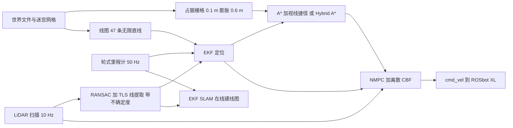

# Maze Runner（arXiv:2611.12949）

**Maze Runner**（*Maze Runner: Autonomous Maze Navigation with Line-Based Localization and Control Barrier Functions*，[arXiv:2611.12949](https://arxiv.org/abs/2611.12949)，作者 Gaona、Gómez-Velayos、Pasuy-Quevedo，cs.RO，v1，2026-11-06）是一个开源的 C++ / ROS 2 迷宫导航栈：从 2D 激光中提取墙线，做 EKF 定位或 EKF SLAM，在栅格上用 A* 规划，再用带离散时间 CBF 约束的 NMPC 跟踪路径。代码：[alvgaona/maze-runner](https://github.com/alvgaona/maze-runner)。所属机构：论文首页抽取文本中未见，未核实。

## 一句话定义

**一个只在 Gazebo 仿真里验证的端到端迷宫导航栈：同一个激光线前端（RANSAC + 总体最小二乘）既做已知线图下的 EKF 定位，也做在线建图的 EKF SLAM，规划用 A* 加视线捷径，控制用把 LiDAR 点当障碍的离散 CBF-NMPC。**

## 英文缩写速查

| 缩写 | 英文全称 | 简要说明 |
|------|----------|----------|
| EKF | Extended Kalman Filter | 扩展卡尔曼滤波，本文用里程计预测、线观测更新 |
| SLAM | Simultaneous Localization and Mapping | 同时定位与建图，本文是以线为地标的 EKF SLAM |
| RANSAC | Random Sample Consensus | 随机采样一致性，用于从扫描点中找直线 |
| TLS | Total Least Squares | 总体最小二乘，最小化点到线的垂直距离 |
| NMPC | Nonlinear Model Predictive Control | 非线性模型预测控制，本文 N=20、Δt=0.1 s |
| CBF | Control Barrier Function | 控制屏障函数，本文用离散时间形式约束预测轨迹 |
| A* / Hybrid A* | A-star / Hybrid A-star | 栅格最短路搜索 / 在连续位姿上用运动基元搜索 |
| IPOPT | Interior Point OPTimizer | 内点法非线性规划求解器，求解 NMPC |
| ROS 2 | Robot Operating System 2 | 机器人中间件，本文栈基于 ROS 2 Lyrical |
| RMSE | Root Mean Square Error | 均方根误差 |

## 为什么重要

- 迷宫走廊几何稀疏且重复，论文把难点归为三件事：感知稀疏模糊的几何、窄通道规划、在估计或地图出错时仍保持安全的控制（摘要、I 引言）。
- 它把定位、规划、安全控制的每一层都写成可对照的算法与参数（算法 1-6、式 1-15），并附复现环境与脚本，适合作为「线特征 + EKF + CBF-NMPC」小型栈的读码入门。
- 论文明确展示了 CBF 的一个常被忽略的性质：约束保证安全，不保证进展（V-D 柱子实验）。

## 核心原理与流程总览

要点（均出自论文 III 节）：

1. **规划（III-A）：** 墙栅格化为 0.1 m 分辨率，离墙 0.6 m 内的格子视为占用，规划器把机器人当点。8 连通 A* 用八分距离启发，再做视线捷径；Hybrid A* 只生成前进弧（5 条，0.3 m，rmin=1 m），启发取欧氏距离与绕墙 Dijkstra 距离的较大者。规划只在收到新目标时触发。
2. **线图（III-B）：** 从网格的竖直面提取 Hesse 形式 (α, d) 的无限直线，该迷宫共 47 条（图 2）。
3. **定位（III-C）：** 中点模型 + 随运动增长的过程噪声预测；观测线与图中线按 2|Δα|+|Δd| 最小关联，超阈值丢弃，再过 χ²（9.21）检验，逐条顺序更新。
4. **SLAM（III-D）：** 状态扩增线地标；用「可见侧」与「沿线段范围重叠」两条规则缓解共线墙歧义；候选线被看到 3 次才升格；起点位姿已知以固定规范。
5. **控制（III-E）：** 对每个 LiDAR 世界系点构造 h(x)=‖p−o‖²−0.5²，约束 h(x_{k+1})≥(1−γ)h(x_k)（γ=0.1，带线性惩罚松弛）；3 m 内、±120° 内的点按 16 个扇区各取最近点，保证问题规模固定。

## 工程实践

- **软件结构（IV-C）：** `maze_runner_core`（无 ROS 的算法与单测）、`maze_runner_nodes`（三个节点，一层一个）、机器人描述与仿真世界两个包；依赖由 pixi 经 RoboStack 锁定，Linux / macOS 上构建、测试、运行各一条命令。每次运行可录 bag，论文所有图表数字由 `.paper/scripts` 从 bag 生成（README 与 IV-C；脚本内容未核实）。
- **求解器（III-E.4）：** CasADi 一次性建问题并展开成标量符号形式，IPOPT 求解；用上一计划平移一步作初值（初值全零会令 IPOPT 失败）；CPU 时间上限 0.8Δt，超时或失败则沿用上一计划最多 5 步再停车；位姿超 0.5 s 或扫描超 0.3 s 也停车。
- **仿真平台（IV-A、IV-B）：** Husarion ROSbot XL（四麦轮按差速驱动）、模拟 RPLIDAR S3（3200 点 / 圈，10 Hz，σ=15 mm 高斯噪声）；Gazebo 的麦轮摩擦近似使里程计在急转时丢失约 20% 到 40% 的转角，作者用乘子（0.907、0.85）粗调。
- **复现注意：** README 称尚无真机 bringup 包，仿真是运行该栈的唯一入口；换真机需要重标定里程计乘子（README「Limits」）。

## 实验结果（论文 V 节，均为单次仿真运行）

| 项目 | 数值 | 出处 |
|------|------|------|
| 路线 | 135 m，269 s，停在离目标 7 cm（容差 15 cm） | V 开头 |
| 已知图定位 | 位置 RMSE 1.0 cm（最大 2.8 cm），航向 RMSE 0.16°（最大 0.83°） | V-A |
| 纯里程计 | 终点偏离真值 42.8 m | V-A |
| EKF SLAM | 位置 RMSE 24 cm（最大 56 cm），无回环，停在离目标 0.52 m；58 条线对 47 条真墙 | V-B |
| 规划（20 次中位数） | A* 6.0 ms / 136.5 m；A*+捷径 6.1 ms / 133.8 m；Hybrid A* 242.7 ms / 134.0 m | 表 I |
| Hybrid A* 仅欧氏启发 | 2×10⁶ 次展开仍无路径（单次） | 表 I、III-A.3 |
| NMPC 求解（2688 次） | 均值 11.7 ms，中位数 12.2 ms，P99 35.6 ms，无超 80 ms，1 次未收敛 | V-D |
| 路径跟踪 | 偏离规划路径 RMS 3.6 cm，最大 17 cm | V-D |
| 未建图柱子（正压路径） | 离柱面 0.52 m 停下，不再前进 | V-D |
| 未建图柱子（偏 0.4 m） | 绕行偏离最多 0.33 m，最小间隙 0.57 m，多用 1 s | V-D |

**作者自述与我的判断分开：** 论文说滤波器「一致且略保守」（±3σ 内 99.9% / 100%），这是对单次运行的统计，不是多次蒙特卡洛；1.0 cm 的定位 RMSE 是「在由同一网格导出的精确线图 + 仿真噪声」下的结果，不宜外推到真实环境（我的判断，推测）。

## 与文章说法的核对

对照公众号文章《机器人动作块太长，什么时候该重新规划？》（2026-11-11，53 篇论文速览）中对本文的一段话：「以激光线特征统一定位与建图，再结合路径规划、非线性预测控制和控制屏障函数。验证集中在仿真迷宫；遇到阻挡时能安全停下，仍不等于保证继续通行。」

| 文章说法 | 核对结果 |
|----------|----------|
| 激光线特征统一定位与建图 | 基本成立但需限定：同一线前端（III-C.3）服务两个独立模式——已知图 EKF 定位与 EKF SLAM（摘要、III-D）。SLAM 建出的地图目前不被规划器使用，规划仍要已知墙（VI） |
| 结合路径规划、NMPC、CBF | 成立（III-A、III-E） |
| 验证集中在仿真迷宫 | 成立，且更强：只有 Gazebo 仿真，作者明说「仅在仿真中评估」（VI），每项结果来自单次运行（V），仅规划表为 20 次中位数 |
| 遇到阻挡能安全停下 | 成立：柱子正压路径时停在 0.52 m 处（V-D） |
| 不等于保证继续通行 | 成立且与作者表述一致：「约束保证安全，不保证进展」，一侧 3.2 m 空地也不绕行（V-D）；未建图障碍压路径或堵走廊会「永久停住」，作者列为未来工作（VI） |
| 文章标题「窄走廊」 | 论文未给出走廊宽度的数值；只给出栅格膨胀半径 0.6 m 与 CBF 安全半径 0.5 m。「窄」是文章措辞，论文中未核实 |
| 文章未提的限定 | 文中未给结果数字；论文的定位数字（1.0 cm / 24 cm）依赖「地图由同一网格导出」；SLAM 误差无回环、会随时间增大（V-B） |

仓库 README 的描述（EKF、A* 带捷径、NMPC + CBF、ROS 2 Lyrical、Gazebo Jetty）与论文一致；README「Limits」中的未知障碍与里程计标定两条与论文局限一致。

## 局限

**论文自己承认的（VI、V-D、IV-A）：**

- 规划器只认识世界文件里的墙，未建图障碍压路径或堵走廊时机器人安全停住但永不继续；建议把 LiDAR 障碍回灌占据栅格，尚未实现。
- SLAM 地图没有被规划使用，规划仍需已知地图；无回环，误差在新走廊中累积；映射线的范围不准（仅 56% 在离墙 0.3 m 内，部分线跨过共线墙的缺口，一例越过迷宫边界），且 58 条线对 47 条真墙，有重复。
- 全覆盖（巡遍自由空间）未实现。
- 只在仿真评估；真机 bringup 与里程计重标定是下一步。里程计在急转弯丢失高达 40% 转角，常数乘子无法修正（IV-A）。

**我看到的未验证之处（我的判断）：**

- 所有结果出自一条路线、一个迷宫、单次运行（规划表除外），没有对 CBF 参数（γ、d_safe）、噪声水平或不同迷宫的敏感性分析；也没有与 Nav2、slam_toolbox 等现成栈的对比。
- 评估用的地图线与仿真由同一 STL 导出，已知图定位的 1 cm 级精度含「地图完美」成分；真实墙的粗糙度、门洞、动态物体未涉及。
- 论文称 CBF 约束使 NMPC 「保证安全」，但该保证只对模型内的预测、被选中的 16 个扇区最近点成立；3 m 外、±120° 外或被扇区选择漏掉的障碍不在约束内（由 III-E.3 的选取规则推得，推测，论文未做反例实验）。
- README 称 Hybrid A* 约 100 到 170 ms，论文表 I 为 242.7 ms，口径差异未说明。
- 性质说明：这是系统 / 软件栈类论文，贡献在工程整合与可复现性，不是新算法；各模块（RANSAC、EKF、A*、Hybrid A*、离散 CBF-MPC）均引用已有工作。

## 关联页面

- [控制屏障函数（CBF）](../concepts/control-barrier-function.md)
- [安全滤波器](../concepts/safety-filter.md)
- [模型预测控制](../methods/model-predictive-control.md)
- [A* 搜索](../methods/a-star.md)
- [卡尔曼滤波](../formalizations/kalman-filter.md)
- [视觉线匹配定位](../methods/visual-line-matching-localization.md)
- [移动机器人导航规划方法对比](../comparisons/mobile-robot-navigation-planning-methods.md)
- [Navigation2](../entities/navigation2.md)
- [slam_toolbox](../entities/slam-toolbox.md)
- [激光雷达感知](../concepts/lidar-sensing.md)
- [Barrier State 安全导航论文](../entities/paper-barrier-state-safe-navigation.md)

## 参考来源

- [maze-runner_arxiv_2611_12949.md](../../sources/papers/maze-runner_arxiv_2611_12949.md)（原文归档，通读：已完成）
- [arXiv:2611.12949](https://arxiv.org/abs/2611.12949)
- [alvgaona/maze-runner（代码仓库，MIT）](https://github.com/alvgaona/maze-runner)
- 公众号文章《机器人动作块太长，什么时候该重新规划？》（2026-11-11，53 篇论文速览，对应第 43 条）

## 推荐继续阅读

- [arXiv PDF](https://arxiv.org/pdf/2611.12949v1)
- [控制屏障函数（CBF）](../concepts/control-barrier-function.md)
- [移动机器人导航规划方法对比](../comparisons/mobile-robot-navigation-planning-methods.md)
