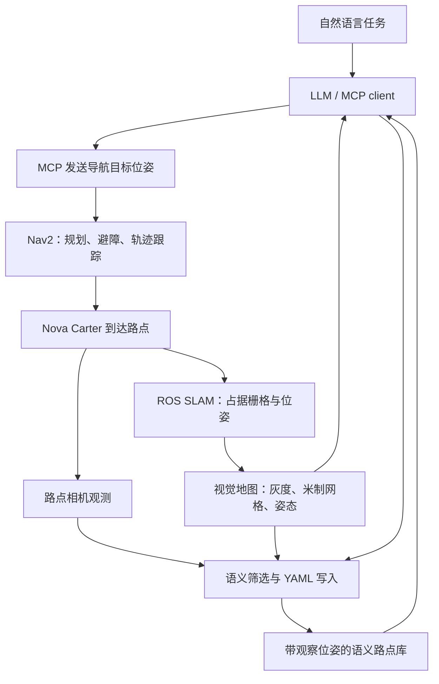

# Spatial and Semantic Reasoning for LLM-Driven Robot Navigation via MCP（基于 MCP 的大语言模型驱动机器人导航空间与语义推理）

## 一句话定义

将语言模型的任务推理与 ROS 导航执行之间的接口升级为带度量坐标的视觉地图和带观察位姿的语义路点，而不是让模型直接解释原始栅格或输出底层控制量。

## 英文缩写速查

| 缩写 | 英文全称 | 简要说明 |
|------|----------|----------|
| MCP | Model Context Protocol | 标准化模型对工具的调用 |
| LLM | Large Language Model | 解释用户目标并选择路点 |
| ROS | Robot Operating System | 提供地图、位姿与导航接口 |
| SLAM | Simultaneous Localization and Mapping | 同步定位与建图 |
| YAML | YAML Ain't Markup Language | 保存语义路点记录 |

## 核心信息

| 项目 | 内容 |
|------|------|
| 机构 | 汉阳大学、汉阳大学 ERICA 校区 |
| 作者 | Jungsoo Lee、Jaegyun Park、Wansoo Kim |
| 论文 | [arXiv:2609.27340v1](https://arxiv.org/abs/2609.27340v1)，2026-09-23 |
| 平台 | Isaac Sim / Nova Carter / ROS 2 / Cartographer / Nav2 |
| 开放状态 | 未发现该论文新增表示层的公开可运行代码；第三方 ROS-MCP Server 已公开 |

## 为什么重要

既有 ROS 通信工具解决接口可达性，却没有自动将几何数据变成可供模型比较房间、识别未知区域和理解物体功能的上下文。论文将表示层独立出来，避免重写底层导航，并展示两个模型后端共享同一类工具的可行性。

## 核心机制与流程总览

1. **视觉地图（§3.2）：** `subscribe_map_as_image` 将 OccupancyGrid 转为灰度图（未知 127、空闲 255、占据概率越大越暗），垂直翻转以对齐 ROS 与图像坐标；`draw_map_axis` 添加自适应米制网格，`draw_robot_pose` 标出机器人位置与朝向。
2. **空间坐标：** 地图原点为 $(x_o,y_o)$、分辨率为 $r$、高度为 $H$ 时，论文采用 $u=(x-x_o)/r$、$v=H-(y-y_o)/r$；此式用于图像定位，实际离散索引须检查边界与原点方向。
3. **语义路点（§3.3）：** 每条记录包含名称、地点描述、观察位姿 $(x,y,\\theta)$、安全地标、功能地标、几何特征。模型按提示词筛选较稳定的线索，通过 `write_semantic_data` 写入 YAML，导航时用 `get_semantic_data` 检索。
4. **执行（§3.4）：** LLM 调用 MCP 工具选择目标位姿，既有 Nav2 负责路径规划、避障和跟踪；探索时到达路点后采集相机观测并更新语义记录，再选择下一目标。

## 源码运行时序图

**不适用**：截至 2026-11-24，论文及作者实验室报告未提供新增地图与语义模块的源码和运行入口。上图是根据 §3 和图 1 重绘的系统逻辑，不是源码执行时序。第三方 [ROS-MCP Server](https://github.com/robotmcp/ros-mcp-server) 仅是论文引用的通用通信底座。

## 实验与评测

论文 §4 和表 3：室内仓库包含两个房间、货架与灭火器等物体。两后端分别先探索建图，再独立重复空间和语义导航各 30 次。

| 任务 | Claude Sonnet 4.6 | GPT-5.5 |
|------|-------------------|---------|
| 自主建图覆盖率 | 97.83% | 99.78% |
| 导航至最小房间 | 26/30（86.67%） | 28/30（93.33%） |
| 导航至灭火器关联路点 | 30/30（100%） | 30/30（100%） |

覆盖率是生成地图与人工遥操作参考地图的空闲像素数量之比；探索提示词以 90% 为停止目标。附录规定优先向主要未知区域选择至少 5 m 远的单个路点，避免距已访问点 3 m 内的回访，并在到达后写入语义观察。空间任务的失败包括把走廊误认作房间及房间面积估计错误。

## 结论

**总判：论文展示了以可解释地图表示和 MCP 接口补足经典导航栈的高层语言目标推理能力，但尚未证明开放环境中的泛化或安全性。**

1. 将语言推理输出约束到目标位姿接口，让下层规划器保留运动执行职责。
2. 语义目标的位姿必须标明是观察点而非物体坐标；若需精确操作，再增加局部定位。
3. 空间推理应独立测试房间分割、面积估计和目标可达性。
4. 将覆盖率、目标选择成功率及实际路径执行结果分别统计；不能用单项 100% 代替总体可靠性。
5. 在稀疏标注、动态场景和真机上补充验证后再评估部署。

## 工程实践

工程扩展建议（非原文验证结果）：对 LLM 的目标坐标进行地图边界、未知区及可通行性检查，限制工具权限，设超时和独立停车机制。语义记录应携带观察时间及失效策略，避免环境变化后沿用过期记录。

## 局限与风险

- 单一室内仿真场景；没有证明真机跨场景表现。
- 语义筛选是提示词层面的定性规则，不是置信度标定；语义数据完整时的成功率不能代表缺失或噪声条件。
- 没有去除表示层的量化对照，不能从两后端结果推断各模块独立贡献。
- 本研究专用实现未找到公开运行入口；未独立复现。

## 关联页面

- [机器人视觉感知栈选型闭环](../queries/robot-perception-stack-selection-loop.md) — 将语义地图与导航执行接口纳入感知栈选型；地图表示不替代底层定位与避障。

- [视觉–语言导航](../tasks/vision-language-navigation.md) — 语言目标接地
- [零样本目标导航](../tasks/zero-shot-object-navigation.md) — 目标搜索任务对照，本文使用已记录路点
- [Nav2](./navigation2.md) — 经典执行栈
- [Cartographer](./cartographer.md) — 建图后端
- [NavMCP](./paper-navmcp-long-horizon-navigation.md) — 对照另一种 VLM 与导航基础模型协作及证据记忆的框架
- [导航纵深路线](../../roadmap/depth-navigation.md) — Stage 4 模块化 LLM 推理

## 推荐继续阅读

- [ROS-MCP Server](https://github.com/robotmcp/ros-mcp-server) — 通用 ROS 通信工具
- [Nav2 官方文档](https://docs.nav2.org/) — 目标执行与安全边界

## 参考来源

- [论文归档](../../sources/papers/mcp_spatial_semantic_navigation_arxiv_2609_27340.md)
- [arXiv HTML v1](https://arxiv.org/html/2609.27340v1)
- [arXiv PDF v1](https://arxiv.org/pdf/2609.27340v1)
- [HARCO Lab ICCAS 2026 报告](https://harco.hanyang.ac.kr/2026/10/29/news_iccas2026.html)
