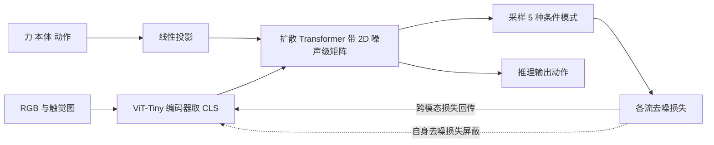

# MDF++：端到端表示学习的视触觉世界动作模型（arXiv:2611.09293）

**MDF++**（*MDF++: Visuo-Tactile World Action Model with End-to-end Representation Learning*，[arXiv:2611.09293](https://arxiv.org/abs/2611.09293)，密歇根大学 Huang、Yu、Charlick、Berenson）。论文首页未标会场；本页由 Glen Berseth 的 CoRL 2026 阅读清单（P2）引入。项目页 [jointmdf.github.io](https://jointmdf.github.io)，未找到公开代码仓库。

## 一句话定义

**视触觉世界动作模型（WAM）：在 Multimodal Diffusion Forcing（MDF）骨干上端到端微调观测编码器，并规定每个模态的编码器只接收其他流（含动作）的去噪梯度、不接收自己那一路的，用跨模态预测压力塑造表示，避免特征坍缩（论文 4.2）。**

## 英文缩写速查

| 缩写 | 英文全称 | 简要说明 |
|------|----------|----------|
| WAM | World Action Model | 单个生成模型联合建模未来观测与动作，按条件模式可当策略、前向或逆动力学（论文 3.2） |
| MDF | Multimodal Diffusion Forcing | 给每个时间步、每个模态独立噪声级，把噪声当作连续掩码（论文 4.1） |
| E2E | End-to-End | 编码器与扩散骨干联合训练 |
| UWM | Unified World Models | 用冻结 SDXL VAE 编码未来观测的统一 WAM，本文基线 |
| DP | Diffusion Policy | 只预测动作的扩散策略基线 |
| ViT | Vision Transformer | 本文用 ViT-Tiny/16 取 CLS token 作潜变量 |
| SIGReg | Sketched Isotropic Gaussian Regularization | 把潜变量往各向同性高斯拉的正则，本文作坍缩缓解的对照（论文 5.1，全称为本页按引用名补全，推测） |
| DDIM | Denoising Diffusion Implicit Models | 本文推理用 10 步 DDIM |

## 为什么重要

- 接触密集任务（拧螺栓、对螺母）光靠视觉不够，需要触觉、力与本体信息（论文 1）。
- 作者主张的新点是表示层面：多数 WAM 在冻结的重建型或语义型编码器的潜空间里学动力学，触觉更缺现成的通用预训练编码器（论文 1、2.1）。
- 与相邻工作的关系见下方「关联页面」；本页只写论文自身说法，不做横向排名。

## 核心原理与流程总览

1. **模型骨架（4.1）：** 沿用 MDF，轨迹是 T 个时间步，每步有 RGB、触觉、力、本体、动作流；噪声级矩阵 K 为 T x M，每个 token 独立加噪，扩散 Transformer 以 K 为条件预测每 token 噪声（式 1）。
2. **结构化条件（4.1）：** 原 MDF 随机采 K，MDF++ 以等概率训练 5 种：策略、世界动作联合、前向动力学、逆动力学、随机掩码；条件 token 噪声为 0，预测 token 噪声在 [0, K] 均匀采样。
3. **选择性梯度流（4.2，式 2）：** 编码器 phi_o 的梯度为 sum over s 的 1[s != o] 乘 grad L_s，即屏蔽自己那一路去噪损失。
4. **训练细节（4.2）：** 对高噪声 token 的编码器输出做 detach；编码器学习率用余弦调度并早于骨干收尾。
5. **推理（附录 A.1）：** 同一模型可用策略模式或世界动作模式出动作，每个任务选表现更好的模式。

## 工程实践

- **数据：** 仿真每个 Factory 任务用 RL 专家采集 1000 条演示，环境改自 Forge 并加 GelSight Mini（5.1）。真机用带 GelSight 的定制 UMI 采集 Nut Mating 255 条、Bolt Screwing 300 条（5.4）。
- **UMI 动作修正（5.4）：** 作者发现 UMI 用未来末端状态当动作不足以补偿控制器跟踪误差，于是在机器人坐标系回放轨迹并按跟踪误差做比例残差修正，平均跟踪误差由约 4 mm 降到 1.2 mm（作者自述，细节见论文附录，本页核对范围内未见更多细节）。
- **超参（附录 Table 3-4）：** 12 层、隐藏维 512、8 头；AdamW，骨干 1e-4，编码器 1e-5，200k 步，batch 64，bf16；损失权重 动作 4.0、力与本体 1.0、RGB 与触觉 0.01。
- **输入模态（Table 5）：** Factory 仿真任务含力，ManiFeel 与真机任务不用力输入。
- **真机硬件（5.4）：** Franka Research 3、WSG-50、GelSight Mini（只给策略右指图像）、腕部 RealSense。
- **评测（5.4、附录 B）：** 每策略每任务 20 次，阶段式评分（对齐 60，旋转半圈 75，啮合 95，释放并固定 100，另有卡住 65 与提前释放加 5 分的规则）。

## 评测证据与清单说法的对比核对

清单原句：「Visuo-tactile world-action model that learns control-relevant representations end-to-end, avoiding feature collapse.」

| 清单措辞 | 论文核对 |
|----------|----------|
| visuo-tactile world-action model | 属实。输入含 RGB、GelSight 触觉图，仿真另有力与本体（Table 5）；真机无力输入。 |
| learns control-relevant representations end-to-end | 属实，但「端到端」是微调：编码器由预训练 ViT-Tiny 初始化（附录 A.1，2.1 也写 starts from a pretrained encoder），且回传的是跨模态与动作损失，自去噪梯度被屏蔽。 |
| avoiding feature collapse | 论文 5.1 与 5.2 有证据：naive grad 平均 64.1% 对 86.9%；Table 2 中探针 MSE 与有效秩支持。但 SIGReg 也不比选择性梯度好，结论是「该设计优于所比的几种替代」，不是对坍缩的一般性证明。 |
| 清单未提的限定 | Table 1 注明 MDF + selective E2E 与 MDF(adapted) 两行是各任务跨种子与模式的最大值而非均值（5.1、5.3 同样说明中间 lambda 用最大值）；MDF(adapted) 的 Forge 运行用了轨迹末尾补齐，与 MDF++ 不完全可比（5.1）；真机每格只有 20 次试验。清单摘要把这些都略去了。 |

另：引言写 MDF++ 在仿真比冻结基线好 28%、比 naive 好 22%，与 Table 1 的 86.9 对 58.7 与 64.1 大致相符（百分点差约 28.2 与 22.8）；引言称真机比视频类 WAM 高 29%，我用 Table 9 平均得分（89.0 对 59.25）算得约 29.75 个得分点，但 UWM 用的是冻结 SDXL VAE 编码图像潜变量，称其「video-based」是论文用语（推测其指视频生成式潜空间）。

## 结论

MDF++ 用跨模态去噪梯度学习视觉触觉表示，为接触任务提供了有效路径，但收益和损失权重依任务而异。

- 复现时检查编码器是否屏蔽自去噪梯度，并分别评估各模态的贡献。
- 对照模型时对齐网络规模、训练步数和权重选择协议。
- 对高频接触和螺纹任务逐项验证，阶段进度高分不等于完整装配成功。

## 局限

论文自述（第 7 节）：

- 力信号处理频率较低，可能漏掉高频接触动力学。
- 各模态损失权重需手动调节。
- 选择性梯度流屏蔽自去噪梯度，可能限制潜空间的可扩散性；提出可探索 Unified Latents。

我读到的未验证之处（本页判断）：

- 5.3 的 lambda 扫描与 Table 1 部分行用最大值挑选，论文自己承认「限制严格受控的解读」。
- 基线网络规模与训练不同（UWM 用 ResNet-18 与 SDXL VAE、100k 步、隐藏维 768，附录 Table 6；MDF++ 用 ViT-Tiny、200k 步），差异不止是表示学习方式。
- 真机每格 20 次，每任务一个物体和一台发动机场景；Nut Mating 成功率仅 40%（8/20）。
- MDF++(policy) 在 ObjectSearch 上比 MDF++ 高 1.3 点（Table 1，5.1 文中亦提及），世界动作目标的收益依任务而异。
- 附录 B 的评分规则含按观察到的行为人工归类，评测者与盲评情况论文未说明。

## 关联页面

- [世界动作模型](../concepts/world-action-models.md)
- [视触觉融合](../concepts/visuo-tactile-fusion.md)
- [触觉感知](../concepts/tactile-sensing.md)
- [接触密集操作](../concepts/contact-rich-manipulation.md)
- [扩散模型](../concepts/diffusion-model.md)
- [扩散 Transformer](../concepts/diffusion-transformer.md)
- [策略的视觉表示](../concepts/visual-representation-for-policy.md)
- [Diffusion Policy](../methods/diffusion-policy.md)
- [Isaac Lab](../entities/isaac-lab.md)
- [VT-WAM 视触觉接触密集论文页](../entities/paper-vt-wam-visuotactile-contact-rich.md)
- [Tactile-WAM 论文页](../entities/paper-sa-2606-26663-tactile-wam-touch-aware-world-action-model-with.md)

## 参考来源

- [来源归档：MDF++ arXiv:2611.09293](../../sources/papers/mdfpp-visuo-tactile-wam_arxiv_2611_09293.md)
- 论文：<https://arxiv.org/abs/2611.09293>
- 项目页：<https://jointmdf.github.io>

## 继续阅读

- 论文 4.2 与 Table 2：选择性梯度流与表示诊断。
- 上游 MDF 与 UWM（论文引用 [10] 与 [9]），REPA-E（论文引用 [54]）。
- 论文附录 Table 9：真机各阶段试验计数。
