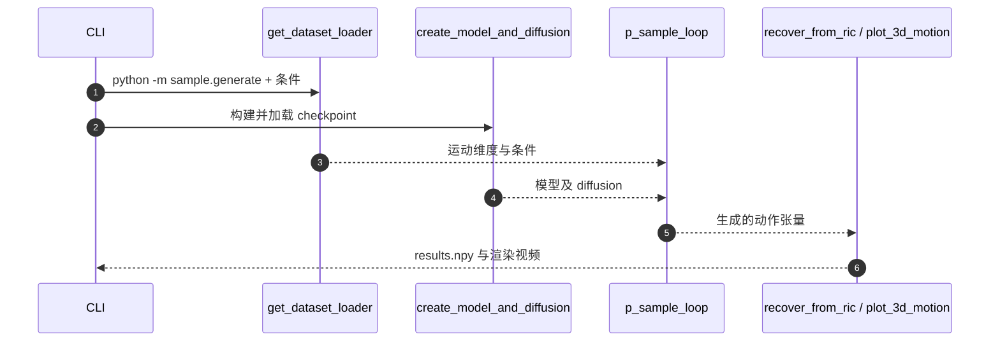

# MDM：文本与动作条件人体运动扩散

## 一句话定义

Transformer 扩散模型直接预测去噪动作样本，允许位置、速度与足接触几何损失；可做文生动作、动作类条件生成及编辑。

## 英文缩写速查

| 缩写 | 英文全称 | 简要说明 |
|---|---|---|
| MDM | Motion Diffusion Model | 人体动作扩散模型 |
| CFG | Classifier-Free Guidance | 条件与无条件引导 |
| CLIP | Contrastive Language–Image Pre-training | 文本编码器 |

## 为什么重要

- 将本研究放进从可控角色动画、实时生成到 G1 真机视觉闭环的对照坐标；输入和输出属于不同技术层级。
- 对工程部署而言，必须分别核查动作生成时间、动作跟踪控制频率和整机成功率。

## 核心信息

| 项 | 内容 |
|---|---|
| 论文/会议 | [ICLR 2023](https://arxiv.org/abs/2209.14916) |
| 机构 | 特拉维夫大学（Tel Aviv University） |
| 作者 | Guy Tevet, Sigal Raab, Brian Gordon, Yonatan Shafir, Daniel Cohen-Or, Amit H. Bermano |
| 项目主页 | [作者官方入口](https://guytevet.github.io/mdm-page/) |
| 开源 | [官方仓库](https://github.com/GuyTevet/motion-diffusion-model)（依赖和模型文件另行准备） |
| 原文阅读状态 | **已完成主要论文全文、适用附录及原文结果复核**；源码仅核对主要运行路径 |

## 流程总览

基于可核对的一手论文机制绘制主干模块关系：

## 核心原理

采用 classifier-free 条件生成与 Transformer 去噪；预测原始动作样本而非直接噪声，使关节位置、速度和足接触相关损失可参与训练。它主要生成给定时长的动作序列。

## 实验与评测

原文在 HumanML3D、KIT-ML 等文本动作基准与动作类别条件任务上评测；官方仓库特别提示早期评价代码曾修复，不应跨版本直接抄旧表。

## 原文复核摘录（正文证据）
- **关键机制：** 不是逐帧自回归。MDM 在给定动作序列长度上对**整段动作**做扩散，Transformer 预测 clean motion x0，CFG 让文本或动作类条件与无条件采样共存。
- **损失边界：** 位置、速度和足接触几何项在有 joint rotations/FK 的场景中使用；论文 §4.1 说明 HumanML3D/KIT 的显式表示**未再施加几何损失**，不可笼统说所有基准都用该项。
- **结果：** HumanML3D FID=0.544；KIT FID=0.497（以 arXiv v2 表1/2 为准），早期论文一次约 1000 次前向、生成一段约 1 分钟，实时交互不在其评测结论中。
- **参考：** §3、§4.1–§4.2、§5.1–§5.2、§6；[论文原文](https://arxiv.org/html/2209.14916)。

## 与其他工作对比

| 工作 | 关注点 | 与本文的区别 |
|------|--------|--------------|
| [ARDY](./ardy.md) | 自回归扩散、流式文本条件的交互式运动生成，4-step 约 33 ms | MDM 对给定长度的整段动作做扩散，单段生成约 1 分钟（§6），不支持流式交互 |
| [Kimodo](./kimodo.md) | 约 700 小时动捕训练的两阶段 root/body 运动学扩散，支持全身 / 末端 / 路径约束并衔接人形下游 | MDM 只在 HumanML3D、KIT 等公开基准训练评测，编辑靠时空 inpainting（§5），不涉及机器人骨架 |
| [ReMoMask-2](./paper-remomask-2.md) | 检索增强的文本到动作生成，对齐检索库与生成器潜空间 | MDM 不用检索，直接在动作空间以 x0 预测做条件扩散 |

## 结论

**研究价值在于 Transformer 扩散模型直接预测去噪动作样本，允许位置、速度与足接触几何损失；对比时必须看清控制层级和数据口径。**

1. 生成模型输出的运动序列并不自动满足真实机器人动态平衡和接触约束。
2. 相关数值只对应论文实验配置，不能横向等同于另一系统的真机成功率。
3. 将该工作与相邻项目区分为 **生成、跟踪、视觉条件适配、闭环执行** 等不同接口。

## 源码运行时序图

依据官方 README 及已核对的代码入口，仅描述可明确确认的运行链路：

## 工程实践

官方仓库含 `train.train_mdm`、`sample.generate`、`eval.eval_humanml`；公开预训练权重与 50-step 加速版本（与原论文训练设定应分开对照）。

## 局限与风险

文生运动学序列并不包含真实机器人的接触估计和控制反馈；原始 MDM 的单次整段生成不等价于 0.5 秒视觉闭环。

**核查边界：** 已复核论文正文、结果与可用附录；代码仓库仅核对 README 与关键运行入口，未运行真机部署或完整训练。论文内已发布结果不等同于独立复现。

## 关联页面

- [从动作生成到人形闭环：方法与证据对比](../comparisons/generative-motion-to-humanoid-closed-loop.md)
- [扩散式动作生成](../methods/diffusion-motion-generation.md)
- [ARDY：交互可控动作生成](./ardy.md)
- [Kimodo：运动生成主干](./kimodo.md)

## 参考来源

- [mdm_human_motion_diffusion_primary.md](../../sources/papers/mdm_human_motion_diffusion_primary.md)
- [mdm-human-motion-diffusion-primary.md](../../sources/sites/mdm-human-motion-diffusion-primary.md)
- [mdm-human-motion-diffusion-official.md](../../sources/repos/mdm-human-motion-diffusion-official.md)

## 推荐继续阅读

- [原始论文](https://arxiv.org/abs/2209.14916)
- [作者项目主页](https://guytevet.github.io/mdm-page/)
- [官方源码](https://github.com/GuyTevet/motion-diffusion-model)
