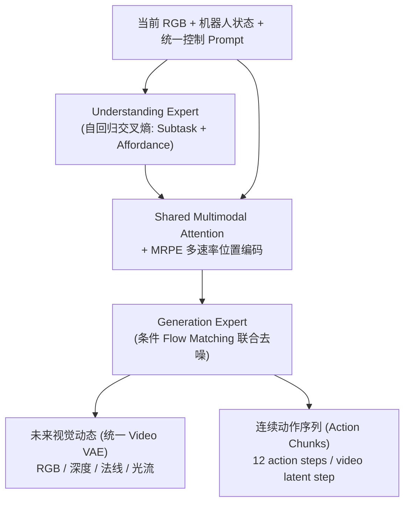
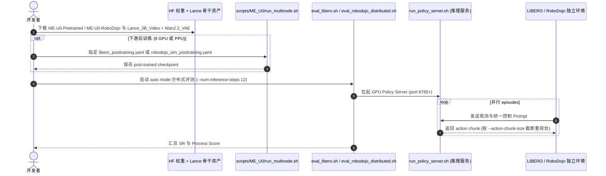

# MachEmbodied-U0（arXiv:2609.25627）

**MachEmbodied-U0**（*MachEmbodied-U0: Unified Understanding and Generation Model for Embodied Intelligence*，[arXiv:2609.25627](https://arxiv.org/abs/2609.25627)，[项目页](https://machembodied.com/ME-U/ME-U0.html)，[代码](https://github.com/MachEmbodied/ME-U0)）来自 [具身智能小站 12 篇盘点](../../sources/blogs/wechat_embodied_station_12_papers_collab_wm_2026-09-23.md)；[2026-09-25 理想四篇盘点](../../sources/blogs/wechat_li_auto_me_brain_vlm_u0_dex_2026-09-25.md) 将其与 ME-Brain / ME-VLM / ME-Dex 并读（**复用本页，不重复 arXiv 节点**）。

## 一句话定义

**Mixture-of-Transformers 连接子任务理解、affordance grounding、视觉动态与连续动作生成；~4200h 预训练。**

## 英文缩写速查

| 缩写 | 英文全称 | 简要说明 |
|------|----------|----------|
| ME-U0 | MachEmbodied-U0 | 本文统一理解–生成具身模型 |
| MoT | Mixture-of-Transformers | 多专家 Transformer 混合 |
| VLA | Vision-Language-Action | 视觉–语言–动作策略 |
| WM | World Model | 环境动态预测模型 |

## 为什么重要

- 把理解、预测与动作合进一个具身模型，避免 VLA 与 world model 割裂；报告 RoboDojo 17.66、LIBERO 99.0%、LIBERO-Plus 82.5%。
- 开源结论：**已开源**（步骤 2.5，2026-09-23）。
- 与 [12 篇技术地图](../overview/collab-wm-12-papers-technology-map.md) 中同类工作可横向对照；与 [ME-Brain 1.0](./paper-me-brain-1-0.md) 分工：U0 缺显式长程记忆（RoboDojo 记忆维 ~7%），Brain 用外部记忆承担演进。

## 核心原理

ME-U0 基于 ByteDance **Lance** 统一多模态基座构建 **Mixture-of-Transformers（MoT）** 双专家架构，使高维语义理解与连续物理动力学在同一注意力计算中协同：

- **Understanding Expert（理解专家）：** 采用自回归交叉熵监督，接收任务指令与当前观测，预测 **Subtask（子任务描述）** 与 **Affordance（可交互目标边界框与交互点）**，将局部意图与空间落点写入共享语义上下文。
- **Generation Expert（生成专家）：** 与理解专家共享多模态注意力（因果文本掩码阻止文本回看未来目标，生成分支双向注意力同步更新），通过条件 **Flow Matching**（logit-normal 采样 $\tau = \operatorname{sigmoid}(u + \log 4)$）联合去噪未来视觉潜变量（可按提示切换生成 **RGB / 深度 / 表面法线 / 光流**，共用同一视频 VAE）与连续动作序列。
- **MRPE（Multi-rate Rotary Position Encoding）：** 针对视频帧率与控制频率不匹配（每帧视频潜变量对应 12 个动作步，$H_a = 3(H_v - 1)$），在保留视频时间索引的同时沿高度轴为组内每个动作步分配独立位置索引，避免时序混叠。
- **跨本体数据与 Ego2Robot 合成：** 约 **4,200 小时** 预训练语料覆盖 6 种机器人本体（AgiBot World Beta、Galaxea、RoboMIND 2.0、RoboCOIN 等）与 Ego2Robot 第一视角合成轨迹，通过统一动作适配器（如夹爪统一 `[0,1]` 闭合坐标、底盘速度统一至车体系）消除控制语义冲突。

### 流程总览

## 源码运行时序图

图依据：基于 `MachEmbodied/ME-U0@d38722f` 的 `README.md`、`scripts/ME_U0/run_multinode.sh` 与 `scripts/ME_U0/eval_libero.sh` 源码核实。

## 实验与评测

- **RoboDojo（42 任务，17.66 Process Score / 11.18% SR）：** 在 WAM 组中综合得分最高，Precision（23.95）与 Long-horizon（36.98）表现突出；但 Memory 维度仅 **8.42 分 / 7.00% SR**，暴露无显式长程记忆的短板。
- **LIBERO & LIBERO-Plus：** 同一 LIBERO 微调检查点在标准 LIBERO 4 套件取得 **99.0%** 平均成功率（Spatial 98.4% / Object 99.8% / Goal 99.0% / Long 98.6%）；在 7 类受控扰动、10,030 条测试实例的 LIBERO-Plus 上零额外适配取得 **82.5%** 平均成功率（光照 97.6%、语言 90.4%、背景 81.9%、噪声 81.3%、布局 84.5%，而机器人初始状态 **75.7%** 与相机视角变化 **70.2%** 相对薄弱）。
- **真机与零样本能力：** 在预训练覆盖的机器人平台上直接零后训练完成抓记号笔、纸巾入盒与算式拼块任务；并在 held-out 数据上验证了零样本深度/法线/光流生成及 affordance/subtask 预测。

## 工程实践

| 项 | 源码配置与部署要点 |
|----|-------------------|
| **骨干与权重准备** | 须先备齐 ByteDance `Lance` 资产（`Lance_3B_Video/`、`Qwen2.5-VL-ViT/`、`Wan2.2_VAE.pth`）与 `ME-U0-Pretrained`，并设置 `LEAP_MODEL_ROOT`、`ME_U0_PRETRAINED_PTH`、`LEAP_WORK_ROOT` |
| **动作空间差异** | LIBERO 后训练采用原生 delta-EEF 动作（min/max 归一化，horizon 24）；RoboDojo 采用 chunk-start delta-joint 动作与随仓 H48 q01/q99 统计（horizon 48） |
| **环境解耦与推理重规划** | 策略环境（`scripts/install.sh`）与仿真器环境（`LIBERO` / `RoboDojo`）通过独立 conda 与服务端/客户端分离；`--action-chunk-size`（LIBERO 示例 12、RoboDojo 示例 36）与 `--num-inference-steps 12` 独立于训练期 horizon |

## 局限与风险

- **缺乏显式长时记忆（论文 §7.2.1 & §8）：** 模型不保留长周期历史观测，导致 RoboDojo Memory 维度得分仅 8.42（SR 7.00%），需要长程记忆的场景须外接类似 [ME-Brain 1.0](./paper-me-brain-1-0.md) 的外部记忆架构。
- **视角与初始状态扰动敏感：** LIBERO-Plus 中相机视角偏移（70.2%）与机器人初态扰动（75.7%）掉点最明显，是后续抗扰增强的主要方向。
- **真机泛化范围边界：** 论文 §7.3 明确真机直接部署测试的是 **预训练语料已包含的熟悉本体**，并非对全新未见机器人的跨本体零样本迁移。
- **大规模预训练未全量开放：** 预训练使用了 368 张 PPU810E 与 ~4,200 h 经 Ego2Robot 等管线清洗的数据；公开仓库仅提供后训练与评测脚本，Ego2Robot 合成与从零预训练管线未一并开源。

## 与其他工作对比

- 横向索引见 [12 篇技术地图](../overview/collab-wm-12-papers-technology-map.md)；与同 arXiv 节点不重复造页。

## 结论

**ME-U0 代表 MachEmbodied 统一理解–生成–动作路线；与 ME-Dex 1.0 触觉 WAM 形成同机构对照。**

1. 开源边界：**已开源** — 以项目页实际链接为准（入库日 2026-09-23）。
2. 核心机制：MoT 多专家 + 统一预训练；子任务理解 / affordance / 视觉动态 / 动作生成共享表征。…
3. 部署前核对任务协议与硬件条件，勿直接横比公众号摘录数字。

## 关联页面

- [vla](../methods/vla.md)
- [world-action-models](../concepts/world-action-models.md)
- [manipulation](../tasks/manipulation.md)
- [paper-me-dex-1-0](./paper-me-dex-1-0.md)

## 参考来源

- [me-u0_arxiv_2609_25627.md](../../sources/papers/me-u0_arxiv_2609_25627.md)
- [wechat_embodied_station_12_papers_collab_wm_2026-09-23.md](../../sources/blogs/wechat_embodied_station_12_papers_collab_wm_2026-09-23.md)
- [wechat_li_auto_me_brain_vlm_u0_dex_2026-09-25.md](../../sources/blogs/wechat_li_auto_me_brain_vlm_u0_dex_2026-09-25.md)
- [arXiv:2609.25627](https://arxiv.org/abs/2609.25627)

## 推荐继续阅读

- [arXiv PDF](https://arxiv.org/pdf/2609.25627)
- [项目页](https://machembodied.com/ME-U/ME-U0.html)
- [https://github.com/MachEmbodied/ME-U0](https://github.com/MachEmbodied/ME-U0)

