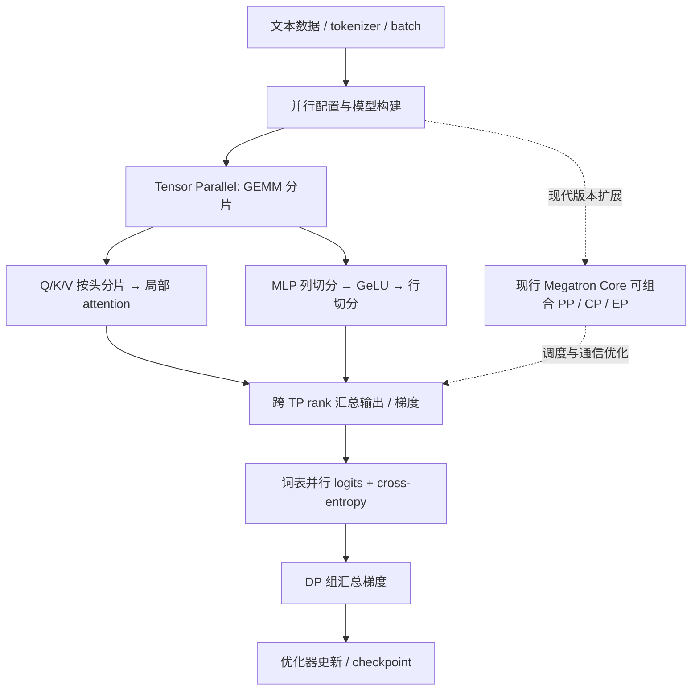

# Megatron-LM：大规模 Transformer 分布式训练框架 / Megatron-LM: Training Multi-Billion Parameter Language Models Using Model Parallelism

## 一句话定义

**Megatron-LM** 是英伟达（NVIDIA）开源的**大模型分布式训练参考实现**。原论文（Shoeybi 等，2019，arXiv:1909.08053）用 Transformer 层内模型并行突破单 GPU 容量限制；如今同一开源仓库也维护面向自定义训练系统的 **Megatron Core** 组件库。**它是训练框架，不是一个已经训练好的语言模型或机器人策略。**

## 英文缩写速查

| 缩写 | 英文全称 | 简要说明 |
|---|---|---|
| LM | Language Model | 本文所讨论的大规模语言模型 |
| TP | Tensor Parallelism | 沿层内权重矩阵维度分片计算 |
| PP | Pipeline Parallelism | 将不同 Transformer 层映射到不同流水段 |
| DP | Data Parallelism | 复制模型、切分 batch，并汇总梯度 |
| CP | Context Parallelism | 沿序列维度切分激活以训练长上下文 |
| EP | Expert Parallelism | 在 MoE 模型中将专家分配到不同 GPU |
| MoE | Mixture of Experts | 多专家稀疏模型，Megatron Core 支持 EP |
| GEMM | General Matrix Multiplication | 线性层中的主要矩阵乘法 |
| NCCL | NVIDIA Collective Communications Library | GPU 间 all-reduce 等集体通信后端 |

## 为什么重要

1. **可训练超出单 GPU 显存的大模型。** 只做 DP 会把完整模型复制到每卡；Megatron-LM 在单层内部拆分权重、激活与计算。
2. **通信与计算共同设计。** 论文并非简单平均分矩阵，而是利用 GeLU 与注意力头的结构安排切分，使每个块之间不必重复同步。
3. **理解现代训练栈的底层。** 现行 Megatron Core 支持 TP、PP、DP、CP、EP 等可组合策略；训练规模、长序列与 MoE 负载应分别考虑。
4. **与机器人研究的连接。** 具身 VLA / 多模态基座模型在需要大规模 Transformer 预训练时可能借助这类分布式训练技术；但 Megatron-LM 本身**不负责**机器人数据采集、控制器推理或 Sim2Real。

## 核心信息

| 项目 | 内容 |
|---|---|
| 机构 | **英伟达（NVIDIA）** |
| 原始研究 | Shoeybi 等，*Megatron-LM: Training Multi-Billion Parameter Language Models Using Model Parallelism*，2019；arXiv v4 更新于 2020-03-13 |
| 论文 | [arXiv:1909.08053](https://arxiv.org/abs/1909.08053) · [HTML 全文](https://arxiv.org/html/1909.08053) |
| 官方代码 | [NVIDIA/Megatron-LM](https://github.com/NVIDIA/Megatron-LM)，**已开源**，Apache-2.0（依赖许可另行检查） |
| 官方技术文档 | [Megatron Core Developer Guide](https://docs.nvidia.com/megatron-core/developer-guide/latest/index.html) |
| 现代仓库分工 | **Megatron-LM**：提供训练入口、配置与示例；**Megatron Core**：提供可组合的核心训练组件 |
| 论文与代码时点 | **2019 论文结果**与 **2026 当前 main 代码能力**应分开引用，不能混作同一实验版本 |

## 核心原理

### 1. 为什么先列切分，再行切分？

论文 §3 对两层 MLP：
- 第一线性层把权重矩阵沿**输出通道**切分（column parallel）。每卡独立计算自己的 `GeLU(XA_i)`，不必先归约再做非线性。
- 第二线性层把权重沿**输入通道**切分（row parallel），接收上一层本地结果，最后再 all-reduce 汇总。
- Self-attention 中 Q/K/V 随注意力头分区，在各卡计算头内 attention；输出投影按输入通道拆分后归约。
- 原论文经典布局下，这使一个 Transformer 层的两部分各发生一次前向 all-reduce 和一次反向 all-reduce。现代 sequence parallel 等布局的通信形式可能不同。

### 2. 词表并行与数据并行

- 输入/输出 embedding 沿词表维度分片。输出 logits 不先把完整词表 gather 回来；采用并行 cross-entropy 减少通信量。
- TP 组持有**一份模型的不同分片**；DP 组在不同模型副本相应位置同步梯度。原论文附录 B 的实例是 **8 TP × 64 DP = 512 GPU**。
- dropout 的 RNG 在模型并行区域内外需要不同种子策略，以防分片内重复随机模式。

### 3. 流程总览（论文方法 + 现行框架能力分层）



> **图示边界：** 实线是原论文的 TP/DP 计算逻辑抽象；虚线代表后来发展到现行 Megatron Core 的 PP/CP/EP 能力，不应误读为 2019 论文已实现全部能力。

## 源码运行时序图

以下对齐 **2026-11-13 官方主仓源码** `pretrain_gpt.py`、`model_provider.py`、`megatron/training/training.py` 与其引用的核心模块，并非套用通用分布式训练模板。

```mermaid
sequenceDiagram
    autonumber
    actor Dev as 训练启动者
    participant CLI as pretrain_gpt.py
    participant CFG as arguments / global_vars
    participant Engine as training.pretrain
    participant Data as datasets.providers
    participant Builder as model_provider / gpt_builders
    participant MCore as core.models.gpt.GPTModel
    participant Schedule as core.pipeline_parallel
    participant Opt as core.optimizer
    participant CKPT as training.checkpointing

    Dev->>CLI: 使用官方示例配置启动分布式训练
    CLI->>CFG: parse_and_validate_args
    CLI->>CFG: 构造 config + set_run_config
    CLI->>Engine: pretrain(config, dataset_provider, model_type, forward_step)
    Engine->>Data: train_valid_test_datasets_provider
    Data-->>Engine: 训练 / 验证 / 测试数据集
    Engine->>Builder: model_provider 构建模型
    Builder->>MCore: gpt_builder 创建 GPTModel
    MCore-->>Engine: 已按并行组初始化的模型
    loop 训练迭代
        Engine->>Schedule: 获取并执行 forward_backward 调度
        Schedule->>CLI: forward_step(data_iterator, model)
        CLI->>MCore: 获取 batch 并执行 forward
        MCore-->>CLI: 模型输出
        CLI-->>Schedule: 返回 loss_func 闭包
        Schedule-->>Engine: backward 与梯度
        Engine->>Opt: optimizer.step
    end
    opt 达到保存条件
        Engine->>CKPT: save_checkpoint
    end
```

**复现路径：** 按 [官方 Quickstart](https://docs.nvidia.com/megatron-core/developer-guide/latest/get-started/quickstart.html) 先配置安装、数据与分布式环境，再跟踪 `pretrain_gpt.py` → `megatron.training.pretrain` → `forward_step` → optimizer/checkpoint。源码追踪记录见 [repo 归档](../../sources/repos/megatron-lm.md)。

## 工程实践

| 决策点 | 建议与核对项 |
|---|---|
| 单卡能够容纳模型 | 先验证普通单 GPU 或 DP 基线；TP 并非规模越小越快 |
| 单层权重/激活过大 | 考虑 TP；注意张量拆分后的 GEMM 效率、跨卡带宽及 per-rank 维度 |
| 模型层数很多 | 考虑 PP；需根据 micro-batch 数量与 pipeline bubble 取舍 |
| 长序列 OOM | 考虑 CP 或重计算；分清 CP 与仅分片部分层的 sequence parallel |
| MoE 专家多 | 考虑 EP，重点监测 all-to-all 与负载均衡；TP+EP 组合遵守官方 sequence-parallel 约束 |
| 训练验证 | 固定数据、硬件、batch、混合精度，观察 step time、吞吐、显存、NCCL 通信、loss 与 checkpoint 恢复 |
| 机器人模型 | 先判断是多机基座模型预训练、VLA 微调还是毫秒级动作部署；不要把训练并行性当作真机控制推理性能 |

## 实验与评测（2019 原论文）

| 配置或指标 | 原论文结果 |
|---|---|
| 训练规模 | 8.3B GPT-2 类模型，512 张 V100 GPU |
| 并行规模 | 8 路 TP × 64 路 DP |
| 总算力 / 缩放效率 | 15.1 PFLOP/s；论文摘要报告 76%（§5.1 曲线口径约 74%） |
| WikiText-103 | 8.3B zero-shot perplexity **10.81**，按论文附录 E 的评测归一化 |
| LAMBADA | 8.3B zero-shot accuracy **66.51%** |
| BERT | 最高至 3.9B；调整 LayerNorm/残差位置后改善扩大模型时的训练稳定性 |
| 固定 1.2B 模型强缩放 | 2 GPU 加速 **1.64×**，8 GPU **2.98×**（附录 D） |

上述是 **V100 年代的论文实验**，不是当前 Megatron Core 的通用速度保证。论文展示了跨 GPU 训练可行性，但效果依赖网络拓扑与矩阵形状。

## 结论

**Megatron-LM 的关键贡献是将 Transformer 层内计算切分与通信模式一起设计；现代 Megatron Core 才进一步扩展为多种并行策略的组合库。**

1. **先看单卡是否装得下模型：** 模型本身放不下时才必须跨卡切分；仅为了吞吐应先评估 DP。
2. **TP 的成本是集体通信：** 优先把高通信量的 TP 组放在高带宽 GPU 互联内。
3. **MLP 列→行切分有具体原因：** 避免在 GeLU 前引入同步点。
4. **不要直接套用 2019 论文指标：** 复现实验须记录 GPU、数据、并行度与评测预处理。
5. **区分训练栈和模型能力：** 对机器人 VLA/WAM 的意义主要是训练基础设施，不代表任何机器人任务效果。

## 与其他工作对比

| 方案 | 关注点与关系 |
|---|---|
| 传统数据并行 | 每 GPU 持有完整模型；更适合单卡可容纳的模型加速 |
| GPipe / 流水线并行 | 沿网络层深度分区；与 2019 Megatron 层内 TP 是互补方向 |
| [LoongForge](./cn-os-loongforge.md) | 提供更上层的模型/具身训练框架，Megatron 是其 LLM/VLM/扩散训练栈的重要基础 |
| [Isaac GR00T](./isaac-gr00t.md) | 具身机器人基座模型训练生态；不应将 Megatron-LM 与具体 VLA 模型混同 |
| [LeRobot](./lerobot.md) | 偏数据与机器人学习训练/部署工作流，与大模型分布式并行框架定位不同 |
| 2021 年 Megatron 扩展论文 | 独立研究 TP/PP/DP 组合与 interleaved pipeline；非 2019 论文同一篇，见延伸阅读 |

## 局限与风险

- **复杂且依赖集群通信：** 通信延迟、网络拓扑、micro-batch 与并行策略相互制约；并行 GPU 数增加不保证线性加速。
- **存在版本漂移：** 2019 原论文的方法图与 2026 Megatron Core 模块不同；用运行源码版本与官方文档对齐结论。
- **复现成本高：** 原论文 512 × V100 实验不适合拿消费级单卡直接复测；本次入库只核对源码与文档，**未实际启动多卡训练**。
- **不等于机器人推理引擎：** RL policy 实时推理、控制环及真机安全还需单独设计。

## 关联页面

- [LoongForge：基于 Megatron 的大模型训练栈及具身训练](./cn-os-loongforge.md)
- [Isaac GR00T：机器人基座模型](./isaac-gr00t.md)
- [LeRobot：机器人学习数据与工具链](./lerobot.md)

## 参考来源

- [Megatron-LM 原始论文归档](../../sources/papers/megatron_lm_arxiv_1909_08053.md)
- [NVIDIA/Megatron-LM 源码核对归档](../../sources/repos/megatron-lm.md)
- [Megatron Core 官方开发文档归档](../../sources/sites/nvidia-megatron-core.md)
- [Shoeybi et al., arXiv:1909.08053（HTML v4）](https://arxiv.org/html/1909.08053)
- [NVIDIA/Megatron-LM](https://github.com/NVIDIA/Megatron-LM)

## 推荐继续阅读

- [官方并行策略指南](https://docs.nvidia.com/megatron-core/developer-guide/latest/user-guide/parallelism-guide.html)
- [官方 Quickstart](https://docs.nvidia.com/megatron-core/developer-guide/latest/get-started/quickstart.html)
- [Narayanan et al. (2021)：Efficient Large-Scale Language Model Training on GPU Clusters Using Megatron-LM](https://arxiv.org/abs/2104.04473) — 另一篇独立论文，扩展至三维并行。
