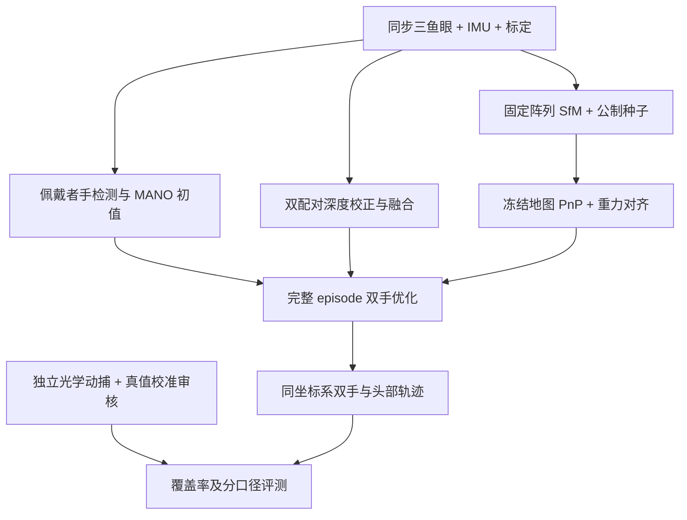

# MEgoVista: Multi-view Ego-aware Motion Estimation for Metric 4D Hands and Head in the Wild（真实场景中公制四维手部与头部运动的多视角自我感知估计）

## 一句话定义

**把佩戴者的多视角头戴录制变成同一重力对齐世界坐标中的双手和头部轨迹，为人类操作示范提供公制标注。** 4D 指三维运动随时间演化，不是机器人控制维度；“一次录制”包含多个同步相机，不是单目手机视频。

## 英文缩写速查

| 缩写 | 英文全称 | 简要说明 |
|------|----------|----------|
| IMU | Inertial Measurement Unit | 提供惯性信息，辅助选帧及重力方向 |
| BA | Bundle Adjustment | 优化相机或轨迹与观测的一致性 |
| MANO | hand Model with Articulated and Non-rigid defOrmations | 手部姿态和形状参数模型 |
| KB | Kannala–Brandt | 论文采用的鱼眼投影模型 |
| PnP | Perspective-n-Point | 在冻结地图上求每帧相机姿态 |
| ATE | Absolute Trajectory Error | 在指定对齐规则下的头部轨迹误差 |
| PA-MPJPE | Procrustes-Aligned Mean Per-Joint Position Error | 对齐后的关节位置误差 |
| PTP | Precision Time Protocol | 采集与独立参考的时钟同步 |

## 为什么重要

从人视频学习机器人操作时，手腕位置的单位、左右手身份及接触时段的漏检会直接影响监督质量。MEgoVista 把“属于谁的手”“深度有多远”“头在世界哪里”拆开处理，再检查参考系统本身。它属于数据重建上游，不是 VLA 或已经完成重定向的机器人动作数据集。

## 核心信息

| 字段 | 核验内容 |
|------|----------|
| 机构 | 西北工业大学、西安交通大学、Maniformer |
| 作者 | Jiangong Xiao、Zhihao Zhang、Yifei Dong、Chao Ma、Zhouyi Jin、Zhiwen Hou、Li Liu、Weihuang Chen、Hongbin Sun、Maoqing Yao |
| 发布时间 | 2026-09-15，arXiv:2609.16684 |
| 采集硬件 | MEgo View；使用中央与左右三鱼眼，60 fps，IMU 500 Hz |
| 输入 | 同步图像、已知内外参/基线、惯性流 |
| 输出 | 佩戴者双手 MANO 轨迹、头部姿态，共享公制且重力对齐坐标 |
| 处理方式 | 离线整段重建；采集率不等于重建吞吐 |

## 方法与模块边界

### 手部：先解决归属，再固定深度

1. 检测位置、handedness 和 ownership，跟踪佩戴者左右手，排除旁人手。
2. WiLoR/HaMeR 类回归器提供每帧 MANO 初值，不直接当作可靠公制标签。
3. MID×LEFT、MID×RIGHT 分别进行虚拟平面校正和 FoundationStereo 深度估计；按置信度融合，再映射回中央鱼眼像素。
4. 按检测置信度、深度质量、骨骼比例等筛选观测，对整个 episode 双手联合优化。

| 约束族 | 解决什么 | 不应误读为 |
|--------|----------|------------|
| 重投影、腕深度、姿态先验 | 观测吻合及沿视线深度约束 | 仅靠 2D 重投影即可恢复真实尺度 |
| 轨迹二阶平滑、根速度/角速度、手指连续性 | 减少抖动与漂移 | 低 jitter 必然等于高位置精度 |
| 关节活动范围、弯曲、角速度软障碍 | 降低不合理手姿态 | 严格满足人体解剖约束的保证 |

### 头部：尺度、相机姿态和竖直分别处理

固定 KB 标定和阵列相对位姿，把三相机看作一个广义相机。惯性信号提名关键帧，视觉跟踪筛选有效帧；关键帧进入增量 SfM，完成后冻结地图，以 pose-only PnP 定位其余帧。

公制尺度来自已标定左右基线构造的初始三角化种子，而不是评测时自由拟合缩放。IMU 不进入联合视觉惯性 BA；视觉完成后传播和滤波重力估计，再施加全局旋转。初始尺度有依据仍不代表后续完全无漂移。

## 流程总览

## 源码运行时序图

**不适用。** 截至 2026-10-12 未发现 MEgoVista 可运行官方代码入口。上图依据论文模块说明，不虚构函数、脚本、权重或安装命令。论文引用的开源对照及依赖不能作为本项目代码开放证明。

## 实验与评测：指标定义先于结果

参考系统为 26 相机、120 Hz Chingmu 动捕，PTP 同步；头部刚性标记簇和手部厂商骨架求解提供参考。hand-eye 标定录制与验证、评测分离，避免对待测预测反向拟合真值。

| 指标 / 检查 | 口径与边界 |
|-------------|------------|
| 头 ATE | hand-eye 对齐，尺度固定为 1；不能与默认 Sim(3) ATE 直接比较 |
| PA-MPJPE-p | Procrustes 相似对齐，去除手尺度和腕朝向，侧重手指 articulation |
| CT-p | 不对齐的相机系腕位置；与上述局部姿态误差不同，原文 HTML 表未明确单位，不擅加 mm |
| Fitted scale | 尺度诊断，不是位置误差；拟合尺度接近 1 不保证轨迹准确 |
| 覆盖率 | 漏检使用确定性占位惩罚，不能靠拒绝预测改善误差 |
| 棋盘验证 | 校验刚性变换和同步链路，不能验证厂商手骨架求解器全部误差 |

### 头部结果（Table 2）

| Session | 方法 | episode 数 | 全段 ATE mm | 去掉前 5 秒的 ATE mm |
|---------|------|------------|-------------|-----------------------|
| 1 | ORB-SLAM3，离线精炼 | 22 | 3.27 | 2.12 |
| 1 | MEgoVista | 22 | 2.87 | 2.83 |
| 2 | ORB-SLAM3，离线精炼 | 20 | 1.00 | 0.92 |
| 2 | MEgoVista | 20 | 0.75 | 0.65 |

头部结果并非全面压过 ORB-SLAM3；后者对照不是原始在线轨迹。DROID-W/MASt3R-SLAM 的表格排除部分失败 episode，应结合失败率而非只看剩余样本均值。

### 手部结果（Table 3）

| 方法 | F1 | PA-MPJPE-p mm | EPE-P px | Jitter mm/frame² |
|------|----|---------------|----------|------------------|
| Dyn-HaMR | 0.84 | 49.18 | 96.42 | 3.50 |
| HaWoR | 0.98 | 16.30 | 83.10 | 16.71 |
| 论文 Ours（表内写 EgoVista） | 1.00 | 4.29 | 9.90 | 1.11 |

HaPTIC 在该多人场景无法提供有效结果。F1=1 是该评测集结果，不是对任意野外录制的零漏检承诺；4.29 mm 不等于所有世界系手部位置都达到此精度。Table 3 的 EgoVista 名称按本篇 Ours 记录，不新建同名重复节点。

约 40 秒的片段中，论文 motion tracking 平均耗时 206 秒；这不是完整双手重建吞吐，更不能说 60 Hz 实时重建。奶茶制作、美甲和动物清洗的野外演示无动捕真值，只提供投影对齐与身份辨别的定性证据。

## 结论

**MEgoVista 的价值是用标定几何确定公制尺度、用身份检测保护手标签，并将参考系统审核纳入离线数据验收。**

1. 录制需同步多相机和基线标定，不能直接套到任意单目视频。
2. 分别验收手指姿态、腕位置、头轨迹、覆盖率和尺度，不以一个对齐指标代表全链路精度。
3. 先审查 reference：棋盘精度不会自动传递为手骨架真值精度。
4. 野外实用性有定性展示，毫米级数值来自室内独立动捕评测。
5. 机器人使用还需身体/灵巧手重定向、时序同步、接触验证和可执行性检查。

## 对比与机器人使用位置

| 路线 | MEgoVista 的区别 |
|------|------------------|
| WiLoR / HaMeR 单帧手回归 | 作为初值；增加多视角尺度与整段一致性 |
| HaWoR / Dyn-HaMR 单目 4D 手重建 | 以已知硬件基线约束公制尺度；对照采集条件不同 |
| ORB-SLAM3 | 本文强调离线阵列初始化及后处理；不是宣布在线 VIO 失效 |
| 机器人遥操作与模仿学习 | 提供人类运动标注上游；未评测最终机器人任务成功率 |

**工程推论：** 接到 [重定向管线](../concepts/motion-retargeting-pipeline.md) 前，应保留手归属、可见性/置信度、时钟和坐标约定；若只导出 MANO 参数而丢掉标定与头位姿，就会失去其公制世界坐标优势。此为使用建议，不是论文已发布的数据格式。

## 局限与开放状态

- 原文 §3.2 明确完整序列优化，§4.4 又称平滑性结果无 test-time optimization；边界未解释，不据此写“免优化”或“实时”。
- 真值筛选能发现冻结、尖峰和异常距离，却不能排除慢速骨架漂移。
- 深度与优化仍依赖有效图像、标定、可用观测；软解剖罚项不保证所有接触都物理正确。
- 官方硬件页未列 MEgoVista 专属代码、权重或评测数据；项目名检索也未找到可运行实现。记录为“未发现公开入口”，不是永久不开源判断。
- 论文 CC BY-SA 4.0 不代表其他资源可商用；MANO 与第三方模型/采集数据须逐项核查许可。

## 关联页面

- [动作重定向管线](../concepts/motion-retargeting-pipeline.md)
- [遥操作](../tasks/teleoperation.md)
- [模仿学习](../methods/imitation-learning.md)

## 推荐继续阅读

- [论文全文](https://arxiv.org/html/2609.16684v1) — §3 与 Tables 1–3
- [MEgo 系列硬件页面](https://www.maniformer.ai/en/mego)

## 参考来源

- [论文与核验摘要](../../sources/papers/megovista_arxiv_2609_16684.md)
- [硬件官方页及开放边界核查](../../sources/sites/megovista-mego-view.md)
