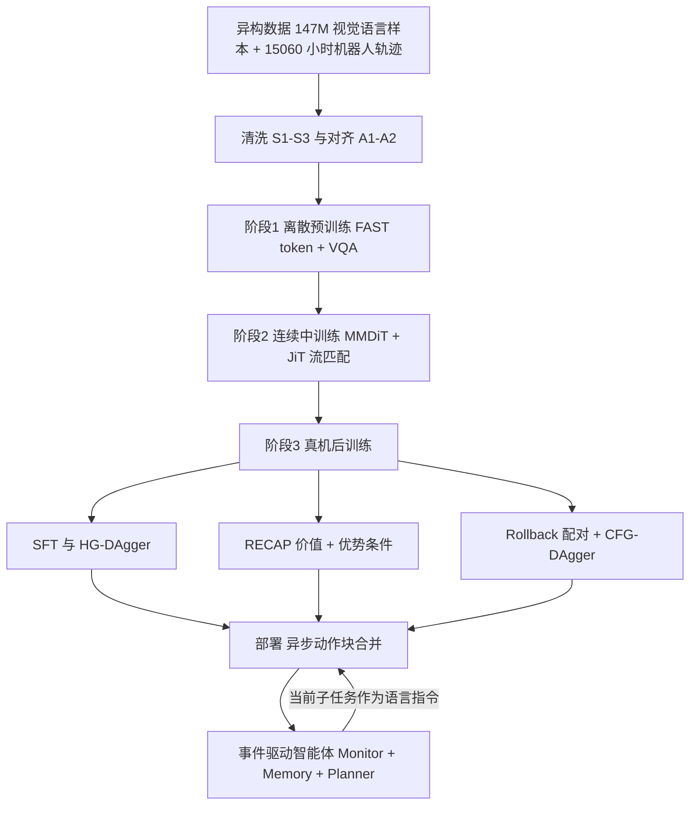

# Meituan-Robotics-0（MR0，arXiv:2611.08577）

**Meituan-Robotics-0**（*Meituan-Robotics-0: A Vision-Language-Action Foundation Model for Desktop Manipulation*，[arXiv:2611.08577](https://arxiv.org/abs/2611.08577)，v1 于 2026-11-05 提交，署名 Meituan Robotics Team）是一份技术报告。原文通读记录见 [来源归档](../../sources/papers/meituan-robotics-0_arxiv_2611_08577.md)。

## 一句话定义

**一个面向固定底座桌面操作的 VLA 基础模型加事件驱动具身智能体：把异构机器人数据对齐成统一末端位姿动作，经「离散预训练、连续中训练、真机后训练」三阶段得到策略，用 Rollback 采集的纠错配对训练 CFG-DAgger，并在推理端用异步动作块合并与事件记忆支撑长程任务。**

## 英文缩写速查

| 缩写 | 英文全称 | 简要说明 |
|------|----------|----------|
| MR0 | Meituan-Robotics-0 | 本文模型与系统名 |
| VLA | Vision-Language-Action | 视觉-语言-动作策略 |
| VQA | Visual Question Answering | 视觉问答，预训练中与动作共同训练 |
| FAST | Frequency-space Action Sequence Tokenization | 对动作块做 DCT 再经 BPE 压缩的离散动作 token 化（论文第 3.1 节引用） |
| MMDiT | Multimodal Diffusion Transformer | 本文连续动作头的结构（观测流与动作流联合自注意力） |
| JiT | （论文未展开全称，引用 Li and He 的 clean-sample 预测工作） | 动作头预测干净样本再换算成速度的参数化（第 3.2.2 节） |
| EEF | End-Effector | 末端执行器，本文统一动作表示基于肩中心系下的 EEF 位姿 |
| HIL | Human-In-the-Loop | 人在回路纠正 |
| HG-DAgger | Human-Gated DAgger | 人工门控的 DAgger，只保留人接管片段做纠正监督 |
| RECAP | RL with Experience and Corrections via Advantage-conditioned Policies | 论文引用的优势条件策略方法（见 π0.6* 页），本文用作对照 |
| CFG | Classifier-Free Guidance | 无分类器引导，这里在动作空间合并正负条件预测 |
| PS | Progress Score | 论文为每个真机任务定义的进度分 |
| SR | Success Rate | 成功率 |

## 为什么重要

- 论文自述的问题（第 1 节）：不同来源的机器人数据观测格式、动作空间、本体和任务描述不一致；只用成功示范训练的策略缺少从自身闭环误差状态恢复的监督；只看当前观测的反应式策略无法保留已离开视野的任务信息。MR0 把这三件事连成一条线。
- 对本仓库读者：它给出一条可对照的「VLA 真机后训练」路线，即同一中训练检查点上并列比较 SFT、HG-DAgger、RECAP 与 CFG-DAgger，比较口径比多数只展示最终成功率的报告更清楚（附录 C）。
- 作者主张的新点是 Rollback：用「被替换的策略片段」做负样本、「人工纠正续作」做正样本，从而不需要价值学习和优势标注（第 3.2.3 节）。这是作者自述，证据范围见下文「局限」。

## 核心机制

### 流程总览

### 数据（第 2 节）

- 视觉语言语料约 147M 样本（训练重采样前），通用 78%、具身 22%（图 2）。具身类监督的选择依据是 CALVIN ABC→D 上的受控消融（表 1）：论文据此选择 2D 目标 affordance 定位、场景描述和 2D 定位三类做自建数据扩充。
- 机器人语料 15,060 小时、12 种本体，仅固定底座：RoboDesk 3,235 h（21.5%，由 AgiBotWorld-Beta、Galaxea Open-World、RoboCOIN、LET、DROID、RoboMIND 六个开源真机数据集构成，表 2）、授权真机 7,530 h（50.0%）、开源仿真 4,295 h（28.5%，InternData-A1、Genie Sim 3.0、RoboTwin 2.0）。
- 清洗：S1 去静止首尾，S2 用 URDF 正运动学核对关节与末端记录，S3 去视频缺陷；A1 规范化动作，A2 分层任务标注（global_task、curr_subtask、scene、skill）。
- 统一动作（式 2–3）：每臂为肩中心系下绝对 EEF 位置 3 维、连续 6D 旋转、归一化夹爪闭合度，共 10 维；双臂 20 维，单臂用 10 维。

### 三阶段训练（第 3 节）

1. **离散预训练：** 骨干由 Qwen3.5-4B 初始化并全程可训练；FAST token 与 VQA 用同一自回归头，损失 L_pre = 1.0·L_action + 0.1·L_vqa，500,000 步、256 GPU。动作池约 13.6k 小时（表 3，与 15,060 小时总清单不同）。
2. **连续中训练：** 丢弃 token 接口（论文给出的理由是 FAST 带来动作重建误差），从零初始化 MMDiT 动作头，JiT 参数化的流匹配，用掩码损失兼容不同动作宽度（d_max=20），128 GPU；混合比例按帧数平方根采样，并随机在子任务标签和整体目标之间切换指令粒度（langmix）。
3. **真机后训练：** 先 SFT，再并列比较 HG-DAgger、RECAP、CFG-DAgger；每种方法每轮都从中训练检查点 π_mid 在累计数据上重新训练，并非依次叠加。

### Rollback 与 CFG-DAgger（第 3.2.3 节，图 6，附录 C.3）

- 操作员在失败附近暂停，选一个更早的已记录状态，用动作历史把机器人带回，再给出纠正续作。同一锚点下，被替换片段 τ⁻ 标 I=0，人工替换 τ⁺ 与示范标 I=1，不要求逐帧对齐；无法恢复场景时退化为普通 HIL，只贡献正样本。
- 单个共享策略学习 I=1、I=0 与无条件三条分支（条件丢弃率 0.3，同一流匹配损失）；推理时 a_CFG = a⁻ + γ(a⁺ − a⁻)，γ=1.25。
- RECAP 对照：价值网络（SigLIP2 + Gemma 3 270M，201 个原子的分类价值）用成功与失败轨迹训练，策略只用成功轨迹训练（脚注称这样效果更好），β=1.75。

### 推理系统（第 4 节）

- **异步动作块合并：** 后台线程以约 3 Hz 预测，控制环 30 Hz 消费；新块到达时丢弃已过期的前 d=min(k, K_lat) 步，并与旧缓冲线性混合（式 7–8，沿用 χ0 的时间块平滑）。
- **事件驱动智能体：** Monitor 以 2 Hz 把 8 帧、2 秒窗口转成结构化描述；Memory Manager 合并成事件并附 4–8 张关键帧，同时输出是否需要重新评估（z_t）；Planner 仅在 z_t=1 时决定保持、前进、等待或重规划。三者用 Qwen3.5-35B-A3B。

## 关键结果（作者报告，带出处）

| 评测 | 设置 | 结果 | 出处 |
|------|------|------|------|
| RoboTwin 2.0 | 50 任务，每任务每划分 100 回合，只评 VLA 策略 | Clean 93.2、Randomized 93.9、Overall 93.6 | 5.1 节，表 4 |
| RoboDojo | 42 个双臂仿真任务，带历史信息的变体 | Score 20.15 / SR 14.63%，表中 9 个 VLA 条目里第 5；开放词汇项 SR 3.38% | 5.1 节，表 5 |
| 真机 MR0 对 π0.5（匹配 HG-DAgger） | 3 任务，各 30 次 | 平均 SR 0.78 对 0.69，平均 PS 0.91 对 0.85；字母块 SR 均为 83% | 5.2.2 节，图 1、图 10 |
| 网线插接 Rollback 对比 | 同一示范与 Rollback 回合，3 轮 | CFG-DAgger SR 0.70 / PS 0.90；RECAP 0.60 / 0.67 | 5.2.2 节，图 11 |
| 智能体 | 两个受控定性案例 | 跨任务事件检索；子任务等待与恢复，无聚合指标 | 5.2.3 节，图 13–14 |

## 工程实践

- **硬件与观测（附录 A）：** 双臂 AgileX PiPER，头部 + 左右腕共 3 路 640×480 相机，经 Smart Resize 到约 352×256；动作块 H=50，20 维末端表示；状态与动作按 1% / 99% 分位归一化。
- **数据量（表 6）：** 字母块 500 示范 + 200 HIL；叠衣服 400 + 400；网线 200 + 450 Rollback（对 π0.5 的对比使用 1,400 多条网线回合）。
- **异步执行参数（表 7）：** f_c=30 Hz，f_π=3 Hz，H=50，K_lat=4，最小旧参考长度 8，2 次暖启动查询。
- **RECAP 超参（表 8）：** 价值学习 6,000 步 / batch 256，策略 30,000 步 / batch 128，N=H=50。
- **开源状态：** 首页与项目页均列出代码、模型、数据入口；本次仅读到项目页，GitHub 仓库内容未核实，复现前需自行确认权重与数据是否放出。

## 与其他工作对比

| 对照 | 差异读法 |
|------|----------|
| [π0.6*（RECAP）](./paper-rcl-2511-14759-0-6-a-vla-that-learns-from-experience.md) | RECAP 靠价值学习与优势条件；MR0 在同一 Rollback 数据上把它当对照，并用片段级正负标签的 CFG-DAgger 替代价值学习 |
| [HG-DAgger / DAgger](../methods/dagger.md) | HG-DAgger 只保留人接管片段；Rollback 额外保留「被替换片段」作负样本 |
| [SimPT 等干预式后训练](./paper-simpt-intervention-based-vla-post-training.md) | 同属利用人工干预数据的 VLA 后训练，机制细节需分别读原文 |
| [Harness VLA](./paper-harness-vla.md)、[SimpleMemVLA](./paper-simplememvla.md) | 同为长程记忆 / 智能体路线；MR0 的记忆在 VLA 之外的事件层，策略本身无历史（RoboDojo 带历史变体例外） |
| [RLinf-VLA](./paper-rlinf-vla.md) | MR0 的 RECAP 价值模型实现自述沿用 RLinf 的 RECAP 实现（附录 C.2） |

## 局限与未验证之处

**论文自己承认的：**

- 智能体评估仅为两个定性案例，无聚合成功率；且作者明确说检索案例不涉及外部干预下所有已满足条件的保持（5.2.3 节）。
- RoboDojo 上开放词汇指令仍弱（SR 3.38%），策略偏向熟悉动作（5.1 节）。
- HIL 数据的收益依任务与已有覆盖而异（图 12）。

**我读到的、论文未验证或证据较弱的（评论，非作者原话）：**

- 样本量小：每个设置 30 次试验、单个任务、未报告多随机种子或置信区间；网线上 0.70 对 0.60 相差约 3 次成功，证据偏弱。
- Rollback 的收益与特定设置绑定：只在网线插接一个任务上做了 CFG-DAgger / RECAP / HG-DAgger 对比（图 11），且 RECAP 的价值模型与策略训练细节（排除失败轨迹等）是作者自行配置；不能外推为「CFG-DAgger 普遍优于 RECAP」。
- 图 10 中网线的 MR0-HG-DAgger SR 70% 使用 1,400 多条回合，图 11 中 HG-DAgger 在 450 条 Rollback 数据下末轮约 50%（读图估计），两者数据量不同，不要混读。
- RoboTwin 2.0 Overall 93.6 仅领先 G0.5（93.3）0.3 个百分点；Clean 单列 G0.5 为 93.7，高于 MR0 的 93.2（表 4）。论文称「最高」是指 Overall。
- RoboDojo 的第五名排位依赖作者选取并展示的条目与 2026-10-26 榜单快照，基线数字按官方榜单抄录，本页未回榜单核对。
- 真机三任务全部在同一 AgileX PiPER 平台，论文未做跨本体真机评估；「跨本体迁移」的证据主要来自仿真与数据规模叙述。

## 小站说法核对

对「具身智能小站」2026-11-09 条目逐条核对：「每策略每任务测试 30 次」属实（5.2.1 节）；「使用 Rollback 数据时 CFG-DAgger 网线插接 70%、RECAP 60%」属实（5.2.2 节、图 11）；「纠错收益来自特定后训练设置」与论文只在网线任务做该对比一致；「跨任务记忆和中断后恢复主要作定性展示」属实（5.2.3 节）。机构：论文首页仅署 Meituan Robotics Team。

## 关联页面
- [具身智能小站 11-09：29 篇论文阅读坐标](../overview/embodied-station-2026-11-09-29-papers-technology-map.md)

- [VLA（Vision-Language-Action）](../methods/vla.md)
- [DAgger](../methods/dagger.md)
- [HIL 混合模仿学习](../methods/hil-hybrid-imitation-learning.md)
- [Action Chunking](../methods/action-chunking.md)
- [StarVLA](../methods/star-vla.md)
- [流匹配具身策略](../concepts/flow-matching-embodied-policy.md)
- [Foundation Policy](../concepts/foundation-policy.md)
- [具身数据清洗](../concepts/embodied-data-cleaning.md)
- [Agent 记忆](../concepts/agent-memory-and-dreaming.md)
- [π0.6*：从经验中学习的 VLA](./paper-rcl-2511-14759-0-6-a-vla-that-learns-from-experience.md)
- [RLinf-VLA](./paper-rlinf-vla.md)
- [SimPT 干预式 VLA 后训练](./paper-simpt-intervention-based-vla-post-training.md)
- [Harness VLA](./paper-harness-vla.md)
- [SimpleMemVLA](./paper-simplememvla.md)
- [π0.5](./paper-pi05-open-world-vla.md)

## 参考来源

- [meituan-robotics-0_arxiv_2611_08577.md](../../sources/papers/meituan-robotics-0_arxiv_2611_08577.md)
- [arXiv:2611.08577](https://arxiv.org/abs/2611.08577)
- [项目页](https://meituan-robotics.github.io/Meituan-Robotics-0/)

## 推荐继续阅读

- [arXiv PDF（v1）](https://arxiv.org/pdf/2611.08577v1)
- [DAgger 方法页](../methods/dagger.md)
- [π0.6* 页面](./paper-rcl-2511-14759-0-6-a-vla-that-learns-from-experience.md)
- [VLA 方法页](../methods/vla.md)
