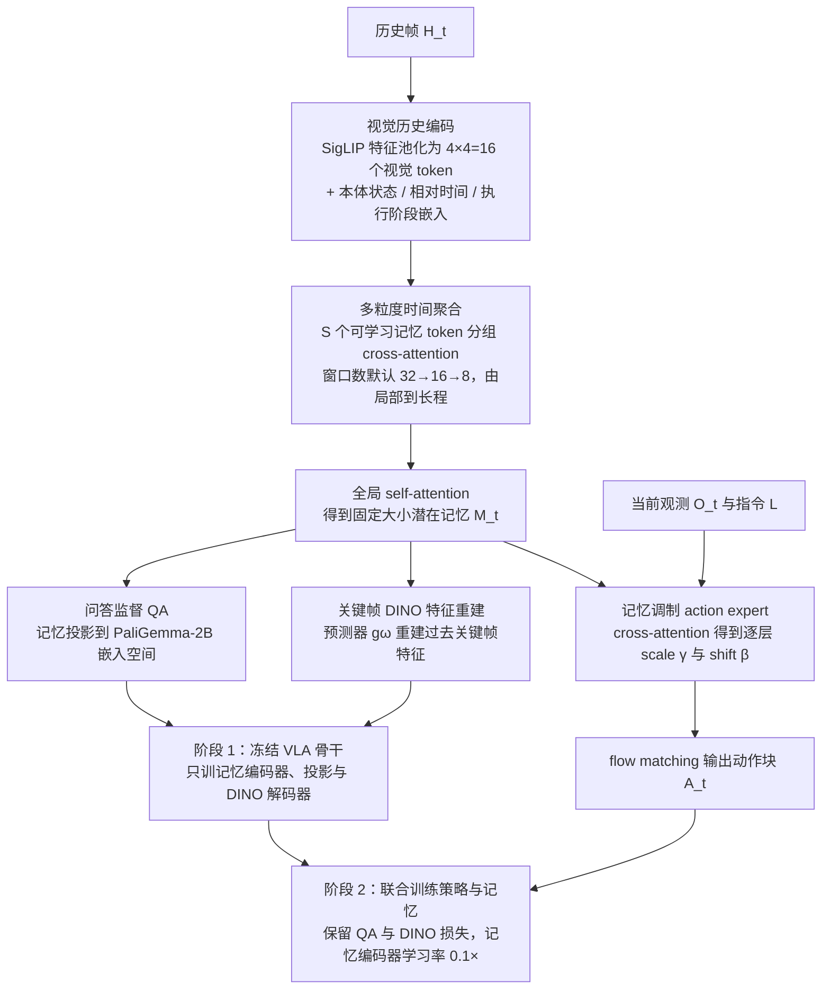

# Mem4Act：面向长程机器人操作的潜在记忆学习

**Mem4Act 把长历史压缩为固定大小的潜在记忆，并显式优化该记忆，使其保留对后续动作有用的信息。**

## 英文缩写速查

| 缩写 | English | 简要说明 |
|------|---------|----------|
| — | Latent memory | 潜在记忆，固定大小的历史压缩表示 |
| — | Multi-granularity aggregation | 多粒度时间聚合，在不同时间尺度上汇总历史 |
| VLA | Vision-Language-Action | 视觉–语言–动作策略 |

## 为什么重要

摘要指出，现有方法或保留原始历史、或保留压缩的视觉 token、或保留语言摘要，前者让策略面对越来越长的输入，后者可能丢掉任务相关的时间、语义与感知信息。

## 流程总览

图依据：论文方法部分（Structured Memory Formation / Memory-Specific Supervision / Memory-Conditioned Action Policy / Memory-First Two-Stage Training）/ Fig. 2。

## 核心信息

| 项目 | 内容 |
|------|------|
| arXiv | [2610.22323](https://arxiv.org/abs/2610.22323) |
| 作者 | Yun Zhang, Zhiyu Huang, Tianhui Cai, Chen Tang, Wei Wang, Jiaqi Ma（arXiv 作者列表） |
| 机构 | 未核实（公众号标注"待核实"） |
| 开源状态 | **未核查代码**（摘要页未列代码链接） |

## 核心原理

1. **覆盖长历史：** 多粒度时间聚合。
2. **保留什么：** 摘要称记忆需保留时间、语义与感知信息。
3. **确保使用：** 通过约束使策略确实依赖记忆，而不是忽略它（摘要点明该问题）。

## 工程实践

- 未发现官方代码入口；源码运行时序图：**不适用**。

## 评测与结果

据 arXiv 摘要（2026-10-22 核对）：

| 设置 | Mem4Act 成功率 |
|------|----------------|
| RoboMME（记忆依赖仿真基准） | 49.88% |
| RMBench | 61.0% |
| 4 个真实操作任务 | 81.5% |

摘要称上述结果在记忆依赖控制上达到 SOTA；消融表明时间聚合、互补记忆监督（问答监督 + 关键帧 [DINO](./paper-dinov2.md) 特征重建）与"记忆优先"两阶段训练三项均有贡献。

## 与其他工作对比

| 记忆路线 | 记忆形态 | 与 Mem4Act 的差异 |
|----------|----------|-------------------|
| 原始历史观测（摘要所述基线类） | 直接拼接历史帧 | 输入随历史增长；Mem4Act 用固定大小潜在记忆限定接口 |
| 压缩视觉 token / 语言摘要（摘要所述基线类） | token 压缩或文本摘要 | 可能丢失时间、语义或感知细节；Mem4Act 用问答监督与关键帧特征重建约束保留内容 |
| [MemoryWAM](./paper-memorywam.md) | 滑窗近期帧 + 起点 anchor + gist token | 同样压缩长历史，但在 WAM 框架内；Mem4Act 额外用两阶段训练迫使策略读取记忆 |
| [GMP](./paper-gated-memory-policy.md) | 学习型门控 + cross-attention 记忆 | 侧重何时读写记忆；Mem4Act 侧重记忆内容的监督目标 |
| [IMPRINT](./paper-imprint-multi-stream-latent-memory.md) | 观察 / 动作 / 本体多流潜在记忆 | 同为潜在记忆，监督信号为历史重建与进度估计 |

前两行对应摘要中的三类既有做法；后三行为路线层面的定性对比，各自基准不同，数值不可直接比较。

## 结论

**一句话总判：长程操作的记忆应是固定大小且被显式优化的潜在表示，并需要验证策略真正读取了它。**

1. **固定大小可控制输入规模** — 避免策略随历史变长而变慢。
2. **记忆要有保留目标** — 时间、语义与感知信息都需要覆盖。
3. **"用上记忆"需要单独检验** — 摘要把这一点列为三个核心挑战之一。

## 局限与风险

- 成功率数字仅取自 arXiv 摘要，RoboMME / RMBench 的分任务结果与试验次数需回原文表格核对。
- 记忆大小的选择对不同任务的敏感度未知。

## 关联页面

- [VLA 方法总览](../methods/vla.md)
- [模仿学习](../methods/imitation-learning.md)
- [操作任务](../tasks/manipulation.md)

## 参考来源

- [论文归档](../../sources/papers/mem4act_arxiv_2610_22323.md)
- [公众号综述摘录（33 篇 Manipulation）](../../sources/raw/wechat_senlanke_manipulation_33_papers_2026-10-12_16.md)
- [arXiv PDF](https://arxiv.org/pdf/2610.22323)：已通读方法部分（实验与附录以略读为准）：问题设定、结构化记忆形成、记忆专用监督、记忆条件动作策略、记忆优先两阶段训练；数据集/基线设定略读

## 推荐继续阅读

- [arXiv:2610.22323](https://arxiv.org/abs/2610.22323)
