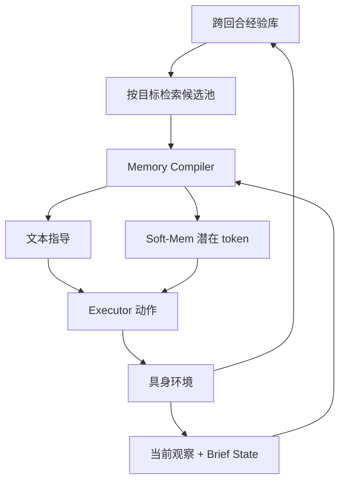
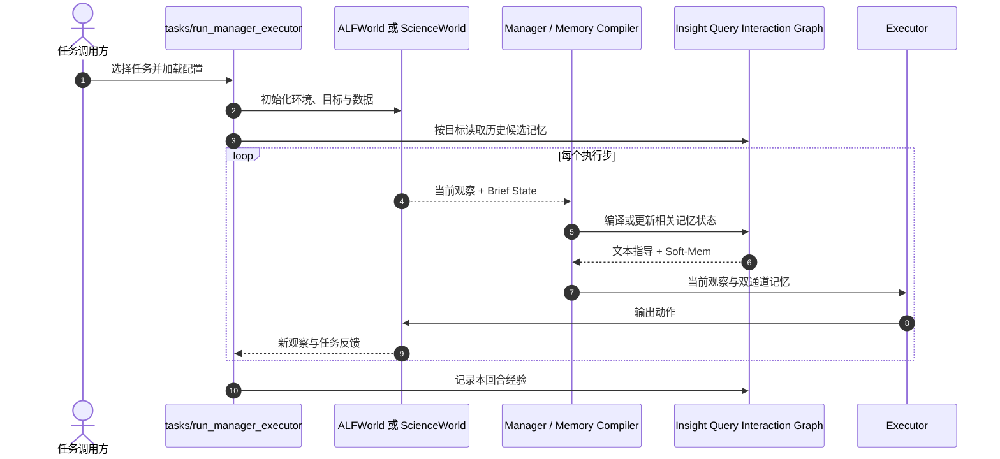

# MemCompiler：具身智能体的状态条件记忆编译

**MemCompiler**（*Compile, Don't Inject — State-Conditioned Memory for Embodied Agents*，[arXiv:2605.07594](https://arxiv.org/abs/2605.07594)，[项目页](https://air-embodied-brain.github.io/MemCompiler/)，[代码](https://github.com/air-embodied-brain/MemCompiler)）由中国科学技术大学、华中科技大学、Microsoft Research、南京大学和清华大学 AIR 团队提出：根据智能体当前执行状态，在每个决策步编译适用经验，并通过文本与潜在 Soft-Mem 两条通道传给执行器。

## 一句话定义

**记忆不仅要检索到，还要在当前动作需要它时按状态编译成合适的执行指导。**

## 英文缩写速查

| 缩写 | 英文全称 | 简要说明 |
|------|----------|----------|
| AMMI | Ahead-of-time Monolithic Memory Injection | episode 开始时整体注入候选记忆并保持静态 |
| SCMC | State-Conditioned Memory Compilation | 每个执行步依据当前状态编译适用记忆 |
| Soft-Mem | Soft Memory | 向执行器 embedding 注入的潜在感知记忆 token |
| GRPO | Group Relative Policy Optimization | 用任务成功奖励优化记忆编译策略的 RL 算法 |
| SFT | Supervised Fine-Tuning | 监督微调编译器与执行策略 |

## 为什么重要

- **补上记忆交付时机：** 以往比较常问存储、检索什么；MemCompiler 把核心变量推进到执行过程中的「何时送达」。
- **面向轻量执行器：** 长期静态提示会让相关经验被无关上下文淹没；编译器试图减少执行器自己筛选记忆的负担。
- **文本表达有上限：** Soft-Mem 把文本不易表达的空间与感知线索直接送入执行器表征。
- **与 [Zeva](./paper-zeva.md) 互补：** Zeva 侧重机器人跨尝试累积自身交互的因果信号；MemCompiler 侧重每一步按 Brief State 决定如何交付候选经验，并训练编译器/Soft-Mem。两者解决「经验怎么形成」与「当前如何使用」的不同侧面。
- **与 [Spatial Memory Agent](./paper-spatial-memory-agent.md) 区分：** SMA 将验证过的空间经验组织成过程性 lesson；MemCompiler 在多类具身任务中显式学习逐步的状态条件记忆编译和双通道输出。

## 核心机制

### 候选池与逐步状态编译

episode 开始时，系统按目标从跨 episode 记忆库取回候选池 \(\mathcal{M}\)。执行时刻 \(t\) 的运行状态由当前观察 \(o_t\) 与结构化 Brief State \(b_t\) 组成。Memory Compiler 每步针对 \((o_t,b_t,\mathcal{M})\) 选择合适内容，而不是要求 Executor 持续在完整历史里自行筛选。

Brief State 汇总目标、动作和观察历史、环境信念与子目标进展；可按执行反馈更新、折叠已完成子目标，并记录偏离进展等状态。四类输出为：

| 编译动作 | 行为 |
|---------|------|
| EXPERIENCE | 输出相关历史经验指导 |
| BRIEF | 更新 Brief State |
| HYBRID | 同时输出经验指导并更新状态 |
| NOACTION | 当前没有适用记忆时不注入 |

### 文本 + Soft-Mem

文本通道提供可读的操作建议；Soft-Mem 从记忆表征中投影潜在 token 到 Executor 的 embedding 空间，保留空间/视觉经验中难以文字化的线索。训练使用正交约束，让潜在通道补充而非复制文本通道。论文配置为 16 个 soft tokens。

### 训练方式

1. **监督微调（SFT）：** 以教师生成的编译指导监督 Compiler 和 Executor，优化文本、动作与 latent 目标。
2. **GRPO：** 用 episode 成功/失败的二值奖励优化编译策略；此阶段 Executor 冻结，更新 Memory Compiler 与 Soft-Mem 投影。
3. **执行：** 每步由编译器按 Brief State 选择记忆，Executor 结合当前观察和指导预测动作，环境反馈进入后续状态与记忆。

### 流程总览

## 评测

论文评测 ALFWorld、EmbodiedBench（EB-ALFRED、EB-Habitat）和 ScienceWorld，覆盖四个开源及两个闭源执行骨干。主要结果：

| 设置 | 结果 |
|------|------|
| 开源 Executor 跨基准 | 均优于无记忆基线；最高相对提升 +110%（EB-ALFRED）、+129%（ScienceWorld） |
| ALFWorld：SCMC vs AMMI | 成功率 35.03% → 82.16% |
| ALFWorld：Executor 输入 token | 2481.1 → 1003.2（减少约 60%） |
| ALFWorld：Executor 每步延迟 | 0.30s → 0.12s（减少约 60%）；编译器额外约 0.093s |
| 注意力分析 | 第 29 步 AMMI 记忆 token attention 下降 86.7%；SCMC 在步间保持更稳定 |

以上为作者报告的具体实验设置与比较；跨基准、执行骨干的提升比例不可直接横比。编译器本身增加推理开销，应与 Executor 节省的 token 和延迟合并衡量。

## 结论

**MemCompiler 的核心贡献是把具身记忆利用从一次性上下文注入改为执行中逐步、状态条件的编译。**

- 长程且子目标/环境状态持续变化的任务，应检查静态记忆是否会逐步失配。
- ALFWorld 对比显示 SCMC 同时提高成功率、缩短 Executor 输入并降低端到端每步延迟；其他模型和设备仍需重新测量。
- Soft-Mem 适合文本难以承载的空间/感知经验，但增加训练与模型接口依赖。
- SFT/GRPO 训练编译层及潜在投影；RL 阶段 Executor 冻结，不能概括为所有训练阶段都不更新执行策略。
- 复现需配置环境数据、Manager/Executor 模型或 API 与训练算力；代码公开不等于权重、全部数据和许可边界均已明确。
- 将其视为具身记忆的在线交付/编译层，可与 Zeva 的交互因果记忆、SMA 的验证式空间 lesson 沿不同设计轴对照。

## 源码运行时序图

对齐官方仓库 README 的 `run_alfworld.sh` / `run_scienceworld.sh` 与 `tasks/run_manager_executor*.py` 入口：

这是按 README 运行入口与论文方法编译出的复现路径；具体记忆存储和更新细节需进一步对照实现目录。

## 工程实践

| 项 | 入口或建议 |
|----|------------|
| 安装 | Python 3.12；`pip install -r requirements.txt` 或 `conda env create -f environment.yml` |
| ALFWorld | `bash run_alfworld.sh` / `python tasks/run_manager_executor.py` |
| ScienceWorld | `bash run_scienceworld.sh` / `python tasks/run_manager_executor_scienceworld.py` |
| 训练模型评测 | `python tasks/eval_with_trained_model.py` |
| 运行条件 | 环境数据路径、Manager/Executor 模型路径或 API key、配置参数 |
| 开源状态 | 代码已公开；论文称 code and data available；项目页所链模型条目无 model card，数据范围/许可证需分别核对 |

## 局限与风险

- **编译器质量：** 状态摘要或记忆选择错误时，指导会与真实环境错位。
- **系统额外成本：** 每一步调用 Compiler 有时延/算力开销；论文 ALFWorld 对比显示执行器节省超过此开销，其他模型和设备需重新测量。
- **软 token 兼容：** Soft-Mem 需要可训练投影与执行器 embedding 接口，并非对所有黑盒 API 执行器都能直接启用。
- **任务覆盖：** 论文基准含文本交互、仿真与家庭环境任务；复杂真机闭环行为的迁移能力仍需实测。
- **复现完整性：** 依赖外部环境数据和模型；项目页链接的模型条目缺少 model card，无法从公开入口确认其与论文全部表格配置一一对应。

## 与其他工作对比

| 维度 | MemCompiler | [Zeva](./paper-zeva.md) | [Spatial Memory Agent](./paper-spatial-memory-agent.md) | [Zetta ζ](./paper-zetta.md) |
|------|-------------|--------------------------|----------------------------------------------|-----------------------------|
| 主要对象 | 记忆交付时机与编译 | 自身交互因果信号 | 验证过的空间 lesson | 运行期 critic / recovery harness |
| 状态使用 | Brief State 每步更新 | 动作效果与阶段匹配 | 语义检索 + 可靠性分数 | critic 检测物理偏差 |
| 输出接口 | 文本 + Soft-Mem | Causal Prompt | 检索 procedure | 可执行 recovery |
| 训练/更新 | SFT + GRPO 训练编译器/投影；RL 阶段 Executor 冻结 | 在线更新交互记忆 | 记忆条目带 verifier/可靠性 | 代码候选经门控晋级 |

表内为架构关注点对照，不代表统一 benchmark 上的量化比较。

## 关联页面

- [VLA](../methods/vla.md)
- [World Action Models](../concepts/world-action-models.md)
- [Spatial Memory Agent](./paper-spatial-memory-agent.md) — 经验证的空间过程记忆
- [Zeva](./paper-zeva.md) — 自身交互因果记忆与部署期学习
- [Zetta ζ](./paper-zetta.md) — 代码 critic/recovery 的具身 harness

- [MemT-1.0：面向原生记忆演化的记忆基础模型](./paper-memt-1-0-memory-native-evolution.md) — 对照内部记忆状态与逐步编译外部经验。

## 参考来源

- [MemCompiler arXiv 摘录](../../sources/papers/memcompiler_arxiv_2605_07594.md)
- [MemCompiler 官方项目页](../../sources/sites/memcompiler.md)
- [air-embodied-brain/MemCompiler](../../sources/repos/air-embodied-brain-memcompiler.md)

## 推荐继续阅读

- [项目页](https://air-embodied-brain.github.io/MemCompiler/)
- [arXiv:2605.07594](https://arxiv.org/abs/2605.07594)
- [官方代码](https://github.com/air-embodied-brain/MemCompiler)
