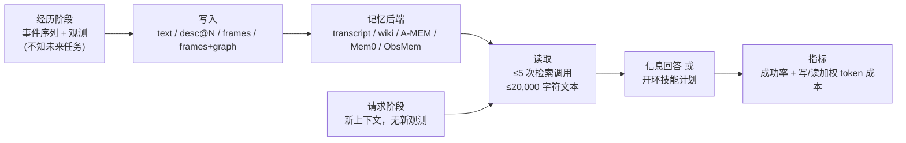

# MeMoREval：具身智能体该记文字、图像还是场景图？

**MeMoREval**（论文 *What Should Embodied Agents Remember? Benchmarking and Evaluating Memory Modality for Embodied Agents*，[arXiv:2610.12561](https://arxiv.org/abs/2610.12561)，[项目页](https://MeMoREval.github.io/)）由 **Dexmate / 卡内基梅隆大学（CMU）/ 普渡大学（Purdue）** 提出：一个把「记忆存什么模态」单独隔离出来的基准协议，在四个仿真室内场景的 53 个任务上同时衡量任务成功率与写入/读取的推理成本，并用两段真机演示说明协议可迁移。

## 一句话定义

**让 LLM 具身智能体先经历一段不知后续用途的事件，再在没有新观测、只剩记忆的条件下回答问题或提交动作计划，比较文字、描述、图像帧、帧加场景图四种记忆内容谁更准、谁更省。**

## 英文缩写速查

| 缩写 | 英文全称 | 简要说明 |
|------|----------|----------|
| MeMoREval | Memory Modality Evaluation | 本文基准名（记忆模态评测） |
| desc@N | Description at N-token budget | 用模型对帧生成 N token 上限的文字描述再存储，N=64/256/1024 |
| A-MEM / Mem0 / ObsMem | 三种智能体记忆系统 | 论文适配到统一接口的记忆后端，与 transcript、wiki 并列共五种 |
| SLAM | Simultaneous Localization and Mapping | 真机演示里建三维地图 |
| SAM 3 | Segment Anything Model 3 | 真机演示中头部相机的分割模型 |

## 为什么重要

- 多数记忆工作比的是「检索算法」，而 MeMoREval 把变量收窄到**存什么**：同一写入/读取接口下换模态，结论更干净。
- 它给出一个反直觉的工程结论：存原始标注帧不仅比存帧的文字描述成功率高，**写入成本还不高于**描述（描述需要额外一次生成调用）。
- 场景图补的是空间关系与用户偏好这类「帧里不显式」的信息，为移动操作机器人的记忆栈选型提供依据。

## 核心信息

| 项 | 内容 |
|----|------|
| 机构 | Dexmate；Carnegie Mellon University；Purdue University（部分作者为 Dexmate 实习期间完成） |
| 仿真 | Genesis，场景改编自 SceneSmith；办公室、摄影棚、住宅、诊所，各 7–9 个房间、200–300 个物体 |
| 机器人 | Dexmate Vega 1 双臂移动操作平台；技能为导航、开关家具、抓放 |
| 任务 | 53 个，七类（物体位置 11、空间配置 11、外观绑定 10、集合聚合 8、用户偏好 5、遮挡状态 4、技能结果 4） |
| 模型 | 主：Gemini 3.7 Flash；另 GPT 5.6 Sol、GLM 5.3 Flash（单种子、三个后端） |
| 开源 | **待发布**：项目页与 HTML 给出 `jimwang418/MeMoREval`，截至 2026-10-12 克隆为空仓库 |

## 方法栈与流程总览

## 方法

- **协议：** 经历阶段与请求阶段严格分离；请求阶段上下文清空，智能体只能通过检索工具访问记忆。请求分信息类（回答）与动作类（提交开环技能计划），多数任务两种都有，技能结果任务只有动作类。另有把 10–11 个任务经历串联的堆叠组合任务，检验经验累积。
- **四种模态：**
  - Text：写入模型把文本观测（用户消息、技能反馈、检测到的物体类别/关节/支撑与包含关系）整理成记录，颜色和纹理被丢弃。
  - desc@64/256/1024：由同一模型对带标注帧加同步文本观测另行生成描述，原样存储、按步检索，绕过写入模型。
  - Frames：带检测框与整数物体 ID 的标注帧直接归档，按步号检索，绕过写入模型。
  - Frames+graph：帧再加场景图快照（物体 ID、世界系 3D 位置、支撑/包含边），检索返回所请求物体与关系的文本记录。
- **控制条件：** 无记忆（下界）与全信息（手写事实，上界）。
- **后端：** transcript（滚动历史、无 LLM 写入）、wiki（命名页面可追加/重写）、A-MEM、Mem0、ObsMem，后三者按统一接口适配。

## 实验与评测

主模型 Gemini 3.7 Flash，六条件 × 五后端 × 53 任务 × 三种子，温度 0，池化结果：

| 条件 | 任务成功 | 信息成功 | 动作成功 | 写入 k tokens/步 |
|------|---------|---------|---------|-----------------|
| Text | 39% | 53% | 51% | 2.48 |
| desc@64 / @256 / @1024 | 56% / 59% / 60% | 70% / 73% / 73% | 64% / 68% / 71% | 2.95 / 3.14 / 3.22 |
| Frames | 70% | 82% | 77% | 2.48 |
| Frames+graph | 75% | 85% | 82% | 2.48 |
| 无记忆 / 全信息 | 6% / 100% | 17% / 100% | 0% / 100% | – |

- **跨模型（种子 0、三个后端）：** 帧+场景图对三个模型都是总体最高——Gemini 3.7 Flash 72%、GPT 5.6 Sol 57%、GLM 5.3 Flash 50%；对应纯文字为 40%、36%、33%。
- **成本（美元，Gemini）：** 写入每千步，文字/帧/帧+图均约 $9.30，描述条件 $11.08–$12.09；读取每次成功信息请求，帧 $0.026、desc@1024 $0.030。
- **类别差：** 帧相对 desc@1024，外观绑定 +18.0 pp、物体位置 +12.7 pp、空间配置 +11.5 pp；帧+图相对帧，空间配置 +9.7 pp、用户偏好 +8.0 pp（技能结果 +16.7 pp 但区间跨零）。
- **扩展：** 堆叠累积经验——wiki+帧 64%、帧+图 74%（A-MEM 帧+图 73%），transcript 从单任务 68% 掉到 28%，原因是历史超出记忆上下文预算；选择性保留帧（保留 8–55%）在各后端都低于自动全量归档（如 wiki 46% 对 63%、A-MEM 62% 对 72%）；给写入模型看图像没有一致收益（wiki 67→64、A-MEM 69→64、Mem0 69→60、ObsMem 68→68）。
- **真机：** Vega 1 + SLAM 地图 + 人工标注场景图 + 头部相机与 SAM 3 分割，wiki 后端搭配帧+图；两个演示（丢弃饮料罐后取回其旁边的水果；移动柠檬后回忆盘子原色并取柠檬右侧的苹果）无人干预完成，仅定性，无量化指标。

## 源码运行时序图

**不适用**：论文给出的 [jimwang418/MeMoREval](https://github.com/jimwang418/MeMoREval) 截至 2026-10-12 为空仓库（无任何提交），没有可对齐的入口脚本；待代码发布后再补。

## 工程实践

| 项 | 建议 |
|----|------|
| 默认模态 | 先存带 ID 的标注原图，不要先转成文字描述再存；写入成本不增反省一次生成调用 |
| 空间/偏好任务 | 在帧之外加场景图（物体 ID、3D 位置、支撑/包含边），增益集中在空间配置与用户偏好 |
| 长期累积 | 不要依赖滚动 transcript；论文里堆叠任务时它崩到 28% |
| 帧保留 | 论文设定下自动全量归档优于让写入模型挑帧 |
| 写入模型 | 给写入模型喂图不是稳赚；一致性差，且会改变写入 token 成本 |
| 真机 | 论文真机场景图靠人工标注；落地需要自动场景图构建，原文未验证 |
| 复现 | 基准代码未发布，当前只能依据论文自行实现协议 |

## 结论

**对 LLM 具身智能体的记忆，先存带标识的原始图像，再按需补场景图，比把图像转成文字更准也不更贵。**

1. **别默认存文字描述。** 同一模型下 Frames 70% 对 desc@1024 60%，且描述条件写入成本更高。
2. **场景图补空间与偏好。** 帧+图相对帧在空间配置 +9.7 pp、用户偏好 +8.0 pp，总体 75% 对 70%。
3. **看成功率也要看读成本。** 帧每次成功信息请求读取成本最低档，Text 虽调用次数少但成功率仅 39%。
4. **长时间累积要换后端。** transcript 在堆叠场景从 68% 跌到 28%，wiki/A-MEM 类结构化后端能保持。
5. **别让写入模型挑帧。** 保留 8–55% 的帧后各后端均下降。
6. **结论有边界。** 完整扫描只有一个主模型，真机只有两段定性演示；跨模型排序一致不等于数值可迁移。

## 局限与风险

- 仅 Gemini 3.7 Flash 有完整扫描；GPT 5.6 Sol 与 GLM 5.3 Flash 为单种子、三个后端。
- 多数结果来自仿真；真机场景图人工标注，无量化真机指标。
- 场景图不含外观属性，也不显式编码序数或视角相关关系；适配后的 A-MEM/Mem0/ObsMem 可能偏离原设计。
- 成本为加权 token，仅同一模型内可比；部分类别差的置信区间含零。
- **开源状态：** 项目页链接的仓库截至 2026-10-12 为空，基准不能被第三方复现；论文没有独立局限性章节，以上局限由正文推出。

## 与其他工作对比

| 对照 | 差异读法 |
|------|----------|
| [六类空间表征](../concepts/embodied-perception-six-spatial-representations.md) | 那一页讨论感知端表征谱系；MeMoREval 评的是「存下来供事后推理」用哪种表征 |
| [LLM 机器人控制接口](../concepts/llm-robotics-control-interfaces.md) | 关注 LLM 如何调用控制；MeMoREval 关注 LLM 调用的记忆内容 |
| [VLA](../methods/vla.md) | VLA 把记忆压在模型权重/短上下文；本文是外挂记忆、开环技能计划的分层智能体 |
| [世界-动作模型](../concepts/world-action-models.md) | 世界模型预测未来；MeMoREval 是回溯性事实记忆，不预测 |

## 关联页面

- [34 篇空间落地技术图谱（汇总页）](../overview/embodied-station-34-papers-spatial-grounding-technology-map.md)
- [操作任务](../tasks/manipulation.md)
- [六类空间表征](../concepts/embodied-perception-six-spatial-representations.md)
- [LLM 机器人控制接口](../concepts/llm-robotics-control-interfaces.md)
- [Genesis 仿真器](./genesis-sim.md)

## 参考来源

- [具身智能小站 34 篇盘点（2026-10-12）](../../sources/blogs/wechat_embodied_station_34_papers_spatial_grounding_2026-10-12.md)
- [memoreval_arxiv_2610_12561.md](../../sources/papers/memoreval_arxiv_2610_12561.md) — 论文摘录与开源核查
- [memoreval.md](../../sources/sites/memoreval.md) — 项目页与仓库状态
- [arXiv:2610.12561](https://arxiv.org/abs/2610.12561)

## 推荐继续阅读

- [MeMoREval 项目页](https://MeMoREval.github.io/)
- [arXiv HTML 全文](https://arxiv.org/html/2610.12561v1)
- [Genesis 仿真器仓库](https://github.com/Genesis-Embodied-AI/Genesis)
