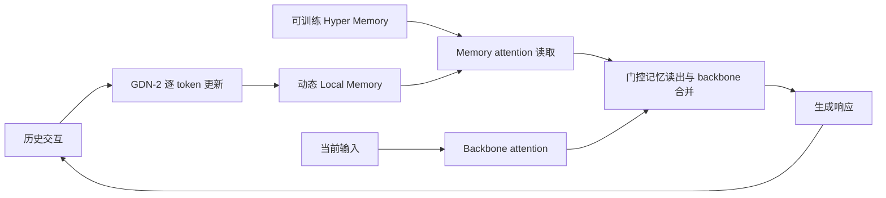
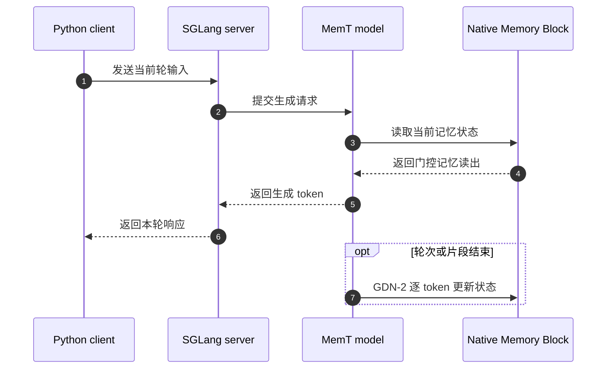

# MemT-1.0：面向原生记忆演化的记忆基础模型

## 一句话定义

**MemT-1.0** 是一组将持久、动态更新的记忆纳入模型计算的语言模型；它在生成过程中读取内部记忆，并在轮次或片段结束时更新记忆状态，从而减少对原始长上下文的持续访问。

## 英文缩写速查

| 缩写 | 英文全称 | 简要说明 |
|------|----------|----------|
| GDN-2 | Gated DeltaNet-2 | 论文用作轮次或片段结束时稳定的逐 token 记忆更新机制 |
| MoS | Mixture-of-Storage | 用于扩展原生记忆容量的存储混合机制 |
| KV cache | Key-Value Cache | Transformer 解码时保留历史键值的缓存，论文以完整上下文 KV cache 作存储比较 |
| SGLang | Structured Generation Language | 官方推理集成提供的模型服务框架 |

## 为什么重要

- **记忆变成模型状态的一部分：** 常见 RAG 或外置摘要会在生成前检索、拼接文本；MemT-1.0 将可演化的记忆状态纳入模型计算，生成时使用记忆注意力。
- **把历史长度与持久状态大小部分解耦：** 作者报告在 128K 历史实验中，Nano 相较完整上下文 KV cache 的持久存储约减少 66 倍；这属于论文给定配置下的比较，不代表无限容量或所有硬件上的吞吐保证。
- **面向程序性经验复用：** 论文还展示 coding agent 在长程任务中重用经验，不必把经验文本持续追加到任务上下文。该结果提示可研究机器人任务层的程序性记忆，但尚不能推导出机器人部署效果。

## 核心原理

MemT-1.0 在 backbone attention 旁加入 Native Memory Block：

| 组件 | 职责 |
|------|------|
| Local Memory Block | 维护随交互变化的多通道动态记忆矩阵 |
| Hyper Memory Block | 通过可训练的记忆 query/key/value 投影与 erase/write/forget/output gates 调节记忆读写 |
| Memory attention | 生成时读取当前状态，对读出归一化、门控后并入 backbone attention 输出 |
| GDN-2 更新 | 在轮次或片段结束时逐 token 更新记忆，供后续生成使用 |

Mixture-of-Storage（MoS）进一步用于扩展原生记忆容量。训练路线包括 backbone preparation、continued pre-training 与 post-training；作者称训练数据规模为 34B tokens。

### 流程总览

## 模型族与评测

| 模型 | Backbone | 总参数 | 激活参数 | 可训练记忆参数 | 动态记忆状态 |
|------|----------|--------|----------|----------------|--------------|
| MemT-1.0-Nano | Qwen3.6-35B-A3B | 36B | 3B | 451M | 10M |
| MemT-1.0-Flash | DeepSeek-V4-Flash | 288B | 17B | 3.61B | 336M |

报告评估 11 项记忆基准。作者报告 Nano 与 Flash 在被比较的**参数化记忆方法**中排名第一、第二；强文本记忆系统整体仍领先，尤其是长历史中需要细粒度证据检索的任务。论文还报告 Nano 在 128K 历史长度下相对完整上下文 KV cache 约 1.86×端到端推理加速、持久存储减少约 66×。这些数字应连同其任务、硬件和基线设置阅读。

## 源码运行时序图

官方仓库公开推理集成及 Nano 服务端 / Python 客户端示例；完整步骤和 Flash 配置见 [官方仓库](../../sources/repos/memtensor-memt-1-0.md)。

## 工程实践

- **先区分应用层级：** MemT-1.0 的论文应用是长程 coding agent。迁移到机器人时，可把它视为任务级历史 / 程序性记忆候选；不要把它当作 100–1000 Hz 的运动控制器或实时安全模块。
- **核对部署资源：** 官方 Nano 示例以两张 GPU 启动 SGLang 服务；Flash 参数量更大。实际显存、吞吐、并发和量化效果应在目标硬件与模型发行版本上测量。
- **拆分许可：** 仓库推理软件使用 PolyForm Noncommercial License 1.0.0，论文材料使用 CC BY-NC-SA 4.0；Hugging Face Flash 模型卡标注权重为 MIT。第三方 backbone、组件及其他权重版本还需遵守其各自条款。
- **做任务级对照：** 与完整上下文、RAG 或外置摘要比较时，分别记录长程任务成功率、事实检索准确性、持久状态大小、端到端延迟和显存；特别检查需要引用早期细节的任务，因为报告承认强文本记忆在此类任务上仍具优势。

## 与其他工作对比

| 路线 | 记忆所在位置 | 与 MemT-1.0 的差异 |
|------|--------------|--------------------|
| 完整上下文（KV cache） | 推理时保留全部历史 token | 论文在 128K 历史下报告 Nano 持久存储约减少 66×、端到端约 1.86× 加速；代价是历史被压缩进固定状态 |
| RAG / 外置摘要（文本记忆系统） | 模型外部的可检索文本 | 生成前检索拼接；论文承认强文本记忆在需细粒度证据检索的长历史任务上整体仍领先 |
| 其他参数化记忆方法 | 模型内可训练参数 / 状态 | 同类对照；作者报告 Nano 与 Flash 在被比较方法中排名第一、第二 |
| [MemCompiler](./paper-memcompiler-state-conditioned-memory.md) | 按状态条件编译的外部经验 | 面向具身智能体逐步编译经验；MemT-1.0 则把记忆写进模型内部状态 |

## 结论

**MemT-1.0 展示了把可更新记忆作为模型内部状态的一条可扩展路径，优势主要落在参数化记忆与长程经验复用；它没有证明原生记忆普遍优于检索式文本记忆。**

- 若任务需要长期复用程序性经验，可将 MemT-1.0 纳入候选并与外置 RAG / 摘要对照。
- 读取 128K 效率数字时，保留 Nano、指定 KV cache 基线和论文实验配置，不外推成通用性能承诺。
- 对需要精确回忆长历史细节的任务，优先单独测事实证据检索，因为论文承认文本记忆系统整体仍领先。
- 将其迁移到具身系统时，限制在任务层记忆研究；实时运动控制和安全闭环仍需独立设计与验证。
- 商业部署前分别检查仓库软件许可、目标权重许可和 backbone / 第三方组件许可。

## 关联页面

- [MemCompiler：具身智能体的状态条件记忆编译](./paper-memcompiler-state-conditioned-memory.md) — 对照逐步编译外部经验与模型内部原生记忆。
- [Spatial Memory Agent](./paper-spatial-memory-agent.md) — 比较具身任务中的空间/程序性经验组织方式。
- [Agentic Coding 时代的软件工程基础](../concepts/agentic-coding-software-fundamentals.md) — 将长程 coding agent 应用放进 agent 工程背景理解。

## 参考来源

- [MemT-1.0 技术报告摘录](../../sources/papers/memt_1_0_arxiv_2610_26825.md)
- [官方项目总览](../../sources/sites/memt-1-0.md)
- [官方实现仓库](../../sources/repos/memtensor-memt-1-0.md)

## 推荐继续阅读

- [MemT-1.0 technical report (arXiv:2610.26825)](https://arxiv.org/abs/2610.26825) — 模型结构、训练、基准与资源效率实验。
- [Official inference repository](https://github.com/MemTensor/MemT-1.0) — 推理代码、SGLang 集成与部署说明。
